# Shadow Guard T1.5-HR-RC：DigitalSet-first 重新设计、开发与测试方案

> 状态：RC 架构与测发方案  
> 日期：2026-07-15  
> 适用范围：Shadow Guard T1 基线重整、T1.5-HR 规范增量、后续 Remote / Board / Asking Star Bridge  
> 前置事实：当前仓库仍处于 T1 标准冻结与 `ShadowSkeleton` 落地阶段；本文不声明 T1/T1.5 已实现或测试通过

## 0. 不可变总纲

> **ShadowDigitalSet 是影卫唯一的底层事实载体。Event、Trace、Charge、GateDecision、Evidence、Artifact、Claim、Retention、Case、Capsule、Workflow、TestPlan、Remote、Board 与 Asking Star Bridge 的公共语义，都必须表现为 DigitalSet Record 或 RefRecord；C++ 只能提供 View、Handle、Resolver、Policy 和 Executor，不能另建与 DigitalSet 平行的事实世界。**

由此形成三项不可混淆的唯一性：

```text
唯一底层事实载体：ShadowDigitalSet
唯一权威持久化源：ShadowStore
唯一风险裁决中心：ShadowGuardGate
```

三者分别回答：

```text
ShadowDigitalSet：事实以什么统一形式存在、引用和组合？
ShadowStore：已提交的数字集事实如何持久化、审计、回放和重建？
ShadowGuardGate：候选动作或公共声明能否获得准入？
```

`ShadowDigitalSet` 不是一个包揽算法、执行和存储的 God Object。它类似统一对象/元对象体系：所有公共语义服从同一身份、类型、引用、版本和生命周期协议；算法仍由 C++ 实现，但算法的配置、输入依据、决策和结果必须回到数字集。

## 1. 对既有方案的最终裁决

### 1.1 原始 T1.5 保留什么

```text
证据、报告和 Artifact 生命周期；
Case / Capsule 的版本、失效和环境匹配；
Mock / Replay / QEMU / Native / BoardReal 声明隔离；
测试计划、证据编排和 MCP 受控接口；
GC inspect / plan / report 先于 apply；
事实不可被代谢掉。
```

### 1.2 T1.5-HR 保留什么

```text
无据不称真；
私域自治，公共有治；
能证则消，但不消事实；
高危动作显式；
一个 Gate，多个 Policy；
SSH / Board / Asking Star 不被遗忘，但不越级实现。
```

### 1.3 必须撤销什么

```text
独立于 ShadowDigitalSet 的 EvidenceRecord 主链；
ActionGate / RemoteGate / EvidenceGate 等并列裁决主权；
以普通 C++ 对象图承载公共事实关系；
让 ShadowStore 兼任语义模型的表述；
把 ShadowDigitalSet 弱化为 JSON 格式或外围记录平面；
把 View、Handle、Policy 或 Projection 当成权威事实；
在 T1 未闭合时直接实现 T1.5 全功能。
```

## 2. DigitalSet 宪法

### 2.1 什么必须成为 Record

满足任一条件的对象必须进入 `ShadowDigitalSet`：

```text
需要稳定身份；
需要跨模块或跨进程传递；
需要被另一个事实引用；
需要持久化、审计或回放；
需要版本、generation 或生命周期；
构成公共声明的依据；
描述外部效果、风险或 Gate 决策；
需要在故障后重建。
```

### 2.2 什么可以不是 Record

```text
局部算法中的纯临时变量；
从 Record 解码出的只读 View；
受作用域约束的运行时 Handle；
RefResolver、Index、FastTable 等可重建结构；
Policy 与 Executor 的 C++ 实现代码；
无身份且不跨边界的局部计算结果。
```

一旦这些局部对象跨越模块、形成声明或产生外部效果，它们的输入和结果必须转换为 Record。

### 2.3 五种身份不可混用

| 身份 | 定义 | 能否持久化为事实 | 能否拥有权威状态 |
|---|---|---:|---:|
| `Record` | DigitalSet 中不可原地修改的事实 | 是 | 是 |
| `RefRecord` | 对 Record 的逻辑引用和约束 | 是 | 只拥有引用事实 |
| `View` | Record 解码后的只读解释 | 否 | 否 |
| `Handle` | 运行时临时访问能力 | 否 | 否 |
| `Projection` | 从 Record/RefRecord 派生的报告或查询结果 | 可缓存但不是事实源 | 否 |

禁止：

```text
把 View 修改后当作原 Record；
把 Handle 地址写入 Store；
用裸指针连接跨 Record 关系；
用 Projection 覆盖事实；
让 Index 成为唯一数据来源；
让模块保留 Store 外不可重建的公共事实。
```

## 3. 最小 ShadowDigitalSet Core

### 3.1 ShadowRecordHeader

```cpp
struct ShadowRecordHeader {
    std::string dataset_id;
    std::string record_id;
    std::string record_type;
    std::uint32_t record_version{1};
    std::uint64_t generation{0};

    std::string trace_id;
    std::string event_id;
    std::string source;
    std::string occurred_at;
    std::uint64_t logical_order{0};

    std::string schema_id;
    std::string payload_digest_algorithm;
    std::string payload_digest;
    std::string previous_record_hash;
    std::string record_hash;
};
```

约束：

```text
record_id 在 dataset_id 内唯一；
record_type + record_version 决定 DecodeRule；
logical_order 是回放权威顺序，不以物理完成时间替代；
hash 覆盖规范化 Header 与 Payload；
摘要算法必须版本化；
未知 record_version 不得静默按旧版本解释。
```

### 3.2 ShadowDigitalSetRecord

第一阶段允许使用类型化 Envelope + JSON Payload 作为兼容序列化，但 JSON 不是语义本体：

```cpp
struct ShadowDigitalSetRecord {
    ShadowRecordHeader header;
    nlohmann::json payload;
};
```

每个 `record_type` 必须有：

```text
Schema；
Validator；
DecodeRule；
升级/拒绝策略；
规范化序列化规则；
对应 View 类型。
```

禁止模块私自写入无 Schema、无 trace、无 record_type 的 JSON。

### 3.3 ShadowRefRecord

```cpp
struct ShadowRefRecord {
    ShadowRecordHeader header;
    std::string target_dataset_id;
    std::string target_record_id;
    std::string expected_record_type;
    std::uint64_t expected_generation{0};
    std::string expected_record_hash;
    std::string relation_kind;
};
```

Resolver 必须验证目标存在、类型、generation 和 hash。跨数据集引用必须显式；不得用文件路径或裸指针替代逻辑引用。

### 3.4 ShadowDigitalSetFragment

```cpp
struct ShadowDigitalSetFragment {
    std::string fragment_id;
    std::string dataset_id;
    std::string trace_id;
    std::vector<ShadowDigitalSetRecord> records;
    std::vector<ShadowRefRecord> refs;
};
```

Fragment 是 Tentacle、Vessel、Store 和 Bridge 之间的标准运输单位。Fragment 不是第二事实源；只有通过校验并提交到 `ShadowDigitalSet / ShadowStore` 后，内部 Record 才成为公共事实。

### 3.5 ShadowDigitalSet、Resolver 与 Registry

最小接口：

```cpp
class ShadowDigitalSet {
public:
    AppendResult append(ShadowDigitalSetFragment fragment);
    RecordView resolve(const ShadowRefRecord& ref) const;
    std::vector<RecordView> trace(const std::string& trace_id) const;
    std::vector<RecordView> queryType(const std::string& record_type) const;
    ValidationReport verify() const;
};
```

配套组件：

```text
ShadowRecordRegistry：注册 record_type / version / DecodeRule；
ShadowRefResolver：解析并校验 RefRecord；
ShadowDigitalSetIndex：可删除、可重建的查询索引；
ShadowRecordView<T>：类型化只读 View；
ShadowRecordHandle：短生命周期访问句柄；
ShadowRecordBuilder：构造 Draft Record，不直接获得事实身份。
```

## 4. 权威 Record 家族

### 4.1 T1 基础 Record

```text
ShadowEventRecord
ShadowTraceRecord
ShadowChargeRecord
ShadowActionCandidateRecord
ShadowGateDecisionRecord
ShadowActionResultRecord
ShadowObservationRecord
ShadowChainAnchorRecord
ShadowStoreCommitRecord
ShadowResponsibilityRecord
ShadowFailureRecord
```

### 4.2 T1.5-HR 增量 Record

```text
ShadowEvidenceContextRecord
ShadowEvidenceRefRecord
ShadowEvidenceClaimRecord
ShadowArtifactRecord
ShadowRetentionInspectRecord
ShadowRetentionPlanRecord
ShadowRetentionDecisionRecord
ShadowRetentionResultRecord
ShadowCaseRecord
ShadowCapsuleRecord
ShadowCapsuleVersionRecord
ShadowCapsuleRelationRecord
ShadowWorkflowRecord
ShadowWorkflowRunRecord
ShadowTestPlanRecord
ShadowTestResultRecord
ShadowReportRecord
```

### 4.3 Remote / Board / Asking Star 契约 Record

早期只冻结 Schema 与 Fixture，不开放真实执行：

```text
ShadowRemoteProfileRecord
ShadowRemoteActionCandidateRecord
ShadowRemoteResultRecord
ShadowBoardProfileRecord
ShadowBoardBootPlanRecord
ShadowBoardSerialEvidenceRecord
ShadowBoardClaimRecord
ShadowAskingStarRunRefRecord
ShadowAskingStarTaskRefRecord
ShadowAskingStarDigitalSetSnapshotRefRecord
ShadowAskingStarArtifactRefRecord
ShadowAskingStarAdapterResultRecord
```

Asking Star Bridge 只记录 Asking Star 主动导出的引用、摘要和结果，不复制或接管其内部调度状态。

## 5. 现有 C++ 类型的迁移裁决

当前实现不能一次推翻，采用兼容迁移。

| 当前类型 | RC 目标身份 | 迁移方式 |
|---|---|---|
| `observer::ShadowEvent` | `ShadowEventView` / 兼容 DTO | 增加 Record codec；调用方逐步改用 View |
| `charge::ShadowChargeToken` | `ShadowChargeView` | 计算结果写 `ShadowChargeRecord`，Gate 只读 View |
| `gate::ShadowGateInput` | `ShadowGateCandidateView` | 由 Candidate/Charge/Profile Ref 解析生成 |
| `gate::ShadowGateDecision` | `ShadowGateDecisionView` | 每次决定必须生成 `ShadowGateDecisionRecord` |
| `chain::ShadowObservationFragment` | `ShadowDigitalSetFragment` + Chain metadata | 先提供兼容转换，再淘汰嵌套 Event 对象 |
| `codec::ObservationGeneCandidate` | Candidate/Observation Record View | 不再把候选信息塞回 event payload |
| `codec::ShadowProjection` | `ShadowProjectionView` | 只读派生，不拥有事实身份 |
| `store::ShadowStore::append(fragment)` | `append(DigitalSetFragment)` | 保留过渡 overload，最终只存规范化 Record |
| `runtime::GateExplanation` | `GateExplanationView` | 从 GateDecisionRecord + RefRecord 重建 |

### 5.1 当前实现的具体债务

```text
ShadowEvent.payload 是自由 JSON，需要 record_type Schema 管理；
ShadowChargeToken 直接引用 source_event_id，需要升级为 RefRecord；
ShadowGateDecision 当前未持久化成独立事实；
ObservationGeneCandidate 被塞回 Event payload，造成事实身份模糊；
ShadowObservationFragment 嵌套完整 Event，缺少通用 Record 支持；
ShadowStore 只能保存 observation fragment，不能保存异构 Record；
ShadowYinChain 当前 hash 面向 Event JSON，而不是规范化 Record；
当前稳定 hash 不适合作为安全证据摘要，需要版本化强摘要方案；
Projection 当前是普通 C++ 结构，必须明确只读派生身份。
```

## 6. DigitalSet-first 运行主链

### 6.1 观察链

```mermaid
flowchart LR
    S["Observation Source"] --> T["Tentacle"]
    T --> B["ShadowEventRecord Builder"]
    B --> F["DigitalSetFragment"]
    F --> DS["ShadowDigitalSet append"]
    DS --> CV["ChargeView / BoundaryView"]
    CV --> G["ShadowGuardGate"]
    G --> GD["GateDecisionRecord"]
    GD --> YC["ShadowYinChain"]
    YC --> ST["ShadowStore commit"]
    ST --> P["Query / Replay / Projection"]
```



原始观察不得因为 Gate 拒绝某个后续动作而消失。Gate 决定的是行动和公共声明，不改写已经发生的观察事实。

### 6.2 执行动作链

```text
ShadowActionCandidateRecord append
  -> ChargeRecord / Boundary Record or Value
  -> CandidateView
  -> ShadowGuardGate
  -> ShadowGateDecisionRecord append and durable commit
  -> Executor executes only when allowed
  -> ShadowActionResultRecord append
  -> ShadowStore commit
```

执行前必须先持久化 Candidate 与 Decision。进程在执行后崩溃时，恢复流程能够识别“已允许但结果未知”，而不是重复执行。

### 6.3 证据声明链

```text
EvidenceContextRecord
  + EvidenceRefRecords
  + ArtifactRefs
  + Environment/Profile Refs
  -> EvidenceClaimRecord
  -> EvidenceClaimPolicy
  -> ShadowGuardGate
  -> GateDecisionRecord
  -> ClaimClosureView
  -> ReportView / ReportRecord
```

`ClaimClosureView` 只能由数字集记录派生，不能作为可写证书。环境、Profile、Artifact 或 Policy 版本变化时，旧 View 自动失效或降级。

### 6.4 Retention / 代谢链

```text
DigitalSet query
  -> RetentionInspectRecord
  -> RetentionPlanRecord
  -> RetentionPolicy
  -> ShadowGuardGate
  -> RetentionDecisionRecord
  -> explicit confirmation if mutation is required
  -> Executor
  -> RetentionResultRecord
```

允许归档或删除的是有策略的外部 blob、可重建 Projection 和 Index。DigitalSet Record、RefRecord、GateDecision、StoreCommit、ChainAnchor 不物理删除；状态变化使用新 Record 表达。

### 6.5 Capsule 链

```text
CaseRecord + Evidence Refs
  -> CapsuleCandidateRecord
  -> exact fingerprint
  -> CapsulePolicy
  -> ShadowGuardGate
  -> CapsuleRecord / VersionRecord / RelationRecord
  -> CapsuleView
```

Capsule 不执行命令。由 Capsule 生成的建议必须先形成新的 TestPlanRecord 或 ActionCandidateRecord，再回到 Gate。

## 7. 单一 Gate 与 Policy

```text
ShadowGuardGate
  <- ActionPolicy
  <- EvidenceClaimPolicy
  <- RemoteCommandPolicy
  <- BoardHarnessPolicy
  <- WorkflowPolicy
  <- CapsulePolicy
  <- RetentionPolicy
```

Policy 是纯判断组件：输入 RecordView/RefView，输出 PolicyFinding。PolicyFinding 本身如果影响公共裁决，必须记录为 `ShadowPolicyFindingRecord` 或嵌入 GateDecisionRecord 的版本化依据。

最终 Gate 决策只能产生一次，并写入统一 `ShadowGateDecisionRecord`。MCP、CLI、Tentacle、Workflow 不得拥有专用 Gate 或绕过入口。

## 8. 证明、风险与声明

三者分离并进入数字集 Schema：

```text
VerificationStage = Static | ScopeEntry | Runtime | PostExecution
RiskClass          = Low | Guarded | Privileged | Destructive
ClaimLevel         = Observed | StaticValidated | ReplayReproduced |
                     VirtualPlatformVerified | NativeOSVerified |
                     BoardRealVerified
```

BoardReal 最低引用集合：

```text
BoardProfileRef
SerialEvidenceRef + serial_baud
ImageArtifactRef + image_hash
DtbArtifactRef + dtb_hash
TraceRef
GateDecisionRef
EnvironmentRef
```

缺少任一强制引用时，只能生成 Incomplete/Rejected ClaimClosureView。

## 9. 开发路线

每轮只形成一个独立、可回滚的提交，不混入其他脏工作区修改。

### D0：DigitalSet 宪法与 T1 标准重整

性质：文档和 Schema，不改执行能力。

交付：

```text
DigitalSet 唯一底层事实载体声明；
Record / RefRecord / View / Handle / Projection 规范；
禁止裸指针与私有公共事实；
RecordHeader / Fragment / RefRecord Schema；
现有 T1 主链改写为 DigitalSet-first；
现有 T1 路线和 T1.5-HR 依赖门更新。
```

验收：所有 T1/T1.5 公共名词都能映射为 Record、RefRecord、View、Handle、Policy 或 Executor。

### D1：最小 DigitalSet Core

实现：

```text
ShadowRecordHeader；
ShadowDigitalSetRecord；
ShadowRefRecord；
ShadowDigitalSetFragment；
ShadowRecordRegistry；
ShadowRefResolver；
内存态 ShadowDigitalSet；
规范化 JSON codec。
```

限制：不迁移现有 Runtime，不增加远程、板端或 GC 能力。

### D2：Event / Trace Record 化

实现：

```text
ShadowEventRecord；
ShadowTraceRecord；
ShadowEventView；
现有 ShadowEvent <-> Record 兼容 codec；
Tentacle 输出 DigitalSetFragment；
trace/query 最小接口。
```

门禁：模块不得再新增无 Schema 的公共 Event JSON。

### D3：Charge / Candidate / GateDecision Record 化

实现：

```text
ShadowChargeRecord / View；
ShadowActionCandidateRecord / View；
ShadowGateDecisionRecord / View；
Gate 输入由 RefResolver 构造；
每次 Gate decide 都可追溯到输入 RecordRefs。
```

门禁：现有 Gate 算法行为保持兼容；不能以数字集迁移为理由改变风险阈值。

### D4：ShadowYinChain / ShadowStore 泛化

实现：

```text
链哈希基于规范化 Record；
ShadowStore append/read DigitalSetFragment；
异构 Record JSONL；
StoreCommitRecord / ChainAnchorRecord；
Index 删除重建；
旧 observation fragment 读取迁移器。
```

门禁：旧数据可读；迁移失败不覆盖原文件；所有 hash 算法带版本。

### D5：Runtime / Codec / Projection 迁移

实现：

```text
ShadowGuardRuntime 使用 DigitalSetFragment；
ObservationCompress 从 RecordView 工作；
GateExplanation 从 GateDecisionRecord 重建；
ShadowProjection 明确降为 View；
报告只能引用 RecordRef。
```

完成后，现有独立 C++ DTO 只保留兼容层，不再承载新公共语义。

### D6：Evidence Claim

实现：

```text
EvidenceContextRecord；
EvidenceRefRecord；
ArtifactRecord；
EvidenceClaimRecord；
EvidenceClaimPolicy；
ClaimClosureView；
完整禁止升级矩阵。
```

### D7：Retention 与 Capsule 最小治理

实现顺序：

```text
inspect；
plan；
dry-run；
有限 reports/history 与 artifacts/temp apply；
Capsule exact dedup；
version / supersede / revise / fork；
deprecated / quarantined / archived。
```

不实现复杂 merge 图和不可解释的浮点热度黑箱。

### D8：TestPlan / Workflow / MCP

先实现只读：

```text
ShadowTestPlanRecord；
changed-files -> tests 规则；
What should not be claimed；
sg.project.inspect；
sg.git.status；
sg.test.plan；
sg.evidence.validate；
sg.report.generate；
sg.gc.plan。
```

执行型 MCP 后置，必须复用相同 CandidateRecord、GateDecisionRecord、Executor 和 ResultRecord 链。

### D9：Remote / Board / Asking Star Contract

仅交付：

```text
Record Schema；
Profile Schema；
Policy；
dry-run plan；
Replay Fixture；
Bridge Contract；
负向声明测试。
```

真实通道在 T1 Remote/Board 能力稳定后单独启用；Asking Star 真实 Bridge 不作为 T1.5-HR 核心发布阻塞项。

### D10：稳定化与发布

```text
Schema 迁移；
未知版本处理；
故障恢复；
性能与容量；
并发 append；
Replay 确定性；
包格式与升级回退；
文档、CLI、JSON 输出一致性。
```

## 10. 测试总策略

### 10.1 测试层级

| 层级 | 目标 | 最低结论 |
|---|---|---|
| L0 Schema/Static | 类型、版本、规范、无裸指针规则 | Schema 合法 |
| L1 Unit | Record、Ref、Resolver、Codec、Policy | 单组件逻辑通过 |
| L2 Component | DigitalSet/Gate/Chain/Store 闭环 | 组件闭环通过 |
| L3 Local Integration | Runtime、CLI、Report、MCP Schema | 当前宿主集成通过 |
| L4 Migration/Replay | 旧数据迁移、历史 Fixture、崩溃恢复 | 可迁移/可回放，不等于实机 |
| L5 Remote/Board Contract | Profile、Plan、Claim 负向矩阵 | 契约通过，不等于真实通道 |
| L6 BoardReal | 指定板、镜像、DTB、串口实测 | 仅绑定本次 Profile 的实机结论 |

### 10.2 DigitalSet Core 必测项

```text
RecordHeader round-trip 保持字段与规范化字节一致；
相同规范化 Record 产生相同 hash；
payload 改变导致 digest/hash 改变；
未知 record_type 被拒绝或作为 OpaqueRecord 安全保留；
未知 record_version 不被旧 Decoder 静默接受；
record_id 重复 append 被拒绝或幂等识别；
generation 回退被拒绝；
logical_order 在 replay 后保持稳定；
Fragment 内 Ref 指向缺失 Record 时校验失败；
跨 Fragment Ref 在目标提交后可解析；
expected_type/generation/hash 不匹配时解析失败；
View 不能修改底层 Record；
Handle 不能被序列化为事实；
删除 Index 后可从 Store 全量重建；
模块不能用裸指针形成跨 Record 持久关系；
Draft Builder 未提交前不能被公共 Query 看到。
```

### 10.3 Gate 必测项

```text
Gate 输入中的 Event/Charge/Candidate/Profile 均有 RecordRef；
每次 decide 生成且只生成一个最终 GateDecisionRecord；
多个 Policy 冲突时由单一 Gate 合并裁决；
Policy 不能直接调用 Executor；
executor_enabled=false 时无执行转换；
Decision 未持久化前 Executor 不启动；
Reject/Freeze/Defer/Seal 同样可回放解释；
CLI、MCP、Workflow 对相同 RecordRefs 得到一致裁决；
GateDecisionView 可完全从 Store 重建。
```

### 10.4 Store / Chain / 故障恢复必测项

```text
异构 Record append/read；
跨进程读取和 replay；
损坏行被定位，不静默跳过；
链中间 Record 被修改后 verify 失败；
StoreCommitRecord 与实际提交边界一致；
执行前 Candidate+Decision 已 durable；
执行后、Result 写入前崩溃可识别为 unknown outcome；
恢复流程不自动重复高风险动作；
旧 ShadowObservationFragment 可迁移；
迁移失败保留原始文件；
索引可删除重建；
Projection 缓存删除不影响事实。
```

### 10.5 Evidence Claim 必测项

```text
Mock -> BoardReal：Reject；
Replay -> BoardReal：Reject；
QEMU -> RK3588 BoardReal：Reject；
Linux baseline -> StarryOS native：Reject；
缺 BoardProfileRef：Incomplete/Reject；
缺 SerialEvidenceRef：Incomplete/Reject；
缺 ImageArtifactRef 或 DtbArtifactRef：Incomplete/Reject；
环境/Profile/Artifact hash 改变：旧 ClaimClosureView expired；
Report 引用不存在 Record：生成失败；
Report 缺 What should not be claimed：发布门失败；
Fixture 来源曾是真板但本次是回放：只能标记 Replay。
```

### 10.6 Retention / Capsule 必测项

```text
inspect 不修改文件；
plan 只追加 Record；
dry-run 不删除或移动；
apply 无确认不执行；
DigitalSet Record/Ref/GateDecision/Anchor 不进入删除集合；
被 RecordRef 引用的外部 blob 不静默删除；
Retention 失败和部分成功都产生 ResultRecord；
相同 fingerprint + 环境复用 Capsule；
环境不同生成 fork/variant；
Mock 与 BoardReal Capsule 不直接 merge；
旧 Capsule 不原地覆盖；
Capsule 建议只能生成 TestPlanRecord/ActionCandidateRecord。
```

### 10.7 Remote / Board / Asking Star 必测项

```text
remote.enabled=false 时只能 plan；
缺 RemoteProfileRef 时 Reject；
远程写入同时保留 locality/effect/risk 多维属性；
Board Plan 缺 image/dtb/serial 配置时 Reject；
Replay 串口日志不能晋升 BoardReal；
Asking Star Bridge 只接受公开导出 Ref/Digest；
Bridge 不能写 Asking Star 内部调度状态；
Bridge Record 保留 source runtime/version/adapter mode；
外部 DigitalSet snapshot 使用 Ref/Digest，不复制成影卫权威原事实。
```

## 11. 测试资产与目录

```text
fixtures/digitalset/core/
fixtures/digitalset/ref-resolution/
fixtures/digitalset/unknown-version/
fixtures/digitalset/corruption/
fixtures/migration/v4-observation-fragment/
fixtures/gate/policy-conflict/
fixtures/claims/mock/
fixtures/claims/replay/
fixtures/claims/qemu/
fixtures/claims/board-log-replay/
fixtures/retention/
fixtures/capsule/
fixtures/workflow/
fixtures/remote/dry-run/
fixtures/board/dry-run/
fixtures/asking-star/contract/
```

Fixture 自身必须有 manifest：

```text
fixture_id
fixture_version
source_mode
expected_record_types
expected_claim_ceiling
input_digest
expected_result_digest
contains_sensitive_data
```

## 12. 测试与开发命令

执行环境：Windows 主机调用 Ubuntu 22.04 WSL。需要 CMake、C++20 编译器、CTest 和项目依赖。以下是本地构建验证，不是远程或真实板端测试。

```powershell
git status --short
wsl.exe -d Ubuntu2204 -- bash -lc "cd '/mnt/d/Shadow Guard' && cmake -S . -B build-wsl"
wsl.exe -d Ubuntu2204 -- bash -lc "cd '/mnt/d/Shadow Guard' && cmake --build build-wsl -j4"
wsl.exe -d Ubuntu2204 -- bash -lc "cd '/mnt/d/Shadow Guard' && ctest --test-dir build-wsl --output-on-failure"
wsl.exe -d Ubuntu2204 -- bash -lc "cd '/mnt/d/Shadow Guard' && ./build-wsl/shadowguard check"
wsl.exe -d Ubuntu2204 -- bash -lc "cd '/mnt/d/Shadow Guard' && ./build-wsl/shadowguard plugins validate config/plugins.d"
git diff --check
git status --short --untracked-files=all
```

新增专项命令应逐轮形成：

```text
shadowguard digitalset schema validate
shadowguard digitalset verify <store>
shadowguard digitalset record show <record_id>
shadowguard digitalset ref resolve <ref_id>
shadowguard digitalset index rebuild
shadowguard migrate inspect <old-store>
shadowguard migrate plan <old-store>
shadowguard evidence validate <claim_id>
shadowguard gc inspect
shadowguard gc plan
```

迁移和 GC 默认只读；真实 apply 必须单独确认。

## 13. 每轮完成报告

每个 D0-D10 轮次必须报告：

```text
Added files
Modified files
Record types added or changed
Schema versions
Compatibility impact
Migration behavior
Test commands
Test results
What was not run
Evidence collected
What should not be claimed
Unfinished items
Next-round recommendation
```

测试失败时不得用“其他大部分通过”替代失败事实。没有运行 L6 BoardReal 时必须明确写：

```text
Replay/Contract passed, but BoardReal was not tested.
```

## 14. 发布门禁

| 发布级别 | 条件 | 可以声明 | 不可以声明 |
|---|---|---|---|
| R0 Standards Preview | D0 完成 | DigitalSet-first 标准已冻结 | 代码已实现 |
| R1 Core Alpha | D1-D4，L0-L2 通过 | DigitalSet Core/Store 组件闭环 | Runtime 已完整迁移 |
| R2 Runtime Alpha | D5，L0-L3 通过 | 本地 Runtime 使用 DigitalSet 主链 | Replay/Remote/Board 已验证 |
| R3 Governance Beta | D6-D8，L0-L4 通过 | Claim/Retention/Capsule/TestPlan 可用 | BoardReal 已验证 |
| R4 Contract Beta | D9，L5 通过 | Remote/Board/Asking Star 契约与 Fixture 通过 | 真实通道通过 |
| R5 Board Profile Release | 指定 Profile 的 L6 通过 | 本次板型、镜像、DTB 的 BoardReal 结果 | 可外推到其他环境 |

阻断发布：

```text
存在 DigitalSet 外公共事实；
存在跨 Record 裸指针关系；
View/Handle/Index 被当成事实源；
存在第二个最终 Gate；
GateDecision 未记录即可执行；
Store 无法从 Record 重建关键 Projection；
未知版本被静默接受；
Mock/Replay/QEMU 可晋升 BoardReal；
Retention 可删除 Record/Ref/Anchor；
MCP 可绕过 Candidate/Gate/Result 链；
迁移覆盖旧数据且无回退；
测试证据缺少不可声称范围。
```

## 15. 第一阶段文件建议

D0 只落标准，不开始 Core 代码：

```text
docs/standards/shadowguard-t1/
  SG-T1-02-shadow-digitalset-format.md        # 扩充为底层事实宪法
  SG-T1-03-shadow-ref-record-view-handle.md   # 完整身份和引用规则
  SG-T1-00-index.md                           # 主链改为 DigitalSet-first
  SG-T1-19-roadmap-rounds.md                  # 调整 D0-D10 门禁

docs/specs/t1.5-hr/
  SG-T15-HR-00-delta-boundary.md
  SG-T15-HR-01-digitalset-core.md
  SG-T15-HR-02-evidence-claim.md
  SG-T15-HR-03-retention-capsule.md
  SG-T15-HR-04-test-release-gates.md
```

D1 才新增：

```text
include/shadow_guard/digitalset/record_header.hpp
include/shadow_guard/digitalset/record.hpp
include/shadow_guard/digitalset/ref_record.hpp
include/shadow_guard/digitalset/fragment.hpp
include/shadow_guard/digitalset/registry.hpp
include/shadow_guard/digitalset/resolver.hpp
include/shadow_guard/digitalset/digitalset.hpp
src/digitalset/*.cpp
tests/test_digitalset_*.cpp
```

## 16. 最终定义

Shadow Guard T1.5-HR-RC 不是以 DigitalSet 为“存储格式”的影卫，而是以 DigitalSet 为公共语义存在方式的影卫：

```text
Tentacle 生产 DigitalSetFragment；
Vessel 运输 Record 与 RefRecord；
Resolver 解析引用；
View 解释事实；
Policy 阅读 View；
ShadowGuardGate 作唯一裁决；
Executor 执行已准入动作；
Result 再次成为 Record；
ShadowYinChain 保护顺序与完整性；
ShadowStore 持久化数字集事实；
Report、Case、Capsule、Replay 只是从数字集生长出的可读投影和新记录。
```

这种设计的哲学含义是：影卫不再让每个模块各自定义“真实”，而是要求所有公共存在先获得数字集身份。模块仍然多样，能力仍然专业，但事实只有一种底层语法，引用只有一种责任路径，裁决只有一个最终中心。数字集不是吞并万物的容器，而是让万物能够被同一套证据法则认识、连接、回放和审判的共同地基。
