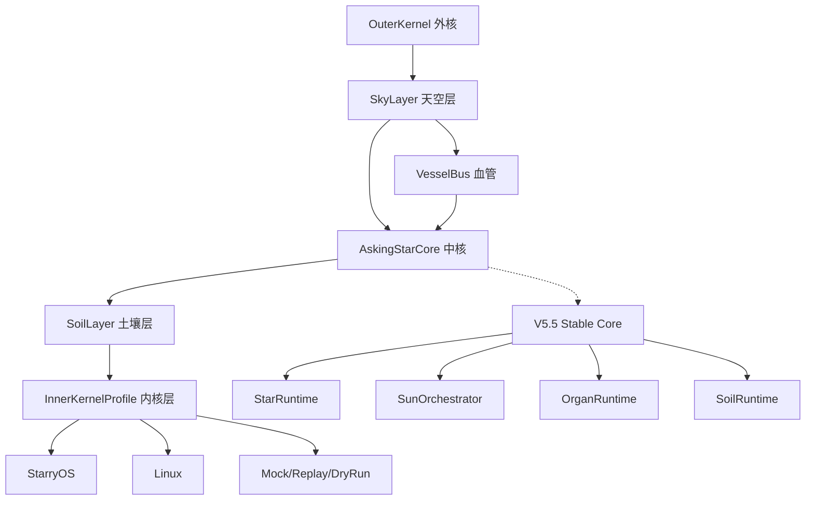
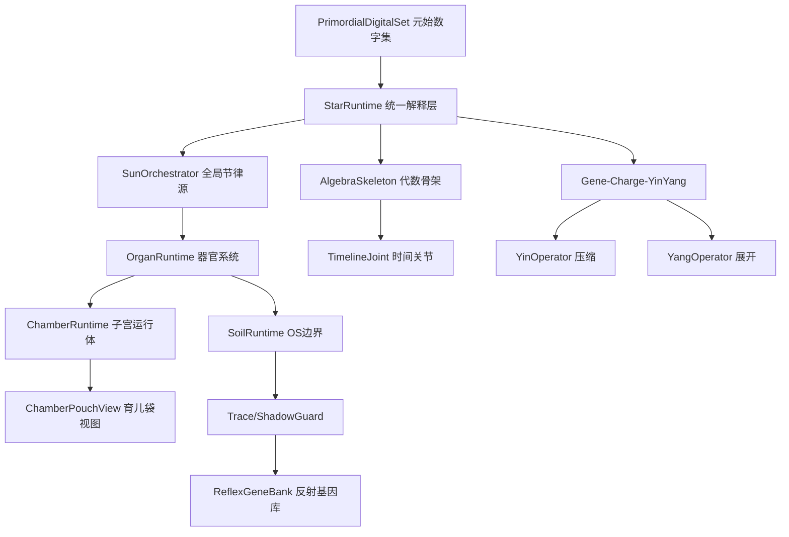

# AskingStar 详细说明文档

## 一、项目概述

AskingStar（问星）是一个 **C++20 命令行原型工程**，用于探索和实现一个面向嵌入式操作系统（StarryOS / RK3588）的自主运行时框架。项目以中国古代哲学（道、阴阳、五行、万物）为世界观命名，映射到严格的工程边界、数据结构和状态规则，形成一套独特的"哲学-工程"双轨架构体系。

当前版本为 **V5.6（Full Reuse Five-Layer Runtime）**，是初赛提交版。V5.6 不推翻 V5.5，而是在 V5.5 Stable Core 外侧增量构建五层结构。

### 1.1 项目定位

- **类型**: 嵌入式自主运行时原型框架
- **核心目标**: 在 StarryOS / RK3588 上建立可观测、可回放、可准入的统一运行时
- **许可证**: 未明确标注（项目内包含 LICENSE 文件）
- **语言**: C++20
- **构建系统**: CMake >= 3.20
- **依赖**: 仅使用 C++ STL，无第三方依赖
- **远程仓库**: `https://gitee.com/ldy050520/asking-star.git`

### 1.2 核心特性

| 特性 | 描述 |
| --- | --- |
| **DigitalSet 事实载体** | 唯一底层事实载体，所有状态以 Record / RefRecord 形式存入 DigitalSet |
| **Gene-Charge-YinYang 运行模型** | Gene=压缩态，Charge=执行态，Yin=压缩算子，Yang=展开算子 |
| **五层对称运行时** | OuterKernel → SkyLayer → AskingStarCore → SoilLayer → InnerKernelProfile |
| **VesselBus 引用运输** | 基于 DigitalSet Ref 的跨层引用运输和观测路径 |
| **多模式适配** | 支持 HostMock / DryRun / StarryOS DryRun / BoardReal / LinuxUser 多种运行模式 |
| **BoardReal 证据规则** | 严格的主板真实运行证据标记，防止 Mock 冒充实机 |
| **完整测试矩阵** | 172 个测试文件，覆盖 unit / integration / smoke 多层级 |

---

## 二、版本演进

AskingStar 经历了多个重要版本阶段，每个阶段都有明确的开发轮次文档：

| 版本 | 名称 | 核心内容 |
| --- | --- | --- |
| V1 | 基础原型 | StateGraph、EventSystem、Walker、Scheduler、WorldTree、StateField |
| V2 | 双链 Walker-Soil | GeneBank 双链事实中心、DualChainEvent、DualReplay、SlidingWindow、WalkerSoil、TaskView、TreeSoil、Projection |
| V3 | 阴阳电荷与基因码 | ChargeToken、ChargeFlow、GeneCode、ProtocolHash、SoilVoltage、GateBudget、YinCompress、YangDecode、ChargeScheduler |
| V5 | DigitalSet Giant Runtime | PrimordialDigitalSet、StarRuntime、DigitalCell、OrganRuntime、SunOrchestrator、SoilRuntime |
| V5.5 | Walker-Giant Primordial Skeleton | 元始骨架、时间关节、皮肤投影、多子宫运行体、育儿袋视图、条件反射基因库 |
| **V5.6** | **Full Reuse Five-Layer Runtime** | **在 V5.5 底座上增量构建五层结构、VesselBus、SkyLayer、SoilLayer、Profile/Policy** |

---

## 三、系统架构

### 3.1 V5.6 五层架构



五层职责：

| 层 | 工程映射 | 职责 | 禁止事项 |
| --- | --- | --- | --- |
| **OuterKernel** | 应用生态运行壳 | 承载应用环境 | 不得 syscall/ioctl/mmap |
| **SkyLayer** | 应用输入边界 | 将 app/shell 输入整理为 DigitalSetFragment | 不得直接调用 SoilAdapter |
| **AskingStarCore** | 语义解释中核 | 默认复用 V5.5 Core | 不得处理 ABI 细节 |
| **SoilLayer** | OS 边界翻译 | 包装 V5.5 SoilAdapter 形成双腔 | 不得替代 kernel |
| **InnerKernelProfile** | 运行环境标记 | StarryOS/Linux/Mock/BoardReal profile | 不得把 mock 标成 board-real |

### 3.2 V5.5 Stable Core 架构



### 3.3 Gene-Charge-YinYang 运行模型

核心 IR 路径：

```text
DigitalSetFragment
  -> YinOperator.compress()
  -> GeneView（压缩态/稳定态）
  -> YangOperator.expand()
  -> ChargeView（执行态/短生命周期）
  -> DigitalCell
```

哲学-工程映射：

| 哲学概念 | 工程含义 |
| --- | --- |
| 道 | PrimordialDigitalSet 启动解释根 |
| 一 | StarRuntime 统一解释 |
| 二 | Gene/Charge 最小运行单元 |
| 三 | 骨架、子宫、育儿袋、器官、土壤、Trace 的运行展开 |
| 阴 | 压缩算子 YinOperator |
| 阳 | 展开算子 YangOperator |
| 电荷 | 短生命周期执行态 ChargeFlow |
| 基因 | 可沉淀压缩态 GeneCode |
| 温度 | Scheduler 策略旋钮（阴温偏观察，阳温偏执行） |

---

## 四、目录结构

```text
proj/AskingStar/
├── CMakeLists.txt              # 构建配置（1083行，定义所有库和目标）
├── README.md                   # 项目主文档
├── Agent.md                    # CodeX 开发代理指南
│
├── core/                       # V1-V3 核心层（107个头文件/源文件）
│   ├── boot/                   # 启动编排：BootRunner、BootGate、BootPlan
│   ├── charge/                 # V3 电荷系统：ChargeToken、ChargeFlow、Gate、SoilVoltage
│   ├── dualchain/              # 双链核心：DualConsistencyChecker、DualReplay
│   ├── embedded_task_os/       # 嵌入式任务OS：Phase1ControlPlane
│   ├── event/                  # 事件系统：EventBus、EventStore
│   ├── gene/                   # 基因系统：GeneCode、GeneProtocol
│   ├── genebank/               # 基因库：GeneBank 双链事实中心
│   ├── jianmu/                 #  JianmuDualIndex 双链索引
│   ├── kernelsoil/             # 内核土壤：ExecutionHost、DriverAdapter
│   ├── mode/                   # 双模式策略：DualRuntimePolicy
│   ├── projection/             # 投影系统：SkillProjection、RuntimeProjection
│   ├── responsibility/         # 责任链：YangResponsibilityChain
│   ├── scheduler/              # 调度器：Scheduler、Policy、Routing
│   ├── state/                  # 状态系统：StateGraph、DAG Store
│   ├── statechain/             # 状态链：YinStateChain、StateGeneFragment
│   ├── statefield/             # 状态场：StateField、DecayModel
│   ├── treesoil/               # 树土壤：TaskView、CloudGraph、IntentGraph
│   ├── walker/                 # Walker：Intent、AppConnector
│   ├── walkersoil/             # Walker土壤：WalkerSoil、GeneGraphView
│   ├── window/                 # 滑动窗口：SlidingWindow
│   ├── worker/                 # 工作器：RuntimeWorker、WorkerPlan
│   ├── worldtree/              # 世界树：Tree、Traversal
│   ├── yin/                    # Yin引擎：HashEngine、DiffBuilder、CommitWriter
│   └── yang/                   # Yang引擎：Composer、GraphBuilder、StateRebuilder
│
├── include/asking_star/        # 公共头文件（164个）
│   ├── ai/                     # AI推理：AIModelManifest、MockAIInferenceAdapter
│   ├── benchmark/              # 性能基准：ParallelRuntimeBenchmark
│   ├── cache/                  # 缓存：ConcurrentGeneCache、ConcurrentChargeCache
│   ├── charge/                 # 预设电荷：PresetCharge、PresetChargeBank
│   ├── cli/                    # CLI：CommandRegistry、CLISession、InteractiveConsole
│   ├── compat/                 # 兼容层：LegacyAdapter、MappingRegistry
│   ├── digitalset/             # DigitalSet核心：DigitalSet、DigitalSetFragment、RefResolver
│   ├── executor/               # 执行器：FixedWorkerPool
│   ├── gcyy/                   # GCYY运行时（60+头文件）
│   │   ├── gene_record.hpp / gene_view.hpp
│   │   ├── charge_record.hpp / charge_view.hpp
│   │   ├── digital_cell.hpp / digital_cell_record.hpp
│   │   ├── star_runtime.hpp / sun_orchestrator.hpp
│   │   ├── organ_runtime.hpp / organ_queue.hpp
│   │   ├── soil_runtime.hpp / kernel_request.hpp
│   │   ├── trace_event.hpp / trace_sink.hpp
│   │   └── ...
│   ├── gene/                   # 反射基因：BootReflexGene、BootReflexRegistry
│   ├── heat/                   # 热调度：HeatScheduler、HeatRecord
│   ├── legacy/                 # 旧适配：LegacyAdapter
│   ├── organ/                  # 器官系统：OrganQueue、OrganRuntimePool、SoilForwardOrgan
│   ├── runtime/                # 运行时：BootReflexLoader、BootReflexRunner
│   ├── scheduler/              # 调度：TaskRecord、StarScheduler、TimelineGraphProjection
│   ├── soil/                   # 土壤运行时：KernelRequest、SoilRuntime、adapters/
│   │   └── adapters/           # 适配器：StarryOSAdapter、LinuxUserAdapter、MockKernelAdapter
│   ├── timeline/               # 时间线：MainTimeAxisRecord、TimeAxisSeed、SlidingWindowRecord
│   ├── trace/                  # 追踪：ParallelTrace
│   ├── v55/                    # V5.5层（20+头文件）
│   │   ├── primordial_seed_refs.hpp
│   │   ├── algebra_skeleton.hpp
│   │   ├── walker_giant_ingress.hpp
│   │   ├── app_gene_charge.hpp
│   │   ├── chamber_runtime.hpp / chamber_pouch.hpp
│   │   ├── reflex_gene_bank.hpp
│   │   ├── soil_multichamber_adapter.hpp
│   │   ├── rknn_runtime_chamber.hpp
│   │   └── ...
│   ├── v56/                    # V5.6层
│   │   ├── benchmark/          # BenchmarkReport
│   │   ├── board/              # BoardSmokeReuse
│   │   ├── compat/             # V55兼容桥：V55CoreBridge、V55SoilAdapterBridge、V55TraceBridge
│   │   ├── core/               # AskingStarCore
│   │   ├── mainline/           # FullHostMockDemo、MainlineRefactorFlow
│   │   ├── policy/             # ProfileRegistry、PlacementPolicy
│   │   ├── sky/                # SkyIngress、AppIntentRecord、PouchRuntime
│   │   ├── soil/               # SoilDualChamber、StarryOSDryRunDualChamber
│   │   ├── testing/            # LayeredTestMatrix
│   │   └── vessel/             # VesselBus、VesselPacketRecord、VesselGateRecord等
│   └── walker/                 # Walker适配：WalkerInputNormalizer、WalkerRuntime
│
├── src/                        # 实现文件（111个.cpp）
│   ├── ai/                     # AI推理实现
│   ├── charge/                 # 预设电荷实现
│   ├── cli/                    # CLI实现
│   ├── compat/                 # 兼容层实现
│   ├── digitalset/             # DigitalSet实现
│   ├── gcyy/                   # GCYY运行时实现（最大模块，50+文件）
│   ├── gene/                   # 反射基因实现
│   ├── legacy/                 # 旧适配实现
│   ├── organ/                  # 器官系统实现
│   ├── runtime/                # 运行时实现
│   ├── scheduler/              # 调度实现
│   ├── soil/                   # 土壤运行时实现
│   │   └── adapters/           # 平台适配器实现
│   ├── timeline/               # 时间线实现
│   ├── v55/                    # V5.5实现
│   ├── v56/                    # V5.6实现
│   │   ├── benchmark/
│   │   ├── board/
│   │   ├── compat/             # V55桥接实现
│   │   ├── core/
│   │   ├── mainline/
│   │   ├── policy/
│   │   ├── sky/
│   │   ├── soil/
│   │   ├── testing/
│   │   └── vessel/
│   └── walker/                 # Walker适配实现
│
├── mode/                       # 运行模式
│   ├── mode_controller.h
│   ├── runtime_mode.cpp
│   └── shadow_guard.cpp
│
├── demo/                       # 演示程序
│   ├── main.cpp                # asking_star_demo 入口
│   ├── boot_runner/            # BootRunner CLI入口
│   ├── chargeos/               # ChargeOS Road/Tree/Valve dry-run demo
│   ├── mock_cli/               # Mock CLI demo
│   ├── soil_starryos_boardreal/ # BoardReal demo
│   ├── v2/                     # V2双链demo（6个文件）
│   ├── v3/                     # V3电荷demo
│   └── walker_terminal/        # StarryOS终端demo
│
├── examples/                   # 示例程序
│   ├── v5_qemu_interactive_cli.cpp
│   ├── v5_parallel_release_demo.cpp
│   ├── v5_parallel_starryos_board_demo.cpp
│   └── v56_full_host_mock_demo.cpp
│
├── tests/                      # 测试文件（172个）
│   ├── unit/                   # 单元测试
│   │   ├── ai/                 # AI推理测试
│   │   ├── cache/              # 缓存测试
│   │   ├── charge/             # 电荷测试
│   │   ├── cli/                # CLI测试
│   │   ├── compat/             # 兼容层测试
│   │   ├── digitalset/         # DigitalSet测试
│   │   ├── executor/           # 执行器测试
│   │   ├── gcyy/               # GCYY运行时测试（最大测试集）
│   │   ├── gene/               # 基因测试
│   │   ├── heat/               # 热调度测试
│   │   ├── legacy/             # 旧适配测试
│   │   ├── organ/              # 器官测试
│   │   ├── scheduler/          # 调度测试
│   │   ├── soil/               # 土壤测试
│   │   ├── timeline/           # 时间线测试
│   │   ├── trace/              # 追踪测试
│   │   ├── v55/                # V5.5测试
│   │   └── walker/             # Walker测试
│   ├── integration/            # 集成测试
│   ├── v55/                    # V5.5阶段测试（S1-S12）
│   └── v56/                    # V5.6测试
│       ├── unit/
│       ├── integration/
│       └── smoke/
│
└── docs/                       # 文档目录
    ├── standards/              # 标准族
    │   ├── v5_5/               # V5.5标准（18个标准文件）
    │   ├── v5_6/               # V5.6标准（11个标准文件）
    │   └── *.md                # 通用标准（AS-GCYY、AS-DSF、AS-TIME等）
    ├── bringup/                # 启动测试文档
    ├── parallel/               # 并行实验文档
    ├── release/                # 发布文档
    ├── troubleshooting/        # 故障排查文档
    ├── asking-star-os-migration/ # OS迁移文档
    ├── development-rounds-*.md # 各版本开发轮次说明
    ├── development-spec-*.md   # 各版本开发规范
    └── v2-demo-guide.md        # V2 Demo使用指南
```

---

## 五、核心模块详解

### 5.1 DigitalSet（数字集）

DigitalSet 是整个 AskingStar 的唯一底层事实载体。所有状态都必须以 `Record / RefRecord` 形式落入 DigitalSet，不得退化成普通 struct 世界。

**核心 IR 路径**：
```text
DigitalSet Record / RefRecord
  -> StarPointer / DecodeRule / RefResolver
  -> View
  -> Runtime Handle
```

**关键组件**：
- `DigitalSet` / `DigitalSetStore`：底层存储
- `DigitalSetFragment`：片段化事实记录
- `DigitalSetRecord` / `RefRecord`：事实和引用记录
- `RefResolver`：引用解析器
- `PrimordialDigitalSet`：元始数字集（启动解释根）

### 5.2 GCYY 运行时（Gene-Charge-Yin-Yang）

GCYY 是 AskingStar 的核心运行模型实现，包含 60+ 头文件和 50+ 源文件，是最大的模块。

**关键组件**：
- `GeneRecord` / `GeneView`：基因记录与视图（压缩态）
- `ChargeRecord` / `ChargeView`：电荷记录与视图（执行态）
- `DigitalCell` / `DigitalCellRecord`：数字细胞（可只含 Gene，支持懒展开 Charge）
- `YinOperator` / `YangOperator`：阴阳算子接口
- `MockYinOperator` / `MockYangOperator`：模拟实现
- `StarProjection` / `ProjectionContext`：投影系统
- `StarRuntime`：统一解释层
- `SunOrchestrator` / `SunTick`：全局节律源（唯一全局逻辑节律源）
- `OrganRuntime` / `OrganQueue`：器官运行时
- `SoilRuntime` / `KernelRequest` / `KernelResult`：土壤运行时
- `TraceEvent` / `TraceSink` / `ShadowGuardTraceAdapter`：追踪系统
- `RuntimeBudget` / `AdmissionPolicy`：预算与准入
- `GeneCache` / `ChargeCache`：缓存层

### 5.3 Soil 土壤层

Soil 是唯一的 OS / ABI / syscall / driver 翻译边界。

**适配器**：
- `MockKernelAdapter`：模拟内核适配器
- `LinuxUserAdapter`：Linux 用户态适配器
- `StarryOSAdapter`：StarryOS 平台适配器
- `StarryOSBuildConfig` / `StarryOSOperationMap` / `StarryOSPlatform`：StarryOS 辅助组件

**运行模式**（通过 CMake 选项控制）：
- `DryRun`：干运行（默认）
- `HostMock`：主机模拟
- `BoardReal`：真实主板

### 5.4 Walker 适配层

Walker 是对外生命体入口，负责将外部输入转换为 DigitalSetFragment。

**关键组件**：
- `WalkerInputNormalizer`：输入归一化
- `WalkerEventParser`：事件解析
- `WalkerCommandAdapter`：命令适配
- `WalkerRuntime`：运行时集成

**支持的输入类型**：command、natural language input、UI event、sensor input、AI result、replay data、external app request

### 5.5 V5.5 层

V5.5 在 V5 基础上补入了元始骨架、时间关节、多子宫运行体等。

**关键组件**：
- `PrimordialSeedRefs`：元始种子引用（TimeAxisSeedRef、ChamberRegistrySeedRef 等）
- `AlgebraSkeleton`：代数骨架（从 TimeAxisSeedRef 展开）
- `WalkerGiantIngress`：Walker-Giant 入口
- `AppGeneCharge`：应用基因/电荷
- `ChamberRuntime` / `ChamberPouch`：子宫运行体 / 育儿袋
- `ReflexGeneBank`：反射基因库（BootReflexGene + ChamberReflexGene）
- `SoilMultiChamberAdapter`：多子宫土壤适配器
- `RknnRuntimeChamber` / `RknnBoardRealTestRecord`：RKNN 运行时
- `SkinUIProjection`：皮肤状态投影
- `ReplayAIChamber`：AI 回放子宫

### 5.6 V5.6 层

V5.6 在 V5.5 外侧增量构建五层结构。

**关键组件**：
- **Compat 桥接**：`V55CoreBridge`、`V55SoilAdapterBridge`、`V55TraceBridge`、`V55BoardEvidenceBridge`
- **VesselBus**：`VesselBus`、`VesselPacketRecord`、`VesselGateRecord`、`VesselRouteRecord`、`VesselBlockRecord`、`VesselRecoveryRecord`、`VesselTapRecord`、`VesselPolicy`
- **SkyLayer**：`SkyIngress`、`AppIntentRecord`、`PouchRuntime`
- **SoilLayer**：`SoilDualChamber`、`StarryOSDryRunDualChamber`
- **Core**：`AskingStarCore`（默认 backend=v5.5）
- **Mainline**：`FullHostMockDemo`、`MainlineRefactorFlow`
- **Policy**：`ProfileRegistry`（PlacementPolicy）
- **Benchmark**：`BenchmarkReport`（Sentinel 集成）
- **Testing**：`LayeredTestMatrix`（T0-T5 分层测试）

---

## 六、构建库与可执行目标

### 6.1 静态库

| 库名 | 内容 | 依赖 |
| --- | --- | --- |
| `asking_star_core` | V1-V3 核心（event、state、yin/yang、walker、scheduler、worldtree） | - |
| `asking_star_v2_demo` | V2 双链 demo | core |
| `asking_star_v3_demo` | V3 电荷 demo | core |
| `asking_star_chargeos_demo` | ChargeOS demo | core |
| `asking_star_mock_cli` | Mock CLI | v5_adapter |
| `asking_star_cli` | CLI 系统 | v5_adapter, soil, ai |
| `asking_star_ai` | AI 推理 | - |
| `asking_star_boot_reflex` | 启动反射 | gcyy, soil |
| `asking_star_gcyy` | GCYY 运行时（最大库） | - |
| `asking_star_v5_adapter` | V5 适配层 | gcyy, core |
| `asking_star_soil` | 土壤运行时 | gcyy |
| `asking_star_v56_compat` | V5.6 兼容桥 | gcyy, soil |
| `asking_star_v56_vessel` | VesselBus | gcyy |
| `asking_star_v56_mainline` | V5.6 主线 | v56_compat, v56_vessel, v5_adapter, soil |
| `asking_star_walker_terminal` | 终端 | core |

### 6.2 可执行目标

| 目标 | 用途 |
| --- | --- |
| `asking_star_demo` | V1 基础闭环 demo |
| `v2_demo` | V2 双链 demo（`--scenario basic`） |
| `v3_demo` | V3 电荷 demo |
| `chargeos_demo` | ChargeOS Road/Tree/Valve dry-run demo |
| `mock_cli` | Mock CLI demo |
| `boot_runner` | BootRunner CLI 入口 |
| `walker_terminal` | StarryOS 终端 demo |
| `v5_qemu_interactive_cli` | V5 QEMU 交互式 CLI |
| `v5_parallel_release_demo` | V5 并行发布 demo |
| `v5_parallel_starryos_board_demo` | V5 StarryOS 主板 demo |
| `v56_full_host_mock_demo` | **V5.6 五层 HostMock 闭环 demo** |
| `soil_starryos_boardreal_demo` | Soil StarryOS BoardReal demo |

---

## 七、测试体系

### 7.1 测试规模

- **总测试文件**: 172 个
- **测试分类**: unit / integration / smoke
- **CTest 注册测试**: 100+ 个

### 7.2 测试分层

| 层级 | 范围 | 示例 |
| --- | --- | --- |
| **T0 单元** | 单个 Record/View 的正确性 | `test_gcyy_digital_set_fragment`、`test_gcyy_gene_view` |
| **T1 集成** | 跨模块链路 | `test_walker_to_mock_runtime`、`test_soil_contract_mock` |
| **T2 Demo** | 完整 demo 端到端 | `test_v2_demo_end_to_end`、`test_chargeos_demo` |
| **T3 阶段** | V5.5/V5.6 阶段验收 | `test_v55_*`、`test_v56_*` |
| **T4 Smoke** | 启动冒烟 | `test_v56_full_host_mock_demo`、`test_v56_board_smoke_reuse_gate` |
| **T5 Benchmark** | 性能基准 | `test_v56_sentinel_benchmark_parser` |

### 7.3 构建与测试命令

```bash
# 基本构建
cmake -S . -B build
cmake --build build -j2

# 全量测试
ctest --test-dir build --output-on-failure

# V5.6 专用
cmake -S . -B build/v56
cmake --build build/v56 -j2
ctest --test-dir build/v56 --output-on-failure

# 运行特定测试
ctest --test-dir build -R scheduler_temperature --output-on-failure
ctest --test-dir build -R v56_full_host_mock_demo --output-on-failure
```

---

## 八、标准族文档体系

AskingStar 有非常完善的标准化文档，分为通用标准和版本专属标准。

### 8.1 通用标准

| 标准编号 | 名称 | 内容 |
| --- | --- | --- |
| AS-GCYY | Gene-Charge-Yin-Yang Runtime | 核心运行模型标准 |
| AS-DSF | DigitalSet Format | DigitalSet 数据格式标准 |
| AS-DCC | DigitalCell Contract | DigitalCell 契约标准 |
| AS-YYO | YinYang Operator | 阴阳算子标准 |
| AS-TIME | Main Time Axis | 主时间轴标准 |
| AS-TRACE | ShadowGuard Trace / Parallel Trace | 追踪标准 |
| AS-RPF | Runtime Protocol Family | 运行时协议族标准 |
| AS-BENCH | Parallel Runtime Benchmark | 性能基准标准 |
| AS-PDS | Primordial DigitalSet | 元始数字集标准 |
| AS-SOIL | Soil ABI Bridge | 土壤 ABI 桥接标准 |

### 8.2 V5.6 标准族（11个文件）

| 序号 | 文件名 | 内容 |
| --- | --- | --- |
| 1 | AS-V56-CORE | Sky-Soil 对称运行时（五层结构定义） |
| 2 | AS-V56-REUSE | V5.5 复用契约 |
| 3 | AS-V56-BOUNDARY | 越权禁止规则 |
| 4 | AS-V56-COMPAT | V5.5 兼容桥接 |
| 5 | AS-V56-VESSEL | Record Bus 血管标准 |
| 6 | AS-V56-SKY | OuterKernel / SkyLayer 标准 |
| 7 | AS-V56-SOIL | Wrapper Layer 土壤层标准 |
| 8 | AS-V56-PROFILE | Placement Policy 放置策略 |
| 9 | AS-V56-BOARDREAL | BoardReal 证据规则 |
| 10 | AS-V56-TEST | Benchmark 与报告标准 |
| 11 | AS-V56-CODEX | 开发规则 |

---

## 九、开发轮次

### 9.1 V5.5 开发轮次（S0-S12）

| 轮次 | 名称 | 状态 |
| --- | --- | --- |
| S0 | 标准族落地 | ✅ 完成 |
| S1 | PrimordialDigitalSet Seed 扩展 | ✅ 完成 |
| S2 | AlgebraSkeleton + TimelineJoint | ✅ 完成 |
| S3 | Walker-Giant Ingress | ✅ 完成 |
| S4 | AppGene / AppCharge | ✅ 完成 |
| S5 | ChamberProfile + ChamberPlacement | ✅ 完成 |
| S6 | ChamberPouchView | ✅ 完成 |
| S7 | ReflexGeneBank | ✅ 完成 |
| S8 | Soil MultiChamber Adapter | ✅ 完成 |
| S9 | SkinUIProjection | ✅ 完成 |
| S10 | 完整 Mock Demo | ✅ 完成 |
| S11 | Replay AI Demo | ✅ 完成 |
| S12 | StableStarryChamber Demo | ✅ 完成 |

### 9.2 V5.6 开发轮次（V56-0 至 V56-12）

| 轮次 | 名称 | 状态 |
| --- | --- | --- |
| V56-0 | 冻结 V5.5 基线 | ✅ 完成 |
| V56-1 | V5.6 标准族与边界冻结 | ✅ 完成 |
| V56-2 | V5.5 Compatibility Layer | ✅ 完成 |
| V56-3 | VesselBus Record 实现 | ✅ 完成 |
| V56-4 | SkyLayer / OuterKernel 骨架 | ✅ 完成 |
| V56-5 | SoilLayer 双腔 wrapper | ✅ 完成 |
| V56-6 | AskingStarCore 复用接入 | ✅ 完成 |
| V56-7 | 五层 HostMock 闭环 | ✅ 完成 |
| V56-8 | Profile / Placement / Policy | ✅ 完成 |
| V56-9 | PouchRuntime / Replay / AIResult | ✅ 完成 |
| V56-10 | Board Smoke 复用接入 | ✅ 完成 |
| V56-11 | Sentinel / Benchmark 集成 | ✅ 完成 |
| V56-12 | 分层测试计划落地 | ✅ 完成 |

---

## 十、StarryOS 集成

### 10.1 启动链路

```text
check-starryos-build-env.sh
  -> build-starryos-artifacts.sh
  -> import-starryos-artifacts.sh
  -> boot_runner（BootPlan -> Gate -> KernelSoil 准入）
  -> start-starryos-terminal.sh
  -> walker_terminal（TCP 串口连接）
```

### 10.2 产物管理

导入后的 StarryOS 产物：
```text
artifacts/starryos/current/
  ├── starryos_aarch64-dyn.elf
  ├── starryos_aarch64-dyn.bin
  ├── rootfs-aarch64.img
  └── manifest.txt
```

### 10.3 BoardReal 证据规则

只有同时满足以下全部条件，才能标记 `BoardReal`：

1. 明确 `adapter_mode=BoardReal`
2. 有主板 UART/log
3. 有运行时间戳
4. 有 V5.6 marker
5. 有 `KernelRequest / KernelResult` trace
6. 有 latency 或 output hash
7. 能对应到具体 binary / commit

否则只能标记为：`HostMock` / `DryRun` / `LinuxUser` / `Replay` / `LinuxBaseline` / `StarryOSDryRun`

---

## 十一、代码统计

| 类别 | 数量 |
| --- | --- |
| 总文件数 | 696 |
| core/ 头文件+源文件 | 107 |
| include/ 公共头文件 | 164 |
| src/ 实现文件 | 111 |
| tests/ 测试文件 | 172 |
| demo/ 演示文件 | 30 |
| docs/ 文档文件 | 102 |
| CMakeLists.txt 行数 | 1083 |
| CTest 注册测试 | 100+ |
| 代码总行数（C++） | 26,076 |

---

## 十二、设计原则与约束

### 12.1 核心设计原则

1. **标准先行**：先写协议和测试，再写 C++20 实现
2. **DigitalSet 唯一事实**：所有状态必须落入 DigitalSet Record / RefRecord
3. **越权禁止**：每层都有明确的禁止事项，不得越界调用
4. **完整复用**：V5.6 不重写 V5.5，通过 bridge/wrapper 增量接入
5. **证据驱动**：BoardReal 必须有完整证据链，Mock 不得冒充实机
6. **哲学映射**：哲学概念必须映射到工程边界、数据结构和测试要求

### 12.2 技术约束

- C++20，CMake >= 3.20
- 仅使用 STL，无第三方依赖
- 先提供命令行 demo，不提供 REST
- 所有 OS 边界先用 mock/fixture/document 接口
- 不引入正负电荷、阴阳链或额外物理极性系统
- StarRuntime 不直接处理 syscall / ioctl / fd / buffer / ABI

---

## 十三、关键 Demo 说明

| Demo | 命令 | 功能 |
| --- | --- | --- |
| asking_star_demo | `./asking_star_demo` | V1 基础闭环（Asking Star/Shadow Guard 模式切换） |
| v2_demo | `./v2_demo --scenario basic` | V2 双链完整编排 |
| v3_demo | `./v3_demo` | V3 电荷流、基因码、阀门决策 |
| chargeos_demo | `./chargeos_demo` | Road/Tree/Valve/KernelSoil dry-run |
| walker_terminal | `./walker_terminal --simulate-shell` | 模拟终端 / TCP/PTY 连接 |
| boot_runner | `./boot_runner --kernel ... --rootfs ...` | 启动准入验证 |
| v56_full_host_mock_demo | `./v56_full_host_mock_demo` | **V5.6 五层 HostMock 闭环** |

---

## 十四、总结

AskingStar V5.6 是一个架构设计精密、文档体系完善的 C++20 嵌入式运行时原型项目。其核心特点包括：

1. **独特的哲学-工程双轨体系**：用道、阴阳、五行等哲学概念引导架构分层，同时严格映射到工程边界
2. **渐进式版本演进**：V1→V2→V3→V5→V5.5→V5.6，每个版本都有明确的开发轮次和准入条件
3. **完整复用策略**：V5.6 不推翻 V5.5，通过标准、桥接、包装分轮推进
4. **严格的边界控制**：每层都有明确的"禁止事项"，防止越权调用
5. **证据驱动的板卡验证**：BoardReal 标记需要完整证据链，杜绝 Mock 冒充
6. **大规模测试覆盖**：172 个测试文件，分层测试矩阵（T0-T5）

项目当前已完成了从 V56-0 到 V56-12 的全部轮次，形成了可运行的五层 HostMock 闭环，并保留了向真实 RK3588 主板部署的能力。
