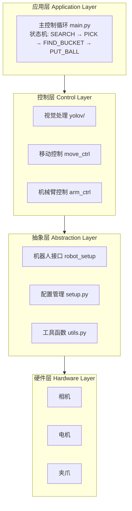
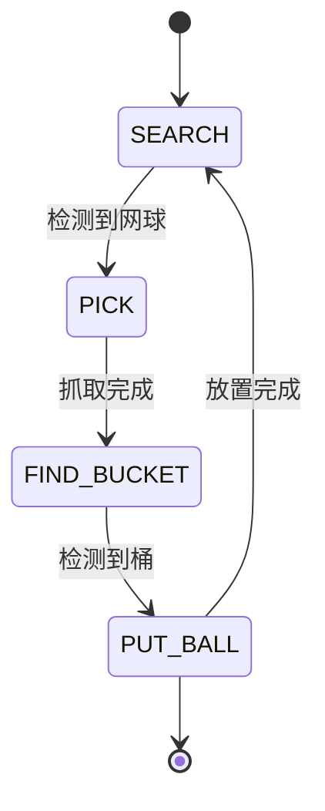

# Desktop-Wanderer 详细说明文档

## 一、项目概述

Desktop-Wanderer 是一个基于视觉引导的移动操作机器人系统，能够自主搜索、跟踪和抓取网球。该系统集成了 YOLO 目标检测、视觉伺服控制和机械臂逆运动学，实现了完整的自主抓取任务流程。

### 1.1 项目定位

- **类型**: 移动操作机器人控制系统
- **目标**: 实现网球的自主搜索、跟踪和抓取
- **硬件支持**: LeKiwi 机器人平台
- **许可证**: MIT License（推测）

### 1.2 功能特性

| 特性 | 描述 |
|------|------|
| 🎯 视觉目标检测 | 基于 YOLO 神经网络实时检测网球，支持 50 FPS |
| 🤖 自主导航 | 视觉伺服控制，自动导航至目标位置 |
| 🦾 双模式机械臂 | ACT 模式（端到端学习）和逆运动学模式（P控制） |
| ⚡ 实时控制 | 20/50 FPS 精确控制循环 |
| 📦 智能放球 | 抓取后自动寻找桶并放置 |

---

## 二、系统架构

### 2.1 整体架构图



### 2.2 目录结构

```
Desktop-Wanderer/
├── src/                          # 源代码目录
│   ├── lekiwi/                   # 硬件抽象层
│   │   ├── __init__.py
│   │   ├── config.py             # 配置解析
│   │   ├── direction_control.py  # 方向控制
│   │   ├── key_board_teleop.py   # 键盘遥操作
│   │   ├── lekiwi.py             # LeKiwi 主类
│   │   ├── lekiwi_config.py      # LeKiwi 配置
│   │   ├── robot.py              # 机器人接口
│   │   └── utils.py              # 工具函数
│   ├── yolov/                    # YOLO 检测模块
│   │   ├── __init__.py
│   │   ├── box.py                # 检测框定义
│   │   ├── process.py            # 推理处理
│   │   └── models/               # 模型文件
│   │       ├── tennis.om         # Atlas 310B 模型
│   │       ├── tennis.onnx       # ONNX 模型
│   │       └── tennis.rknn       # RK3588 模型
│   ├── policy/                   # 策略模型（ACT）
│   │   ├── data/                 # 数据集统计
│   │   └── train/                # 训练目录
│   ├── main.py                   # 主控制循环
│   ├── setup.py                  # 全局配置管理
│   ├── robot_setup.py            # 机器人初始化
│   ├── move_controller.py        # 移动控制器
│   ├── arm_act_controller.py     # ACT 机械臂控制器
│   └── arm_inverse_controller.py # 逆运动学控制器
├── thirdparty/                   # 第三方库
│   └── acllite/                  # Atlas 310B 加速库
├── docs/                         # 文档目录
├── config.yaml                   # 配置文件
├── requirements.txt              # 依赖列表
└── README.md                     # 项目说明
```

---

## 三、核心模块详解

### 3.1 主控制循环 (`src/main.py`)

主控制循环是系统的核心，负责协调整个机器人的行为：

```python
# 状态机定义
class RobotStatus(Enum):
    SEARCH = "search"      # 搜索网球
    PICK = "pick"          # 抓取网球
    FIND_BUCKET = "find_bucket"  # 寻找桶
    PUT_BALL = "put_ball"  # 放置网球
```

**主循环流程：**
1. **初始化**：加载配置、连接机器人、读取初始关节角度
2. **视觉检测**：根据当前状态执行 YOLO 检测或颜色检测
3. **状态决策**：根据检测结果切换状态
4. **动作执行**：执行移动或机械臂动作
5. **频率控制**：保证控制频率稳定

**抓取动作序列 (`CATCH_ACTION`)：**
```python
CATCH_ACTION = [
    ("move_to", (0.0989, 0.125)),   # 移动到预抓取位置
    ("shoulder_pan", -12),           # 肩部旋转
    ("gripper", 60),                 # 打开夹爪
    ("wrist_flex", 80),              # 腕部弯曲
    ("move_to", (0.140, 0.1211)),    # 接近球
    ("move_to", (0.140, -0.05)),     # 到达球位置
    ("gap", 0),                      # 停顿
    ("gripper", -60),                # 关闭夹爪
    ("gap", 0),                      # 停顿
    ("shoulder_pan", 12),            # 肩部回位
    ("move_to", (-0.1, 0.2)),        # 举起球
    ("wrist_flex", -20)              # 腕部调整
]
```

### 3.2 移动控制器 (`src/move_controller.py`)

移动控制器实现基于视觉的伺服控制：

**核心算法逻辑：**

| 条件 | 动作 |
|------|------|
| 目标在目标框左侧 | 左旋（慢速/正常） |
| 目标在目标框右侧 | 右旋（慢速/正常） |
| 目标太小（距离远） | 前进 |
| 目标太大（距离近） | 后退 |
| 目标稳定10帧 | 进入抓取状态 |

**搜索恢复机制：**
当球丢失时，根据最后记录的球位置进行方向性搜索：
```python
if _last_ball_center_x is not None:
    frame_center = (left + right) // 2
    if _last_ball_center_x < frame_center:
        action = direction.get_action("rotate_left")
    else:
        action = direction.get_action("rotate_right")
```

### 3.3 机械臂逆运动学控制器 (`src/arm_inverse_controller.py`)

该模块实现 2 连杆机械臂的逆运动学求解：

**逆运动学公式：**
```python
def inverse_kinematics(x, y, l1=0.1159, l2=0.1350):
    # 使用余弦定律计算关节角度
    cos_theta2 = -(r ** 2 - l1 ** 2 - l2 ** 2) / (2 * l1 * l2)
    theta2 = math.pi - math.acos(cos_theta2)
    beta = math.atan2(y, x)
    gamma = math.atan2(l2 * math.sin(theta2), l1 + l2 * math.cos(theta2))
    theta1 = beta + gamma
    ...
```

**P 控制参数：**
```python
MOTION_PARAMS = {
    'max_step': 0.01,    # 最大步长 1cm
    'min_step': 0.001,   # 最小步长 1mm
    'slow_dist': 0.05,   # 减速距离 5cm
    'dead_zone': 0.0005  # 死区 0.5mm
}
```

**关节校准表：**
| 关节名称 | 零位偏移 | 缩放因子 |
|----------|----------|----------|
| arm_shoulder_pan | 6.0 | 1.0 |
| arm_shoulder_lift | 2.0 | 0.97 |
| arm_elbow_flex | 0.0 | 1.05 |
| arm_wrist_flex | 0.0 | 0.94 |
| arm_wrist_roll | 0.0 | 0.5 |
| arm_gripper | 0.0 | 1.0 |

### 3.4 YOLO 视觉检测 (`src/yolov/process.py`)

视觉检测模块支持多种硬件推理后端：

| 硬件模式 | 推理框架 | 模型文件 |
|----------|----------|----------|
| `normal` | ONNX Runtime | `tennis.onnx` |
| `310b` | Atlas 310B NPU | `tennis.om` |
| `rk3588` | RKNN | `tennis.rknn` |

**图像处理流程：**
1. **图像缩放**：保持宽高比缩放至 640x640
2. **填充**：边缘填充灰色背景
3. **归一化**：BGR→RGB，除以 255
4. **推理**：执行 YOLO 检测
5. **NMS**：非极大值抑制
6. **坐标转换**：还原到原始图像坐标

**颜色检测（桶识别）：**
- **黑色桶检测**：HSV 阈值 + 形态学操作 + 连通域分析
- **红色桶检测**：双范围 HSV 阈值（红色跨越 0°）

---

## 四、状态机架构

### 4.1 状态转换图



### 4.2 状态详细说明

| 状态 | 触发条件 | 执行动作 | 退出条件 |
|------|----------|----------|----------|
| **SEARCH** | 系统启动或放球完成 | YOLO 检测 + 移动控制 | 网球稳定10帧 |
| **PICK** | SEARCH 检测到稳定目标 | 执行抓取动作序列 | 动作序列完成 |
| **FIND_BUCKET** | PICK 抓取完成 | 颜色检测 + 移动控制 | 桶稳定10帧 |
| **PUT_BALL** | FIND_BUCKET 检测到桶 | 执行放球动作序列 | 动作序列完成 |

---

## 五、配置文件说明

### 5.1 `config.yaml`

```yaml
port: /dev/ttyACM0          # 串口端口
fps: 20                     # 控制频率 (Hz)
log_level: INFO             # 日志级别
hardware_mode: normal       # 硬件模式: normal, 310b, rk3588
control_mode: inverse       # 控制模式: inverse, act
```

### 5.2 硬件模式说明

| 模式 | 描述 | 推理后端 | 适用场景 |
|------|------|----------|----------|
| `normal` | CPU 模式 | ONNX Runtime | 开发调试 |
| `310b` | Atlas 310B | AscendCL | 边缘部署 |
| `rk3588` | 瑞芯微 RK3588 | RKNN | 嵌入式部署 |

### 5.3 控制模式说明

| 模式 | 描述 | 特点 |
|------|------|------|
| `inverse` | 逆运动学模式 | 基于 P 控制的 8 步抓取序列 |
| `act` | ACT 模式 | 基于 Action Chunking Transformer 的端到端学习策略 |

---

## 六、安装与运行

### 6.1 环境要求

```bash
# Python 版本
Python 3.10+

# 核心依赖
pip install opencv-python numpy

# 可选依赖（根据硬件模式）
pip install onnxruntime          # normal 模式
pip install torch torchvision    # ACT 模式（训练）
pip install lerobot              # LeRobot 框架
```

### 6.2 配置步骤

1. **编辑配置文件**：
```bash
vim config.yaml
```

2. **设置串口权限**（Linux）：
```bash
sudo chmod 666 /dev/ttyACM0
```

### 6.3 启动命令

```bash
# 启动主程序
python -m src.main

# 键盘遥操作（可选）
# W/S: 前进/后退
# A/D: 左移/右移  
# Q/E: 左转/右转
# [/]: 减速/加速
```

---

## 七、技术特点

### 7.1 视觉伺服控制

系统采用分层控制策略：
- **优先级1**：旋转对齐目标
- **优先级2**：前后移动调整距离
- **自适应速度**：距离目标越近，速度越慢

### 7.2 双模式机械臂控制

| 模式 | 适用场景 | 优点 | 缺点 |
|------|----------|------|------|
| 逆运动学 | 精度要求高 | 可预测、稳定 | 需要精确标定 |
| ACT | 复杂任务 | 端到端学习 | 需要大量训练数据 |

### 7.3 多硬件支持

通过配置切换不同的推理后端，支持 CPU、NPU 等多种硬件平台。

---

## 八、开发指南

### 8.1 添加新功能

1. 在相应控制器模块中添加逻辑
2. 更新状态机（如需要）
3. 修改配置文件支持新参数

### 8.2 调试模式

设置 `hardware_mode: 'normal'` 可启用可视化界面：
- 显示摄像头画面
- 绘制检测框和目标区域
- 按 `q` 键退出

### 8.3 添加新目标检测

1. 在 `src/yolov/process.py` 中添加新的检测函数
2. 准备相应的模型文件
3. 在 `main.py` 中调用新函数

---

## 九、项目资源

### 9.1 官方链接

- **GitHub 仓库**: [https://github.com/my-robot-army/Desktop-Wanderer](https://github.com/my-robot-army/Desktop-Wanderer)
- **LeKiwi 平台**: LeRobot 框架

### 9.2 目录索引

| 文件 | 路径 | 说明 |
|------|------|------|
| 主控制循环 | [`src/main.py`](https://github.com/my-robot-army/Desktop-Wanderer/blob/main/src/main.py) | 状态机和主循环 |
| 移动控制 | [`src/move_controller.py`](https://github.com/my-robot-army/Desktop-Wanderer/blob/main/src/move_controller.py) | 视觉伺服移动 |
| 逆运动学 | [`src/arm_inverse_controller.py`](https://github.com/my-robot-army/Desktop-Wanderer/blob/main/src/arm_inverse_controller.py) | 机械臂控制 |
| YOLO 检测 | [`src/yolov/process.py`](https://github.com/my-robot-army/Desktop-Wanderer/blob/main/src/yolov/process.py) | 视觉推理 |
| 配置文件 | [`config.yaml`](https://github.com/my-robot-army/Desktop-Wanderer/blob/main/config.yaml) | 系统配置 |

---

## 十、总结

Desktop-Wanderer 是一个完整的视觉引导移动操作机器人系统，具有以下特点：

1. **功能完整**：从目标检测到抓取放置的完整流程
2. **模块化设计**：清晰的分层架构，便于扩展
3. **多硬件支持**：支持 CPU、NPU 等多种推理后端
4. **双控制模式**：逆运动学和端到端学习策略
5. **实时性强**：支持 20-50 FPS 控制频率

该项目适合用于机器人学习和研究，模块化设计便于功能扩展和维护。

---

## 十一、Desktop-Wanderer 在比赛项目中的作用（基于官方文档）

### 11.1 竞赛定位

根据**官方文档**（`docs/src/overview.md`），Desktop-Wanderer 是：

> "一个基于视觉引导的小型机器人系统，实现了自主目标检测、导航和抓取功能"

在**"面向边缘智能的 AIOS 设计与优化"**赛题中：

| 维度 | 说明 | 来源 |
|------|------|------|
| **赛题要求** | 完成网球拾取机器人功能 | 赛题.md |
| **Desktop-Wanderer 作用** | 提供完整的参考实现 | `docs/src/overview.md` |
| **与 StarryOS 关系** | 需要从 Linux 迁移到 StarryOS | 赛题要求 |

### 11.2 官方文档中的核心功能

根据 `docs/src/overview.md`，系统具备以下核心功能：

1. **视觉感知**：基于 YOLO 的目标检测系统
   - 支持 ONNX CPU 推理
   - 支持 Atlas 310B NPU 加速
   - 支持 RK3588 NPU 加速
   - 源码：[`src/yolov/process.py`](https://github.com/my-robot-army/Desktop-Wanderer/blob/4d26d3f7de81720ed1aae138e22fe11437374bbd/src/yolov/process.py)

2. **智能导航**：视觉引导的移动控制
   - 源码：[`src/move_controller.py`](https://github.com/my-robot-army/Desktop-Wanderer/blob/4d26d3f7/src/move_controller.py)

3. **精确操作**：两种机械臂控制模式
   - ACT 学习策略
   - 逆运动学控制
   - 源码：[`src/setup.py`](https://github.com/my-robot-army/Desktop-Wanderer/blob/main/src/setup.py)

4. **状态管理**：基于状态机的行为控制
   - 实现搜索-抓取的自动化流程
   - 源码：[`src/setup.py`](https://github.com/my-robot-army/Desktop-Wanderer/blob/main/src/setup.py)

### 11.3 官方状态机设计（来自 docs/src/state_machine.md）

**RobotStatus 枚举定义**（`src/setup.py`）：
```python
class RobotStatus(Enum):
    SEARCH = "search"       # 找球模式
    PICK = "pick"          # 捡球模式
    FIND_BUCKET = "find_bucket"  # 找桶模式
    PUT_BALL = "put_ball"  # 放球模式
```

**状态转换图**（官方文档提供）：
```
┌─────────┐    ┌─────────┐    ┌──────────────┐    ┌──────────┐    ┌─────────┐
│ SEARCH  │───▶│  PICK   │───▶│ FIND_BUCKET  │───▶│ PUT_BALL │───▶│ SEARCH  │
└─────────┘    └─────────┘    └──────────────┘    └──────────┘    └─────────┘
```

**各状态详细说明**（来自官方文档）：

#### 1. SEARCH（找球模式）
- **进入条件**：系统启动后初始状态 / PUT_BALL 完成后返回
- **行为**：
  - 使用 `move_controller()` 控制底盘移动
  - 调用 `yolo_infer()` 进行目标检测（找球）
  - 检测到球并在视野中央**稳定 10 帧**后进入 PICK 状态

#### 2. PICK（捡球模式）
- **进入条件**：SEARCH 状态下检测到球并稳定 10 帧
- **行为**：使用 `p_control_loop()` 执行 `CATCH_ACTION` 动作序列

**官方 CATCH_ACTION 序列**（12 步）：
```python
CATCH_ACTION = [
    ("move_to", (0.0989, 0.125)),    # 移动到初始位置
    ("shoulder_pan", -12),            # 肩部旋转
    ("gripper", 60),                   # 张开夹爪
    ("wrist_flex", 80),               # 腕部弯曲
    ("move_to", (0.140, 0.1211)),     # 移动到球上方
    ("move_to", (0.140, -0.05)),      # 下降到球位置
    ("gap", 0),                        # 停顿
    ("gripper", -60),                  # 闭合夹爪（夹住球）
    ("gap", 0),                        # 停顿
    ("shoulder_pan", 12),              # 肩部归位
    ("move_to", (-0.1, 0.2)),          # 举起球
    ("wrist_flex", -20)                # 腕部配合
]
```

#### 3. FIND_BUCKET（找桶模式）
- **进入条件**：PICK 状态动作序列执行完成
- **行为**：
  - 检查夹爪是否仍然夹住球（`gripper_pos > 25`）
  - 如果球丢失，返回 SEARCH 状态重新寻找
  - 使用 `move_controller_for_bucket()` 控制底盘移动
  - **找桶策略**：优先检测黑色桶，找不到则检测红色桶

#### 4. PUT_BALL（放球模式）
- **进入条件**：FIND_BUCKET 状态下检测到桶并稳定 10 帧
- **行为**：使用 `p_control_loop()` 执行 `PUT_ACTION` 动作序列

**官方 PUT_ACTION 序列**（6 步）：
```python
PUT_ACTION = [
    ("shoulder_lift", 50),      # 抬起机械臂
    ("gap", 0),                  # 停顿
    ("gripper", 60),             # 张开夹爪（放球）
    ("gap", 0),                  # 停顿
    ("move_to", (-0.1, 0.2)),    # 收回机械臂
    ("gripper", -60),            # 闭合夹爪
]
```

### 11.4 官方安装要求（来自 docs/src/installation_and_configuration.md）

**官方文档明确说明**：

> "在PC上进行调试需要安装lerobot平台，具体安装方法可以参考 lerobot_Installation"

**安装步骤**（来自官方文档）：

1. **安装 miniforge**
   ```bash
   wget "https://github.com/conda-forge/miniforge/releases/latest/download/Miniforge3-$(uname)-$(uname -m).sh"
   bash Miniforge3-$(uname)-$(uname -m).sh
   ```

2. **创建 Python 3.10 环境**（官方指定版本）
   ```bash
   conda create -y -n lerobot python=3.10
   conda activate lerobot
   conda install ffmpeg -c conda-forge
   ```

3. **从源码安装 LeRobot**
   ```bash
   git clone https://github.com/huggingface/lerobot.git
   cd lerobot
   pip install -e .
   pip install -e ".[feetech]"  # 舵机控制 SDK
   ```

4. **运行程序**
   ```bash
   python -m src.main
   ```

**配置文件**（来自官方文档）：
```yaml
port: /dev/ttyACM0 # 在控制板上的默认端口号
fps: 20 # 每秒识别20帧
log_level: INFO # 日志级别
hardware_mode: normal # normal, rk3588 支持的硬件
control_mode: inverse # inverse, act 行动模式
```

**官方说明**：
- `port`：在 LeRobot 环境下运行 `lerobot-find-port` 获取
- `hardware_mode`：PC 调试选 `normal`，控制板运行选 `rk3588`

### 11.5 迁移到 StarryOS 的具体方案

**基于官方文档的实际迁移步骤**：

#### 步骤 1：StarryOS 支持 Python 3.10 环境

```bash
# StarryOS 需要提供：
# 1. Python 3.10 运行时（官方要求）
# 2. conda 或等效包管理器
# 3. ffmpeg 支持
```

#### 步骤 2：安装 LeRobot 框架（官方要求）

```bash
# 按官方文档安装
pip install -e .  # LeRobot 核心
pip install -e ".[feetech]"  # 舵机控制
```

#### 步骤 3：适配串口设备

**官方使用 `/dev/ttyACM0`**，StarryOS 需要：
- 提供 UART 驱动
- 支持 `/dev/ttyACM0` 或修改配置为 `/dev/ttyS0`
- 支持 `termios` 系统调用

#### 步骤 4：NPU 推理支持

**官方支持三种模式**（来自 `config.yaml`）：
- `normal`：ONNX CPU 推理
- `310b`：Atlas 310B NPU
- `rk3588`：RK3588 NPU（比赛使用）

StarryOS 需要实现 RKNN 推理支持。

#### 步骤 5：运行测试

```bash
# 按官方方式运行
python -m src.main
```

### 11.6 LeKiwi 平台支持（来自官方文档）

根据 `docs/src/lekiwi/` 目录，Desktop-Wanderer 有完整的 LeKiwi 文档：

- `lekiwi/overview.md` - LeKiwi 概述与架构
- `lekiwi/quickstart.md` - LeKiwi 快速开始
- `lekiwi/workflow.md` - LeKiwi 工作流程
- `lekiwi/configuration.md` - LeKiwi 配置参数
- `lekiwi/debugging.md` - LeKiwi 调试方法
- `lekiwi/troubleshooting.md` - LeKiwi 故障排除

**迁移时需要参考这些官方文档**。

### 11.7 比赛中的开发建议（基于官方文档）

#### 阶段 1：环境搭建

- [ ] StarryOS 在 RK3588 上启动
- [ ] 支持 Python 3.10 运行时（官方要求）
- [ ] 安装 LeRobot 框架（按官方文档）
- [ ] Desktop-Wanderer 基础运行（`normal` 模式）

#### 阶段 2：驱动完善

- [ ] NPU 驱动开发（支持 `rk3588` 模式）
- [ ] RKNN 推理运行（`tennis.rknn` 模型）
- [ ] UART 驱动开发（`/dev/ttyACM0` 或 `/dev/ttyS0`）
- [ ] LeKiwi 电机控制（参考官方 LeKiwi 文档）

#### 阶段 3：功能完整

- [ ] 完整状态机运行（SEARCH → PICK → FIND_BUCKET → PUT_BALL）
- [ ] 网球拾取完整流程
- [ ] 性能测试数据

#### 阶段 4：性能优化

- [ ] 启动速度优化
- [ ] 内存占用优化
- [ ] 推理性能优化（50 FPS YOLO）

### 11.8 总结

Desktop-Wanderer 在比赛中是**核心应用**，**所有信息都来自官方文档**：

- ✅ 官方文档位置：`docs/src/` 目录
- ✅ 提供完整的网球拾取参考实现
- ✅ 需要从 Linux 迁移到 StarryOS
- ✅ 验证 StarryOS 的兼容性和性能
- ✅ 展示边缘智能场景的实际应用

**核心关系**（基于官方架构）：
```
StarryOS（操作系统）
  ↓ 运行
Python 3.10 + LeRobot（官方要求）
  ↓ 运行
Desktop-Wanderer（应用逻辑）
  ↓ 控制
LeKiwi（硬件平台）
  ↓ 执行
网球拾取任务（SEARCH → PICK → FIND_BUCKET → PUT_BALL）
```