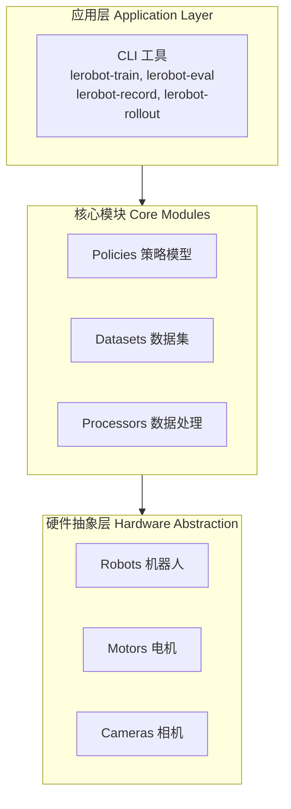

# LeRobot 详细说明文档

## 一、项目概述

LeRobot 是 Hugging Face 推出的一个面向真实世界机器人的机器学习库，基于 PyTorch 。目标是降低机器人学习的入门门槛，让每个人都能贡献和受益于共享数据集和预训练模型。

### 1.1 项目定位

- **类型**: 机器人学习框架
- **核心目标**: 降低机器人学习的入门门槛
- **许可证**: Apache 2.0
- **语言**: Python 3.12+

### 1.2 核心特性

| 特性          | 描述                                                       |
| ----------- | -------------------------------------------------------- |
| **硬件无关接口**  | 标准化控制接口，支持从低成本机械臂到类人机器人                                  |
| **统一数据格式**  | LeRobotDataset 格式（Parquet + MP4/图像），托管在 Hugging Face Hub |
| **SoTA 策略** | 支持模仿学习、强化学习、视觉-语言-动作（VLA）模型                              |
| **生态系统支持**  | 全面支持开源生态，实现物理 AI 的民主化                                    |

---

## 二、系统架构

### 2.1 整体架构图



### 2.2 目录结构

```
lerobot/
├── src/lerobot/                  # 核心源代码
│   ├── scripts/                  # CLI 入口脚本
│   ├── configs/                  # 配置定义
│   ├── policies/                 # 策略模型
│   │   ├── act/                  # Action Chunking Transformer
│   │   ├── diffusion/            # 扩散模型
│   │   ├── pi0/                  # Pi0 视觉语言模型
│   │   ├── groot/                # GR00T VLA 模型
│   │   ├── smolvla/              # SmolVLA 模型
│   │   └── ...                   # 其他策略
│   ├── datasets/                 # 数据集处理
│   ├── processor/                # 数据处理器
│   ├── robots/                   # 机器人接口
│   ├── motors/                   # 电机控制
│   ├── cameras/                  # 相机接口
│   ├── teleoperators/            # 遥操作设备
│   ├── envs/                     # 仿真环境
│   ├── rl/                       # 强化学习模块
│   └── rollout/                  # 部署推理
├── examples/                     # 示例代码
├── docs/                         # 文档
├── docker/                       # Docker 镜像
└── tests/                        # 测试用例
```

---

## 三、核心模块详解

### 3.1 策略模型

LeRobot 实现了多种最先进的策略模型：

| 类别 | 模型 | 说明 | 文档链接 |
|------|------|------|----------|
| **模仿学习** | ACT | Action Chunking Transformer | [文档](https://huggingface.co/docs/lerobot/act) |
| | Diffusion | 扩散策略 | [文档](https://huggingface.co/docs/lerobot/policy_diffusion_README) |
| | VQ-BeT | 向量量化行为转换器 | [文档](https://huggingface.co/docs/lerobot/policy_vqbet_README) |
| | Multi-task DiT | 多任务扩散模型 | [文档](https://huggingface.co/docs/lerobot/policy_multi_task_dit_README) |
| **强化学习** | HIL-SERL | 硬件在环强化学习 | [文档](https://huggingface.co/docs/lerobot/hilserl) |
| | TDMPC | 时域差分模型预测控制 | [文档](https://huggingface.co/docs/lerobot/policy_tdmpc_README) |
| **VLA 模型** | Pi0Fast | 轻量级视觉语言动作模型 | [文档](https://huggingface.co/docs/lerobot/pi0fast) |
| | Pi0.5 | 改进版 Pi0 | [文档](https://huggingface.co/docs/lerobot/pi05) |
| | GR00T N1.5 | 大型 VLA 模型 | [文档](https://huggingface.co/docs/lerobot/policy_groot_README) |
| | SmolVLA | 小型 VLA 模型 | [文档](https://huggingface.co/docs/lerobot/policy_smolvla_README) |
| | XVLA | 跨模态 VLA | [文档](https://huggingface.co/docs/lerobot/xvla) |

### 3.2 数据集系统

LeRobotDataset 是统一的数据集格式：

**核心特性：**
- **存储格式**: Parquet 文件用于状态/动作数据 + MP4 视频用于视觉数据
- **Hub 集成**: 无缝集成 Hugging Face Hub
- **工具支持**: 支持删除片段、分割数据集、添加/删除特征、合并数据集

**使用示例：**
```python
from lerobot.datasets.lerobot_dataset import LeRobotDataset

# 从 Hub 加载数据集
dataset = LeRobotDataset("lerobot/aloha_mobile_cabinet")

# 访问数据（自动处理视频解码）
episode = dataset[0]
print(f"动作形状: {episode['action'].shape}")
```

### 3.3 机器人接口

统一的 `Robot` 类接口：

```python
from lerobot.robots.myrobot import MyRobot

# 连接机器人
robot = MyRobot(config=...)
robot.connect()

# 读取观测并发送动作
obs = robot.get_observation()
action = model.select_action(obs)
robot.send_action(action)
```

**支持的硬件平台：**
- **机械臂**: SO100, SO101, LeKiwi, Koch, HopeJR, OMX, OpenARM
- **移动机器人**: EarthRover Mini Plus, Unitree G1
- **人形机器人**: Reachy2
- **遥操作设备**: Gamepads, Keyboards, Phones, Homunculus Glove

### 3.4 数据处理器

处理器管道系统支持多种数据转换：

| 处理器 | 功能 |
|--------|------|
| `normalize_processor` | 数据归一化 |
| `delta_action_processor` | 增量动作处理 |
| `relative_action_processor` | 相对动作处理 |
| `observation_processor` | 观测数据处理 |
| `tokenizer_processor` | 语言 token 处理 |

---

## 四、CLI 工具

### 4.1 主要命令

| 命令 | 功能 | 示例 |
|------|------|------|
| `lerobot-train` | 训练策略 | `lerobot-train --policy=act --dataset.repo_id=lerobot/aloha_mobile_cabinet` |
| `lerobot-eval` | 评估策略 | `lerobot-eval --policy.path=lerobot/pi0_libero_finetuned --env.type=libero` |
| `lerobot-record` | 记录数据 | `lerobot-record --robot=lekiwi` |
| `lerobot-replay` | 重放数据 | `lerobot-replay --dataset=lerobot/my_dataset` |
| `lerobot-rollout` | 部署策略 | `lerobot-rollout --policy.path=lerobot/my_policy --robot=so100` |
| `lerobot-teleoperate` | 遥操作 | `lerobot-teleoperate --robot=lekiwi --teleoperator=gamepad` |
| `lerobot-calibrate` | 校准电机 | `lerobot-calibrate --robot=so100` |
| `lerobot-info` | 系统信息 | `lerobot-info` |

### 4.2 训练命令详解

```bash
lerobot-train \
  --policy=act \                    # 策略类型
  --dataset.repo_id=lerobot/aloha_mobile_cabinet \  # 数据集
  --train.batch_size=64 \           # 批次大小
  --train.max_steps=100000 \       # 训练步数
  --optim.lr=3e-4 \                 # 学习率
  --logging.wandb_project=my_project  # W&B 项目
```

---

## 五、安装与配置

### 5.1 基础安装

```bash
# 基础安装
pip install lerobot

# 检查安装
lerobot-info
```

### 5.2 完整安装（包含所有功能）

```bash
# 包含所有可选依赖
pip install "lerobot[all]"

# 或根据需求选择
pip install "lerobot[training]"    # 训练功能
pip install "lerobot[hardware]"    # 硬件支持
pip install "lerobot[viz]"         # 可视化
pip install "lerobot[pi]"          # Pi0 模型
pip install "lerobot[diffusion]"   # 扩散模型
```

### 5.3 开发环境

```bash
# 使用 uv 进行开发
uv sync --locked                            # 基础依赖
uv sync --locked --extra test --extra dev   # 测试 + 开发工具
git lfs install && git lfs pull             # 测试资源
```

---

## 六、使用流程

### 6.1 数据采集

```bash
# 1. 连接机器人并记录数据
lerobot-teleoperate --robot=lekiwi --teleoperator=gamepad

# 2. 保存数据集到 Hub
lerobot-record --robot=lekiwi --output=lerobot/my_dataset
```

### 6.2 模型训练

```bash
# 训练 ACT 策略
lerobot-train \
  --policy=act \
  --dataset.repo_id=lerobot/my_dataset \
  --train.max_steps=50000

# 训练 Pi0 模型
lerobot-train \
  --policy=pi0 \
  --dataset.repo_id=lerobot/my_dataset \
  --train.max_steps=100000
```

### 6.3 模型评估

```bash
# 在仿真环境中评估
lerobot-eval \
  --policy.path=lerobot/my_policy \
  --env.type=libero \
  --env.task=libero_object \
  --eval.n_episodes=10

# 在真实硬件上评估
lerobot-rollout \
  --policy.path=lerobot/my_policy \
  --robot=lekiwi \
  --rollout.n_episodes=5
```

---

## 七、支持的机器人平台

### 7.1 机械臂

| 机器人 | 厂商 | 文档链接 |
|--------|------|----------|
| SO-100 | Seeed Studio | [文档](https://huggingface.co/docs/lerobot/so100) |
| SO-101 | Seeed Studio | [文档](https://huggingface.co/docs/lerobot/so101) |
| LeKiwi | Hugging Face | [文档](https://huggingface.co/docs/lerobot/lekiwi) |
| Koch | Hugging Face | [文档](https://huggingface.co/docs/lerobot/koch) |
| HopeJR | Hugging Face | [文档](https://huggingface.co/docs/lerobot/hope_jr) |
| OMX | Omron | [文档](https://huggingface.co/docs/lerobot/omx) |
| OpenARM | Biomechatronics | [文档](https://huggingface.co/docs/lerobot/openarm) |

### 7.2 移动机器人

| 机器人 | 厂商 | 文档链接 |
|--------|------|----------|
| EarthRover Mini Plus | EarthRover | [文档](https://huggingface.co/docs/lerobot/earthrover_mini_plus) |
| Unitree G1 | Unitree | [文档](https://huggingface.co/docs/lerobot/unitree_g1) |

### 7.3 人形机器人

| 机器人 | 厂商 | 文档链接 |
|--------|------|----------|
| Reachy 2 | Pollen Robotics | [文档](https://huggingface.co/docs/lerobot/reachy2) |

---

## 八、支持的仿真环境

| 环境 | 类型 | 文档链接 |
|------|------|----------|
| LIBERO | 操作任务基准 | [文档](https://huggingface.co/docs/lerobot/libero) |
| MetaWorld | 操作任务基准 | [文档](https://huggingface.co/docs/lerobot/metaworld) |
| RoboCasa | 居家场景 | [文档](https://huggingface.co/docs/lerobot/robocasa) |
| PushT | 推块任务 | [文档](https://huggingface.co/docs/lerobot/) |
| Aloha | 双臂操作 | [文档](https://huggingface.co/docs/lerobot/) |

---

## 九、技术特点

### 9.1 硬件无关设计

统一的抽象层使策略可以在不同硬件之间无缝迁移，无需修改代码。

### 9.2 分布式训练

支持 Hugging Face Accelerate，轻松实现多 GPU 训练：

```bash
lerobot-train \
  --policy=act \
  --dataset.repo_id=lerobot/my_dataset \
  --accelerator.num_processes=4  # 使用 4 个 GPU
```

### 9.3 实时推理

支持 RTC（Real-Time Control）模式，确保低延迟控制：

```bash
lerobot-rollout \
  --policy.path=lerobot/my_policy \
  --robot=so100 \
  --rollout.strategy=rtc  # 实时控制模式
```

### 9.4 异步推理

支持异步推理模式，提高系统响应性：

```bash
# 启动策略服务器
python -m lerobot.async_inference.policy_server --policy.path=lerobot/my_policy

# 启动机器人客户端
python -m lerobot.async_inference.robot_client --robot=lekiwi
```

---

## 十、项目资源

### 10.1 官方链接

- **GitHub 仓库**: [https://github.com/huggingface/lerobot](https://github.com/huggingface/lerobot)
- **官方文档**: [https://huggingface.co/docs/lerobot/index](https://huggingface.co/docs/lerobot/index)
- **数据集 Hub**: [https://huggingface.co/lerobot](https://huggingface.co/lerobot)
- **Discord 社区**: [https://discord.gg/q8Dzzpym3f](https://discord.gg/q8Dzzpym3f)
- **中文教程**: [LeRobot+SO-ARM101中文教程](https://zihao-ai.feishu.cn/wiki/space/7589642043471924447)

### 10.2 学习资源

- **Robot Learning Tutorial**: [https://huggingface.co/spaces/lerobot/robot-learning-tutorial](https://huggingface.co/spaces/lerobot/robot-learning-tutorial)
- **示例代码**: [https://github.com/huggingface/lerobot/tree/main/examples](https://github.com/huggingface/lerobot/tree/main/examples)

### 10.3 引用

如果在项目中使用 LeRobot，请引用：

```bibtex
@misc{cadene2024lerobot,
    author = {Cadene, Remi and Alibert, Simon and Soare, Alexander and Gallouedec, Quentin and Zouitine, Adil and Palma, Steven and Kooijmans, Pepijn and Aractingi, Michel and Shukor, Mustafa and Aubakirova, Dana and Russi, Martino and Capuano, Francesco and Pascal, Caroline and Choghari, Jade and Moss, Jess and Wolf, Thomas},
    title = {LeRobot: State-of-the-art Machine Learning for Real-World Robotics in Pytorch},
    howpublished = "\url{https://github.com/huggingface/lerobot}",
    year = {2024}
}
```

---

## 十一、总结

LeRobot 是一个功能强大的机器人学习框架，具有以下特点：

1. **统一接口**: 硬件无关的抽象层，支持多种机器人平台
2. **丰富的策略**: 从模仿学习到 VLA 模型，覆盖多种学习范式
3. **生态集成**: 无缝集成 Hugging Face Hub，便于数据和模型共享
4. **易用性**: 提供简洁的 CLI 工具，降低使用门槛
5. **实时性**: 支持实时控制和异步推理模式

该项目适合机器人学习研究和开发，无论是学术研究还是工业应用都非常适用。

---

## 十二、LeRobot 在比赛项目中的作用（基于官方文档）

### 12.1 竞赛定位

根据**LeRobot 官方 README**，LeRobot 的定位是：

> "LeRobot aims to provide models, datasets, and tools for real-world robotics in PyTorch. The goal is to lower the barrier to entry so that everyone can contribute to and benefit from shared datasets and pretrained models."

在**"面向边缘智能的 AIOS 设计与优化"**赛题中：

| 维度 | 说明 | 来源 |
|------|------|------|
| **赛题要求** | 验证 StarryOS 在边缘智能场景的可行性 | 赛题.md |
| **LeRobot 作用** | 提供机器人数据采集、训练、部署工具链 | LeRobot README |
| **与 StarryOS 关系** | StarryOS 运行 LeRobot 应用 | 比赛架构 |

### 12.2 官方核心特性（来自 README）

根据 LeRobot 官方 README，提供三大核心能力：

#### 1. 硬件无关接口（Hardware-Agnostic Interface）

**官方原文**：
> "A hardware-agnostic, Python-native interface that standardizes control across diverse platforms, from low-cost arms (SO-100) to humanoids."

**官方代码示例**（来自 README）：
```python
from lerobot.robots.myrobot import MyRobot

# Connect to a robot
robot = MyRobot(config=...)
robot.connect()

# Read observation and send action
obs = robot.get_observation()
action = model.select_action(obs)
robot.send_action(action)
```

**支持的硬件**（官方列表）：
- SO100, LeKiwi, Koch, HopeJR, OMX
- EarthRover, Reachy2
- Gamepads, Keyboards, Phones
- OpenARM, Unitree G1, reBot B601

**比赛用途**：Desktop-Wanderer 使用的 LeKiwi 平台在官方支持列表中。

#### 2. 标准化数据集格式（LeRobotDataset）

**官方原文**：
> "A standardized, scalable LeRobotDataset format (Parquet + MP4 or images) hosted on the Hugging Face Hub, enabling efficient storage, streaming and visualization of massive robotic datasets."

**官方代码示例**（来自 README）：
```python
from lerobot.datasets.lerobot_dataset import LeRobotDataset

# Load a dataset from the Hub
dataset = LeRobotDataset("lerobot/aloha_mobile_cabinet")

# Access data (automatically handles video decoding)
episode_index=0
print(f"{dataset[episode_index]['action'].shape=}\n")
```

**比赛用途**：
- 使用 LeRobotDataset 格式存储网球拾取数据
- 利用 HF Hub 共享数据集
- 使用官方工具分析数据质量

#### 3. SoTA 策略模型（State-of-the-Art Policies）

**官方原文**：
> "State-of-the-art policies that have been shown to transfer to the real-world ready for training and deployment."

**官方模型列表**（来自 README 表格）：

| 类别 | 模型 | 官方文档链接 |
|------|------|-------------|
| **模仿学习** | ACT, Diffusion, VQ-BeT, Multitask DiT | `docs/source/policy_*_README.md` |
| **强化学习** | HIL-SERL, TDMPC | `docs/source/hilserl.mdx` |
| **VLA 模型** | Pi0, Pi0Fast, Pi0.5, GR00T N1.5, SmolVLA | `docs/source/pi0.mdx` 等 |
| **世界模型** | VLA-JEPA | `docs/source/vla_jepa.mdx` |

**训练示例**（来自 README）：
```bash
lerobot-train \
  --policy=act \
  --dataset.repo_id=lerobot/aloha_mobile_cabinet
```

### 12.3 官方安装要求（来自 README）

**官方快速开始**（README 原文）：
```bash
pip install lerobot
lerobot-info
```

**官方重要提示**（README 原文）：
> "For detailed installation guide, please see the Installation Documentation."

**Desktop-Wanderer 官方文档中的 LeRobot 安装**（来自 `docs/src/installation_and_configuration.md`）：

```bash
# 1. Python 3.10 环境准备
wget "https://github.com/conda-forge/miniforge/releases/latest/download/Miniforge3-$(uname)-$(uname -m).sh"
bash Miniforge3-$(uname)-$(uname -m).sh
conda create -y -n lerobot python=3.10
conda activate lerobot
conda install ffmpeg -c conda-forge

# 2. 从源码安装 LeRobot
git clone https://github.com/huggingface/lerobot.git
cd lerobot
pip install -e .

# 3. 舵机控制 SDK
pip install -e ".[feetech]"
```

### 12.4 官方 CLI 工具（来自 README）

LeRobot 提供完整的命令行工具：

| 命令 | 功能 | 官方示例 |
|------|------|----------|
| `lerobot-train` | 训练策略 | `lerobot-train --policy=act --dataset.repo_id=...` |
| `lerobot-eval` | 评估策略 | `lerobot-eval --policy.path=... --env.type=libero` |
| `lerobot-record` | 记录数据 | 录制 LeRobotDataset 格式数据 |
| `lerobot-replay` | 重放数据 | 重放录制的数据 |
| `lerobot-rollout` | 部署策略 | 在真实硬件上部署 |
| `lerobot-teleoperate` | 遥操作 | 遥控机器人 |
| `lerobot-calibrate` | 校准电机 | 校准舵机 |
| `lerobot-info` | 系统信息 | 检查安装状态 |

### 12.5 官方资源（来自 README）

**官方提供的学习资源**：

1. **完整文档**：[Documentation](https://huggingface.co/docs/lerobot/index)
2. **中文教程**：[LeRobot+SO-ARM101中文教程-同济子豪兄](https://zihao-ai.feishu.cn/wiki/space/7589642043471924447)
   - 官方 README 特别推荐
   - 包含组装、遥操作、数据集、训练、部署全流程
   - 由 Seed Studio 和全球 5 位黑客松玩家验证
3. **Discord 社区**：[LeRobot Server](https://discord.gg/q8Dzzpym3f)
4. **Robot Learning Tutorial**：[免费实操课程](https://huggingface.co/spaces/lerobot/robot-learning-tutorial)
5. **LeLab**：[Web 界面](https://github.com/huggingface/leLab)
   - 无需 CLI，浏览器中完成遥操作、校准、录制数据集、训练

### 12.6 与 Desktop-Wanderer 的官方集成关系

**Desktop-Wanderer 官方文档明确说明**（来自 `docs/src/overview.md`）：

> "在PC上进行调试需要安装lerobot平台，具体安装方法可以参考 lerobot_Installation"

**具体集成点**：

| Desktop-Wanderer 功能 | LeRobot 集成 | 官方文档来源 |
|----------------------|--------------|-------------|
| **LeKiwi 平台支持** | LeRobot 原生支持 LeKiwi | LeRobot README |
| **舵机控制** | 使用 `lerobot.[feetech]` SDK | Desktop-Wanderer 安装文档 |
| **数据格式** | 可使用 LeRobotDataset | LeRobot README |
| **Python 环境** | 需要 Python 3.10 | Desktop-Wanderer 安装文档 |

### 12.7 在 StarryOS 上的集成方案

**基于官方文档的实际步骤**：

#### 步骤 1：StarryOS 支持 Python 3.10

**官方要求**（来自 Desktop-Wanderer 文档）：
- Python 3.10（指定版本）
- conda 环境管理
- ffmpeg 支持

#### 步骤 2：安装 LeRobot（官方方式）

```bash
# 按 Desktop-Wanderer 官方文档安装
git clone https://github.com/huggingface/lerobot.git
cd lerobot
pip install -e .
pip install -e ".[feetech]"  # 舵机控制
```

#### 步骤 3：LeKiwi 机器人控制

**官方方式**（来自 LeRobot README）：
```python
from lerobot.robots.lekiwi import LeKiwi

robot = LeKiwi(config={...})
robot.connect()
obs = robot.get_observation()
action = model.select_action(obs)
robot.send_action(action)
```

#### 步骤 4：数据集管理

**官方方式**（来自 LeRobot README）：
```python
from lerobot.datasets.lerobot_dataset import LeRobotDataset

# 创建网球拾取数据集
dataset = LeRobotDataset("your-org/tennis_pickup")
# 保存到 HF Hub
```

### 12.8 比赛中的实际使用建议（基于官方文档）

#### 必须使用 ✅（官方要求）

1. **LeRobot 框架**：Desktop-Wanderer 官方明确要求安装
2. **Python 3.10 环境**：官方指定版本
3. **feetech SDK**：`pip install -e ".[feetech]"` 官方要求

#### 推荐使用 ✅（官方提供）

1. **LeRobotDataset 格式**：官方标准化数据格式
2. **lerobot-record**：官方数据录制工具
3. **lerobot-replay**：官方数据重放工具
4. **中文教程**：官方推荐的同济子豪兄教程

#### 可选使用（加分项） 🌟

1. **ACT 策略训练**：官方支持，可替代逆运动学
2. **上传数据集到 Hub**：官方功能，展示开源贡献
3. **LeLab Web 界面**：官方提供的浏览器操作界面

### 12.9 开发优先级（基于官方依赖关系）

| 阶段 | LeRobot 相关任务 | 官方文档依据 | 优先级 |
|------|-----------------|-------------|--------|
| **阶段 1** | StarryOS 基础启动 + NPU 驱动 | 赛题要求 | ⭐⭐⭐ |
| **阶段 2** | Python 3.10 + LeRobot 安装 | Desktop-Wanderer 安装文档 | ⭐⭐⭐ |
| **阶段 3** | LeKiwi 控制（feetech SDK） | Desktop-Wanderer 安装文档 | ⭐⭐⭐ |
| **阶段 4** | LeRobotDataset 格式适配 | LeRobot README | ⭐⭐ |
| **阶段 5** | 可选：ACT 策略训练 | LeRobot README | ⭐ |

### 12.10 官方引用

**如果在项目中使用 LeRobot，按官方要求引用**（来自 README）：

```bibtex
@misc{cadene2024lerobot,
    author = {Cadene, Remi and Alibert, Simon and Soare, Alexander and Gallouedec, Quentin and Zouitine, Adil and Palma, Steven and Kooijmans, Pepijn and Aractingi, Michel and Shukor, Mustafa and Aubakirova, Dana and Russi, Martino and Capuano, Francesco and Pascal, Caroline and Choghari, Jade and Meftah, Khalil and Ellerbach, Maxime and Moss, Jess and Wolf, Thomas},
    title = {LeRobot: State-of-the-art Machine Learning for Real-World Robotics in Pytorch},
    howpublished = "\url{https://github.com/huggingface/lerobot}",
    year = {2024}
}
```

**学术论文引用**（ICLR 2026）：
```bibtex
@inproceedings{cadenelerobot,
  title={LeRobot: An Open-Source Library for End-to-End Robot Learning},
  author={Cadene, Remi and Alibert, Simon and Capuano, Francesco and Aractingi, Michel and Zouitine, Adil and Kooijmans, Pepijn and Choghari, Jade and Russi, Martino and Pascal, Caroline and Palma, Steven and Shukor, Mustafa and Moss, Jess and Soare, Alexander and Aubakirova, Dana and Lhoest, Quentin and Gallou\'edec, Quentin and Wolf, Thomas},
  booktitle={The Fourteenth International Conference on Learning Representations},
  year={2026},
  url={https://arxiv.org/abs/2602.22818}
}
```

### 12.11 总结

LeRobot 在比赛中主要提供（**全部基于官方文档**）：

- ✅ 硬件无关的机器人控制接口（LeRobot README）
- ✅ 标准化的 LeRobotDataset 数据格式（LeRobot README）
- ✅ SoTA 策略模型和训练工具（LeRobot README）
- ✅ Desktop-Wanderer 的必需依赖（Desktop-Wanderer 官方文档）
- ✅ 完整的中文教程和社区支持（LeRobot README）

**核心关系**（基于官方文档）：
```
StarryOS（操作系统）
  ↓ 运行
Python 3.10 + LeRobot（官方要求）
  ↓ 控制
LeKiwi（硬件平台，LeRobot 原生支持）
  ↓ 运行
Desktop-Wanderer（应用逻辑，依赖 LeRobot）
  ↓ 执行
网球拾取任务
```