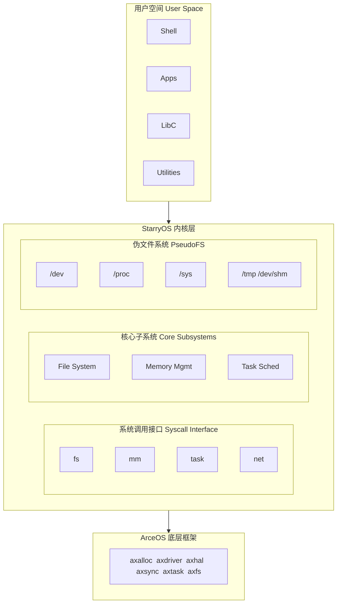
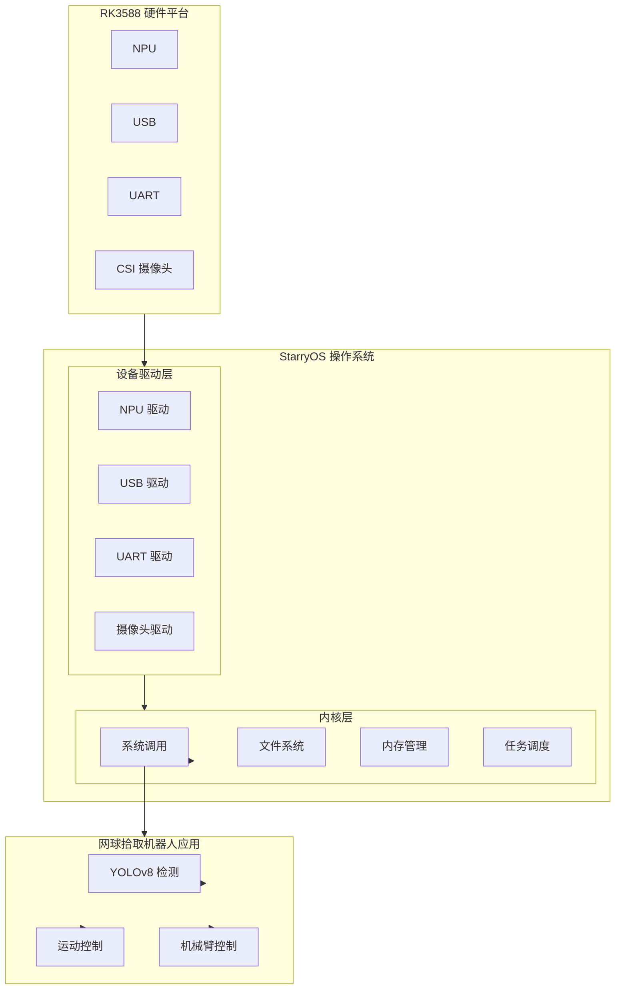

# StarryOS 说明文档

> **项目链接**：https://github.com/Starry-OS/StarryOS  
> **比赛赛题**：面向边缘智能的 AIOS 设计与优化（proj4）  

---

## 一、项目概述

StarryOS 是一个基于 **ArceOS** 构建的实验性单体操作系统内核（Monolithic OS Kernel），目标是实现 Linux 兼容的系统调用接口，支持多种硬件架构。

### 1.1 项目定位

- **类型**: 单体式操作系统内核 (Monolithic OS Kernel)
- **基础**: 基于 ArceOS unikernel 框架
- **目标**: 提供 Linux 兼容的系统调用接口
- **语言**: Rust（内存安全、类型安全、零成本抽象）
- **许可证**: Apache License 2.0
- **状态**: 活跃开发中

### 1.2 支持的架构

| 架构          | 状态  | 备注      |
| ----------- | --- | ------- |
| RISC-V 64   | ✅ 支持  | 主要开发目标  |
| LoongArch64 | ✅ 支持  | 龙芯架构    |
| AArch64     | ✅ 支持  | ARM 64位，**RK3588 基于此架构** |
| x86_64      | 🚧 开发中 | 正在进行    |

### 1.3 核心特性

**系统调用支持**（已实现 150+ Linux 系统调用）：

| 类别 | 主要系统调用 | 状态 |
|------|-------------|------|
| **文件操作** | openat, read, write, close, stat, mkdirat, unlinkat | ✅ 完整 |
| **内存管理** | mmap, munmap, brk, mprotect, mremap, madvise | ✅ 完整 |
| **进程管理** | fork, execve, exit, wait4, clone, clone3 | ✅ 完整 |
| **网络通信** | socket, bind, connect, listen, accept, sendto, recvfrom | ✅ 完整 |
| **信号处理** | kill, sigaction, sigprocmask, sigsuspend | ✅ 完整 |
| **同步原语** | futex, membarrier, epoll_create1, epoll_ctl, poll, pselect6 | ✅ 完整 |
| **进程间通信** | msgget, msgsnd, msgrcv, shmget, shmat, shmdt | ✅ 完整 |
| **时间管理** | gettimeofday, clock_gettime, nanosleep, clock_nanosleep | ✅ 完整 |

**伪文件系统支持**：
- `/dev` - 设备文件（tty, ptm, pts, rtc, fb, loop, memtrack 等）
- `/proc` - 进程信息
- `/sys` - 系统设备信息
- `/tmp`, `/dev/shm` - 临时内存文件系统

**内核启动流程**（基于 `kernel/src/entry.rs`）：
1. 挂载所有伪文件系统
2. 生成 alarm 任务（定时器）
3. 创建用户地址空间
4. 加载用户应用程序
5. 设置标准输入输出（stdin, stdout, stderr）
6. 启动 init 进程

### 1.4 与比赛赛题的关系

StarryOS 是本次比赛**proj4**的目标操作系统。赛题要求将基于 C 的 Linux 的开源网球拾取机器人系统完整迁移至基于 Rust 语言的 StarryOS，并在 RK3588 平台上进行性能优化。

---

## 二、项目架构

### 2.1 整体架构图



### 2.2 目录结构

```
StarryOS/
├── .github/           # GitHub 配置（CI/CD、模板）
├── docs/              # 文档目录
│   └── x11.md         # GUI 环境搭建指南
├── kernel/            # 内核源码
│   ├── Cargo.toml     # 内核依赖配置
│   └── src/
│       ├── config/    # 架构相关配置
│       │   ├── aarch64.rs     # ARM64 配置（RK3588 用这个）
│       │   ├── loongarch64.rs # 龙芯配置
│       │   ├── riscv64.rs     # RISC-V 配置
│       │   └── x86_64.rs      # x86 配置
│       ├── file/      # 文件抽象层
│       │   ├── epoll.rs       # epoll 实现
│       │   ├── event.rs       # eventfd
│       │   ├── fs.rs          # 文件系统操作
│       │   ├── net.rs         # 网络文件
│       │   ├── pipe.rs        # 管道
│       │   └── signalfd.rs    # 信号 fd
│       ├── mm/        # 内存管理
│       │   ├── access.rs      # 用户内存访问
│       │   ├── aspace/        # 地址空间
│       │   │   └── backend/   # 后端实现
│       │   │       ├── cow.rs       # 写时复制
│       │   │       ├── file.rs      # 文件映射
│       │   │       ├── linear.rs    # 线性映射
│       │   │       └── shared.rs    # 共享内存
│       │   ├── io.rs          # 内存映射 I/O
│       │   └── loader.rs      # 用户程序加载
│       ├── pseudofs/  # 伪文件系统
│       │   ├── dev/           # 设备文件
│       │   │   ├── tty/       # 终端设备
│       │   │   ├── fb.rs      # 帧缓冲
│       │   │   ├── rtc.rs     # 实时时钟
│       │   │   └── loop.rs    # 循环设备
│       │   ├── proc.rs        # 进程信息
│       │   ├── sys.rs         # 系统信息
│       │   └── tmp.rs         # 临时文件
│       ├── syscall/   # 系统调用处理
│       │   ├── mod.rs         # 系统调用分发（641 行）
│       │   ├── fs/            # 文件系统调用
│       │   ├── mm/            # 内存管理调用
│       │   ├── task/          # 进程管理调用
│       │   ├── net/           # 网络调用
│       │   ├── signal.rs      # 信号处理
│       │   ├── ipc/           # 进程间通信
│       │   └── sync/          # 同步原语
│       ├── task/      # 任务管理
│       ├── entry.rs   # 内核入口（init 进程初始化）
│       └── lib.rs     # 内核库入口
├── make/              # Makefile 构建脚本
├── src/               # 用户空间入口
│   └── init.sh        # 初始化脚本
├── Cargo.toml         # Rust 项目配置
├── Makefile           # 主构建脚本
└── README.md          # 项目说明
```

---

## 三、核心模块详解

### 3.1 系统调用层 (`kernel/src/syscall/`)

系统调用层是用户程序与内核交互的接口，实现了大量 Linux 系统调用：

| 子模块 | 功能 | 主要系统调用 |
|--------|------|-------------|
| `fs/` | 文件系统操作 | openat, read, write, close, stat, mkdirat, rmdir |
| `mm/` | 内存管理 | mmap, munmap, brk, mprotect, mremap |
| `task/` | 进程管理 | fork, execve, exit, wait4, clone, clone3 |
| `net/` | 网络通信 | socket, bind, connect, listen, accept, sendto, recvfrom |
| `signal/` | 信号处理 | kill, sigaction, sigprocmask, sigsuspend |
| `sync/` | 同步原语 | futex, membarrier |
| `ipc/` | 进程间通信 | msgget, msgsnd, shmget, shmat |
| `io_mpx/` | I/O 多路复用 | epoll, poll, select |

系统调用处理入口位于 [`kernel/src/syscall/mod.rs`](kernel/src/syscall/mod.rs)，通过 `handle_syscall` 函数分发处理，共支持 **150+ 系统调用**。

### 3.2 任务管理 (`kernel/src/task/`)

任务管理模块负责线程和进程的创建、调度和销毁：

**核心数据结构：**
- **Thread**：线程内部数据，包含进程数据引用、信号管理器、时间管理器等
- **ProcessData**：进程共享数据，包含地址空间、命令行参数、资源限制等

**关键功能：**
- 线程创建与退出
- 进程创建（clone/fork）
- 信号处理
- 资源管理（内存、文件描述符）

### 3.3 内存管理 (`kernel/src/mm/`)

内存管理模块负责虚拟地址空间的管理：

| 子模块 | 功能 |
|--------|------|
| `aspace/` | 地址空间管理 |
| `access/` | 用户内存访问 |
| `loader/` | 用户程序加载 |
| `io/` | 内存映射 I/O |

**地址空间后端类型：**
- `cow.rs` - 写时复制（Copy-on-Write）
- `file.rs` - 文件映射
- `linear.rs` - 线性映射
- `shared.rs` - 共享内存

### 3.4 伪文件系统 (`kernel/src/pseudofs/`)

伪文件系统提供内核信息和设备访问接口：

| 文件系统 | 挂载点 | 功能 |
|----------|--------|------|
| `devfs` | `/dev` | 设备文件（终端、内存、循环设备等） |
| `procfs` | `/proc` | 进程信息 |
| `sysfs` | `/sys` | 系统设备信息 |
| `tmpfs` | `/tmp`, `/dev/shm` | 临时内存文件系统 |

### 3.5 文件抽象层 (`kernel/src/file/`)

文件抽象层定义了统一的文件接口：

- **FileLike trait**：所有可打开对象的统一接口
- **FD_TABLE**：文件描述符表（线程局部）
- 支持的文件类型：普通文件、管道、socket、pidfd、信号fd、epoll等

---

## 四、启动流程

### 4.1 内核启动流程

```
1. 硬件启动 → Bootloader → 内核入口
         ↓
2. ArceOS 初始化（内存、驱动、调度器）
         ↓
3. StarryOS 内核初始化
         ↓
4. 挂载伪文件系统 (/dev, /proc, /sys, /tmp)
         ↓
5. 加载并执行 init 进程
         ↓
6. 执行 init.sh 脚本
         ↓
7. 启动 shell，进入用户交互
```

### 4.2 init 进程初始化

init 进程是系统的第一个用户进程，初始化流程位于 [`kernel/src/entry.rs`](kernel/src/entry.rs)：

1. 挂载所有伪文件系统 (`pseudofs::mount_all()`)
2. 生成 alarm 任务（定时器）(`spawn_alarm_task()`)
3. 创建用户地址空间 (`new_user_aspace_empty()`)
4. 加载用户应用程序 (`load_user_app()`)
5. 设置标准输入输出 (`add_stdio()`)
6. 启动 init 任务 (`spawn_task()`)

### 4.3 用户空间初始化脚本

[`src/init.sh`](src/init.sh) 是系统启动后的初始化脚本：

```bash
export HOME=/root
echo "Welcome to Starry OS!"
env
echo "Use apk to install packages."
cd ~
sh --login
```

---

## 五、构建与运行

### 5.1 环境准备

#### 方式一：使用 Docker（推荐）

```bash
# 中国大陆用户
docker pull docker.cnb.cool/starry-os/arceos-build
docker run -it --rm -v $(pwd):/workspace -w /workspace docker.cnb.cool/starry-os/arceos-build

# 其他用户
docker pull ghcr.io/arceos-org/arceos-build
docker run -it --rm -v $(pwd):/workspace -w /workspace ghcr.io/arceos-org/arceos-build
```

#### 方式二：手动安装依赖

```bash
# 安装系统依赖（Debian/Ubuntu）
sudo apt update
sudo apt install -y build-essential cmake clang qemu-system

# 安装 Musl 工具链
# 从 https://github.com/arceos-org/setup-musl/releases 下载
export PATH=/opt/riscv64-linux-musl-cross/bin:$PATH

# 设置 Rust 工具链
cargo -V
```

### 5.2 构建命令

```bash
# 准备根文件系统
make rootfs                    # 默认 RISC-V 64
make ARCH=riscv64 rootfs       # 指定架构
make ARCH=loongarch64 rootfs
make ARCH=aarch64 rootfs       # RK3588 使用这个

# 构建内核
make build                     # 默认 RISC-V 64
make ARCH=riscv64 build
make ARCH=aarch64 build        # RK3588 使用这个

# 运行（自动重建）
make ARCH=riscv64 run
make ARCH=aarch64 run          # RK3588 使用这个
```

### 5.3 构建系统结构

构建脚本位于 [`make/`](make/) 目录：

| 文件 | 功能 |
|------|------|
| `Makefile` | 主入口 |
| `build.mk` | 构建规则 |
| `cargo.mk` | Cargo 集成 |
| `config.mk` | 配置管理 |
| `platform.mk` | 平台配置 |
| `qemu.mk` | QEMU 运行配置 |

---

## 六、技术特点

### 6.1 Linux 兼容性

StarryOS 实现了丰富的 Linux 系统调用接口，使得大部分 Linux 应用程序可以直接在 StarryOS 上运行。

**对比赛的意义**：网球拾取机器人原基于 Linux 开发，Linux 兼容性降低了迁移难度。但需要补全机器人所需的特定系统调用（如 ioctl、mmap 用于设备访问）。

### 6.2 基于 ArceOS 框架

ArceOS 提供了底层抽象：
- **axalloc**：内存分配器
- **axhal**：硬件抽象层
- **axsync**：同步原语
- **axtask**：任务调度
- **axfs**：文件系统框架

**对比赛的意义**：ArceOS 的模块化设计使得添加 RK3588 平台支持和设备驱动更加清晰。

### 6.3 多架构支持

通过配置模块支持多种架构：
- [`config/aarch64.rs`](kernel/src/config/aarch64.rs) - **RK3588 使用这个**
- [`config/loongarch64.rs`](kernel/src/config/loongarch64.rs)
- [`config/riscv64.rs`](kernel/src/config/riscv64.rs)
- [`config/x86_64.rs`](kernel/src/config/x86_64.rs)

**对比赛的意义**：RK3588 基于 ARM64 架构，需要在 aarch64 配置基础上添加 RK3588 特定的设备树和驱动支持。

### 6.4 Rust 语言优势

**内存安全**：编译期检查内存错误，避免缓冲区溢出等安全问题

**类型安全**：强类型系统减少运行时错误

**零成本抽象**：高级语言特性不带来性能损失

**并发安全**：所有权系统防止数据竞争

**对比赛的意义**：
- 机器人系统对稳定性要求极高，Rust 的内存安全性可降低崩溃风险
- 实时性要求高，零成本抽象保证性能
- 多任务并发（视觉、控制、推理），Rust 的并发安全性有优势

---

## 七、比赛相关开发指南

### 7.1 RK3588 平台适配

**目标**：让 StarryOS 在 RK3588 开发板上成功启动

**关键任务**：
1. 添加 RK3588 设备树（DTS）支持
2. 配置 UART 控制台输出
3. 实现基础中断处理
4. 配置时钟和电源管理

**参考资源**：
- [[NPU-Driver]] 文档中的 RK3588 适配经验
- Starry NPU 驱动参考：https://atomgit.com/aios-porting/3906cf9f2ccbf898bd3512d5862ef92e

### 7.2 NPU 驱动开发

**目标**：打通 NPU 推理链路，支持 RKNN 模型推理

**关键任务**：
1. 实现 NPU 硬件驱动
2. 支持 [[rknn-toolkit2]] 模型转换
3. 实现用户空间 API 接口
4. 完成 YOLOv8 模型推理测试

**技术栈**：
- NPU 驱动：基于 ArceOS 驱动框架
- 模型格式：RKNN（通过 [[rknn-toolkit2]] 转换）
- 推理框架：参考 Desktop-Wanderer 的 YOLOv8 实现

**验收标准**：
- NPU 模型推理功能正常
- 推理性能可量化测量

### 7.3 外设驱动开发

**目标**：实现机器人所需的所有外设驱动

#### 7.3.1 USB 驱动

**用途**：支持机械臂感知

**关键任务**：
- 实现 USB 主机控制器驱动
- 支持 USB 摄像头
- 支持 USB 机械臂接口

#### 7.3.2 UART 驱动

**用途**：串口通信，控制机械臂电机

**关键任务**：
- 实现 UART 串口驱动
- 配置波特率和数据格式
- 实现机械臂电机控制协议

#### 7.3.3 摄像头驱动

**用途**：视觉感知，网球检测

**关键任务**：
- 实现 MIPI CSI 或 USB 摄像头驱动
- 支持图像数据采集
- 保证帧率满足实时性要求（≥ 20 FPS）

### 7.4 系统调用补全

**目标**：补全网球拾取机器人所需的系统调用

**方法**：
1. 分析 Desktop-Wanderer 使用的系统调用
2. 对比 StarryOS 已实现的系统调用
3. 补全缺失的系统调用
4. 测试验证

**常见需要补全的系统调用**：
- 设备访问：ioctl、mmap
- 进程管理：clone、wait4
- 文件系统：select、poll、epoll
- 网络通信：socket、bind、connect

### 7.5 性能优化策略

**目标**：在多个指标上超越 Linux 基线

#### 7.5.1 启动速度优化

**策略**：
- 内核裁剪：只保留必要的模块
- 驱动延迟加载：不需要的驱动不加载
- 服务按需启动：非必要服务延迟启动

**目标**：相比 Linux 启动时间缩短 30%+

#### 7.5.2 内存占用优化

**策略**：
- 内存管理优化：改进内存分配算法
- 缓存策略改进：优化缓存命中率
- 减少冗余服务：去除 Linux 中的通用服务开销

**目标**：相比 Linux 内存占用降低 50%+

#### 7.5.3 推理性能优化

**策略**：
- NPU 优化：充分利用 NPU 算力
- 模型轻量化：使用更小的模型
- 内存访问优化：减少内存拷贝

**目标**：推理一帧时间缩短 20%+

#### 7.5.4 实时性优化

**策略**：
- 实时调度优化：优先级调度
- 中断延迟优化：减少中断处理时间
- 控制算法优化：改进控制循环

**目标**：机械臂定位和抓取速度提升 15%+

---

## 八、StarryOS 在比赛项目中的集成方案

### 8.1 整体集成架构



### 8.2 集成步骤

**步骤 1：StarryOS RK3588 基础启动**
- 基于 `config/aarch64.rs` 添加 RK3588 支持
- 配置设备树（DTS）
- UART 控制台输出
- 验证基础系统调用

**步骤 2：NPU 驱动集成**
- 参考 [[NPU-Driver]] 实现 NPU 驱动
- 集成 RKNN-Toolkit2
- 测试 YOLOv8 模型推理（模型来自 Desktop-Wanderer）

**步骤 3：外设驱动集成**
- USB 驱动（机械臂感知）
- UART 驱动（电机控制）
- 摄像头驱动（视觉输入）

**步骤 4：应用迁移**
- 将 Desktop-Wanderer 的 Python 代码适配到 StarryOS
- 使用 StarryOS 系统调用替代 Linux 调用
- 验证完整拾取流程

**步骤 5：性能优化**
- 启动速度优化
- 内存占用优化
- 推理性能优化
- 与 Linux 基线对比测试

### 8.3 与 Desktop-Wanderer 的集成

Desktop-Wanderer 是参考实现，需要迁移到 StarryOS：

| Desktop-Wanderer 组件 | StarryOS 集成方式 |
|----------------------|-------------------|
| **YOLOv8 检测** | 使用 RKNN 格式模型，通过 NPU 驱动推理 |
| **LeKiwi 控制** | 通过 UART 驱动发送电机控制指令 |
| **摄像头输入** | 通过摄像头驱动获取图像数据 |
| **状态机逻辑** | 用 Rust 重写，调用 StarryOS 系统调用 |
| **配置文件** | 适配 StarryOS 文件系统路径 |

### 8.4 与 LeRobot 的集成

[[LeRobot]] 是 Hugging Face 的机器人框架，可提供：

- **数据集格式**：LeRobotDataset 标准化数据格式
- **策略模型**：ACT、Diffusion 等预训练模型
- **工具链**：数据收集、训练、可视化工具

**集成方式**：
1. 使用 LeRobot 格式存储网球拾取数据集
2. 可选：使用 LeRobot 的 ACT 策略替代逆运动学
3. 利用 LeRobot 工具分析和优化性能

---

## 九、项目资源

### 9.1 官方链接

- **GitHub 仓库**: [https://github.com/Starry-OS/StarryOS](https://github.com/Starry-OS/StarryOS)
- **ArceOS 框架**: [https://github.com/arceos-org/arceos](https://github.com/arceos-org/arceos)
- **根文件系统**: [https://github.com/Starry-OS/rootfs](https://github.com/Starry-OS/rootfs)
- **NPU 驱动参考**: https://atomgit.com/aios-porting/3906cf9f2ccbf898bd3512d5862ef92e

### 9.2 比赛相关资源

- **赛题文档**: [[赛题]]
- **网球拾取机器人**: [[Desktop-Wanderer]]
- **机器人框架**: [[LeRobot]]
- **NPU 驱动参考**: [[NPU-Driver]]
- **RKNN 工具**: [[rknn-toolkit2]]
- **测试计划**: [[TESTING_PLAN]]

### 9.3 贡献指南

参考 [`CONTRIBUTING.md`](CONTRIBUTING.md)

---

## 十、总结

### 10.1 StarryOS 技术特点

StarryOS 是一个基于 ArceOS 的实验性操作系统内核，具有以下特点：

1. **Linux 兼容**：实现了 150+ Linux 系统调用
2. **多架构支持**：支持 RISC-V、LoongArch、ARM 等架构
3. **模块化设计**：清晰的代码组织结构
4. **现代化技术栈**：使用 Rust 语言编写，类型安全
5. **单体架构**：性能优化潜力大

### 10.2 比赛项目意义

通过本次比赛项目，将实现：

1. **技术验证**：验证 StarryOS 在边缘智能场景的可行性
2. **性能突破**：在启动速度、资源消耗、能耗上超越 Linux
3. **生态建设**：为 StarryOS 积累 RK3588 平台支持和设备驱动
4. **人才培养**：培养操作系统开发和嵌入式 AI 人才

### 10.3 技术挑战

1. **RK3588 平台适配**：需要深入理解 ARM64 架构和设备树
2. **NPU 驱动开发**：需要理解 NPU 硬件架构和推理流程
3. **外设驱动开发**：需要实现 USB、UART、摄像头等驱动
4. **性能优化**：需要在多个维度上超越 Linux 基线
5. **系统迁移**：需要将完整的机器人系统从 Linux 迁移到 StarryOS

### 10.4 预期成果

1. **完整的 StarryOS RK3588 支持**
2. **NPU 驱动和推理链路**
3. **外设驱动集合**
4. **性能优化方案和数据**
5. **开源代码和文档**
