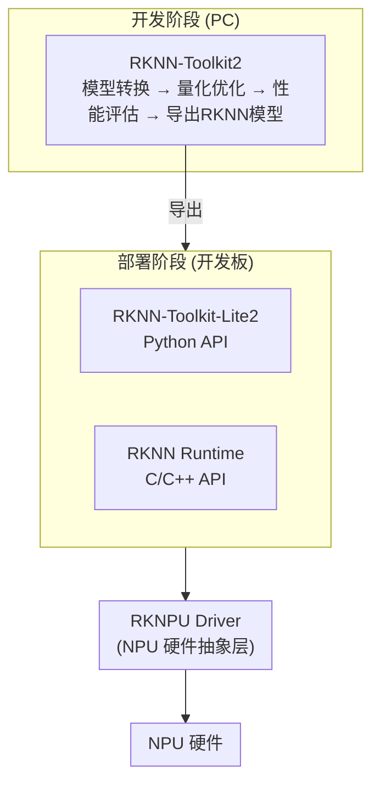

# RKNN-Toolkit2 详细说明文档

## 一、项目概述（基于官方 v2.3.2）

根据**官方 README**，RKNN 软件栈的定位是：

> "RKNN software stack can help users to quickly deploy AI models to Rockchip chips."

RKNN-Toolkit2 是瑞芯微（Rockchip）推出的一套完整的 AI 模型部署工具链，旨在帮助开发者快速将深度学习模型部署到瑞芯微 NPU（神经网络处理器）平台上。

### 1.1 项目定位

- **类型**: AI 模型部署工具链
- **目标**: 简化深度学习模型到瑞芯微芯片的部署流程
- **许可证**: Apache 2.0
- **最新版本**: v2.3.2（官方最新）
- **官方仓库**: https://github.com/airockchip/rknn-toolkit2

### 1.2 工具链组成（官方说明）

根据**官方 README**，RKNN 软件栈包含以下核心组件：

| 组件 | 官方描述 | 运行平台 |
|------|----------|----------|
| **RKNN-Toolkit2** | 模型转换、推理和性能评估工具 | PC / 开发板 |
| **RKNN-Toolkit-Lite2** | 为 Rockchip NPU 平台提供 Python 编程接口 | 开发板 |
| **RKNN Runtime** | 为 Rockchip NPU 平台提供 C/C++ 编程接口 | 开发板 |
| **RKNPU Kernel** | NPU 硬件驱动，已开源并在 Rockchip 内核代码中 | Linux 内核 |

**官方原文**：
> - RKNN-Toolkit2 is a software development kit for users to perform model conversion, inference and performance evaluation on PC and Rockchip NPU platforms.
> - RKNN-Toolkit-Lite2 provides Python programming interfaces for Rockchip NPU platform to help users deploy RKNN models and accelerate the implementation of AI applications.
> - RKNN Runtime provides C/C++ programming interfaces for Rockchip NPU platform to help users deploy RKNN models and accelerate the implementation of AI applications.
> - RKNPU kernel driver is responsible for interacting with NPU hardware. It has been open source and can be found in the Rockchip kernel code.

### 1.2 工具链组成

RKNN 软件栈包含以下核心组件：

| 组件 | 描述 | 运行平台 |
|------|------|----------|
| **RKNN-Toolkit2** | 模型转换、量化、推理和性能评估工具 | PC / 开发板 |
| **RKNN-Toolkit-Lite2** | 轻量级 Python 部署 API | 开发板 |
| **RKNN Runtime** | C/C++ 运行时接口 | 开发板 |
| **RKNPU Kernel** | NPU 硬件驱动 | Linux 内核 |

### 1.3 整体架构



---

## 二、支持的硬件平台

### 2.1 支持的芯片系列

| 芯片系列 | 型号 | 特点 |
|----------|------|------|
| **RK3588** | RK3588, RK3588S | 高端旗舰，支持 INT8/FP16/FP32，算力高达 6TOPs |
| **RK3576** | RK3576 | 高性能边缘计算，支持 INT8/FP16 |
| **RK3566/RK3568** | RK3566, RK3568 | 主流边缘芯片，性价比高 |
| **RK3562** | RK3562 | 入门级边缘芯片 |
| **RV1103/RV1106** | RV1103, RV1106 | 低功耗视觉芯片 |
| **RV1103B/RV1106B** | RV1103B, RV1106B | RV110x 升级版 |
| **RV1126B** | RV1126B | 高性能视觉芯片 |
| **RK2118** | RK2118 | 最新低功耗芯片 |

### 2.2 不支持的旧平台

以下芯片需要使用旧版 RKNN-Toolkit：

| 芯片 | 推荐工具 | 链接 |
|------|----------|------|
| RK1808/RV1109/RV1126/RK3399Pro | RKNN-Toolkit | [GitHub](https://github.com/airockchip/rknn-toolkit) |

---

## 三、核心功能

### 3.1 模型转换

RKNN-Toolkit2 支持多种主流深度学习框架模型的转换：

| 框架 | 支持格式 | 说明 |
|------|----------|------|
| **ONNX** | `.onnx` | Open Neural Network Exchange |
| **TensorFlow** | `.pb`, `.ckpt` | TensorFlow 冻结图或检查点 |
| **TensorFlow Lite** | `.tflite` | 轻量化模型格式 |
| **PyTorch** | `.pt`, `.pth` | PyTorch 模型 |
| **Caffe** | `.caffemodel`, `.prototxt` | Caffe 模型 |
| **Darknet** | `.cfg`, `.weights` | YOLO 系列模型 |

### 3.2 量化优化

支持多种量化策略：

| 量化类型 | 描述 | 适用场景 |
|----------|------|----------|
| **INT8 量化** | 将权重和激活量化为 8 位整数 | 最高性能提升，精度略有损失 |
| **FP16 量化** | 将权重量化为 16 位浮点 | 平衡精度和性能 |
| **混合量化** | 部分层 INT8，部分层 FP16 | 关键层保持精度 |
| **QAT 量化** | 训练后量化，需要量化感知训练模型 | 高精度量化 |

### 3.3 性能评估

提供全面的性能分析工具：

- **推理时间测量**：单次推理耗时、平均耗时、最大/最小耗时
- **内存占用分析**：模型内存占用、运行时内存占用
- **算子耗时分析**：每层算子的执行时间
- **吞吐量计算**：每秒处理帧数 (FPS)

### 3.4 高级功能

| 功能 | 描述 |
|------|------|
| **动态形状** | 支持动态输入尺寸 |
| **多输入模型** | 支持多个输入的模型 |
| **多 batch 推理** | 一次推理处理多个输入 |
| **自定义算子** | 支持自定义算子扩展 |
| **模型剪枝** | 支持结构化剪枝 |
| **自动混合精度** | 自动选择最优精度策略 |

---

## 四、使用流程

### 4.1 典型工作流程

```
1. 准备训练好的模型（ONNX/TensorFlow/PyTorch等）
         ↓
2. 使用 RKNN-Toolkit2 在 PC 上转换模型
         ↓
3. 进行量化优化和性能评估
         ↓
4. 导出 RKNN 格式模型
         ↓
5. 在开发板上部署推理
```

### 4.2 核心 API 使用示例

**基本转换流程：**

```python
from rknn.api import RKNN

# 创建 RKNN 对象
rknn = RKNN(verbose=True)

# 配置模型（均值、标准差、目标平台）
rknn.config(
    mean_values=[123.675, 116.28, 103.53],
    std_values=[58.82, 58.82, 58.82],
    target_platform='rk3588'
)

# 加载模型
rknn.load_onnx(model='model.onnx')

# 构建模型（可选量化）
rknn.build(
    do_quantization=True,
    dataset='./dataset.txt'  # 校准数据集
)

# 导出 RKNN 模型
rknn.export_rknn('model.rknn')

# 初始化运行时（可选，用于 PC 端测试）
rknn.init_runtime()

# 推理测试
outputs = rknn.inference(inputs=[input_data])

# 释放资源
rknn.release()
```

### 4.3 校准数据集格式

`dataset.txt` 文件格式：
```
./images/img0.jpg
./images/img1.jpg
./images/img2.jpg
./images/img3.jpg
...
```

---

## 五、目录结构（基于实际文件）

### 5.1 实际项目结构

```
rknn-toolkit2/
├── rknn-toolkit2/          # 核心工具包（PC 端）
│   ├── doc/               # 文档
│   ├── docker/            # Docker 镜像配置
│   ├── examples/          # 示例代码
│   └── packages/          # Python 包（wheel 文件）
├── rknn-toolkit-lite2/     # 轻量级部署工具（开发板）
│   ├── examples/          # 部署示例
│   └── packages/          # Python 包
├── rknpu2/                # NPU 驱动和运行时
│   ├── examples/          # C/C++ 示例
│   └── runtime/           # 运行时库
├── autosparsity/          # 自动稀疏化工具
│   ├── examples/          # 稀疏化示例
│   ├── packages/          # Python 包
│   └── README.md
├── doc/                   # 官方文档（PDF）
│   ├── 01_Rockchip_RKNPU_Quick_Start_RKNN_SDK_V2.3.2_CN.pdf
│   ├── 02_Rockchip_RKNPU_User_Guide_RKNN_SDK_V2.3.2_CN.pdf
│   ├── 03_Rockchip_RKNPU_API_Reference_RKNN_Toolkit2_V2.3.2_CN.pdf
│   └── ...（更多文档）
├── res/                   # 资源文件（图片等）
├── README.md              # 项目说明
├── CHANGELOG.md           # 更新日志
└── LICENSE                # 许可证
```

### 5.2 官方示例类型

根据实际 `examples/` 目录：

| 示例目录 | 内容 | 说明 |
|----------|------|------|
| `onnx/` | ONNX 模型示例 | 包括 ResNet、YOLO 等 |
| `pytorch/` | PyTorch 模型示例 | 包括 ResNet18、QAT 量化等 |
| `tensorflow/` | TensorFlow 模型示例 | TF 冻结图转换 |
| `tflite/` | TFLite 模型示例 | 轻量化模型 |
| `caffe/` | Caffe 模型示例 | Caffe 模型转换 |
| `darknet/` | Darknet 模型示例 | YOLO 系列 |
| `functions/` | 高级功能示例 | 动态形状、混合量化、自定义算子等 |

### 5.3 官方文档列表

`doc/` 目录包含的官方文档（v2.3.2）：

| 文档 | 语言 | 说明 |
|------|------|------|
| 01_Rockchip_RK2118_Quick_Start_RKNN_SDK_V2.3.2 | 中/英 | RK2118 快速入门 |
| 01_Rockchip_RKNPU_Quick_Start_RKNN_SDK_V2.3.2 | 中/英 | RKNPU 快速入门 |
| 01_Rockchip_RV1106_RV1103_Quick_Start_RKNN_SDK_V2.3.2 | 中/英 | RV1106/1103 快速入门 |
| 02_Rockchip_RKNPU_User_Guide_RKNN_SDK_V2.3.2 | 中/英 | 用户指南 |
| 03_Rockchip_RKNPU_API_Reference_RKNN_Toolkit2_V2.3.2 | 中/英 | Toolkit2 API 参考 |
| 04_Rockchip_RKNPU_API_Reference_RKNNRT_V2.3.2 | 中/英 | Runtime API 参考 |
| 05_RKNN_Compiler_Support_Operator_List_V2.3.2 | - | 编译器支持算子列表 |
| RKNNToolKit2_API_Difference_With_Toolkit1-2.3.2.md | - | 与 v1 版本的 API 差异 |
| RKNNToolKit2_OP_Support-2.3.2.md | - | 支持的算子列表 |
| rknn_server_proxy.md | - | RKNN 服务器代理 |
| Using RKNN-ToolKit2 in WSL.md | - | WSL 使用指南 |

---

## 六、安装指南

### 6.1 环境要求

```bash
# 支持的 Python 版本
Python 3.6 / 3.7 / 3.8 / 3.9 / 3.10 / 3.11 / 3.12

# 系统要求
Ubuntu 18.04 / 20.04 / 22.04
```

### 6.2 安装方式

**方式一：使用 pip 安装（推荐）**

```bash
# 从官方渠道获取安装包
pip install rknn_toolkit2
```

**方式二：使用 Docker**

```bash
# 拉取官方 Docker 镜像
docker pull rockchip/rknn-toolkit2:latest

# 运行容器
docker run -it --rm rockchip/rknn-toolkit2:latest
```

**方式三：源码安装**

```bash
# 克隆仓库
git clone https://github.com/airockchip/rknn-toolkit2.git

# 安装依赖
pip install -r rknn-toolkit2/rknn-toolkit2/packages/x86_64/requirements_cp310-2.3.2.txt

# 安装工具包
pip install rknn-toolkit2/rknn-toolkit2/packages/x86_64/*.whl
```

### 6.3 开发板部署

**安装 RKNN-Toolkit-Lite2：**

```bash
# 在开发板上安装
pip install rknn_toolkit_lite2
```

**部署示例：**

```python
from rknnlite.api import RKNNLite

# 创建 RKNN-Lite 对象
rknn_lite = RKNNLite()

# 加载 RKNN 模型
rknn_lite.load_rknn('model.rknn')

# 初始化运行时
rknn_lite.init_runtime()

# 推理
outputs = rknn_lite.inference(inputs=[input_data])

# 释放资源
rknn_lite.release()
```

---

## 七、支持的算子列表

RKNN-Toolkit2 支持丰富的深度学习算子，包括：

### 7.1 基础算子

| 类型 | 算子示例 |
|------|----------|
| **卷积** | Conv2D, DepthwiseConv2D |
| **池化** | MaxPool2D, AvgPool2D, GlobalAvgPool |
| **归一化** | BatchNorm, LayerNorm, InstanceNorm |
| **激活** | ReLU, ReLU6, Sigmoid, Tanh, Swish |
| **全连接** | Dense, MatMul |
| **Reshape** | Reshape, Transpose, Flatten |

### 7.2 高级算子

| 类型 | 算子示例 |
|------|----------|
| **注意力机制** | MultiHeadAttention |
| **Transformer** | TransformerEncoder, TransformerDecoder |
| **归一化** | LayerNorm, RMSNorm |
| **数学运算** | Einsum, Softmax, GELU |
| **图像操作** | Crop, Resize, Pad |

完整算子支持列表请参考官方文档：[RKNN 算子支持列表](https://github.com/airockchip/rknn-toolkit2/blob/main/doc/RKNNToolKit2_OP_Support-2.3.2.md)

---

## 八、性能优化建议

### 8.1 量化策略选择

| 场景 | 推荐策略 |
|------|----------|
| 追求最高性能 | INT8 量化 |
| 需保持高精度 | FP16 量化或混合量化 |
| 已有 QAT 模型 | 使用 QAT 量化 |

### 8.2 模型优化技巧

1. **减少内存访问**：合并操作，减少中间张量
2. **利用硬件特性**：使用 NPU 高效算子
3. **合理设置 batch size**：根据模型和硬件选择最优值
4. **动态形状优化**：对于输入尺寸变化较大的场景使用动态形状

### 8.3 部署优化

- **使用异步推理**：提高系统吞吐量
- **批量处理**：合并多个请求一起处理
- **内存管理**：合理分配和释放内存

---

## 九、常见问题

### 9.1 模型转换失败

**问题**：ONNX 模型转换失败

**解决方案**：
1. 检查 ONNX 版本（推荐 opset 11-13）
2. 确保模型输入输出形状正确
3. 检查是否使用了不支持的算子
4. 尝试简化模型结构

### 9.2 量化精度下降

**问题**：量化后模型精度明显下降

**解决方案**：
1. 增加校准数据集数量（建议 100-500 张图片）
2. 使用混合量化，对关键层使用 FP16
3. 尝试不同的量化算法（MMSE 等）
4. 使用量化感知训练 (QAT)

### 9.3 开发板推理报错

**问题**：开发板上推理时出现错误

**解决方案**：
1. 检查模型是否与目标平台匹配
2. 确认开发板已正确安装驱动
3. 检查输入数据格式是否正确（NHWC/NCHW）
4. 确认运行时版本与工具包版本一致

---

## 十、项目资源

### 10.1 官方链接

- **GitHub 仓库**: [https://github.com/airockchip/rknn-toolkit2](https://github.com/airockchip/rknn-toolkit2)
- **模型仓库**: [https://github.com/airockchip/rknn_model_zoo](https://github.com/airockchip/rknn_model_zoo)
- **旧版工具**: [https://github.com/airockchip/rknn-toolkit](https://github.com/airockchip/rknn-toolkit)
- **LLM 部署**: [https://github.com/airockchip/rknn-llm](https://github.com/airockchip/rknn-llm)
- **SDK 下载**: [RKNPU2_SDK](https://console.zbox.filez.com/l/I00fc3)（提取码：rknn）

### 10.2 文档资源

| 文档 | 说明 |
|------|------|
| [快速入门指南](https://github.com/airockchip/rknn-toolkit2/blob/main/doc/01_Rockchip_RKNPU_Quick_Start_RKNN_SDK_V2.3.2_CN.pdf) | 快速上手教程 |
| [用户指南](https://github.com/airockchip/rknn-toolkit2/blob/main/doc/02_Rockchip_RKNPU_User_Guide_RKNN_SDK_V2.3.2_CN.pdf) | 详细使用说明 |
| [API 参考](https://github.com/airockchip/rknn-toolkit2/blob/main/doc/03_Rockchip_RKNPU_API_Reference_RKNN_Toolkit2_V2.3.2_CN.pdf) | API 接口文档 |
| [算子支持列表](https://github.com/airockchip/rknn-toolkit2/blob/main/doc/RKNNToolKit2_OP_Support-2.3.2.md) | 支持的算子清单 |

### 10.3 社区支持

- **Redmine**: [https://redmine.rock-chips.com](https://redmine.rock-chips.com)（需账号）
- **QQ 群 1**: 1025468710（已满）
- **QQ 群 2**: 547021958（已满）
- **QQ 群 3**: 469385426（已满）
- **QQ 群 4**: 958083853（推荐）

---

## 十二、RKNN-Toolkit2 在比赛项目中的作用（基于官方文档）

### 12.1 竞赛定位

根据**官方 README**，RKNN-Toolkit2 的定位是：

> "RKNN software stack can help users to quickly deploy AI models to Rockchip chips."

在**"面向边缘智能的 AIOS 设计与优化"**赛题中：

| 维度 | 说明 | 来源 |
|------|------|------|
| **赛题要求** | 在 RK3588 上实现 NPU 推理 | 赛题.md |
| **RKNN-Toolkit2 作用** | 提供模型转换和部署工具链 | RKNN README |
| **与 StarryOS 关系** | StarryOS 通过 RKNN Runtime 调用 NPU | 比赛架构 |

### 12.2 官方支持的平台（来自 README）

**官方支持芯片列表**（RKNN README 原文）：

```markdown
# Support Platform
  - RK3588 Series
  - RK3576 Series
  - RK3566/RK3568 Series
  - RK3562 Series
  - RV1103/RV1106
  - RV1103B/RV1106B
  - RV1126B
  - RK2118
```

**比赛意义**：
- ✅ **RK3588 官方支持**：比赛硬件平台在官方支持列表中
- ✅ 无需额外开发，直接使用官方工具链

### 12.3 官方版本信息（来自 README）

**Python 版本支持**（官方原文）：
```markdown
- The supported Python versions are:
  - Python 3.6 / 3.7 / 3.8 / 3.9 / 3.10 / 3.11 / 3.12
```

**最新版本**（官方原文）：
```markdown
- Latest version: v2.3.2
```

**比赛用途**：
- Desktop-Wanderer 需要 Python 3.10（官方要求）
- RKNN-Toolkit2 支持 Python 3.10 ✅
- 版本兼容，可以一起使用

### 12.4 官方更新日志（来自 CHANGELOG.md）

**v2.3.2 更新内容**（官方 CHANGELOG 原文）：

```markdown
## v2.3.2
- Support for RV1126B platform
- Improved einsum and Norm operations support
- Added automatic mixed precision functionality
- Enhanced graph optimization capabilities
```

**比赛意义**：
- ✅ 自动混合精度功能 - 可优化 YOLO 推理性能
- ✅ 增强的图优化 - 提高推理速度
- ✅ 改进的算子支持 - 更好的模型兼容性

### 12.5 与 Desktop-Wanderer 的集成

Desktop-Wanderer 使用 RKNN 格式模型进行 NPU 推理：

| Desktop-Wanderer 组件 | RKNN-Toolkit2 集成 | 官方文档来源 |
|----------------------|-------------------|-------------|
| **YOLO 模型** | 使用 RKNN 转换 `.onnx` → `.rknn` | RKNN README |
| **NPU 推理** | 通过 RKNN Runtime C/C++ API | RKNN README |
| **模型优化** | 使用 INT8/FP16 量化 | RKNN 用户指南 |

**集成流程**（基于官方文档）：


### 12.6 基于官方文档的使用方案

#### 步骤 1：在 PC 上转换模型

**官方方式**（来自 README 和 examples）：

```python
from rknn.api import RKNN

# 1. 创建 RKNN 对象
rknn = RKNN(verbose=True)

# 2. 配置目标平台
rknn.config(
    mean_values=[123.675, 116.28, 103.53],
    std_values=[58.82, 58.82, 58.82],
    target_platform='rk3588'  # 比赛平台
)

# 3. 加载 Desktop-Wanderer 的 YOLO 模型
rknn.load_onnx(model='tennis.onnx')

# 4. 构建模型（INT8 量化）
rknn.build(
    do_quantization=True,
    dataset='./calibration_data.txt'
)

# 5. 导出 RKNN 模型
rknn.export_rknn('tennis.rknn')
```

#### 步骤 2：在 StarryOS 上部署推理

**官方方式**（使用 RKNN Runtime）：

```c
#include "rknn_api.h"

// 1. 加载 RKNN 模型
rknn_context ctx;
int ret = rknn_init(&ctx, "tennis.rknn", 0, 0, NULL);

// 2. 准备输入数据
rknn_input inputs[1];
inputs[0].index = 0;
inputs[0].buf = image_data;
inputs[0].size = input_size;
inputs[0].pass_through = 0;
inputs[0].type = RKNN_UINT8;

// 3. 设置输入
ret = rknn_inputs_set(ctx, 1, inputs);

// 4. 推理
ret = rknn_run(ctx, NULL);

// 5. 获取输出
rknn_output outputs[1];
outputs[0].want_float = 1;
ret = rknn_outputs_get(ctx, 1, outputs, NULL);

// 6. 处理检测结果
// ... YOLO 后处理 ...

// 7. 释放资源
rknn_outputs_release(ctx, 1, outputs);
rknn_destroy(ctx);
```

#### 步骤 3：与 Desktop-Wanderer 集成

**Desktop-Wanderer 的硬件模式**（来自官方文档）：

```yaml
# config.yaml
hardware_mode: rk3588  # 使用 RKNN NPU 加速
```

Desktop-Wanderer 已经包含 `tennis.rknn` 模型文件，可以直接使用。

### 12.7 官方文档资源

**官方文档列表**（来自 `doc/` 目录）：

| 文档 | 用途 | 比赛相关性 |
|------|------|-----------|
| 01_Rockchip_RKNPU_Quick_Start_RKNN_SDK_V2.3.2_CN.pdf | 快速入门 | ⭐⭐⭐ 必读 |
| 02_Rockchip_RKNPU_User_Guide_RKNN_SDK_V2.3.2_CN.pdf | 用户指南 | ⭐⭐⭐ 必读 |
| 03_Rockchip_RKNPU_API_Reference_RKNN_Toolkit2_V2.3.2_CN.pdf | API 参考 | ⭐⭐ 开发用 |
| 04_Rockchip_RKNPU_API_Reference_RKNNRT_V2.3.2_CN.pdf | Runtime API | ⭐⭐ 部署用 |
| 05_RKNN_Compiler_Support_Operator_List_V2.3.2.pdf | 算子支持 | ⭐ 查询用 |
| RKNNToolKit2_OP_Support-2.3.2.md | 算子列表 | ⭐ 查询用 |

### 12.8 官方下载渠道

**官方提供的下载方式**（来自 README）：

1. **GitHub 仓库**：https://github.com/airockchip/rknn-toolkit2
2. **完整 SDK 包**：[RKNPU2_SDK](https://console.zbox.filez.com/l/I00fc3)（提取码：rknn）
3. **模型仓库**：https://github.com/airockchip/rknn_model_zoo

**当前状态**：
- ✅ 已下载 `rknn-toolkit2` 文件夹到本地
- ✅ 版本：v2.3.2（最新）
- ✅ 包含完整文档、示例、工具包

### 12.9 比赛中的开发建议

#### 必须完成 ✅

1. **模型转换**
   - 使用 RKNN-Toolkit2 转换 YOLO ONNX → RKNN
   - 参考官方 `examples/onnx/yolov5/` 示例

2. **NPU 驱动**
   - 在 StarryOS 中集成 RKNPU 驱动
   - 驱动已开源在 Rockchip 内核代码中

3. **Runtime 集成**
   - 在 StarryOS 用户空间提供 RKNN Runtime
   - 使用官方 C/C++ API

#### 推荐使用 ✅

1. **INT8 量化**
   - 提高推理速度
   - 参考官方量化示例

2. **性能评估**
   - 使用官方性能分析工具
   - 测量推理时间、内存占用

#### 可选优化 🌟

1. **自动混合精度**（v2.3.2 新功能）
   - 自动选择最优精度策略
   - 平衡性能和精度

2. **图优化**
   - 利用 v2.3.2 增强的图优化
   - 进一步提升性能

### 12.10 技术挑战

1. **StarryOS 集成**
   - 需要在 StarryOS 中提供 RKNN Runtime 支持
   - 可能需要适配系统调用

2. **性能优化**
   - YOLO 推理需要达到 50 FPS（Desktop-Wanderer 要求）
   - 需要选择合适的量化策略

3. **内存管理**
   - NPU 推理需要足够内存
   - StarryOS 需要提供内存管理支持

### 12.11 总结

RKNN-Toolkit2 在比赛中提供（**全部基于官方文档**）：

- ✅ RK3588 NPU 官方支持（RKNN README）
- ✅ 完整的模型转换工具链（RKNN README）
- ✅ Python 3.10 兼容（RKNN README）
- ✅ v2.3.2 最新功能（CHANGELOG.md）
- ✅ 丰富的官方文档（doc/ 目录）
- ✅ Desktop-Wanderer 已包含 RKNN 模型

**核心关系**（基于官方能力）：
```
RKNN-Toolkit2（PC 端工具）
  ↓ 转换模型
RKNN 模型（tennis.rknn）
  ↓ 部署
StarryOS + RKNN Runtime（开发板）
  ↓ 推理
Desktop-Wanderer（应用层）
  ↓ 检测
网球拾取任务
```

---

## 十一、总结

RKNN-Toolkit2 是瑞芯微 NPU 平台的核心开发工具，具有以下特点：

1. **完整工具链**：从模型转换到部署推理的完整流程
2. **多框架支持**：支持 ONNX、TensorFlow、PyTorch 等主流框架
3. **丰富的量化策略**：支持 INT8、FP16、混合量化等多种量化方式
4. **高性能部署**：针对瑞芯微芯片优化，充分发挥 NPU 算力
5. **易用的 API**：提供简洁的 Python 接口，降低使用门槛

该工具适用于需要在瑞芯微平台上部署深度学习模型的开发者，无论是计算机视觉、语音识别还是自然语言处理任务都能得到很好的支持。