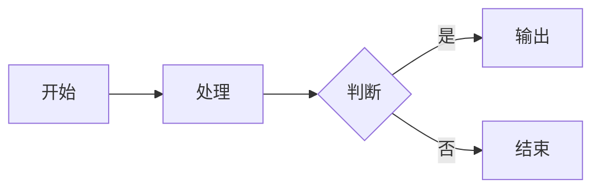
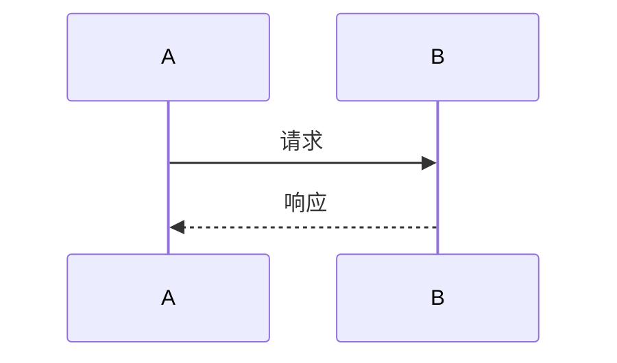
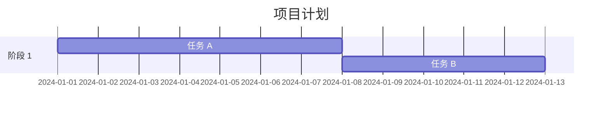
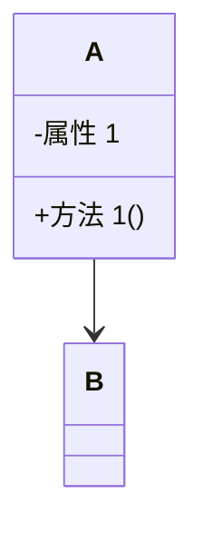

# Obsidian 学习指南

> 本文档记录 Obsidian 知识库搭建、工程文档写作方法、及高效插件使用技巧。
> 目标：建立一个**结构化、可检索、易维护**的个人知识库，写出**工程化、标准化、高可读**的技术文档。

---

## 一、Obsidian优势

### 1.1 为什么选 Obsidian？

- **本地**优先，数据安全
- Markdown 格式，通用性强
- 双向链接，知识**关联**
- 插件生态，高度**可扩展**
- 免费**开源**，跨平台

### 1.2 核心概念

- **笔记**：基本的 Markdown 文件
- **仓库**：笔记的集合，一个项目一个仓库
- **双向链接**：`[[笔记名]]` 建立关联
- **标签**：`#标签` 分类标记
- **图谱视图**：可视化笔记关系

---

## 二、知识库

### 2.1 知识库设计原则

#### 2.1.1 结构化思维

- **目录树设计**：按项目/领域/类型分层
- **命名规范**：统一前缀、日期格式、避免特殊字符
- **索引文档**：每个目录一个 README/Index

#### 2.1.2 知识组织方式

**PARA 方法**（重点）：

PARA 是一种**以行动为导向**的知识组织系统，由 Tiago Forte 提出。核心理念是：**按可操作性排序，而不是按主题分类**。

四个层级：

| 层级 | 全称 | 含义 | 特点 | 示例 |
|------|------|------|------|------|
| **P** | Projects | 项目 | 有明确目标和截止日期 | "操作系统比赛"、"写毕业论文" |
| **A** | Areas | 领域 | 需要持续关注的责任区 | "健康管理"、"技术学习"、"财务" |
| **R** | Resources | 资源 | 感兴趣的主题和参考资料 | "AI 笔记"、"设计灵感"、"食谱" |
| **A** | Archives | 归档 | 已完成或不再活跃的内容 | "2023 年项目"、"旧版文档" |

PARA 的优势：
- **按行动排序**：正在做的放最前面
- **只有 4 个分类**：简单易记
- **动态流动**：项目完成后 → 归档
- **聚焦当下**：减少干扰，专注当前任务

**PARA 工作流**：

```
新项目 → Projects（正在进行）
      ↓ 完成
    Archives（归档）

持续责任 → Areas（长期关注）

感兴趣主题 → Resources（参考资料）
```

**实际应用示例**：

```
你的知识库：
├── 10-Projects/
│   ├── 操作系统比赛/          ← 有截止日期（6 月 30 日）
│   ├── 毕业论文/              ← 有明确目标
│   └── 找实习/                ← 正在进行
│
├── 20-Areas/
│   ├── 技术学习/              ← 持续提升
│   ├── 健康管理/              ← 长期责任
│   └── 人际关系/              ← 需要维护
│
├── 30-Resources/
│   ├── AI 技术笔记/           ← 感兴趣的主题
│   ├── 设计灵感/              ← 参考资料
│   └── 好书推荐/              ← 收藏的内容
│
└── 40-Archives/
    ├── 2024-上学期课程/       ← 已完成
    └── 2023-旧项目/           ← 不再活跃
```

**使用建议**：
1. 每周回顾：检查 Projects 是否有需要归档的
2. 新项目先放 Projects，完成后再决定移到哪里
3. Areas 不要太多（5-7 个为宜）
4. Resources 可以按兴趣自由扩展

**混合模式**：项目驱动 + 知识沉淀

- 用 PARA 组织**行动相关的内容**
- 用双向链接组织**知识关联**
- 两者结合：PARA 管结构，链接管关系

#### 2.1.3 知识流转流程

```
收集 → 整理 → 内化 → 输出 → 归档
```

- **收集**：快速记录想法、摘抄、截图
- **整理**：分类、打标签、建立链接
- **内化**：重写成自己的话、添加思考
- **输出**：文章、PPT、代码、方案
- **归档**：过期内容移入 Archive

### 2.2 目录结构设计

#### 2.2.1 推荐结构（项目驱动型）

```
Vault/
├── 00-Inbox/           # 收集箱（未整理）
├── 10-Projects/        # 进行中的项目
│   ├── Proj-A/
│   └── Proj-B/
├── 20-Areas/           # 持续关注的领域
│   ├── 技术学习/
│   ├── 工作方法/
│   └── 健康管理/
├── 30-Resources/       # 参考资料
│   ├── 书籍笔记/
│   ├── 文章摘抄/
│   └── 工具手册/
├── 40-Archives/        # 已归档
│   ├── 2024-项目A/
│   └── 2023-旧项目/
├── 90-Templates/       # 模板库
├── 99-Assets/          # 附件（图片、PDF）
├── MOC.md              # 地图内容（Map of Content）
└── Daily-Notes/        # 日记
```

#### 2.2.2 命名规范

- **文件命名**：`YYYY-MM-DD-标题.md` 或 `类别-主题.md`
- **避免特殊字符**：`/ \ : * ? " < > |`
- **统一前缀**：`01_`、`02_` 排序
- **中文 vs 英文**：保持一致，推荐中文（易读）

### 2.3 知识关联技巧

#### 2.3.1 双向链接

- `[[笔记名]]`：基础链接
- `[[笔记名#标题]]`：链接到具体标题
- `[[笔记名|显示文本]]`：自定义显示文本
- **反向链接面板**：查看谁链接了我

#### 2.3.2 标签系统

- **层级标签**：`#项目/A阶段`、`#技术/AI/大模型`
- **状态标签**：`#待整理`、`#已完成`、`#进行中`
- **类型标签**：`#概念`、`#方法`、`#案例`、`#工具`

#### 2.3.3 MOC（Map of Content）

**什么是 MOC？**

MOC（Map of Content，内容地图）是**知识库的导航页**，类似于书籍的"目录"或网站的"主页"。

**为什么需要 MOC？**

问题场景：
- 笔记越来越多（100+、500+、1000+），找不到东西
- 只有双向链接，但没有全局视图
- 搜索太慢，不知道有哪些相关笔记

MOC 的作用：
- **集中导航**：一个页面汇总所有相关笔记
- **主题索引**：按主题组织，而不是按时间
- **知识地图**：看到这个主题的全貌
- **快速入口**：点击链接直接跳转

**如何创建 MOC？**

**步骤 1**：创建一个新的笔记，命名为 `XXX MOC.md`
**步骤 2**：按主题分类，列出相关笔记

```markdown
# AI 技术 MOC

> 本页面汇总所有 AI 相关笔记，作为快速导航入口。

## 基础概念
- [[Transformer]] - 现代 AI 的核心架构
- [[LLM]] - 大语言模型
- [[Embedding]] - 嵌入向量

## 应用技术
- [[RAG]] - 检索增强生成
- [[Agent]] - 智能代理
- [[Fine-tuning]] - 模型微调

## 工具与框架
- [[LangChain]] - AI 应用框架
- [[HuggingFace]] - 模型库

## 学习资源
- [[AI 课程笔记]]
- [[论文阅读清单]]
```

**步骤 3**：添加简短描述，说明每篇笔记的核心内容
**步骤 4**：定期更新，添加新笔记

**MOC 的最佳实践**：

1. **一个主题一个 MOC**：不要把所有东西放一个 MOC
2. **层级不要太深**：2-3 层为宜（主 MOC → 子 MOC → 笔记）
3. **添加描述**：不要只列链接，加上简短说明
4. **定期维护**：每周回顾，更新链接
5. **双向链接**：在笔记中也链接回 MOC

**MOC  vs  文件夹**：

| 维度 | 文件夹 | MOC |
|------|--------|-----|
| **组织方式** | 物理位置 | 逻辑关联 |
| **一篇笔记** | 只能在一个文件夹 | 可以在多个 MOC |
| **查找方式** | 逐级展开 | 点击链接 |
| **灵活性** | 低（移动文件） | 高（添加链接） |
| **适用场景** | 粗粒度分类 | 细粒度索引 |

**建议**：文件夹 + MOC 结合使用
- 文件夹管**大分类**（PARA 四层）
- MOC 管**主题索引**（灵活关联）

---

## 三、工程型高效文档写作

### 3.1 工程型文档的特点

#### 3.1.1 与传统文档的区别

| 维度 | 传统文档 | 工程型文档 |
|------|----------|------------|
| **目标** | 记录知识 | 解决问题 |
| **结构** | 线性叙述 | 模块化拆解 |
| **语言** | 学术化 | 简洁直白 |
| **验证** | 理论推导 | 数据证明 |
| **更新** | 写完就放 | 持续迭代 |

#### 3.1.2 核心原则

1. **问题导向**：每篇文档解决一个具体问题
2. **结构清晰**：统一的模板，降低阅读成本
3. **数据驱动**：用数据、截图、日志证明
4. **可复用**：模块化内容，可组合可迁移
5. **版本管理**：Git 跟踪，可回溯

---

## 四、相关插件

### 4.1 Templater 模板插件（重点）

#### 4.1.1 为什么用 Templater？

Obsidian 内置的模板功能很弱，只能插入静态文本。Templater 是**增强版模板插件**，支持：

- **JavaScript 脚本**：动态生成内容
- **用户输入**：交互式填写字段
- **日期计算**：昨天、明天、上周等
- **文件操作**：自动创建文件夹、重命名
- **自动化工作流**：一键完成多个操作

**使用场景**：
- 每天写日记，自动填入日期
- 创建项目文档，自动创建文件夹和 Frontmatter
- 写会议记录，交互式输入参会人员

#### 4.1.2 安装与配置

**步骤 1**：安装插件
1. 设置 → 第三方插件 → 浏览
2. 搜索 "Templater"
3. 安装并启用

**步骤 2**：配置模板文件夹
1. 创建文件夹
2. 设置 → Templater → Template folder location → 选择模板

**步骤 3**：配置触发方式
- **推荐**：设置快捷键（如 `Ctrl/Cmd + T`）
- 或：命令面板 → Templater: Insert template

**步骤 4**：配置高级选项（可选）
- 启用 "Trigger Templater on new file creation"（创建新文件时自动触发）
- 设置 HTTP 请求权限（如果需要调用 API）

#### 4.1.3 Templater 工作流建议

**日常使用流程**：

```
1. 创建日记
   ↓ Ctrl/Cmd + T → 日记模板
   ↓ 自动填入日期
   
2. 记录想法
   ↓ 快速笔记 → 稍后整理
   
3. 创建项目文档
   ↓ Ctrl/Cmd + T → 项目模板
   ↓ 交互式输入状态、技术栈
   ↓ 自动创建文件夹
   
4. 写技术笔记
   ↓ Ctrl/Cmd + T → 技术概念模板
   ↓ 自动填入标题
```

**模板管理建议**：

1. **分类存放**：
   ```
   90-Templates/
   ├── 日记/
   │   ├── 日记模板.md
   │   └── 周报模板.md
   ├── 项目/
   │   ├── 项目文档模板.md
   │   └── 会议记录模板.md
   └── 技术/
       ├── 技术概念模板.md
       └── 问题排查模板.md
   ```

2. **命名规范**：统一用 "XXX 模板.md" 格式
3. **定期清理**：删除不用的模板
4. **版本管理**：用 Git 跟踪模板变更

### 4.2 画图插件（Excalidraw）

#### 4.2.1 为什么用 Excalidraw？

- 手绘风格，工程感强
- 支持架构图、流程图、时序图
- 可嵌入 Obsidian 笔记
- 双向链接支持

#### 4.2.2 安装与配置

1. 社区插件搜索 "Excalidraw"
2. 启用插件
3. 设置绘图保存位置
4. 配置快捷键：Alt + E 新建绘图

#### 4.2.3 常用图表类型

**分层架构图**：

```
┌─────────────────┐
│   应用层         │
├─────────────────┤
│   控制层         │
├─────────────────┤
│   抽象层         │
├─────────────────┤
│   硬件层         │
└─────────────────┘
```

**Pipeline 流程图**：

```
输入 → 处理 1 → 处理 2 → 处理 3 → 输出
```

**DAG（有向无环图）**：

```
A → B → C
 ↓    ↑
 D → E
```

**时序图**：

```
A ──请求──→ B
A ←─响应── B
```

#### 4.3.4 Excalidraw 使用技巧

**快捷键**：

- `Q`：矩形
- `E`：椭圆
- `L`：线条
- `A`：文字
- `Ctrl/Cmd + D`：复制样式
- `Ctrl/Cmd + G`：组合

**嵌入笔记**：

```markdown
![[架构图.excalidraw]]
```

**双向链接**：

- 在 Excalidraw 中添加文字：`[[笔记名]]`
- 点击可跳转到对应笔记

**导出图片**：

- 右键 → 导出为 PNG/SVG
- 用于 PPT、文档

### 4.3 Mermaid 图表

#### 4.3.1 Mermaid vs Excalidraw

| 维度 | Mermaid | Excalidraw |
|------|---------|------------|
| **类型** | 代码生成图 | 手绘图 |
| **优势** | 版本管理、快速修改 | 自由度高、美观 |
| **适用** | 流程图、时序图、甘特图 | 架构图、拓扑图 |
| **学习成本** | 低（Markdown 语法） | 中（需要练习） |

#### 4.3.2 常用 Mermaid 图表

**流程图**：



**时序图**：



**甘特图**：



**类图**：



#### 4.3.3 Mermaid 使用技巧

- **实时预览**：编辑时即时渲染
- **主题切换**：`%%{init: {'theme': 'dark'}}%%`
- **版本管理**：纯文本，Git 友好

### 4.4 其他高热度插件

#### 4.4.1 Dataview

**功能**：查询和展示笔记数据

**示例**：

```dataview
TABLE status, created
FROM "10-Projects"
WHERE status = "进行中"
SORT created DESC
```

**应用场景**：
- 项目看板
- 任务列表
- 文档索引

#### 4.4.2 Web Clipper

**功能**：网页剪藏到 Obsidian

**工具**：
- MarkDownload（浏览器扩展）
- Save to Obsidian

**使用技巧**：
- 自动添加来源链接
- 提取正文，去除广告
- 打标签分类

---

## 五、最佳实践

### 5.1 搜索与检索

#### 5.1.1 搜索语法

- `关键词`：基础搜索
- `"精确短语"`：精确匹配
- `tag:#标签`：按标签搜索
- `path:目录`：限定目录
- `-排除`：排除关键词

#### 5.1.2 搜索技巧

- **用标签分类**：快速过滤
- **用链接关联**：反向查找
- **用 Dataview 查询**：复杂条件

### 5.2 知识沉淀

#### 5.2.1 从收集到内化

```
收集（摘抄）→ 整理（分类）→ 内化（重写）→ 输出（分享）
```

#### 5.2.2 原子化笔记

- **一个笔记一个概念**：不要什么都放一起
- **可独立理解**：不依赖其他笔记
- **可组合复用**：像乐高一样拼装

#### 5.2.3 定期回顾

- **每周回顾**：整理收集箱
- **每月总结**：更新 MOC
- **每季度清理**：归档过期内容

### 5.3 性能优化

#### 5.3.1 仓库优化

- **控制仓库大小**：单仓库 < 10000 笔记
- **附件管理**：图片、PDF 统一存放
- **禁用不用的插件**：提高启动速度

#### 5.3.2 搜索优化

- **用标签代替全文搜索**：更快
- **建立 MOC 索引**：减少搜索次数
- **用 Dataview 预查询**：提前生成列表

### 5.4 备份与同步

#### 5.4.1 备份策略
- **本地备份**：外部硬盘
- **Git 备份**：版本管理
- **云端备份**：Obsidian Sync / iCloud / OneDrive

#### 5.4.2 多设备同步
- **Obsidian Sync**：官方方案（付费）
- **Git 同步**：技术用户推荐
- **iCloud / OneDrive**：简单方案

### 5.5 协作与分享

#### 5.5.1 导出格式

- **PDF**：打印、分享
- **Markdown**：通用格式
- **HTML**：发布网页

---

## 六、如何坚持写笔记？

- **降低门槛**：用**模板**，3 分钟就能写完
- **绑定习惯**：每天固定时间（如睡前）
- **看到价值**：定期回顾，感受到**积累**的力量
- **不要完美主义**：先写下来，再慢慢完善

---

## 七、学习资源

### 7.1 官方资源

- [Obsidian 官方文档](https://help.obsidian.md)
- [Obsidian 论坛](https://forum.obsidian.md)
- [Obsidian Discord](https://discord.gg/obsidian)

### 7.2 教程推荐

- [Obsidian 入门教程](https://help.obsidian.md/Getting+started)
- [Templater 文档](https://silentvoid13.github.io/Templater/)
- [Excalidraw 文档](https://zsviczian.github.io/obsidian-excalidraw-plugin/)
- [Dataview 文档](https://blacksmithgu.github.io/obsidian-dataview/)

### 7.3 社区资源

- [Obsidian 插件列表](https://obsidian.md/plugins)
- [Obsidian 主题列表](https://obsidian.md/themes)
- [Awesome Obsidian](https://github.com/kmaasrud/awesome-obsidian)
