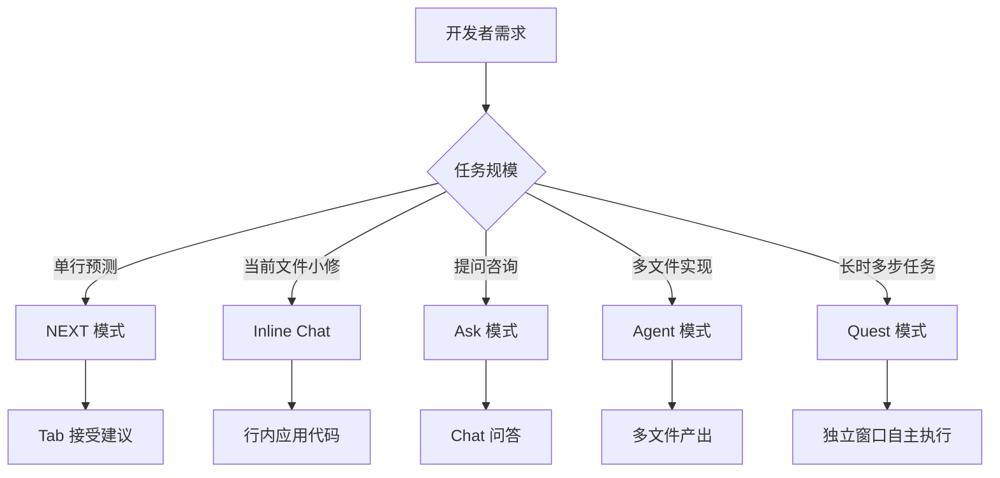

# Qoder 使用指南

> Qoder 是阿里巴巴旗下团队于 2025 年 8 月正式发布的新一代 Agentic 编程平台，专为真实软件工程场景设计。深度理解整个项目架构（能检索分析 10 万+ 代码文件），集成 Claude、GPT、Gemini 等全球顶尖 AI 模型实现多模型智能路由，其中 Quest 模式作为王牌功能，实现从需求描述到自主开发交付的跨越。

**关键词**：Qoder、Agentic 编程、阿里巴巴、Quest 模式、多模型路由

## 抽象类比

Qoder 就像一位"AI 项目经理"带的施工队。普通 AI 编程工具像"打字员"——你敲一行它补一行；Qoder 则能像项目经理一样先读懂整个项目（10 万+ 文件都不在话下），再根据任务规模分派给合适的"工人"：单行修改交给 NEXT，跨文件改动交给 Agent，完整需求模块则委托给 Quest 模式让它独立开窗干活、看板汇报进度。它还会把项目代码自动整理成一本"Repo Wiki 百科"，新人接手项目就像翻一本说明书。

## 适合人群 / 预备知识

- 中高级全栈开发者，处理大型项目需要 AI 深度参与
- 接手遗留项目或学习开源项目的新成员
- 关注代码知识沉淀与团队协作的技术负责人
- 使用 JetBrains IDE 的资深工程师
- 熟悉主流编程语言与框架
- 了解 IDE 与插件基本使用
- 对 Agentic 编程概念有初步认知

## 一、Qoder 是什么

- 定义：阿里巴巴旗下团队推出的新一代 Agentic 编程平台
- 发布时间：2025 年 8 月正式发布
- 设计理念：专为真实软件工程场景设计
- 核心能力：能检索分析 10 万+ 代码文件，深度理解项目架构
- 模型集成：Claude、GPT、Gemini 等全球顶尖模型，多模型智能路由
- 平台支持：Windows、macOS、Linux
- 计费：个人版免费试用
- 与传统补全工具区别：
  - 传统工具：单行/单文件补全，缺乏全局理解
  - Qoder：项目级理解 + 多步自主执行 + 知识沉淀

## 二、五种交互模式

Qoder 提供五种交互模式覆盖从单点编辑到长时自主任务的全场景。

### NEXT（下一编辑建议）

- AI 预测下一步代码修改，给出多行代码建议
- 快捷键：macOS `⌥P` / Windows `Alt+P`
- 接受建议：`Tab`

### Inline Chat（内联聊天）

- 在编辑器内直接调出对话框
- 调出：`⌘I` / `Ctrl+I`
- 应用代码：`⌘⏎` / `Ctrl+Enter`

### Ask（问答）

- 快捷键：`⌘L` / `Ctrl+L` 打开 Chat
- 问答优先，适合提问咨询

### Agent（代理）

- 多文件实现，适合较大任务
- 介于单文件交互和长时自主任务之间

### Quest（王牌功能）

- 自主委托，长时多步任务
- 独立窗口运行，agent 自动执行
- 看板跟踪进度和产物

### 何时用哪个

- 改一行代码：NEXT
- 改一段当前文件代码：Inline Chat
- 不了解某段逻辑想提问：Ask
- 实现一个跨文件功能：Agent
- 完整交付一个需求模块：Quest

## 三、Quest 模式详解

### Spec 驱动开发流程

1. 开发者用自然语言描述需求
2. 选择"设计并执行"
3. Qoder 自动生成技术设计文档（技术选型、功能模块划分、接口设计）
4. 确认设计后点击执行
5. agent 自动完成项目开发

### 类比

- 类比："从辅助工具到自主开发者的跨越"
- 形象说法："AI 当项目经理"，你提需求，AI 出方案并执行

### 适用场景

- 完整功能模块开发
- 跨多文件重构
- 新业务子系统从零搭建
- 复杂 Bug 多步骤定位修复

## 四、Repo Wiki 代码库百科化

### 功能

- 自动分析代码库生成结构化文档
- 架构图、时序图、类图自动生成
- 每行重要源码配注解

### 生成的文档类型

- 项目架构总览
- 模块依赖关系图
- 核心类与接口说明
- 关键流程时序图
- 源码逐行注解

### 应用场景

- 学习开源项目：快速理解陌生代码库
- 接手遗留项目：缩短上手周期
- 团队知识共享：沉淀项目文档避免人员依赖

## 五、其他核心功能

- Action Flow：可视化展示 AI 执行计划
- Task Report：任务报告汇总，便于复盘
- 项目知识保留系统：学习编码风格，跨会话记忆
- 多模型智能路由：自动为任务选最优模型
- JetBrains IDE 插件支持：IntelliJ、PyCharm 等
- 一键部署：Netlify 集成

## 六、安装与入门

### 下载与注册

1. 访问 qoder.com/download
2. 选择独立 Qoder IDE 或 JetBrains 插件
3. 注册：Google / GitHub 账号或邮箱

### 第一次使用流程

1. 打开已有项目
2. 用 NEXT 模式体验下一编辑建议（`Alt+P`）
3. 用 Inline Chat 修改当前文件（`Ctrl+I`）
4. 用 Ask 模式提问项目相关疑问（`Ctrl+L`）
5. 用 Agent 模式实现跨文件小功能
6. 用 Quest 模式委托一个完整需求

### 探索功能快捷键

- NEXT 建议：`Alt+P`（macOS `⌥P`）
- Inline Chat：`Ctrl+I`（macOS `⌘I`）
- Ask Chat：`Ctrl+L`（macOS `⌘L`）
- 应用 Inline Chat 代码：`Ctrl+Enter`（macOS `⌘⏎`）

## 七、配置体系

### 三级配置

- 全局配置：影响所有项目
- 项目配置：仅当前项目生效
- 规则配置：定义代码风格与框架约束

### 项目规则

- 在 `.qoder/rules` 目录下配置
- `style.json`：代码风格规范
- `framework.json`：框架版本与约束

### 数据源关联

- 导入 API 文档供 AI 引用
- 导入组件库手册
- 关联数据库 Schema

### CLI 工具

- 融入终端工作流
- 集成到 CI/CD 流水线

## 八、JetBrains 插件使用

### 支持的 IDE

- IntelliJ IDEA
- PyCharm
- WebStorm
- GoLand 等 JetBrains 全家桶

### 使用方式

1. 在 JetBrains 插件市场搜索 Qoder 安装
2. 登录 Qoder 账号关联
3. 在 IDE 中使用 NEXT、Inline Chat、Ask 等模式
4. Quest 等重型功能建议在独立 Qoder IDE 中使用

### 优势

- 无需切换 IDE，融入现有工作流
- 保留 JetBrains 强大的调试与重构能力
- 享受 Qoder 的项目级 AI 理解

## 九、核心优势

- 项目级理解：检索分析 10 万+ 代码文件
- 自主编程：Quest 模式实现端到端交付
- 知识可视化：Repo Wiki 让代码库自我解释
- 多模型路由：自动选最优模型应对不同任务
- 跨平台：Windows、macOS、Linux 全支持
- 生态融合：JetBrains 插件 + CLI 工具 + CI/CD 集成

## 十、实战技巧

1. 大型项目首次使用先让 Qoder 生成 Repo Wiki，建立全局认知
2. Quest 模式需求描述尽量具体，包含验收标准，AI 方案更精准
3. 在 `.qoder/rules` 预置团队风格，避免反复纠正 AI 命名
4. 多模型路由不要手动指定，让系统自动选最优
5. Inline Chat 修改当前文件比 Ask 更高效，少切换上下文
6. NEXT 建议连续 Tab 接受，适合批量生成相似结构代码
7. Quest 任务执行中通过看板及时介入纠偏，避免错误累积
8. 复杂重构前用 Task Report 汇总历史，便于团队评审
9. 导入 API 文档作为数据源，让 AI 准确调用内部接口
10. CLI 工具集成到 CI/CD，在流水线中自动检查代码合规

## 十一、常见问题

- Qoder 个人版免费试用有什么限制？具体额度与功能限制以官网为准
- Quest 模式生成的代码可信吗？需人工审查，复杂业务逻辑尤甚
- 是否必须使用 JetBrains 才能用 Qoder？提供独立 Qoder IDE，无需 JetBrains
- 数据是否上传云端？项目代码片段上传处理，敏感项目需评估合规
- 多模型路由如何选模型？系统根据任务类型自动选择，无需手动干预
- Repo Wiki 支持私有项目吗？支持，但需在合规范围内使用

## 十二、参考资源链接

- 官网：https://qoder.com
- 下载页面：https://qoder.com/download
- 官方文档：https://docs.qoder.com
- JetBrains 插件市场：搜索 Qoder
