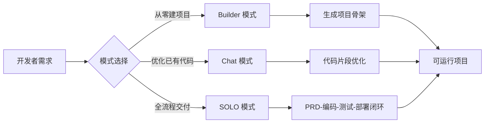

# Trae 使用指南

> Trae 是字节跳动推出的 AI 集成开发环境（AI IDE），专为中文开发者深度优化，国内版免费。定位为"从需求到部署的一站式智能编程平台"，内置豆包、DeepSeek等模型，并支持自定义模型 API 接入。

**关键词**：Trae、AI IDE、字节跳动、Builder 模式、SOLO 模式

## 抽象类比

Trae 就像一支随叫随到的"AI 建筑队"。你只管提需求——要几层楼、什么风格、几时交钥匙，剩下的拆任务、画图纸、打地基、砌墙、装修都由它来。Builder 模式是"快速搭毛坯房"，一句话出项目骨架；Chat 模式是"现场监理问答"，对着图纸讨论哪里改哪里；SOLO 模式则是"全包交钥匙工程"，从 PRD 到编码、测试、部署一条龙。对中文开发者来说，它还自带"本地翻译"——中文术语、变量命名、报错信息都贴心地汉化过。

## 适合人群 / 预备知识

- 中高级前端、后端、移动端开发者
- 希望用自然语言快速搭建项目原型的全栈工程师
- 国内中文环境下需要 AI 辅助但厌倦英文交互的开发者
- 团队技术负责人，关注代码规范一致性
- 熟悉至少一门主流编程语言基础语法
- 了解 IDE 基本操作（项目结构、文件管理、快捷键）
- 对 AI 编程概念有初步认知即可，无需深入理解模型原理

## 一、Trae 是什么

- 定义：字节跳动 2025 年推出的 AI 原生 IDE
- 定位："从需求到部署的一站式智能编程平台"
- 官网：trae.cn
- 计费：国内版免费，国际版 $3/月
- 内置模型：豆包 1.5-pro、DeepSeek R1/V3 等
- 支持自定义模型 API 接入
- 与 Cursor 对比：
  - Trae 中文深度优化，国内免费
  - Cursor 国际化成熟，生态更早建立
  - Trae 对国产框架（Taro、uni-app）适配更深

## 二、核心模式

Trae 提供三大核心模式与智能体自定义能力，覆盖从单文件对话到端到端项目交付的全场景。



### Builder 模式（项目生成器）

- 类比："说需求得完整项目"
- 自然语言描述需求，AI 自动拆解任务、生成代码框架、配置环境、实时预览

### Chat 模式（编程拍档）

- 类比："旁边坐着一位资深同事"
- 编辑器侧边栏对话，引用当前文件或项目上下文
- 支持代码解释、优化建议、Bug 修复
- 快捷键 `Ctrl+K`（macOS `Cmd+K`）

### SOLO 模式（2.0 革命性升级）

- 类比："AI 当工程师"，端到端自主开发
- PRD → 编码 → 测试 → 部署全流程闭环
- 支持语音、草图、Figma 设计图多模态输入

### 智能体自定义

- 通过 MCP 协议配置工具调用逻辑
- 创建连接 Figma、Blender 等外部工具的专属 Agent

## 三、核心功能

- 自然语言秒变可运行代码
- 看图写代码：设计稿（Figma/草图）转前端代码，多模态解析
- 规则引擎：`.trae/rules` 配置团队规范，AI 生成代码自动合规
- 冲突解决：多人编码智能调和，实时冲突检测
- 上下文感知：全局理解项目结构，跨文件理解依赖关系
- 实时缺陷防护：基于 AST 分析实时标注错误

## 四、技术栈支持

覆盖 50+ 编程语言、100+ 框架。

### 前端

- React / Vue / Angular / Svelte
- Next.js 等元框架

### 后端

- Node.js / Python / Java
- Go / Rust

### 移动端

- React Native / Flutter
- Swift / Kotlin

### 小程序

- Taro（深度适配）
- uni-app（深度适配国产框架）

### 数据库

- MySQL / PostgreSQL
- MongoDB / Redis

## 五、安装与入门

### 系统要求

- Windows 10/11
- macOS 10.15+
- Linux 版本预计 2025 Q4 发布
- 建议 8GB+ 内存

### 第一次使用流程

1. 访问 trae.cn 下载安装包
2. 安装后启动，使用手机号或邮箱注册登录
3. 打开已有项目或新建空目录
4. 在 Builder 模式输入自然语言需求生成项目
5. 切换到 Chat 模式（`Ctrl+K`）调试优化代码
6. 需要端到端交付时使用 SOLO 模式

## 六、Builder 模式详解

### 使用步骤

1. 新建空项目目录并在 Trae 中打开
2. 切换到 Builder 模式
3. 输入自然语言需求描述
4. 等待 AI 拆解任务并生成项目骨架
5. 在实时预览中查看效果
6. 迭代调整需求直到满意

### 示例 prompt

```
用 React + TypeScript + Tailwind 搭建一个待办应用，
要求支持任务分类、优先级标记、本地存储持久化，
界面参考 Notion 简洁风格。
```

### 适用场景

- 从零搭建新项目脚手架
- 快速验证产品原型
- 生成符合团队规范的基础代码

## 七、Chat 模式详解

### 快捷键

- 调出对话：`Ctrl+K`（macOS `Cmd+K`）
- 引用当前文件：在对话中输入 `@文件名`
- 引用整个项目：在对话中输入 `@project`

### 引用上下文

- 单文件引用：聚焦当前编辑文件
- 项目级引用：AI 理解全局依赖
- 选区引用：只针对选中代码片段优化

### 适用场景

- 解释陌生代码逻辑
- 重构优化已有代码
- 定位修复 Bug
- 编写单元测试

## 八、SOLO 模式详解

### 全流程闭环

1. 输入 PRD 或自然语言需求
2. AI 自动规划技术方案
3. 生成代码并配置环境
4. 自动运行测试用例
5. 部署到目标环境

### 多模态输入

- 文本 PRD
- 语音描述
- 手绘草图
- Figma 设计稿

### 适用场景

- 创业团队快速验证 MVP
- 非技术成员交付简单产品
- 资深开发者从重复劳动中解放

## 九、规则引擎与团队规范

### 配置方式

- 在项目根目录创建 `.trae/rules` 目录
- 编写规则文件定义代码风格、命名约定、架构约束

### 生效机制

- AI 生成代码时自动读取规则
- 不符合规范的代码会被实时提示
- 团队成员共享同一套规则配置

### 推荐规则

- 命名规范（阿里规约、Google 风格）
- 框架版本约束
- 目录结构约定
- 禁用 API 列表

## 十、核心优势

- 原生中文深度优化：中文术语解析、变量命名、报错汉化
- 免费开放：国内版无功能阉割
- 开放生态：MCP 协议连接 Figma、Blender 等工具
- 工程化适配：符合阿里规约、Google 风格
- 多模型支持：内置豆包、DeepSeek，支持自定义 API

## 十一、实战技巧

1. Builder 模式描述需求时，明确技术栈和参考风格，效果更稳定
2. Chat 模式优先引用具体文件而非整个项目，减少上下文噪音
3. 复杂 Bug 用 SOLO 模式让其自主定位修复，比单轮对话更高效
4. 在 `.trae/rules` 中预置团队禁用 API，避免生成不安全代码
5. 设计稿转代码时优先用 Figma 链接而非截图，结构更准确
6. 利用 MCP 接入团队知识库，让 AI 理解内部组件库用法
7. 报错时把完整堆栈贴进 Chat，比逐行分析更快定位
8. 重构前先让 AI 生成测试用例，保证行为不回归
9. 大型项目分模块让 AI 处理，避免一次性任务过载
10. 定期更新 IDE 版本，新模型和新功能持续迭代

## 十二、常见问题

- Trae 免费版功能有限制吗？国内版核心功能免费，无功能阉割
- 是否必须联网？需要联网调用云端模型，暂不支持纯本地推理
- 数据是否安全？代码片段上传到云端处理，敏感项目可配置自定义模型
- 国际版和国内版区别？国际版 $3/月，模型选型偏向海外；国内版内置豆包、DeepSeek
- 是否支持插件扩展？通过 MCP 协议接入外部工具，原生插件市场仍在完善
- SOLO 模式可以完全替代人工吗？复杂业务逻辑仍需人工审查，适合重复性工作

## 十三、参考资源链接

- 官网：https://trae.cn
- 官方文档：https://docs.trae.cn
- 下载页面：https://trae.cn/download
- 社区反馈与更新动态：https://trae.cn/community
