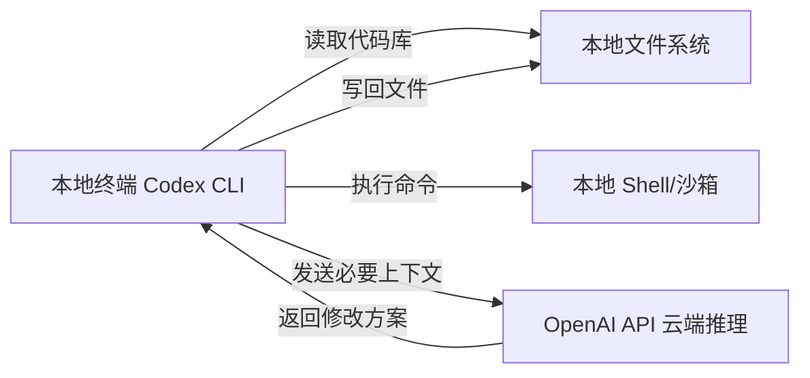
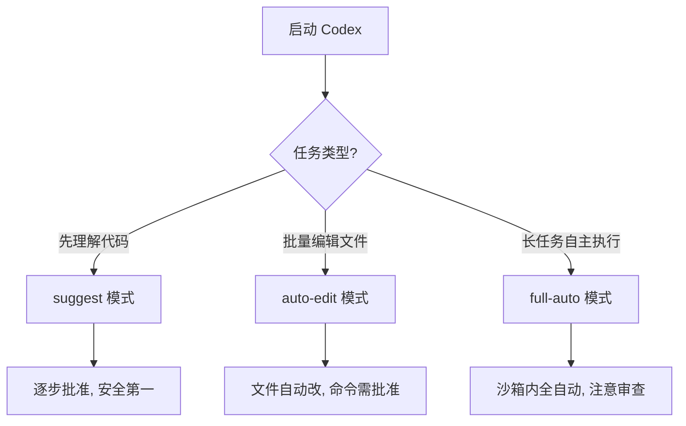
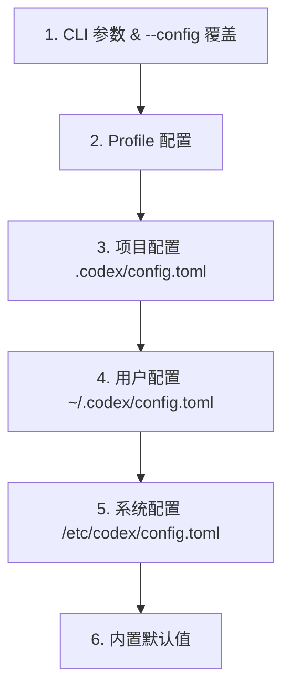

# Codex 使用指南

> Codex 是 OpenAI 推出的本地终端 AI 编程代理，基于 GPT-5-codex 模型构建。它不是"终端里的 ChatGPT"，而是一个能读取代码库、修改文件、执行 shell 命令、跑测试、通过 MCP 连接外部工具的完整代理。代码留在本地，只把必要上下文发到 OpenAI API，因此既快又安全。本文面向 Windows 环境开发者，从安装、登录、模式选择到国内中转方案，系统讲解 Codex CLI 的使用方法。学完后，你能独立用 Codex 解释陌生代码库、修复 bug、跑测试、做 code review，并能为自动化脚本配置非交互式流程。

**关键词**：Codex、AI 编程代理、命令行工具、OpenAI、代码审查

## 抽象类比

Codex 就像坐在你旁边的资深程序员。你把项目代码、报错信息、需求描述丢给它，它能自己读代码、改文件、跑命令、跑测试，再给你一份带着 diff 的修改方案。和"终端里调 ChatGPT"不同，它不只是回答问题，而是真正动手干活——读你的代码库、写回磁盘、执行 shell 命令，把"问 AI"变成"使唤 AI"。

## 适合人群 / 预备知识

- 想用 AI 提升编码效率的后端/前端/全栈开发者
- 熟悉命令行基础操作（cd、git、npm 等命令）
- 有一个 OpenAI 账号（ChatGPT 订阅用户或 API Key 用户）
- 本机已安装 Node.js 22+ 或可用 PowerShell 脚本安装
- 了解 Git 基本工作流（status、diff、commit）
- 有可访问的代码仓库用于练习

## 一、Codex 是什么

Codex 是一个 agentic coding product（代理式编程产品），用 Rust 编写，速度快。它和"终端里调用 ChatGPT API"有本质区别：

- 能直接读取整个代码库的上下文
- 能修改文件并写入磁盘
- 能执行 shell 命令、跑测试、跑 lint
- 能通过 MCP（Model Context Protocol）连接外部工具
- 本地执行 + 云端推理的混合架构

### 四个入口

- Codex CLI：终端工具，最适合新手理解工作循环，本文重点
- IDE extension：集成在 VS Code/Cursor/Windsurf 编辑器内
- Codex app：桌面端，支持多线程、worktree、浏览器预览、Git diff
- Codex cloud：远程并行任务，适合长任务批量执行

### 混合架构



代码、文件、命令执行都发生在本地，只有推理请求发送到 OpenAI 服务器，既保护代码隐私，又利用了云端模型能力。

## 二、安装

### 系统要求

- 操作系统：macOS 12+、Ubuntu 20.04+/Debian 10+、Windows 11（需 WSL2 或原生 PowerShell）
- Node.js 22+（推荐 LTS 版本）
- Git 2.23+（可选但强烈推荐）
- 内存：4GB 最低，8GB+ 推荐

### 各系统安装命令

npm 方式（跨平台，推荐 Windows 用户）：

```bash
npm install -g @openai/codex
```

Homebrew 方式（macOS）：

```bash
brew install codex
```

官方脚本方式（macOS/Linux）：

```bash
curl -fsSL https://chatgpt.com/codex/install.sh | CODEX_NON_INTERACTIVE=1 sh
```

Windows PowerShell 方式：

```powershell
$env:CODEX_NON_INTERACTIVE=1; irm https://chatgpt.com/codex/install.ps1 | iex
```

### 验证与更新

```bash
codex --version        # 或 codex -V
codex doctor           # 检查环境是否完整，推荐首次安装后立即运行
npm install -g @openai/codex@latest   # 更新（无自带更新命令）
```

## 三、登录认证

Codex 像一个坐在你旁边的资深开发者，但它干活前需要先"出示工牌"。登录认证就是这个工牌，有两种方式。

### 方式一：ChatGPT 登录（默认）

适合 ChatGPT Plus/Pro/Team/Edu/Enterprise 用户（Edu 可免费体验）。

1. 终端运行 `codex login`
2. 浏览器自动打开 OAuth 授权页面
3. 授权后凭据自动写入 `~/.codex/auth.json`
4. 验证状态：`codex login status`

### 方式二：API Key 登录

适合 CI/CD、脚本自动化、无订阅用户。

临时设置（macOS/Linux）：`export OPENAI_API_KEY="sk-xxx"`

临时设置（Windows PowerShell）：`$env:OPENAI_API_KEY="sk-xxx"`

永久设置（Windows）：`setx OPENAI_API_KEY "sk-xxx"`

永久写入配置文件，编辑 `~/.codex/auth.json`：

```json
{"OPENAI_API_KEY": "sk-xxx"}
```

远程/无浏览器环境使用：`codex login --device-auth`

### 两种方式切换与凭据保护

```bash
codex --config preferred_auth_method="apikey"   # 切到 API Key
codex --config preferred_auth_method="chatgpt"  # 切回 ChatGPT
codex logout                                    # 登出
```

- 凭据文件 `auth.json` 像密码一样保护，绝对不能提交到 Git 仓库
- 建议把 `~/.codex/` 加入全局 gitignore 或项目 .gitignore

## 四、三种工作模式

模式决定 Codex 在干活时有多少自主权。新手从 suggest 开始，逐步放开权限。

### suggest 模式（默认，建议新手使用）

- 权限：只读文件，提议编辑和 shell 命令
- 操作：每一步都需要手动批准
- 适用：安全探索、代码审查、学习陌生代码库
- 启动：`codex`（默认就是 suggest）

### auto-edit 模式（自动编辑）

- 权限：可读取和写入文件
- 操作：执行 shell 命令前仍需批准
- 适用：重构、批量重命名、重复性编辑任务
- 启动：`codex --auto-edit` 或 `codex -a`

### full-auto 模式（完全自动）

- 权限：在沙盒中自主读取、写入、执行命令
- 操作：基本不需要人工干预
- 适用：修复构建错误、原型开发、长任务
- 启动：`codex --full-auto` 或 `codex -f`

### 模式选择决策



### 新手推荐组合

```bash
codex --sandbox workspace-write --ask-for-approval on-request
```

官方推荐的安全起步组合：允许写工作区，但每一步都先问你。

## 五、沙箱与权限系统

Codex 用两层安全机制防止误操作，就像给一个能干但偶尔冒失的助手套上"安全围栏"。

### 第一层：sandbox（技术上能做什么）

- read-only：只能读文件，不能写
- workspace-write：可以写当前工作目录内的文件
- full-access：可以读写任意路径，包括系统文件

### 第二层：approval policy（什么时候停下来问）

- on-request：每次需要操作时都问
- on-failure：先尝试，失败后再问
- never：从不打断（危险，仅限可信任务）

### 推荐配置阶梯

- 第一周：`--sandbox read-only`（只看不改）
- 第二周：`--sandbox workspace-write --ask-for-approval on-request`
- 熟悉后：`--sandbox workspace-write --ask-for-approval on-failure`
- 永远不要一开始就给 `full-access`

### 安全建议

- 在 Git 仓库内运行，便于随时回滚
- 重要操作前 `git status` 确认工作区干净
- full-auto 模式务必配合 workspace-write 沙箱
- 不熟悉的命令让 Codex 解释后再批准

## 六、常用命令速查

### 交互式会话

- `codex`：启动交互式会话（默认 suggest 模式）
- `codex "修复 README 里的拼写错误"`：直接给定任务进入交互
- `codex --full-auto "跑一遍测试"`：以全自动模式启动

### 非交互式（脚本/CI 友好）

- `codex exec "任务描述"`：非交互式执行（别名 `codex e`）
- `codex exec --json "任务"`：JSON 输出，便于脚本解析
- `codex exec --full-auto "任务"`：全自动非交互执行
- `codex apply <patch>`：把代理生成的 diff 应用到工作树（别名 `codex a`）

### 会话与登录管理

- `codex resume`：恢复之前的会话；`codex resume --last` 恢复最近一次
- `codex login`：ChatGPT OAuth 登录；`codex login --device-auth` 设备授权
- `codex login status`：查看登录状态；`codex logout`：登出

### MCP 与工具

- `codex mcp list`：列出已配置的 MCP 服务器
- `codex mcp add <name>`：添加 MCP 服务器
- `codex completion zsh`：生成 shell 补全（也支持 bash、fish）
- `codex doctor`：检查环境配置

## 七、交互式会话内置命令

进入 `codex` 交互会话后，用斜杠命令控制会话：

- `/status`：查看当前配置、所用模型、Token 消耗情况
- `/model`：切换模型（gpt-5 / gpt-5-codex / o4-mini）或调整推理强度
- `/approvals`：实时调整批准策略
- `/init`：在当前目录生成 AGENTS.md 项目规则文件
- `/help`：查看所有可用命令
- `/quit` 或 Ctrl+C 两次：退出会话

`/status` 是排查问题的第一步，Token 消耗异常或模型不对时先看这里。

## 八、配置体系

Codex 配置有五层优先级，从高到低覆盖。就像 CSS 的层叠规则，越具体的越优先。

### 五层优先级



### config.toml 示例

用户配置文件 `~/.codex/config.toml`：

```toml
model = "gpt-5-codex"
model_provider = "openai"
approval_policy = "on-request"
sandbox_mode = "workspace-write"
```

项目配置文件 `<项目根>/.codex/config.toml` 可覆盖用户配置（如 `model = "gpt-5"`）。

### AGENTS.md 项目规则

AGENTS.md 是给 Codex 的"项目说明书"，提供持久化上下文。建议放项目根目录，内容包括：

- 编码规范（命名、缩进、注释风格）
- 依赖说明（包管理器、版本要求）
- 测试命令（`npm test`、`pytest` 等）
- 项目结构（主要目录职责）
- 已知坑点和注意事项

`codex /init` 会自动扫描项目并生成 AGENTS.md 初稿，然后手动完善。

## 九、模型选择

Codex 默认使用 gpt-5.3-codex，但不同任务适合不同模型。

### 三个模型对比

- gpt-5.3-codex
  - 定位：代码生成专用，默认模型
  - 优势：专为编程优化，速度快
  - 何时用：日常编码、修 bug、写测试
- gpt-5
  - 定位：复杂推理
  - 优势：分析能力强，理解复杂逻辑
  - 何时用：代码审查、架构分析、难题排查
- o4-mini
  - 定位：轻量任务
  - 优势：成本低、响应快
  - 何时用：简单修改、批量重复任务、控制成本

### 切换模型与推理强度

交互式会话内用 `/model` 切换，或在 config.toml 中设置 `model = "gpt-5"`。`/model` 还能调整推理强度（reasoning effort）：

- low：快速响应，简单任务
- medium：默认平衡
- high：复杂任务，多想一会儿

## 十、第一次使用完整流程

第一次用 Codex，建议按这个流程走，避免上来就翻车。

### 准备工作

1. 进入一个 Git 仓库：`cd your-project`
2. 确认工作区干净：`git status`
3. 如有未提交改动，先 commit 或 stash

### 启动并理解项目

4. 启动 Codex：`codex`
5. 让它先解释项目结构，用这个 prompt：

```
先阅读这个仓库，解释主要目录、启动命令和测试命令。不要修改文件。
```

6. 仔细阅读它的解释，对照实际代码验证

### 给小任务试水

7. 给一个小的修改任务，比如修文档拼写、加注释
8. 让它运行测试或 lint：

```
运行项目测试，报告结果。如果有失败，先分析原因再修复。
```

9. 用 `git diff` 审查所有改动
10. 满意后 `git add` + `git commit`

### 逐步放大任务

11. 尝试稍微复杂的任务：重构函数、提取组件
12. 全程保持 suggest 或 auto-edit 模式
13. 不要一开始就让它"重构整个项目"

## 十一、国内使用方案

国内直连 OpenAI API 不稳定，需要科学上网或使用网关中转。下面是中转方案配置步骤。

### 配置步骤

1. 登出当前账号：`codex logout`
2. 在中转服务（如 agentrouter.org）注册并获取 API Key
3. 设置环境变量：`setx AGENT_ROUTER_TOKEN "你的中转 API Key"`
4. 创建 `~/.codex/config.toml`，配置中转地址：

```toml
model = "gpt-5"
model_provider = "openai-chat-completions"

[model_providers.openai-chat-completions]
name = "OpenAI Chat Completions"
base_url = "https://agentrouter.org/v1"
env_key = "AGENT_ROUTER_TOKEN"
```

5. 创建 `~/.codex/auth.json`：`{"OPENAI_API_KEY": "你的中转 API Key"}`
6. 验证：`codex doctor` 和 `codex "测试一下连接"`

### 注意事项

- 中转服务的稳定性和延迟会影响使用体验
- 部分中转服务可能不支持所有模型，先用 `codex doctor` 测试
- 切换回官方服务时，记得改回 config.toml 的 base_url
- 不同中转服务计费方式不同，注意成本控制

## 十二、实战技巧

10 条高手都在用的 Codex 技巧：

1. 用 AGENTS.md 固化项目规则，避免每次重复说明编码规范
2. 大任务拆小步骤，每步用 git commit 锁定，便于回滚
3. 让 Codex 先解释再修改：`先解释这段代码的作用，再提议修改方案`
4. 用 `codex exec --json` 接入 CI/CD，自动跑 code review
5. full-auto 模式前先 `git stash` 保护未提交工作
6. 复杂 bug 让 Codex 先列假设再验证：`列出 3 个可能的根因，逐一验证`
7. 用 `codex resume --last` 恢复中断的会话，省去重新解释上下文
8. 模型切换：日常用 gpt-5-codex，审查架构切 gpt-5，省钱用 o4-mini
9. 让 Codex 写测试再让它跑测试，形成闭环验证
10. 用 MCP 连接外部工具（如数据库、API 文档），扩展 Codex 能力边界

## 十三、常见问题与避坑

- 安装失败：检查 Node.js 版本是否 22+，用 `node -v` 验证
- 登录卡住：尝试 `codex login --device-auth`，或检查网络代理
- Token 消耗过快：用 `/status` 查看消耗，小任务切 o4-mini
- 修改了不该改的文件：用 sandbox 限制为 workspace-write，立即 `git checkout`
- full-auto 跑飞了：Ctrl+C 中断，`git reset --hard` 回滚到安全点
- 国内连不上：配置中转服务，参考第十一节
- 命令执行失败：先 `codex doctor` 检查环境，再检查沙箱权限
- 模型回答不对题：检查 AGENTS.md 是否提供足够上下文，prompt 是否清晰
- 凭据泄露风险：把 `~/.codex/auth.json` 加入 .gitignore，绝不提交
- 多线程改同一文件冲突：用 worktree 或串行执行，避免并行冲突

## 十四、学习路径建议

从入门到进阶的阶梯式学习路径：

### 第一阶段：入门（1-2 天）

- 安装并登录 Codex
- 用 suggest 模式解释一个熟悉的小项目
- 完成一次小修改（修拼写、加注释）
- 学会 `/status` 和 `/model` 命令

### 第二阶段：熟练（3-5 天）

- 切换到 auto-edit 模式做批量编辑
- 让 Codex 跑测试和 lint，形成闭环
- 创建第一个 AGENTS.md
- 学会 `codex resume` 恢复会话

### 第三阶段：进阶（1-2 周）

- 尝试 full-auto 模式跑长任务
- 配置 config.toml 定制工作流
- 用 `codex exec --json` 接入脚本或 CI
- 学习 MCP 扩展外部工具

### 第四阶段：精通（持续）

- 多模型组合策略（codex 干活、gpt-5 审查、o4-mini 省钱）
- 编写自动化 code review 流水线
- 团队共享 AGENTS.md 规范
- 探索 Codex app 和 cloud 的多线程能力

### 学习心法

- 真正的价值来自"清晰任务 + 可验证命令 + Git 审查"三件套
- 不要追求一次让 Codex 干完所有事，分步骤反而更可控
- 把 Codex 当成需要明确指令的实习生，而不是全自动机器人

## 十五、参考资源

- 官方文档：developers.openai.com/codex/cli
- GitHub 仓库：github.com/openai/codex
- Codex CLI npm 包：npmjs.com/package/@openai/codex
- OpenAI 开发者平台：developers.openai.com
- AGENTS.md 规范：见官方文档 Configuration 章节
- MCP 协议说明：modelcontextprotocol.io
- 社区示例配置：GitHub 仓库的 examples 目录
