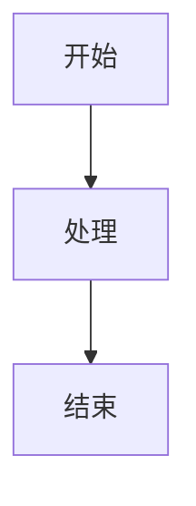

# Markdown

> Markdown 是一种轻量级标记语言，用纯文本格式编写文档，可转换为 HTML、PDF、Word 等多种格式。本文介绍 Markdown 的基础语法、常用扩展和使用技巧，帮助快速编写结构化文档。

**关键词**：Markdown、标记语言、纯文本、文档编写、跨平台

## 抽象类比

Markdown 就像**简化版的写作语法**。它用我们日常写邮件、记笔记时就会用到的符号（`#`、`*`、`>`、`-`）来表达"这是标题""这是强调""这是引用""这是列表"，让写作时不必切换鼠标去点格式工具栏，双手不离键盘就能完成排版。可以理解为"用纯文本写出带格式文档"的通用约定。

---

## 一、介绍

### 1.1 什么是 Markdown

Markdown 是一种轻量级标记语言，使用纯文本格式编写文档。

**应用场景**：
- README 文档
- 技术文档
- 博客文章
- 笔记记录

### 1.2 优势

| 优势 | 说明 |
|------|------|
| 专注内容 | 不需要关注格式和排版 |
| 学习成本低 | 几分钟即可掌握基本语法 |
| 跨平台 | 所有文本编辑器都支持 |
| 可转换 | 可导出为 HTML、PDF、Word 等 |
| 版本控制 | Git 友好，diff 清晰 |

---

## 二、基本语法

### 2.1 标题

```markdown
# 一级标题
## 二级标题
### 三级标题
#### 四级标题
##### 五级标题
###### 六级标题
```

### 2.2 文本格式

```markdown
**粗体文本**
*斜体文本*
~~删除线~~
`行内代码`
```

### 2.3 列表

#### 无序列表
```markdown
- 项目 1
- 项目 2
  - 子项目 2.1
  - 子项目 2.2
- 项目 3
```

#### 有序列表
```markdown
1. 第一项
2. 第二项
3. 第三项
```

#### 任务列表
```markdown
- [x] 已完成任务
- [ ] 未完成任务
- [ ] 待办事项
```

### 2.4 链接与图片

```markdown
[链接名称](URL)
<URL>


```

### 2.5 引用

```markdown
> 这是一段引用文本
> 可以多行书写
> 
> > 嵌套引用
```

### 2.6 代码块

````markdown
```语言名称
代码内容
```

例：
```python
def hello():
    print("Hello, World!")
```
````

### 2.7 表格

```markdown
| 列 1 | 列 2 | 列 3 |
|------|------|------|
| 内容 | 内容 | 内容 |
| 内容 | 内容 | 内容 |
```

### 2.8 分隔线

```markdown
---
或
***
```

### 2.9 转义字符

```markdown
\* 不是斜体
\# 不是标题
\` 不是代码
```

---

## 三、高级功能

### 3.1 数学公式

#### 行内公式
```markdown
$E = mc^2$
```

#### 块级公式
```markdown
$$
\sum_{i=1}^{n} x_i = x_1 + x_2 + ... + x_n
$$
```

### 3.2 目录生成

```markdown
[TOC]
```

### 3.3 脚注

```markdown
这是一个脚注[^1]。

[^1]: 这是脚注的内容。
```

### 4.4  Mermaid图

````markdown

````

### 4.5 常用快捷键

| 功能 | 快捷键 |
|------|--------|
| 加粗 | `Ctrl + B` |
| 斜体 | `Ctrl + I` |
| 链接 | `Ctrl + K` |
| 代码块 | `Ctrl + Shift + K` |
| 预览 | `Ctrl + Shift + V` |
