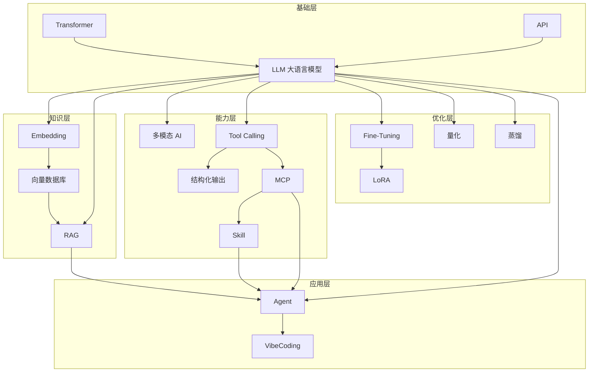
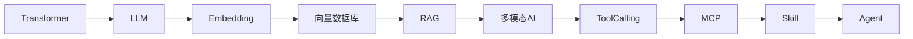
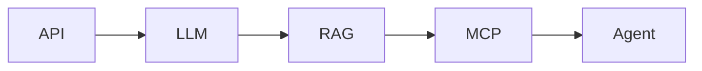
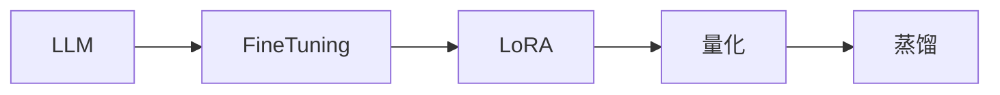
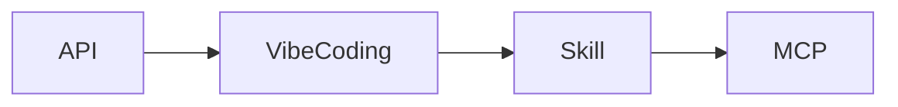
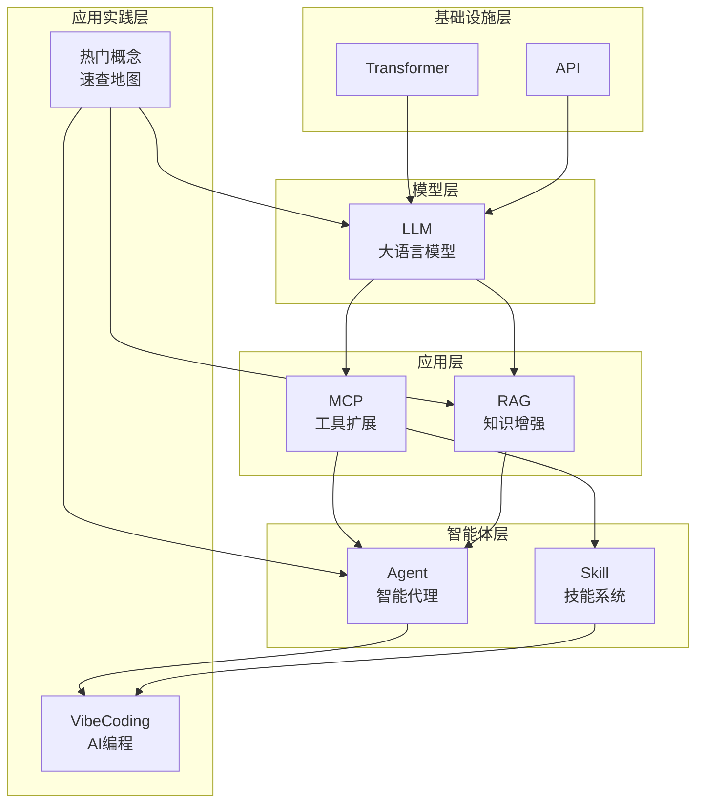
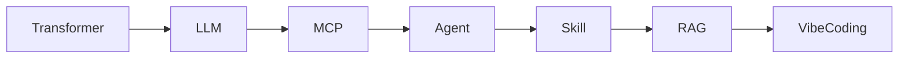
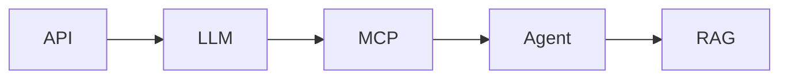

# AI 技术文档索引

> 📚 本文档是 OS/AI 目录下所有 AI 相关技术文档的索引和概览，帮助你快速找到所需内容。

> 小白先读：不要从术语开始背。按照"模型是什么 → 怎么获取知识 → 怎么扩展能力 → 怎么优化 → 怎么应用"这条线读，你会理解得更快。

---

## 📋 目录结构

```
OS/AI/
├── 00_AI_Index.md         # 📖 本索引文档
│
├── 【基础层】AI 核心原理
├── 01_Transformer.md      # 🔥 深度学习的革命性架构
├── 02_LLM.md              # 🧠 大语言模型
├── 03_API.md              # 🌐 应用程序接口
│
├── 【知识层】AI 如何获取知识
├── 04_Embedding.md        # 🔢 嵌入向量
├── 05_向量数据库.md        # 💾 向量存储与检索
├── 06_RAG.md              # 📚 检索增强生成
│
├── 【能力层】AI 如何扩展能力
├── 07_多模态AI.md         # 👁️ 能看会听的 AI
├── 08_ToolCalling.md      # 🔧 工具调用
├── 09_结构化输出.md        # 📋 格式化输出
├── 10_MCP.md              # 🔌 模型上下文协议
├── 11_Skill.md            # 🛠️ 技能系统
│
├── 【优化层】模型优化技术
├── 12_FineTuning.md       # 🎯 模型微调
├── 13_LoRA.md             # ⚡ 低秩自适应
├── 14_量化.md             # 📦 模型压缩
├── 15_蒸馏.md             # 🎓 知识蒸馏
│
└── 【应用层】AI 应用实践
├── 16_Agent.md            # 🤖 智能代理
└── 17_VibeCoding.md       # ✨ 氛围编码
```

---

## 🚀 快速导航

### 🎯 我想了解...

| 需求 | 推荐阅读 | 简介 |
|------|----------|------|
| **AI 是怎么"思考"的？** | [01_Transformer.md](01_Transformer.md) | 深度学习的革命性架构 |
| **大语言模型是什么？** | [02_LLM.md](02_LLM.md) | LLM 的核心原理与应用 |
| **怎么调用 AI 服务？** | [03_API.md](03_API.md) | API 基础知识 |
| **怎么让 AI 理解相似性？** | [04_Embedding.md](04_Embedding.md) | 把万物变成数字 |
| **怎么快速找相似内容？** | [05_向量数据库.md](05_向量数据库.md) | AI 的记忆宫殿 |
| **怎么让 AI 引用资料？** | [06_RAG.md](06_RAG.md) | 检索增强生成 |
| **AI 怎么看图听声音？** | [07_多模态AI.md](07_多模态AI.md) | 多模态 AI |
| **怎么让 AI 使用工具？** | [08_ToolCalling.md](08_ToolCalling.md) | 工具调用机制 |
| **怎么让 AI 按格式输出？** | [09_结构化输出.md](09_结构化输出.md) | 结构化输出 |
| **怎么给 AI 接工具？** | [10_MCP.md](10_MCP.md) | 模型上下文协议 |
| **怎么让 AI 有专业技能？** | [11_Skill.md](11_Skill.md) | 技能系统 |
| **怎么让 AI 适应特定场景？** | [12_FineTuning.md](12_FineTuning.md) | 模型微调 |
| **怎么低成本微调？** | [13_LoRA.md](13_LoRA.md) | 低秩自适应 |
| **怎么让模型更小更快？** | [14_量化.md](14_量化.md) | 模型量化压缩 |
| **怎么让小模型变强？** | [15_蒸馏.md](15_蒸馏.md) | 知识蒸馏 |
| **怎么让 AI 自主完成任务？** | [16_Agent.md](16_Agent.md) | 智能代理 |
| **怎么用 AI 写代码？** | [17_VibeCoding.md](17_VibeCoding.md) | 氛围编码 |

---

## 🔥 核心概念关系图



---

## 📚 文档详情

### 【基础层】AI 核心原理

#### 1️⃣ 01_Transformer.md - 深度学习的革命性架构

**一句话描述**：Transformer 是现代 AI 的"心脏"，理解它就理解了为什么 AI 这么强大。

**核心内容**：
- 自注意力机制：Query、Key、Value 的工作原理
- 多头注意力：并行学习不同类型的依赖关系
- 位置编码：为序列注入位置信息
- 编码器-解码器：理解 vs 生成的架构
- 变体模型：BERT、GPT、T5 的对比

**一句话总结**：Transformer 用"注意力"替代了"循环"，让 AI 能够并行处理信息。

---

#### 2️⃣ 02_LLM.md - 大语言模型

**一句话描述**：LLM 是 Transformer 的"大成者"，让 AI 能够理解和生成人类语言。

**核心内容**：
- 工作原理：Transformer 架构、预训练-微调
- 主流模型：GPT、LLaMA、Qwen、ChatGLM
- 应用场景：对话、代码生成、文档处理
- 使用方式：API 调用、本地部署、提示词工程

**一句话总结**：LLM 是"读过"海量文本的 AI，能够回答各种问题并生成内容。

---

#### 3️⃣ 03_API.md - 应用程序接口

**一句话描述**：API 是软件之间的"对话协议"，是使用 AI 服务的基础。

**核心内容**：
- REST API：HTTP 方法、状态码、设计原则
- 认证方式：API Key、JWT、OAuth
- 调用方式：curl、Python、JavaScript
- 最佳实践：错误处理、版本控制、文档编写

**一句话总结**：API 是 AI 服务的"入口"，掌握 API 才能使用 AI。

---

### 【知识层】AI 如何获取知识

#### 4️⃣ 04_Embedding.md - 嵌入向量

**一句话描述**：Embedding 把文字、图片等内容变成数字，让 AI 能理解和比较"相似度"。

**核心内容**：
- 什么是 Embedding：将内容映射为向量
- 工作原理：语义相似的向量距离更近
- 典型应用：语义搜索、推荐系统、文本分类
- 与 RAG 的关系：RAG 的核心技术基础

**一句话总结**：Embedding 是给内容贴的"智能标签"，让机器能理解语义相似性。

---

#### 5️⃣ 05_向量数据库.md - 向量存储与检索

**一句话描述**：向量数据库专门存储 Embedding，能快速找到"意思相近"的内容。

**核心内容**：
- 与普通数据库的区别：语义相似 vs 精确匹配
- 工作原理：近似最近邻搜索
- 常见数据库：Milvus、Pinecone、Chroma
- 典型应用：RAG 检索层、语义搜索、推荐系统

**一句话总结**：向量数据库像图书管理员，你描述想要什么，它帮你找最相关的。

---

#### 6️⃣ 06_RAG.md - 检索增强生成

**一句话描述**：RAG 让 AI 回答前先查资料，再组织答案，减少"胡编乱造"。

**核心内容**：
- 核心价值：解决幻觉、知识时效性、可追溯性
- 工作流程：文档加载 → 向量化 → 检索 → 生成
- 技术栈：LangChain、FAISS、向量数据库
- 优化策略：文档分割、嵌入模型、检索策略

**一句话总结**：RAG 把闭卷考试变开卷考试，让 AI 的回答有据可查。

---

### 【能力层】AI 如何扩展能力

#### 7️⃣ 07_多模态AI.md - 能看会听的 AI

**一句话描述**：多模态 AI 不只懂文字，还能理解图片、声音、视频等多种信息。

**核心内容**：
- 什么是模态：信息的类型（文本、图像、音频、视频）
- 核心能力：跨模态理解、多模态融合、跨模态生成
- 典型应用：视觉问答、图像描述、视频理解
- 技术挑战：模态对齐、模态融合、计算资源

**一句话总结**：多模态 AI 像正常人一样能看、能听、能说、能理解。

---

#### 8️⃣ 08_ToolCalling.md - 工具调用

**一句话描述**：Tool Calling 让 AI 能判断何时使用工具、选择工具并按规范调用。

**核心内容**：
- 工作流程：分析问题 → 选择工具 → 生成参数 → 执行调用
- 关键要素：工具定义、工具选择、参数生成、结果处理
- 典型应用：智能助手、数据分析、客服系统
- 安全控制：权限管理、参数验证、结果审查

**一句话总结**：Tool Calling 让 AI 从"只聊天"变成"能办事"。

---

#### 9️⃣ 09_结构化输出.md - 格式化输出

**一句话描述**：结构化输出让 AI 按固定格式输出数据，程序能可靠解析。

**核心内容**：
- 实现方式：Prompt 工程、Schema 约束、函数调用
- 典型应用：信息提取、数据分类、报告生成
- 最佳实践：明确定义格式、验证输出、错误处理
- 与 Tool Calling 的关系：保证工具结果可解析

**一句话总结**：结构化输出像填表格而不是写作文，让 AI 输出可预测、可解析。

---

#### 🔟 10_MCP.md - 模型上下文协议

**一句话描述**：MCP 是 AI 连接外部工具和数据源的统一协议。

**核心内容**：
- MCP 概念：Server、Tool、Context 的关系
- 工具分类：文件操作、命令执行、浏览器控制、搜索
- 使用场景：代码开发、文档处理、系统管理
- 与 Tool Calling 的关系：MCP 让工具更容易被调用

**一句话总结**：MCP 是 AI 的"USB-C 插口"，不同工具只要遵守标准就能连接。

---

#### 1️⃣1️⃣ 11_Skill.md - 技能系统

**一句话描述**：Skill 是 AI 的"专业能力包"，让 AI 能完成特定领域的复杂任务。

**核心内容**：
- 技能定义：Skill vs MCP 的层次关系
- 常用技能：代码审查、调试、网页开发、安全扫描
- 调用方式：Skill 框架的使用方法
- 自定义技能：如何开发自己的 Skill

**一句话总结**：Skill 是 AI 的"超能力"，让通用 AI 变成领域专家。

---

### 【优化层】模型优化技术

#### 1️⃣2️⃣ 12_FineTuning.md - 模型微调

**一句话描述**：Fine-tuning 用特定数据继续训练模型，让它更适合特定场景。

**核心内容**：
- 为什么需要：领域适应、风格统一、任务优化
- vs RAG：修改参数 vs 检索知识
- 工作流程：准备数据 → 清洗标注 → 选择模型 → 执行训练
- 主要方法：全量微调、LoRA、指令微调

**一句话总结**：Fine-tuning 像通才员工经过公司培训变成行业专家。

---

#### 1️⃣3️⃣ 13_LoRA.md - 低秩自适应

**一句话描述**：LoRA 是高效的微调方法，只训练少量附加参数，成本降低 10000 倍。

**核心内容**：
- 核心思想：冻结原模型 + 添加小参数 + 只训练小参数
- 关键参数：Rank（秩）、Alpha（缩放因子）、Target Modules
- 典型应用：多领域适配、个性化定制、快速实验
- 变体：QLoRA、AdaLoRA、DoRA

**一句话总结**：LoRA 像给房子加装智能家居模块，不动原有结构只增加新功能。

---

#### 1️⃣4️⃣ 14_量化.md - 模型压缩

**一句话描述**：量化用低精度数字表示模型参数，让模型更小、更快、更省资源。

**核心内容**：
- 工作原理：FP32 → INT8/INT4，降低精度
- 主要方法：训练后量化（PTQ）、量化感知训练（QAT）
- 典型效果：模型缩小 4 倍、速度提升 3 倍、精度损失 1-2%
- 应用场景：边缘 AI 部署、实时推理、大规模服务

**一句话总结**：量化像给模型"瘦身"，用够用的精度换更快的速度。

---

#### 1️⃣5️⃣ 15_蒸馏.md - 知识蒸馏

**一句话描述**：蒸馏让小模型学习大模型的能力，在较小体积下获得接近大模型的性能。

**核心内容**：
- 工作原理：软标签 vs 硬标签，学生学教师
- 关键技术：温度参数、损失函数、中间层蒸馏
- 典型效果：模型缩小 10-100 倍、保留 80-95% 能力
- 发展趋势：自蒸馏、在线蒸馏、数据免费蒸馏

**一句话总结**：蒸馏像名师带徒弟，小模型学习大模型的"解题思路"。

---

### 【应用层】AI 应用实践

#### 1️⃣6️⃣ 16_Agent.md - 智能代理

**一句话描述**：Agent 是 AI 的"行动派"，能围绕目标自主规划、调用工具、执行步骤。

**核心内容**：
- 核心特征：自主性、感知、决策、行动
- 架构设计：感知模块、规划模块、执行模块
- 执行流程：目标分析 → 计划制定 → 步骤执行 → 结果评估
- 多 Agent 协作：多个 Agent 分工合作

**一句话总结**：Agent 让 AI 从"能说"进化到"能做"，成为真正的智能助手。

---

#### 1️⃣7️⃣ 17_VibeCoding.md - 氛围编码

**一句话描述**：VibeCoding 是 AI 时代的"新编程范式"，让代码编写更注重风格和创意。

**核心内容**：
- 核心理念：风格感知、直觉编码、人机协作
- 工作流程：描述意图 → AI 生成 → 实时反馈 → 迭代优化
- 工具生态：GitHub Copilot、Cursor、CodeLlama
- 应用场景：快速原型、代码重构、跨语言开发

**一句话总结**：VibeCoding 让编程从"照着菜谱做菜"变成"跟着感觉做菜"。

---

## 🎓 学习路径建议

### 路线一：从原理到实践（推荐）



**适合人群**：想要系统学习 AI 原理和应用的开发者

**学习时间**：约 3-4 周

---

### 路线二：快速上手 AI 应用



**适合人群**：想要快速开发 AI 应用的开发者

**学习时间**：约 1-2 周

---

### 路线三：模型优化与部署



**适合人群**：想要优化和部署 AI 模型的开发者

**学习时间**：约 1-2 周

---

### 路线四：AI 辅助编程



**适合人群**：想要用 AI 提升编程效率的开发者

**学习时间**：约 3-5 天

---

## 🔗 概念关系速查

| 概念 | 层次 | 依赖 | 被依赖 | 类比 |
|------|------|------|--------|------|
| **Transformer** | 基础层 | 无 | LLM | 发动机 |
| **LLM** | 基础层 | Transformer | 所有上层 | 聪明的脑袋 |
| **API** | 基础层 | 无 | LLM, MCP | 门把手 |
| **Embedding** | 知识层 | LLM | 向量数据库 | 智能标签 |
| **向量数据库** | 知识层 | Embedding | RAG | 记忆宫殿 |
| **RAG** | 知识层 | LLM, 向量数据库 | Agent | 参考资料库 |
| **多模态AI** | 能力层 | LLM | - | 五官感知 |
| **Tool Calling** | 能力层 | LLM | MCP, 结构化输出 | 调度员 |
| **结构化输出** | 能力层 | Tool Calling | - | 填表格 |
| **MCP** | 能力层 | Tool Calling | Skill, Agent | USB-C 插口 |
| **Skill** | 能力层 | MCP | Agent | 专业技能 |
| **Fine-Tuning** | 优化层 | LLM | LoRA | 专业培训 |
| **LoRA** | 优化层 | Fine-Tuning | - | 智能家居模块 |
| **量化** | 优化层 | LLM | - | 瘦身 |
| **蒸馏** | 优化层 | LLM | - | 名师带徒 |
| **Agent** | 应用层 | LLM, MCP, RAG, Skill | VibeCoding | 智能助手 |
| **VibeCoding** | 应用层 | LLM, Agent | 无 | 编程新范式 |

---

## 💡 常见问题

### Q1: Transformer 和 LLM 有什么区别？

| 概念 | 层级 | 说明 |
|------|------|------|
| **Transformer** | 底层架构 | 一种深度学习模型架构 |
| **LLM** | 上层应用 | 基于 Transformer 的大规模语言模型 |

**类比**：Transformer 像"发动机原理"，LLM 像"基于此原理制造的汽车"。

---

### Q2: RAG 和 Fine-tuning 有什么区别？

| 技术 | 方式 | 适用场景 | 类比 |
|------|------|----------|------|
| **RAG** | 检索外部知识 | 需要最新信息、频繁更新 | 开卷考试 |
| **Fine-tuning** | 微调模型参数 | 改变模型行为、特定风格 | 把知识背下来 |

---

### Q3: MCP、Tool Calling 和 Skill 有什么区别？

| 概念 | 层级 | 说明 | 类比 |
|------|------|------|------|
| **Tool Calling** | 机制 | AI 调用工具的能力 | 调度员知道该叫谁 |
| **MCP** | 协议 | 工具接入的统一标准 | USB-C 插口 |
| **Skill** | 技能 | 复杂任务的封装 | 组装家具的专业技能 |

---

### Q4: 量化和蒸馏有什么区别？

| 技术 | 原理 | 效果 | 类比 |
|------|------|------|------|
| **量化** | 降低参数精度 | 模型缩小 4 倍 | 用整数代替小数 |
| **蒸馏** | 小模型学大模型 | 模型缩小 10-100 倍 | 名师带徒弟 |

---

### Q5: Agent 是怎么组成的？

```
Agent = LLM（大脑）+ MCP（工具）+ RAG（知识）+ Skill（技能）
```

Agent 是"行动派"，不仅能思考，还能调用工具、查阅资料、执行任务。

---

## 📖 阅读顺序建议

### 入门者（第一次接触 AI）

1. ✅ [01_Transformer.md](01_Transformer.md) - 理解 AI 核心原理
2. ✅ [02_LLM.md](02_LLM.md) - 了解大语言模型
3. ✅ [03_API.md](03_API.md) - 学会调用 AI 服务
4. ✅ [07_多模态 AI.md](07_多模态 AI.md) - 认识多模态 AI
5. ✅ [08_ToolCalling.md](08_ToolCalling.md) - 了解工具调用
6. ✅ [16_Agent.md](16_Agent.md) - 认识智能代理

### 进阶者（想要构建 AI 应用）

1. ✅ [04_Embedding.md](04_Embedding.md) - 理解向量化
2. ✅ [05_向量数据库.md](05_向量数据库.md) - 学习向量检索
3. ✅ [06_RAG.md](06_RAG.md) - 构建知识库
4. ✅ [10_MCP.md](10_MCP.md) - 扩展工具能力
5. ✅ [11_Skill.md](11_Skill.md) - 开发专业技能

### 深入者（想要优化和部署）

1. ✅ [12_FineTuning.md](12_FineTuning.md) - 模型微调
2. ✅ [13_LoRA.md](13_LoRA.md) - 高效微调
3. ✅ [14_量化.md](14_量化.md) - 模型压缩
4. ✅ [15_蒸馏.md](15_蒸馏.md) - 知识蒸馏

---

## 🛠️ 实践项目建议

### 初级项目
- 🔧 用 API 调用 LLM 生成文本
- 🔧 用 Embedding 做语义搜索
- 🔧 用 Tool Calling 让 AI 查询天气

### 中级项目
- 🔧 构建 RAG 知识库问答系统
- 🔧 开发一个自定义 Skill
- 🔧 构建一个聊天机器人（Agent）

### 高级项目
- 🔧 多 Agent 协作系统
- 🔧 LoRA 微调大模型
- 🔧 边缘设备部署量化模型

---

## 📚 参考资源

### 官方文档
- [Hugging Face Transformers](https://huggingface.co/docs/transformers)
- [OpenAI API](https://platform.openai.com/docs)
- [Anthropic Claude](https://docs.anthropic.com)
- [LangChain](https://docs.langchain.com)

### 学习平台
- [Fast.ai](https://fast.ai)
- [Coursera Deep Learning](https://www.coursera.org/specializations/deep-learning)
- [Stanford CS224N](https://web.stanford.edu/class/cs224n/)

### 开源项目
- [Transformers 库](https://github.com/huggingface/transformers)
- [LangChain](https://github.com/langchain-ai/langchain)
- [Llama](https://github.com/facebookresearch/llama)
- [Milvus 向量数据库](https://github.com/milvus-io/milvus)

---

## 🔄 文档更新日志

| 日期 | 版本 | 更新内容 |
|------|------|----------|
| 2024-01 | v1.0 | 初始版本（8 个文档） |
| 2024-06 | v2.0 | 重构排序，新增 10 个文档 |

---

## 🙏 致谢

本文档参考了以下资源：
- [Attention Is All You Need](https://arxiv.org/abs/1706.03762)
- [Hugging Face Course](https://huggingface.co/course)
- 各官方文档和开源项目

---

> 📝 **最后一句话**：AI 技术日新月异，本文档会持续更新。建议收藏此索引，需要时快速查阅！
# AI 技术文档索引

> 📚 本文档是 OS/AI 目录下所有 AI 相关技术文档的索引和概览，帮助你快速找到所需内容。

> 小白先读：如果你是第一次系统看 AI，不要从术语开始背。先按“模型是什么 → 怎么调用 → 怎么查资料 → 怎么用工具 → 怎么完成任务 → 怎么落到项目”这条线读。

---

## 📋 目录结构

```
OS/AI/
├── 00_AI_Index.md     # 📖 本索引文档
├── 01_Transformer.md  # 🔥 深度学习的革命性架构
├── 02_LLM.md          # 🧠 大语言模型
├── 03_API.md          # 🌐 应用程序接口
├── 04_MCP.md          # 🔌 模型上下文协议
├── 05_RAG.md          # 📚 检索增强生成
├── 06_Skill.md        # 🛠️ 技能系统
├── 07_Agent.md        # 🤖 智能代理
├── 08_VibeCoding.md   # ✨ 氛围编码
└── 09_热门AI概念速查.md # 🧭 热门概念地图
```

---

## 🚀 快速导航

### 🎯 我想了解...

| 需求 | 推荐阅读 | 简介 |
|------|----------|------|
| **AI 是怎么"思考"的？** | [01_Transformer.md](01_Transformer.md) | 深度学习的革命性架构 |
| **LLM 是什么？** | [02_LLM.md](02_LLM.md) | 大语言模型的核心原理 |
| **Agent 如何工作？** | [07_Agent.md](07_Agent.md) | 智能代理的架构与实践 |
| **怎么给 AI 扩展能力？** | [04_MCP.md](04_MCP.md) | 模型上下文协议 |
| **如何让 AI 有特定技能？** | [06_Skill.md](06_Skill.md) | 技能系统 |
| **怎么让 AI 引用外部知识？** | [05_RAG.md](05_RAG.md) | 检索增强生成 |
| **AI 之间怎么通信？** | [03_API.md](03_API.md) | 应用程序接口 |
| **怎么用 AI 写代码？** | [08_VibeCoding.md](08_VibeCoding.md) | 氛围编码 |
| **最近热门 AI 概念怎么串起来？** | [09_热门AI概念速查.md](09_热门概念.md) | 多模态、Agent、RAG、MCP、量化等 |

---

## 🔥 核心概念关系图



---

## 📚 文档详情

### 1️⃣ 01_Transformer.md - 深度学习的革命性架构

**一句话描述**：Transformer 是现代 AI 的"心脏"，理解它就理解了为什么 AI 这么强大。

**核心内容**：

| 章节 | 内容 |
|------|------|
| 自注意力机制 | Query、Key、Value 的工作机制 |
| 多头注意力 | 并行学习不同类型的依赖关系 |
| 位置编码 | 为序列注入位置信息 |
| 编码器-解码器 | 理解 vs 生成的架构 |
| 变体模型 | BERT、GPT、T5 的架构对比 |
| 训练技术 | 预训练、微调、RLHF |

**适合人群**：想深入理解 AI 原理的开发者

**一句话总结**：Transformer 用"注意力"替代了"循环"，让 AI 能够并行处理信息。

---

### 2️⃣ 02_LLM.md - 大语言模型

**一句话描述**：LLM 是 Transformer 的"大成者"，让 AI 能够理解和生成人类语言。

**核心内容**：

| 章节 | 内容 |
|------|------|
| 工作原理 | Transformer 架构、自注意力、预训练-微调 |
| 主流模型 | GPT、LLaMA、Qwen、ChatGLM |
| 应用场景 | 对话、代码生成、文档处理 |
| 使用方式 | API 调用、本地部署、提示词工程 |
| 挑战与解决 | 幻觉、计算成本、上下文限制 |

**适合人群**：想要使用或开发 LLM 应用的开发者

**一句话总结**：LLM 是"读过"海量文本的 AI，能够回答各种问题并生成内容。

---

### 3️⃣ 07_Agent.md - 智能代理

**一句话描述**：Agent 是 AI 的"行动派"，不仅能思考，还能执行操作。

**核心内容**：

| 章节 | 内容 |
|------|------|
| 核心特征 | 自主性、感知、决策、行动 |
| 架构设计 | 感知模块、规划模块、执行模块 |
| 执行流程 | 目标分析 → 计划制定 → 步骤执行 → 结果评估 |
| 应用场景 | 自动化办公、软件开发、数据分析 |
| 多 Agent 协作 | 多个 Agent 协同完成复杂任务 |

**适合人群**：想要构建自动化 AI 系统的开发者

**一句话总结**：Agent 让 AI 从"能说"进化到"能做"，成为真正的智能助手。

---

### 4️⃣ 06_Skill.md - 技能系统

**一句话描述**：Skill 是 AI 的"专业能力包"，让 AI 能够完成特定领域的任务。

**核心内容**：

| 章节 | 内容 |
|------|------|
| 技能定义 | Skill vs MCP 的层次关系 |
| 常用技能 | 代码审查、调试、网页开发、安全扫描 |
| 调用方式 | Skill 框架的使用方法 |
| 自定义技能 | 如何开发自己的 Skill |
| 最佳实践 | 选择合适的工具类型 |

**适合人群**：想要扩展 AI 能力的开发者

**一句话总结**：Skill 是 AI 的"超能力"，让通用 AI 变成领域专家。

---

### 5️⃣ 04_MCP.md - 模型上下文协议

**一句话描述**：MCP 是 AI 连接外部世界的"桥梁"，让 AI 能够调用各种工具。

**核心内容**：

| 章节 | 内容 |
|------|------|
| MCP 概念 | Server、Tool、Context 的关系 |
| 工具分类 | 文件操作、命令执行、浏览器控制、搜索 |
| 使用场景 | 代码开发、文档处理、系统管理 |
| 最佳实践 | 错误处理、日志记录、参数验证 |
| 与 Skill 对比 | 底层工具 vs 高层技能 |

**适合人群**：想要让 AI 操作系统资源的开发者

**一句话总结**：MCP 是 AI 的"手臂"，让 AI 不仅能思考，还能动手操作。

---

### 6️⃣ 05_RAG.md - 检索增强生成

**一句话描述**：RAG 给 AI 装上了"图书馆"，让 AI 能够引用真实资料回答问题。

**核心内容**：

| 章节 | 内容 |
|------|------|
| 核心价值 | 解决幻觉、知识时效性、可追溯性 |
| 工作流程 | 文档加载 → 向量化 → 检索 → 生成 |
| 技术栈 | LangChain、FAISS、向量数据库 |
| 优化策略 | 文档分割、嵌入模型、检索策略 |
| 应用场景 | 企业知识库、客服系统、学术研究 |

**适合人群**：想要让 AI 引用企业知识或最新信息的开发者

**一句话总结**：RAG 让 AI 的回答有据可查，不再"胡编乱造"。

---

### 7️⃣ 03_API.md - 应用程序接口

**一句话描述**：API 是软件之间的"对话协议"，是现代 AI 服务的基础。

**核心内容**：

| 章节 | 内容 |
|------|------|
| REST API | HTTP 方法、状态码、设计原则 |
| 认证方式 | API Key、JWT、OAuth |
| 调用方式 | curl、Python、JavaScript |
| 最佳实践 | 错误处理、版本控制、文档编写 |
| 测试工具 | Postman、curl、Swagger |

**适合人群**：需要调用 AI API 或开发 API 服务的开发者

**一句话总结**：API 是 AI 服务的"入口"，掌握 API 才能玩转 AI。

---

### 8️⃣ 08_VibeCoding.md - 氛围编码

**一句话描述**：VibeCoding 是 AI 时代的"新编程范式"，让代码编写更注重风格和创意。

**核心内容**：

| 章节 | 内容 |
|------|------|
| 核心理念 | 风格感知、直觉编码、人机协作 |
| 工作流程 | 描述意图 → AI 生成 → 实时反馈 → 迭代优化 |
| 工具生态 | GitHub Copilot、Cursor、CodeLlama |
| 应用场景 | 快速原型、代码重构、跨语言开发 |
| 未来趋势 | 更智能的风格理解、实时协作 |

**适合人群**：想要用 AI 提升编程效率的开发者

**一句话总结**：VibeCoding 让编程从"照着菜谱做菜"变成"跟着感觉做菜"。

---

### 9️⃣ 09_热门AI概念速查.md - 热门 AI 概念地图

**一句话描述**：把多模态、VLM、Embedding、向量数据库、RAG、MCP、Agent、LoRA、量化、边缘 AI 等热门概念串成一张小白能读懂的地图。

**核心内容**：

| 章节 | 内容 |
|------|------|
| 模型层 | LLM、VLM、多模态、MoE、推理模型 |
| 知识层 | Embedding、向量数据库、RAG |
| 工具层 | Tool Calling、MCP、结构化输出 |
| 行动层 | Agent、多 Agent、工作流 |
| 部署层 | LoRA、量化、蒸馏、边缘 AI |

**适合人群**：想快速跟上 AI 热门概念，但不想陷入术语堆的人。

**一句话总结**：热门概念不是散点，它们共同构成“AI 大脑 + 知识库 + 工具 + 行动 + 部署”的应用系统。

---

## 🎓 学习路径建议

### 路线一：从原理到实践（推荐）



**适合人群**：想要系统学习 AI 原理和应用的开发者

**学习时间**：约 2-3 周

---

### 路线二：快速上手 AI 开发



**适合人群**：想要快速开发 AI 应用的开发者

**学习时间**：约 1-2 周

---

### 路线三：AI 辅助编程


**适合人群**：想要用 AI 提升编程效率的开发者

**学习时间**：约 3-5 天

---

## 🔗 概念关系速查

| 概念 | 依赖 | 被依赖 | 类似 |
|------|------|--------|------|
| **Transformer** | 无 | LLM | 发动机 |
| **LLM** | Transformer | Agent, RAG, API | 聪明的脑袋 |
| **Agent** | LLM, MCP | VibeCoding | 能干的助理 |
| **Skill** | MCP | Agent | 专业技能 |
| **MCP** | API | Agent, Skill | 工具箱 |
| **RAG** | LLM, API | Agent | 参考资料库 |
| **API** | 无 | LLM, MCP, Agent | 门把手 |
| **VibeCoding** | LLM, API, MCP | 无 | 编程新方式 |

---

## 💡 常见问题

### Q1: Transformer 和 LLM 有什么区别？

| 概念 | 层级 | 说明 |
|------|------|------|
| **Transformer** | 底层架构 | 一种深度学习模型架构 |
| **LLM** | 上层应用 | 基于 Transformer 的大规模语言模型 |

**类比**：Transformer 像"发动机原理"，LLM 像"基于此原理制造的汽车"。

---

### Q2: MCP 和 Skill 有什么区别？

| 概念 | 层级 | 说明 |
|------|------|------|
| **MCP** | 底层工具 | 单一功能，如读取文件、执行命令 |
| **Skill** | 高层技能 | 复杂流程，如代码审查、网页开发 |

**类比**：MCP 像"螺丝刀"，Skill 像"组装家具的技能"。

---

### Q3: RAG 和 Fine-tuning 有什么区别？

| 技术 | 方式 | 适用场景 |
|------|------|----------|
| **RAG** | 检索外部知识 | 需要最新信息、频繁更新 |
| **Fine-tuning** | 微调模型参数 | 改变模型行为、特定风格 |

**类比**：RAG 像"开卷考试"，Fine-tuning 像"把知识背下来"。

---

### Q4: Agent 和 Skill 有什么关系？

```
Agent = LLM + Skill + MCP + RAG
```

Agent 是"大脑"，Skill 是"技能包"，MCP 是"工具"，RAG 是"知识库"。

---

## 📖 阅读顺序建议

### 入门者（第一次接触 AI 开发）

1. ✅ [09_热门AI概念速查.md](09_热门概念.md) - 先建立概念地图
2. ✅ [01_Transformer.md](01_Transformer.md) - 理解 AI 的核心原理
3. ✅ [02_LLM.md](02_LLM.md) - 了解大语言模型
4. ✅ [03_API.md](03_API.md) - 学会调用 AI 服务
5. ✅ [04_MCP.md](04_MCP.md) - 让 AI 操作工具
6. ✅ [08_VibeCoding.md](08_VibeCoding.md) - 开始用 AI 写代码

### 进阶者（想要构建复杂 AI 系统）

6. ✅ [07_Agent.md](07_Agent.md) - 构建智能代理
7. ✅ [05_RAG.md](05_RAG.md) - 让 AI 引用知识
8. ✅ [06_Skill.md](06_Skill.md) - 扩展 AI 技能

### 深入者（想要深入理解 AI）

- 阅读论文原文
- 阅读源码
- 参与开源项目

---

## 🛠️ 实践项目建议

### 初级项目
- 🔧 用 API 调用 LLM 生成文本
- 🔧 用 MCP 实现文件自动化处理
- 🔧 用 VibeCoding 写一个简单应用

### 中级项目
- 🔧 构建一个聊天机器人（Agent）
- 🔧 实现一个 RAG 知识库问答系统
- 🔧 开发一个自定义 Skill

### 高级项目
- 🔧 多 Agent 协作系统
- 🔧 结合 RAG 和 Agent 的智能助手
- 🔧 完整的 AI 应用平台

---

## 📚 参考资源

### 官方文档
- [Hugging Face Transformers](https://huggingface.co/docs/transformers)
- [OpenAI API](https://platform.openai.com/docs)
- [Anthropic Claude](https://docs.anthropic.com)
- [LangChain](https://docs.langchain.com)

### 学习平台
- [Fast.ai](https://fast.ai)
- [Coursera Deep Learning](https://www.coursera.org/specializations/deep-learning)
- [Stanford CS224N](https://web.stanford.edu/class/cs224n/)

### 开源项目
- [Transformers 库](https://github.com/huggingface/transformers)
- [LangChain](https://github.com/langchain-ai/langchain)
- [Llama](https://github.com/facebookresearch/llama)
- [ChatGLM](https://github.com/THUDM/ChatGLM-6B)

---

## 🔄 文档更新日志

| 日期 | 版本 | 更新内容 |
|------|------|----------|
| 2024-XX | v1.0 | 初始版本 |

---

## 🙏 致谢

本文档参考了以下资源：
- [Attention Is All You Need](https://arxiv.org/abs/1706.03762)
- [Hugging Face Course](https://huggingface.co/course)
- 各官方文档和开源项目

---

> 📝 **最后一句话**：AI 技术日新月异，本文档会持续更新。建议收藏此索引，需要时快速查阅！
