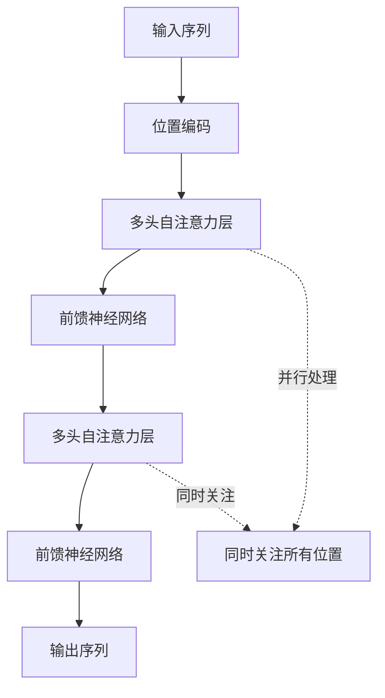
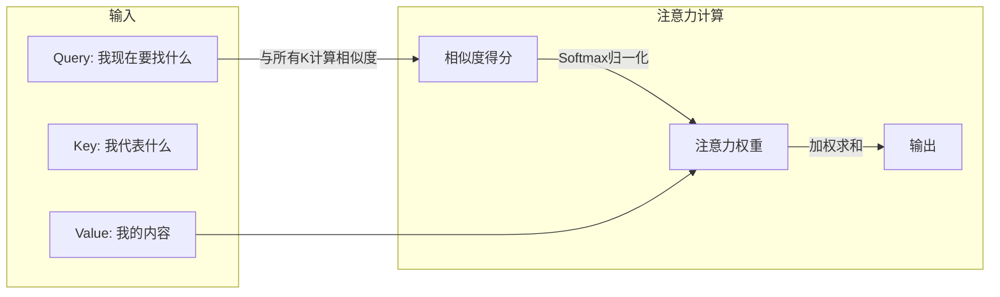
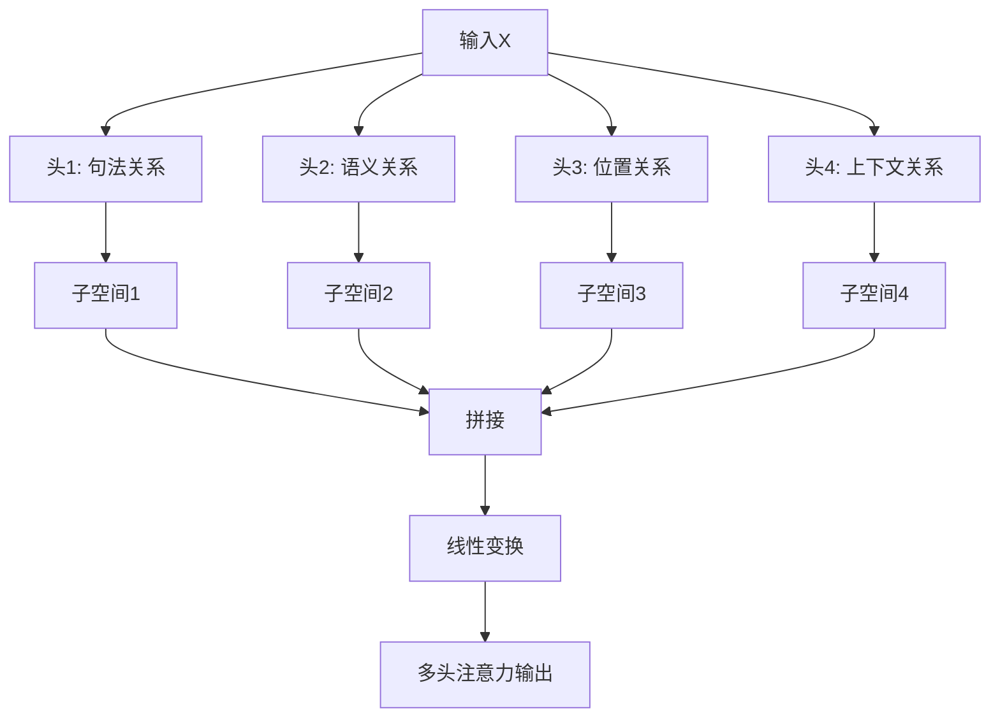
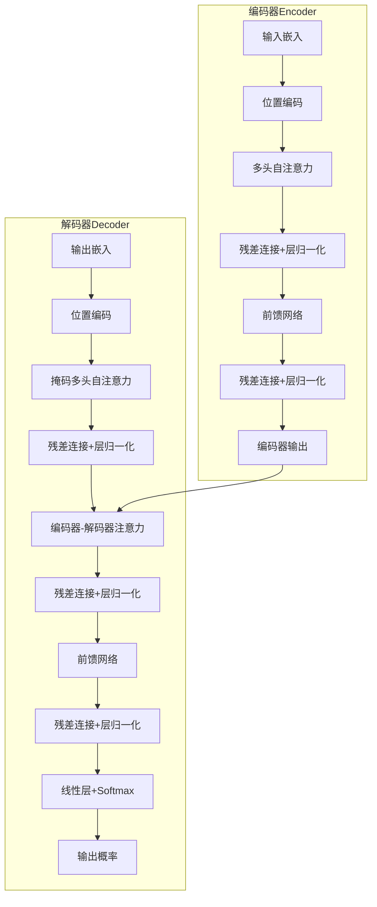
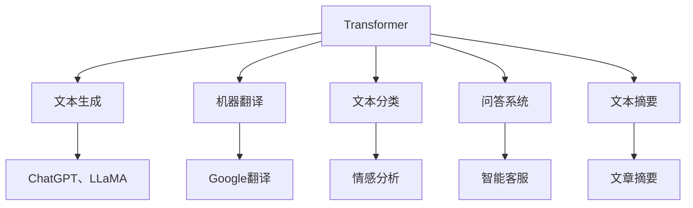
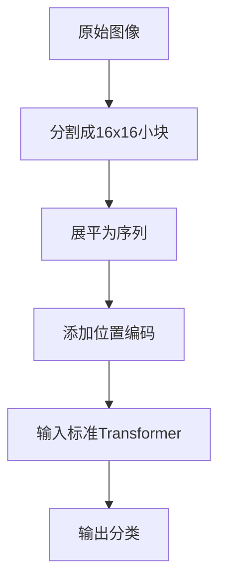
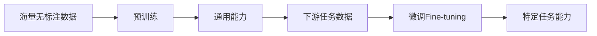
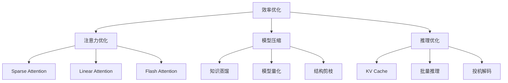
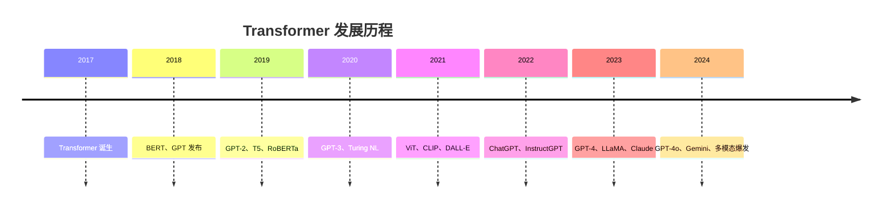

# Transformer：深度学习的革命性架构

> 小白先读：Transformer 可以先理解成一种“会抓重点的阅读方法”。它不再一个字一个字慢慢读，而是能同时看整段内容，并判断哪些词、哪些图像区域、哪些信息彼此相关。
>
> 学这篇时先抓 3 个问题：注意力是什么？为什么它能支撑 LLM？为什么它也能用于图像、语音和多模态？

## 先用一句生活话理解

你读一句话“我把苹果放进包里，因为它太重了”，人会自动判断“它”指的是苹果还是包。Transformer 的注意力机制做的就是类似事情：在一堆信息里判断谁和谁关系更大。

所以 Transformer 的核心不是“神经网络很复杂”，而是：**让模型学会在大量信息中分配注意力。**

## 一、什么是 Transformer

**Transformer** 是一种深度学习模型架构，彻底改变了自然语言处理（NLP）领域，并在计算机视觉、语音处理等领域取得突破性进展。

**生动比喻**：如果把传统深度学习模型比作"逐字阅读一本书的读者"，那么 Transformer 就像"能够同时关注书中所有内容的读者"。它不仅能理解每个词，还能理解词与词之间的关系，就像一个优秀的文学评论家，能够捕捉到文本中微妙的联系和模式。

---

## 二、Transformer 的诞生背景

### 2.1 传统序列模型的局限

| 模型 | 问题 | 原因 |
|------|------|------|
| **RNN（循环神经网络）** | 长序列依赖问题 | 信息需要一步步传递，距离越远衰减越严重 |
| **LSTM（长短期记忆网络）** | 计算效率低 | 必须按顺序处理，无法并行 |
| **GRU** | 仍然难以处理超长序列 | 门控机制不能完全解决长距离依赖 |

### 2.2 突破性创新



**核心突破**：Transformer 彻底抛弃了"顺序处理"的方式，实现了真正的并行计算，让长序列处理变得高效。

---

## 三、核心概念详解

### 3.1 自注意力机制（Self-Attention）

**类比**：想象你在阅读一篇文章，当你读到"他"这个词时，大脑会自动回溯去找"他"指的是谁。自注意力机制就是让模型学会这种"回溯"能力。

**工作原理**：
- **Query（查询）**：当前位置的"我"
- **Key（键）**：每个位置的"标签"
- **Value（值）**：每个位置的实际内容



**数学公式**：
```
Attention(Q, K, V) = softmax(QK^T / √d_k) × V
```

### 3.2 多头注意力（Multi-Head Attention）

**类比**：就像一个团队从不同角度分析问题，每个人关注不同的方面，然后将结果汇总。

**核心思想**：
- 将注意力机制并行运行多次
- 每个"头"学习不同的注意力模式
- 捕捉不同类型的依赖关系



### 3.3 位置编码（Positional Encoding）

**问题**：自注意力机制本身不包含位置信息，"我打你"和"你打我"会被认为是相同的。

**解决方案**：为每个位置添加一个独特的"位置信号"。

**类比**：就像在课堂上点名，"第一排左边的同学"和"第三排右边的同学"位置不同。

**常用方法**：
| 方法 | 公式 | 特点 |
|------|------|------|
| **正弦/余弦编码** | sin/cos(pos/k) | 固定模式，可外推 |
| **可学习位置编码** | 可训练的参数 | 更灵活，需要更多数据 |
| **旋转位置编码（RoPE）** | 旋转矩阵 | LLaMA 使用 |
| **相对位置编码** | 相对距离 | 更适合长序列 |

---

## 四、Transformer 架构详解

### 4.1 整体架构



### 4.2 编码器 vs 解码器

| 组件 | 编码器 | 解码器 |
|------|--------|--------|
| **输入** | 完整输入序列 | 目标序列（部分） |
| **注意力** | 自注意力 | 自注意力 + 交叉注意力 |
| **掩码** | 无掩码 | 需要掩码（未来信息） |
| **用途** | 理解输入 | 生成输出 |
| **代表模型** | BERT、ViT | GPT、LLaMA |

### 4.3 关键组件

| 组件 | 功能 | 重要性 |
|------|------|--------|
| **残差连接** | 缓解梯度消失 | ⭐⭐⭐ |
| **层归一化** | 稳定训练 | ⭐⭐⭐ |
| **前馈网络** | 特征变换 | ⭐⭐ |
| **Dropout** | 防止过拟合 | ⭐⭐ |

---

## 五、Transformer 的变体

### 5.1 编码器-only（Encoder-Only）

**代表模型**：BERT、RoBERTa、ALBERT

**特点**：
- 双向注意力，可以看到上下文
- 适合理解任务（分类、实体识别）
- 预训练任务：掩码语言模型（MLM）

```python
# BERT 预训练示例
# 输入："今天的[MASK]很好"
# 目标：预测被遮盖的词

# 预测："今天的天气很好"
```

### 5.2 解码器-only（Decoder-Only）

**代表模型**：GPT、LLaMA、ChatGLM

**特点**：
- 单向注意力（从左到右）
- 适合生成任务
- 预训练任务：下一个词预测

```python
# GPT 生成示例
# 输入："今天天气"
# 预测下一个词：["很"]
# 继续预测："很好"
# 继续预测："很适合"
# 最终："今天天气很适合出门"
```

### 5.3 编码器-解码器（Encoder-Decoder）

**代表模型**：T5、BART、Transformer

**特点**：
- 编码器理解输入，解码器生成输出
- 适合序列到序列任务
- 经典应用：机器翻译

```python
# T5 序列到序列示例
# 输入："translate English to Chinese: Hello world"
# 输出："你好世界"
```

### 5.4 变体架构对比

| 架构 | 代表模型 | 适用场景 | 参数量级 |
|------|----------|----------|----------|
| **Encoder-Only** | BERT、RoBERTa | 文本分类、NER | 100M-1B |
| **Decoder-Only** | GPT、LLaMA | 文本生成 | 1B-100B+ |
| **Encoder-Decoder** | T5、BART | 翻译、摘要 | 100M-20B |

---

## 六、Transformer 在各领域的应用

### 6.1 自然语言处理



**应用示例**：
- **GPT 系列**：文本生成、对话
- **BERT 系列**：搜索排序、文本分类
- **T5**：翻译、摘要、问答

### 6.2 计算机视觉

**ViT（Vision Transformer）**：将图像分割成小块（patch），然后用 Transformer 处理。



**应用示例**：
- **ViT**：图像分类
- **DETR**：目标检测
- **Stable Diffusion**：图像生成

### 6.3 多模态

| 模型 | 能力 | 说明 |
|------|------|------|
| **CLIP** | 图文匹配 | 理解图像和文本的关系 |
| **GPT-4V** | 视觉理解 | 看图说话、视觉问答 |
| **Flamingo** | 多模态对话 | 结合图像和文本输入 |

---

## 七、Transformer 的训练

### 7.1 预训练 + 微调范式



### 7.2 常用优化技术

| 技术 | 作用 | 说明 |
|------|------|------|
| **梯度累积** | 增加有效批大小 | 显存不足时的解决方案 |
| **混合精度训练** | 加速训练 | 使用FP16/BF16 |
| **Flash Attention** | 加速注意力计算 | 减少显存占用 |
| **LoRA** | 高效微调 | 减少微调参数量 |
| **RLHF** | 对齐人类偏好 | ChatGPT 训练技术 |

### 7.3 训练代码示例

```python
# 使用 Hugging Face 加载和使用 Transformer
from transformers import AutoTokenizer, AutoModelForCausalLM

# 加载预训练模型
model_name = "gpt2"
tokenizer = AutoTokenizer.from_pretrained(model_name)
model = AutoModelForCausalLM.from_pretrained(model_name)

# 编码输入
inputs = tokenizer("Hello, my name is", return_tensors="pt")

# 生成文本
outputs = model.generate(
    **inputs,
    max_length=50,
    num_return_sequences=1,
    temperature=0.7
)

# 解码输出
generated_text = tokenizer.decode(outputs[0], skip_special_tokens=True)
print(generated_text)
```

---

## 八、Transformer 的挑战与优化

### 8.1 主要挑战

| 挑战 | 问题 | 解决方案 |
|------|------|----------|
| **计算复杂度** | O(n²) 随序列长度平方增长 | 稀疏注意力、线性注意力 |
| **显存占用** | 长序列显存爆炸 | 梯度检查点、量化 |
| **长上下文** | 难以处理超长序列 | RoPE、位置编码改进 |
| **幻觉问题** | 生成不存在的知识 | RAG、外部知识库 |

### 8.2 效率优化技术



### 8.3 Longformer 和 BigBird

- **滑动窗口注意力**：只关注局部上下文
- **全局注意力**：关键位置（如[CLS]）关注全局
- **随机注意力**：随机关注一些远距离位置

---

## 九、Transformer 的未来发展

### 9.1 技术趋势

| 趋势 | 说明 | 潜力 |
|------|------|------|
| **更长的上下文** | 百万级token | ⭐⭐⭐ |
| **多模态融合** | 文本、图像、音频统一 | ⭐⭐⭐ |
| **高效架构** | 更少参数、更高性能 | ⭐⭐⭐ |
| **自主学习** | 持续学习、自我改进 | ⭐⭐ |
| **神经符号结合** | 结合神经网络和符号推理 | ⭐⭐ |

### 9.2 新兴架构

| 架构 | 创新点 | 应用场景 |
|------|--------|----------|
| **RetNet** | 同时实现并行和循环 | 长序列推理 |
| **Mamba** | 状态空间模型 | 高效序列建模 |
| **RWKV** | 线性注意力 + RNN | 无注意力Transformer |
| **Gemma** | 轻量级开源模型 | 边缘部署 |

---

## 十、Transformer 总结

### 10.1 核心要点

```
Transformer = 自注意力 + 多头机制 + 位置编码 + 残差连接
```

**三大支柱**：
1. **自注意力**：并行处理，捕捉长距离依赖
2. **多头注意力**：多角度理解，捕捉不同模式
3. **位置编码**：注入位置信息

### 10.2 发展脉络



### 10.3 一句话总结

**Transformer 是深度学习领域的"万能钥匙"**，它用注意力机制解决了序列处理的核心问题，成为了现代 AI 的基础设施。

---

## 十一、附录：常见问题

### Q1: Transformer 和 RNN 的主要区别？

| 维度 | RNN | Transformer |
|------|-----|-------------|
| **并行性** | 串行 | 完全并行 |
| **长距离依赖** | 难以处理 | 轻松捕捉 |
| **计算复杂度** | O(n) | O(n²) |
| **可解释性** | 较差 | 注意力权重可可视化 |

### Q2: 为什么 Transformer 需要位置编码？

自注意力机制本身是"置换不变的"，即打乱输入顺序，输出不变。位置编码为模型提供了序列顺序信息。

### Q3: Transformer 如何处理变长序列？

使用注意力掩码（Attention Mask）来处理填充（padding），并通过位置编码来处理不同长度的序列。

---

## 十二、和当前比赛项目的关系

你的比赛项目里，Transformer 不一定直接出现在内核代码中，但它是理解现代 AI 模型的底层钥匙：

- YOLO、VLM、LLM、多模态模型都受到注意力机制影响。
- 边缘智能要考虑把这类模型压缩、量化、部署到 NPU。
- Asking Star、Agent、RAG 这类系统的大脑通常依赖 LLM，而 LLM 基本建立在 Transformer 思路上。

答辩时不需要讲公式，可以这样说：**Transformer 让模型能在大量输入中抓重点，是现代大模型和多模态模型的重要基础。**

---

**参考链接**：
- 原始论文：[Attention Is All You Need](https://arxiv.org/abs/1706.03762)
- Hugging Face：[https://huggingface.co/docs/transformers](https://huggingface.co/docs/transformers)
- The Illustrated Transformer：[https://jalammar.github.io/illustrated-transformer](https://jalammar.github.io/illustrated-transformer)
