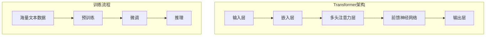
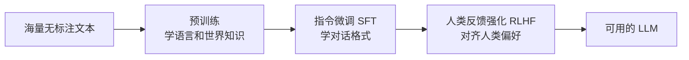
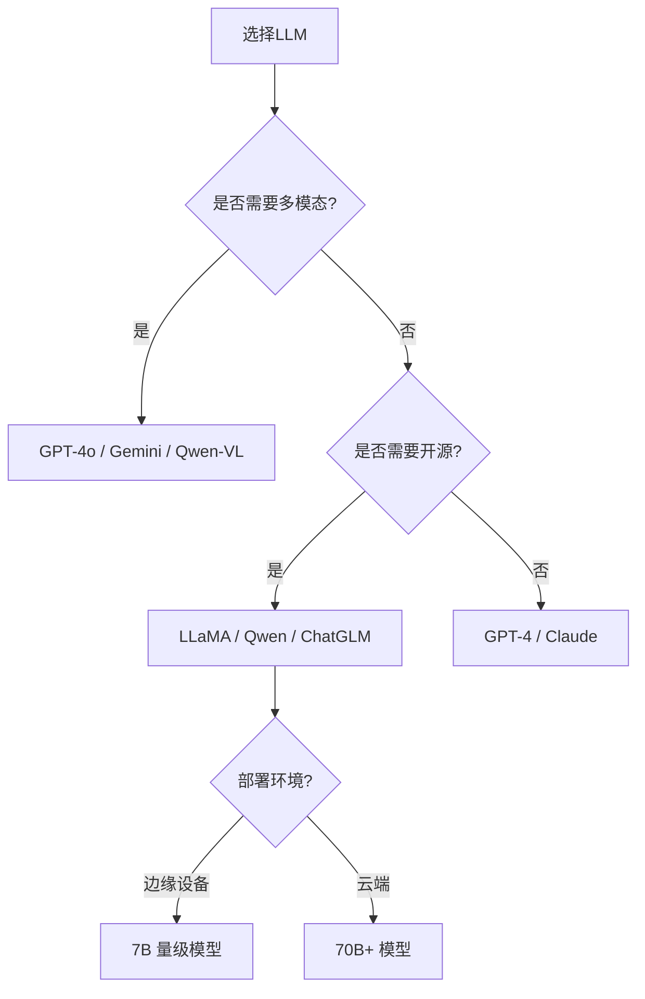

# LLM：大语言模型

> LLM（大语言模型）是基于深度学习、能够理解和生成人类语言的人工智能模型。它通过预测"下一个最合理的词"来完成回答、写作、改代码等任务，是 ChatGPT、LLaMA 等模型的底层技术。本文讲解 LLM 的核心原理、训练范式与能力边界。

**关键词**：LLM、大语言模型、预训练、微调、上下文、Token

## 抽象类比

LLM 像一个"读过海量资料的实习生"：很会总结、写作、解释、改代码，但不一定真的"知道事实"，**有时会自信地说错**。所以用 LLM 时要给资料、给规则、给检查机制。

一句话：**LLM 擅长生成和推理，但需要外部知识、工具和验证来变可靠。**

## 什么是 LLM

**LLM**（Large Language Model，大语言模型）是一种基于深度学习的人工智能模型，能够理解和生成人类语言。

**类比**：如果把普通 AI 模型比作"小学生"，那么 LLM 就像一个"读过海量书的学生"——读过海量书籍，可以回答各种问题，还能创作文学作品。

## 适合人群与预备知识

- 了解 Transformer 架构的基本概念
- 知道"预训练"和"微调"的大致含义
- 想了解 ChatGPT、LLaMA 等模型的来龙去脉

## LLM 的核心原理

### 基础架构

LLM 通常基于 Transformer 的 **Decoder-Only** 架构，核心机制包括：

- **自注意力机制**：让模型关注输入中不同位置的关系
- **预测下一个词**：根据上文预测最可能的下一个 token
- **海量参数**：百亿到万亿级参数，存储从训练数据中学到的知识

### 预训练-微调范式

- **预训练**：在互联网级语料上学习"下一个词预测"，获得通用能力
- **指令微调（SFT）**：用问答对训练，让模型学会听懂指令
- **RLHF**：基于人类反馈的强化学习，对齐人类偏好（ChatGPT 的关键）

## 主流 LLM 模型

### 闭源模型

- **GPT 系列（OpenAI）**：GPT-3.5、GPT-4、GPT-4o，性能领先，多模态能力
- **Claude（Anthropic）**：擅长长文本、推理
- **Gemini（Google）**：原生多模态，长上下文

### 开源模型

- **LLaMA 系列（Meta）**：LLaMA 2/3，开源生态标杆，7B/13B/70B 等规格
- **Qwen（阿里）**：中文优化强，多尺寸开源
- **ChatGLM（智谱）**：中英双语，国产开源代表
- **Mistral（Mistral AI）**：高效推理，MoE 架构
- **DeepSeek**：国产开源，推理能力强

### 模型选择建议

## 关键概念

### 上下文窗口（Context Window）

模型一次能"看到"的最大 token 数量，决定了 LLM 的记忆容量。

- 早期模型：2K-4K tokens
- 主流模型：32K-128K tokens
- 长上下文模型：200K-1M tokens（如 Claude、Gemini）

**类比**：像一个人能同时记住多少页的资料来回答问题，超出窗口的内容会被"遗忘"。

### 幻觉问题（Hallucination）

LLM 会"一本正经地胡说八道"，生成看似合理但事实错误的内容。

**原因**：

- 训练数据本身有错误或过时
- 模型本质是在"预测下一个词"，不是在"查事实"
- 缺乏外部知识时，模型倾向于编造

**缓解方法**：

- **RAG（检索增强生成）**：先查知识库再回答
- **事实核查**：让模型自检或调用工具验证
- **限制输出范围**：明确告诉模型"不知道就说不知道"

### Token 与分词

- **Token**：LLM 处理文本的最小单位，可能是一个字、一个词或一个子词
- 中文一个字通常是 1-2 个 token，英文一个词约 1-2 个 token
- Token 数量影响上下文长度、API 计费、推理速度

## 应用场景

- **对话系统**：聊天机器人、智能客服（ChatGPT、Siri）
- **内容生成**：写作、营销文案、剧本创作
- **信息检索**：知识库问答、RAG 系统
- **语言翻译**：多语言文档翻译
- **代码辅助**：代码生成、调试、注释（GitHub Copilot）
- **数据分析**：解释数据、生成报告、可视化
- **Agent 智能体**：作为 Agent 的"大脑"自主完成任务

## 如何使用 LLM

### 调用方式（概览）

- **云端 API**：通过 HTTP 请求调用厂商服务，最简单
- **本地部署**：用 Hugging Face Transformers、vLLM、Ollama 等部署开源模型
- **边缘部署**：通过量化把小模型放到手机、嵌入式设备

调用 API 的本质：把对话历史作为输入，模型返回"下一个最可能的内容"。

### 提示词工程

有效的提示词结构：

- **角色设定**：你是谁（如"你是一位专业程序员"）
- **任务描述**：要做什么（如"解释这段代码"）
- **输入数据**：具体内容
- **输出要求**：格式、长度、风格

**关键技巧**：

- 给具体例子（few-shot）
- 让模型"一步步思考"（Chain of Thought）
- 明确"不知道就说不知道"，降低幻觉

## 优缺点与挑战

### 优点

- 能力强大，可完成多种任务
- 学习能力强，从海量数据中获取知识
- 适应性广，一个模型覆盖多场景
- 持续进化，模型不断更新

### 缺点与挑战

- **幻觉问题**：可能生成错误信息 → 用 RAG + 事实核查
- **计算成本高**：训练和推理都需要大量算力 → 用量化、高效推理
- **上下文限制**：输入长度有上限 → 用长上下文模型、上下文压缩
- **偏见问题**：可能继承训练数据中的偏见 → 数据清洗、偏见检测
- **安全性**：可能生成有害内容 → 做对齐和过滤

## 关键术语

- **预训练**：在大规模无标注语料上学习通用能力
- **微调（Fine-tuning）**：在特定任务数据上调整模型
- **SFT**：监督微调，用指令-回答对训练
- **RLHF**：基于人类反馈的强化学习
- **上下文窗口**：模型一次能处理的最大 token 数
- **Token**：模型处理文本的最小单位
- **幻觉**：模型生成看似合理但错误的内容
- **RAG**：检索增强生成，结合外部知识库
- **Agent**：以 LLM 为大脑、能自主调用工具的智能体
- **量化**：用更低精度（如 INT4/INT8）存储模型，降低显存占用

## 面试 Q&A

**Q1：LLM 为什么会产生幻觉？如何缓解？**
LLM 本质是在"预测下一个最合理的词"，而不是"查事实"，缺乏外部知识时会编造。缓解方法：用 RAG 引入外部知识、限制回答范围、让模型自检、用工具验证。

**Q2：预训练和微调的区别？**
预训练在海量无标注数据上学习通用语言能力，成本高、通用性强；微调在特定任务的小规模有标注数据上调整模型，成本低、针对性强。

**Q3：上下文窗口大小为什么重要？**
上下文窗口决定模型一次能"记住"多少内容，直接影响长文档理解、多轮对话、RAG 等任务的效果；窗口太小会导致信息丢失。

**Q4：闭源模型和开源模型怎么选？**
闭源（GPT-4、Claude）性能强、开箱即用，但成本高、数据隐私受限；开源（LLaMA、Qwen、ChatGLM）可本地部署、可微调，适合有隐私和定制需求的场景。

## 如何向他人解释

> LLM 像一个"读过海量书的学生"：它读过的书多，所以能写文章、改代码、回答各种问题；但它不是真的"记住事实"，而是在猜"接下来最合理的话是什么"，所以有时会一本正经地说错。要让它更可靠，就得给它资料（RAG）、给它工具（Agent）、给它检查机制。

## 未来发展

- **多模态融合**：文本、图像、语音、视频统一处理
- **长上下文**：百万级 token，处理整本书或整个代码库
- **更强推理**：逐步推理、自我反思、规划能力
- **Agent 化**：从"回答问题"走向"自主完成任务"
- **边缘部署**：小模型本地运行，保护隐私、降低延迟
- **垂直领域**：医疗、法律、金融等专用模型

---

**一句话总结**：LLM 是基于 Transformer 的大语言模型，用"预训练+微调"获得通用语言能力，是现代 AI 应用的核心引擎，但仍需结合 RAG、工具和验证机制来变可靠。
