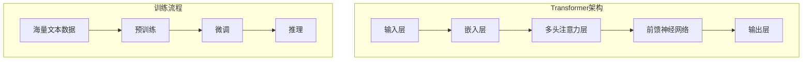
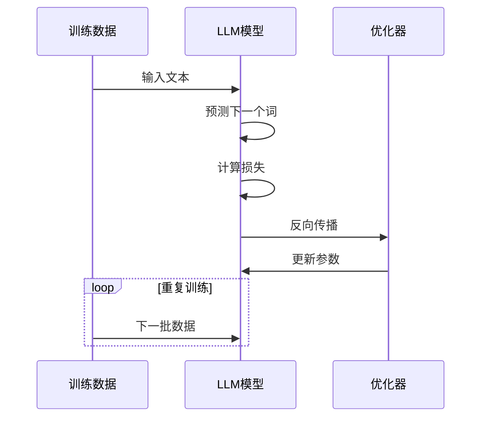
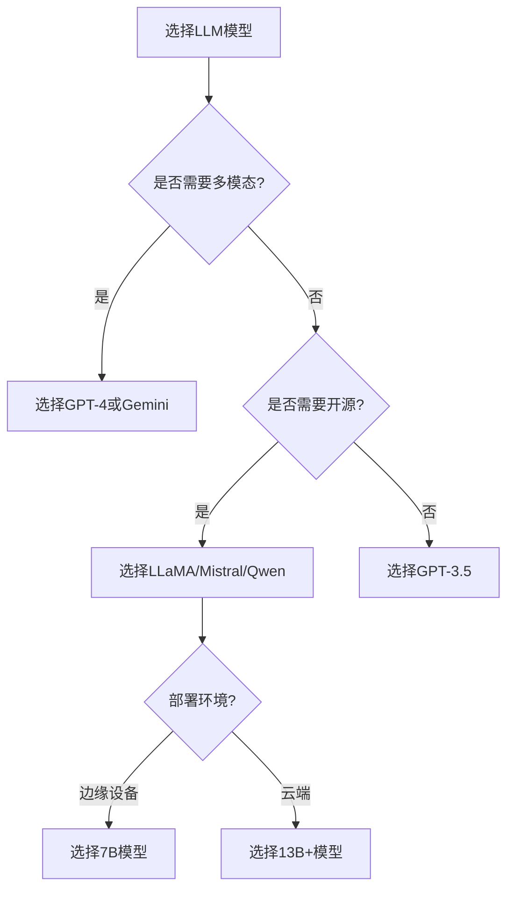
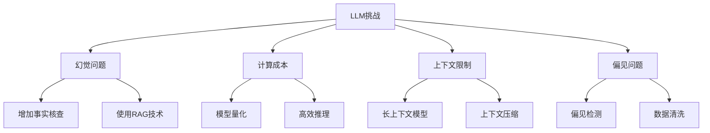

# LLM（大语言模型）

> 小白先读：LLM 可以先理解成“读过大量文本、会根据上下文接着说话的语言大脑”。它不是简单查字典，而是在预测“接下来最合理的内容”。
>
> 学这篇时先抓 3 个问题：它为什么会说话？它为什么会犯错？怎么把它接到真实项目里？

## 先用一句生活话理解

LLM 像一个读过很多资料的实习生：它很会总结、写作、解释、改代码，但它不一定真的“知道事实”，有时会自信地说错。所以用 LLM 时要给资料、给规则、给检查机制。

一句话：**LLM 擅长生成和推理，但需要外部知识、工具和验证来变可靠。**

## 一、什么是 LLM

**LLM**（Large Language Model，大语言模型）是一种基于深度学习的人工智能模型，能够理解和生成人类语言。

**生动比喻**：如果把普通 AI 模型比作"小学生"，那么 LLM 就像一个"博学的学者"，它读过海量的书籍，可以回答各种问题，还能创作文学作品。

## 二、LLM 的工作原理

### 2.1 核心概念

| 概念 | 说明 |
|------|------|
| **Transformer** | LLM 的基础架构，由编码器和解码器组成 |
| **自注意力机制** | 能够关注输入序列中不同位置的关系 |
| **预训练** | 在海量文本数据上进行训练 |
| **微调** | 在特定任务上进行针对性训练 |
| **提示词工程** | 通过精心设计的提示引导模型输出 |

### 2.2 架构示意图



### 2.3 训练过程



## 三、主流 LLM 模型

### 3.1 模型对比

| 模型 | 发布方 | 参数规模 | 特点 |
|------|--------|----------|------|
| **GPT-4** | OpenAI | ~1T | 多模态能力，最强性能 |
| **GPT-3.5** | OpenAI | ~175B | 平衡性能与成本 |
| **LLaMA** | Meta | 7B/13B/33B/65B | 开源免费 |
| **LLaMA 2** | Meta | 7B/13B/70B | 改进版，商业可用 |
| **Mistral** | Mistral AI | 7B/8x7B | 高效推理 |
| **Qwen** | 阿里 | 7B/14B/72B | 中文优化 |
| **Llama 3** | Meta | 8B/70B | 最新开源模型 |

### 3.2 模型选择建议



## 四、LLM 的应用场景

### 4.1 常见应用

| 场景 | 说明 | 示例 |
|------|------|------|
| **对话系统** | 聊天机器人、客服 | Siri、ChatGPT |
| **内容生成** | 写作、创作 | 写文章、代码生成 |
| **信息检索** | 问答系统 | 知识库问答 |
| **语言翻译** | 多语言翻译 | 文档翻译 |
| **代码辅助** | 代码生成、调试 | GitHub Copilot |
| **数据分析** | 数据解释、可视化 | 分析Excel数据 |

### 4.2 应用示例

**示例1：内容创作**
```
用户：帮我写一篇关于人工智能的文章
LLM：好的，我来为您撰写一篇关于人工智能的文章...
（输出一篇完整的文章）
```

**示例2：代码生成**
```
用户：用Python写一个快速排序算法
LLM：好的，这是快速排序的Python实现：
```python
def quicksort(arr):
    if len(arr) <= 1:
        return arr
    pivot = arr[len(arr) // 2]
    left = [x for x in arr if x < pivot]
    middle = [x for x in arr if x == pivot]
    right = [x for x in arr if x > pivot]
    return quicksort(left) + middle + quicksort(right)
```

**示例3：问答系统**
```
用户：什么是量子计算？
LLM：量子计算是一种利用量子力学现象...
```

## 五、如何使用 LLM

### 5.1 API 调用方式

```python
# 使用 OpenAI API
import openai

openai.api_key = "your-api-key"

response = openai.ChatCompletion.create(
    model="gpt-3.5-turbo",
    messages=[
        {"role": "system", "content": "你是一个乐于助人的助手"},
        {"role": "user", "content": "你好，介绍一下你自己"}
    ]
)

print(response.choices[0].message['content'])
```

### 5.2 本地部署

```python
# 使用 Hugging Face Transformers
from transformers import AutoTokenizer, AutoModelForCausalLM

# 加载模型
tokenizer = AutoTokenizer.from_pretrained("meta-llama/Llama-2-7b-chat-hf")
model = AutoModelForCausalLM.from_pretrained("meta-llama/Llama-2-7b-chat-hf")

# 生成文本
inputs = tokenizer("你好，介绍一下你自己", return_tensors="pt")
outputs = model.generate(**inputs, max_new_tokens=50)
print(tokenizer.decode(outputs[0], skip_special_tokens=True))
```

### 5.3 提示词工程

**有效的提示词结构**：
```
角色设定：你是一位专业的程序员
任务：解释这段代码的功能
输入：[代码]
输出格式：详细解释，包含注释
```

**示例提示词**：
```
你是一位专业的数据分析师。请分析以下销售数据：

数据：
- 一月：100万
- 二月：120万
- 三月：90万
- 四月：150万

请提供：
1. 趋势分析
2. 异常值识别
3. 建议
```

## 六、LLM 的优缺点

### 6.1 优点

| 优点 | 说明 |
|------|------|
| **能力强大** | 可以完成多种任务 |
| **学习能力强** | 从海量数据中学习 |
| **适应性广** | 适用于多种场景 |
| **持续进化** | 模型不断更新改进 |

### 6.2 缺点与挑战

| 挑战 | 说明 |
|------|------|
| **幻觉问题** | 可能生成错误信息 |
| **计算成本高** | 训练和推理成本高 |
| **上下文限制** | 输入长度有限制 |
| **偏见问题** | 可能存在偏见 |
| **安全性** | 可能生成有害内容 |

### 6.3 解决方案



## 七、LLM 的未来发展

### 7.1 技术趋势

| 趋势 | 说明 |
|------|------|
| **多模态** | 结合文本、图像、语音 |
| **长上下文** | 支持更长的输入 |
| **个性化** | 定制化模型 |
| **效率提升** | 更小更快的模型 |
| **推理能力** | 更强的逻辑推理 |

### 7.2 应用趋势

| 趋势 | 说明 |
|------|------|
| **垂直领域** | 医疗、法律、金融等专业领域 |
| **边缘部署** | 在终端设备上运行 |
| **Agent化** | 作为智能代理的核心 |
| **教育应用** | 个性化学习助手 |

## 八、总结

LLM 是人工智能领域的重大突破，具有以下特点：

1. **能力强大**：能够理解和生成人类语言
2. **应用广泛**：适用于多种场景
3. **发展迅速**：模型不断更新改进
4. **仍有挑战**：需要解决幻觉、偏见等问题

**使用建议**：
- 根据需求选择合适的模型
- 掌握提示词工程技巧
- 结合其他技术（如RAG）提升效果

---

## 九、和当前比赛项目的关系

LLM 在你的项目里可以承担“辅助研发”和“智能交互”两类角色：

- 研发侧：帮助整理文档、生成测试计划、分析日志、做代码解释。
- 系统侧：可以作为 Asking Star、Agent 或对话推理模块的大脑。
- 比赛侧：需要记录 AI 工具的使用场景、交互记录和产出边界。

如果要把 LLM 和 StarryOS/RK3588 结合，关键问题不是“模型很聪明”，而是：**它能否在边缘设备约束下可靠运行，或者通过云边协同服务机器人任务。**
