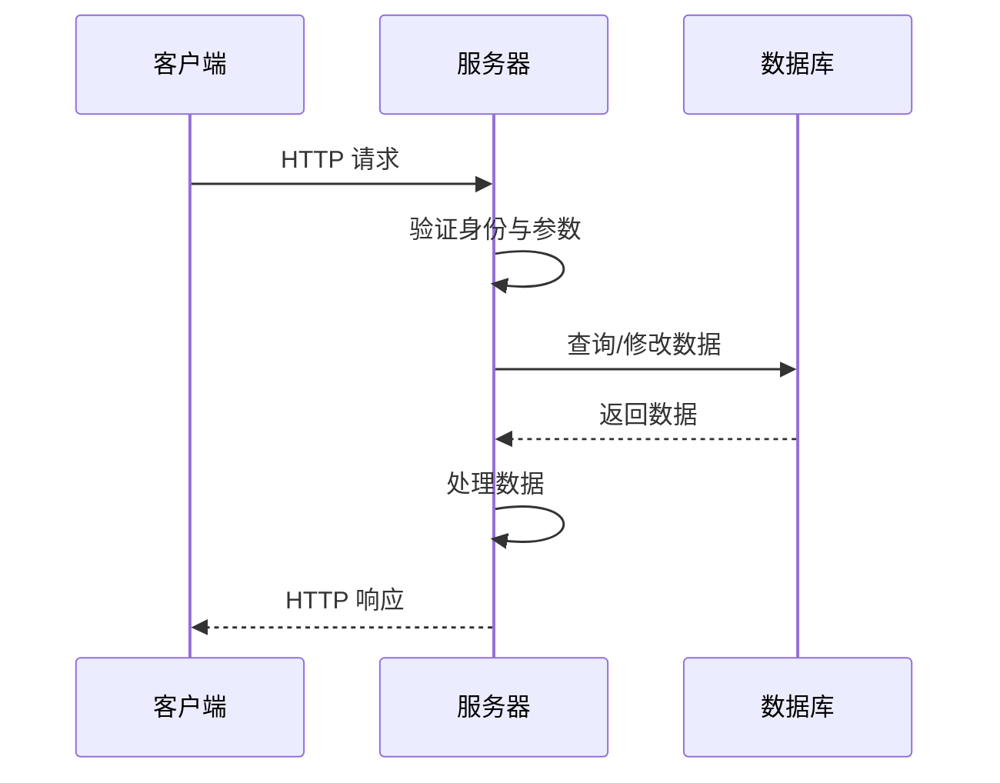
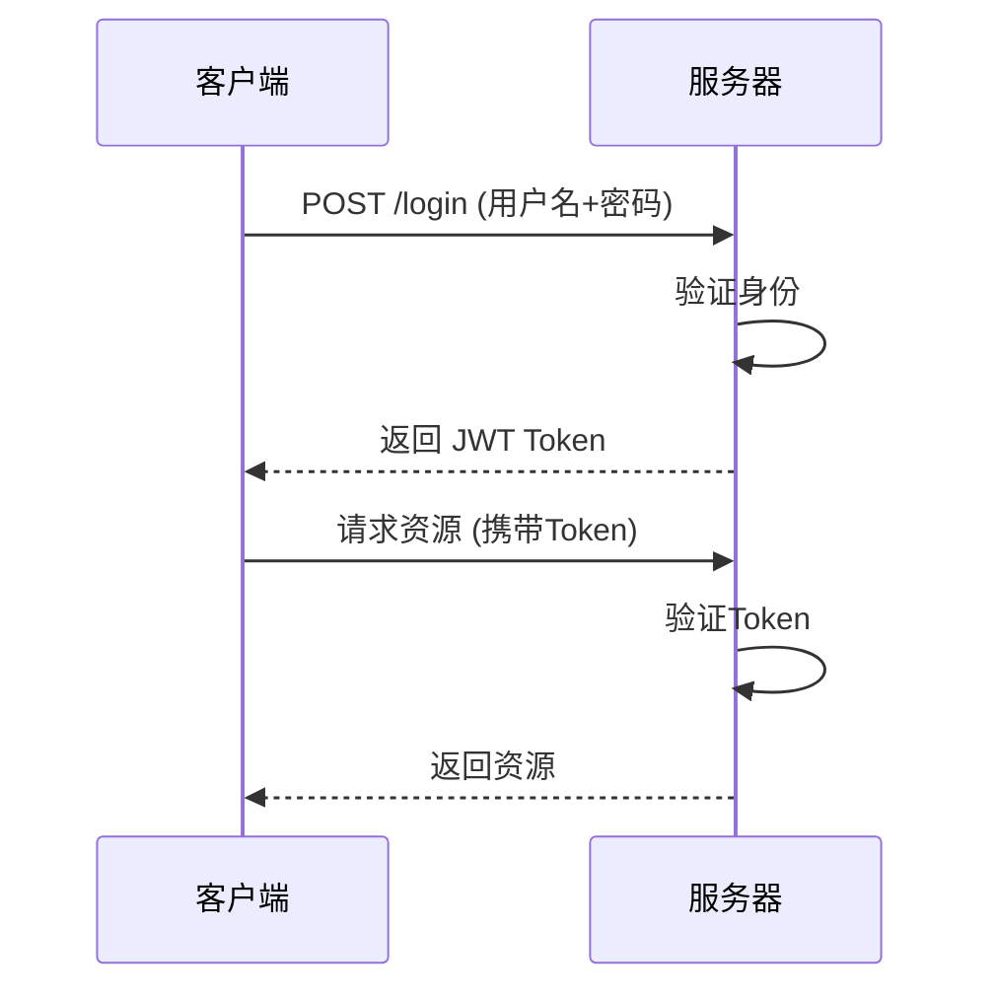
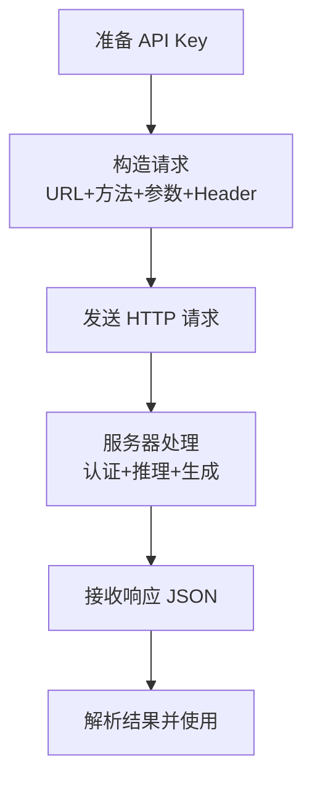

# API：应用程序编程接口

> API（应用程序编程接口）是不同软件组件之间的通信协议，让一个程序能访问另一个程序的功能或数据。它定义了"两个系统之间怎么说话"的规则，是调用 AI 服务、对接外部系统的标准方式。本文讲解 API 的核心概念、常见类型与调用方法。

**关键词**：API、REST、HTTP、端点、请求响应、认证

## 抽象类比

调用 AI API 就像在外卖软件点餐：你填地址、选菜、备注口味，平台返回订单状态和菜品。程序调用 API 也是这样：发出请求，等待服务返回结构化结果。

API 像餐厅的"点菜窗口"——你不用进后厨、不用知道菜怎么炒，只要按菜单格式下单，后厨就按规则返回结果。API 的重点不是"会写请求代码"，而是**定义清楚两个系统之间怎么说话**。

## 什么是 API

**API**（Application Programming Interface，应用程序编程接口）是不同软件组件之间的通信协议，允许一个应用程序访问另一个应用程序的功能或数据。

**类比**：API 像餐厅的"点菜窗口"或门把手——你不用进后厨、不用懂电路，只要按规则下单或推门，就能拿到结果。

## 适合人群与预备知识

- 了解基本的网络通信概念（HTTP）
- 会一门编程语言（Python、JavaScript 等）
- 想调用 AI 服务或对接外部系统

## API 核心概念

### 基本术语

- **端点（Endpoint）**：API 的访问地址，如 `https://api.example.com/users`
- **请求（Request）**：客户端向服务器发送的消息
- **响应（Response）**：服务器返回给客户端的消息
- **HTTP 方法**：GET、POST、PUT、DELETE 等
- **状态码**：表示请求结果的三位数字
- **认证**：验证调用方身份的机制

### API 类型

- **REST API**：基于 HTTP 的 RESTful 风格，最常见
- **GraphQL API**：用查询语言精确获取所需数据
- **gRPC API**：基于 HTTP/2，高性能，常用于微服务
- **WebSocket API**：双向实时通信，如聊天应用
- **SOAP API**：企业级老协议，较重

## REST API 详解

### REST 核心原则

- **无状态**：每个请求独立，服务器不保存会话状态
- **统一接口**：用标准 HTTP 方法和状态码
- **资源导向**：以资源为中心，通过 URL 访问
- **可缓存**：响应可被缓存以提升性能
- **分层系统**：可通过代理、网关等分层

### HTTP 方法

- **GET**：获取资源（如 `GET /users` 获取用户列表）
- **POST**：创建资源（如 `POST /users` 创建新用户）
- **PUT**：更新整个资源（如 `PUT /users/1` 更新用户1）
- **PATCH**：部分更新资源
- **DELETE**：删除资源（如 `DELETE /users/1` 删除用户1）

**类比**：GET 是"看"，POST 是"新增"，PUT 是"替换"，PATCH 是"修补"，DELETE 是"扔掉"。

### 常见状态码

- **2xx 成功**：200 OK（请求成功）、201 Created（创建成功）
- **3xx 重定向**：301 永久重定向
- **4xx 客户端错误**：400 参数错误、401 未授权、403 禁止访问、404 资源不存在
- **5xx 服务器错误**：500 服务器内部错误、503 服务不可用

## API 的工作原理

### 请求流程



### 请求与响应结构

请求示例（HTTP 报文）：

```
GET /api/users?page=1&limit=10 HTTP/1.1
Host: api.example.com
Authorization: Bearer token123
Content-Type: application/json
```

响应示例（JSON 格式）：

```json
{
  "status": "success",
  "data": [{"id": 1, "name": "张三"}],
  "pagination": {"page": 1, "total": 100}
}
```

**类比**：请求像你递给窗口的"点菜单"（地址+方法+参数+身份凭证），响应像后厨递回的"出餐单"（状态码+数据）。

## API 的认证方式

### 常见认证方式

- **API Key**：在请求头或参数中携带密钥，最简单，常用于服务间通信
- **Bearer Token / JWT**：登录后拿到令牌，后续请求携带，常用于前后端分离
- **Basic Auth**：用户名密码 Base64 编码，仅用于简单场景
- **OAuth 2.0**：第三方授权机制，用于社交登录、跨应用授权
- **API Signature**：对请求做签名验证，用于金融等高安全场景

### JWT 认证流程



**类比**：JWT 像酒店的房卡——入住时前台给你一张房卡（登录拿 token），之后用房卡开门（带 token 调 API），房卡过期就得重新办理。

## 如何使用 API

### 调用方式概览

- **命令行**：用 curl 快速测试
- **编程语言**：用 Python requests、JavaScript fetch 等
- **图形工具**：Postman、Insomnia、Swagger UI
- **SDK**：厂商提供的封装库（如 OpenAI SDK）

### 调用 AI API 的基本流程



**调用 AI API 的关键点**：

- 在请求头携带 API Key 做认证
- 在请求体中传入模型名称、提示词、参数（temperature、max_tokens 等）
- 响应中拿到模型生成的文本，按 JSON 解析后使用
- 注意处理错误码（如 429 限流、500 服务器错误）

## 与 AI 服务的关系

AI API 是连接 LLM、Agent、RAG、工具服务的基础设施：

- **上层应用**通过 API 请求模型推理结果
- **Agent** 通过工具 API 读取文件、执行命令、查询资料
- **RAG 系统**通过 API 调用嵌入模型和 LLM
- **云边协同**时，边缘设备通过 API 与云端服务通信

**类比**：AI API 像给应用装的"AI 开关"——应用不关心模型多复杂，只要按格式请求，就能拿到 AI 的能力。

## API 设计最佳实践

- **用名词而非动词**：`/users` 而非 `/getUsers`
- **用复数名词**：`/users` 而非 `/user`
- **支持嵌套资源**：`/users/1/posts` 表示用户1的帖子
- **提供分页**：用 `page`、`limit` 参数
- **提供过滤和排序**：用 `filter`、`sort` 参数
- **版本控制**：在 URL 中加版本号，如 `/v1/users`、`/v2/users`
- **统一错误格式**：返回清晰的错误码和消息

## 关键术语

- **端点（Endpoint）**：API 的访问地址
- **HTTP 方法**：定义对资源的操作（GET/POST/PUT/DELETE）
- **状态码**：表示请求结果的三位数字
- **REST**：一种基于 HTTP 的 API 设计风格
- **API Key**：用于身份验证的密钥
- **JWT**：JSON Web Token，一种自包含的令牌格式
- **OAuth 2.0**：第三方授权标准
- **Webhook**：服务端主动推送数据的回调机制
- **SDK**：厂商封装的软件开发工具包，简化 API 调用

## 面试 Q&A

**Q1：GET 和 POST 的区别？**
GET 用于获取资源，参数在 URL 中，可缓存、可收藏；POST 用于创建资源，参数在请求体中，更安全、可传大数据。GET 不应产生副作用，POST 会改变服务器状态。

**Q2：API Key、JWT、OAuth 各适合什么场景？**
API Key 适合服务间简单认证；JWT 适合前后端分离的登录态管理；OAuth 2.0 适合第三方授权（如"用微信登录"），让用户不必把密码给第三方应用。

**Q3：什么是 RESTful API？**
REST 是一种基于 HTTP 的 API 设计风格，以资源为中心，用标准 HTTP 方法操作资源，无状态、可缓存、统一接口。符合这些原则的 API 就叫 RESTful API。

**Q4：调用 AI API 时常见的错误码有哪些？**
401 未授权（API Key 错误）、429 限流（请求过快）、500 服务器错误、503 服务不可用；通常需要做重试、退避、降级处理。

## 如何向他人解释

> API 像餐厅的"点菜窗口"：你不用进后厨、不用懂做菜流程，只要按菜单格式下单（发请求），后厨就按规则递回菜品（返回数据）。调用 AI API 也是这样——你的程序告诉服务器"用哪个模型、回答什么问题"，服务器返回 AI 生成的结果，你的程序再继续处理。API 把复杂能力封装成一个稳定入口，让不同模块低耦合协作。

---

**一句话总结**：API 是软件之间的"点菜窗口"，用标准化的请求-响应格式让不同系统低耦合协作，是 AI 服务、Agent、RAG 等系统互联互通的基础设施。

---

**参考链接**：

- RESTful API 设计指南：[https://restfulapi.net](https://restfulapi.net)
- OpenAPI 规范：[https://www.openapis.org](https://www.openapis.org)
- Postman：[https://www.postman.com](https://www.postman.com)
