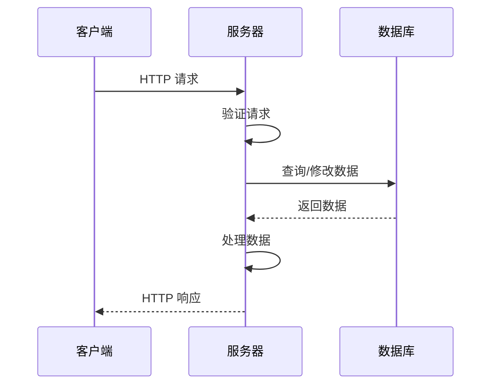
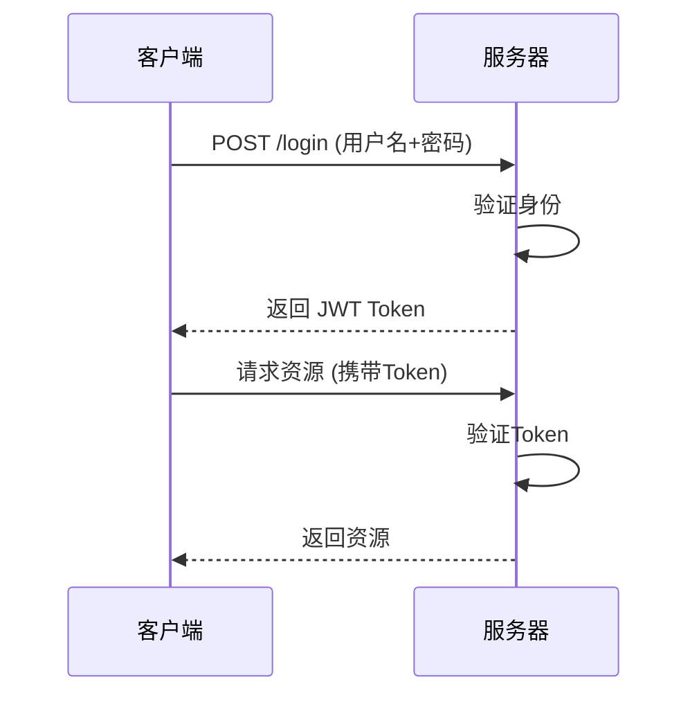
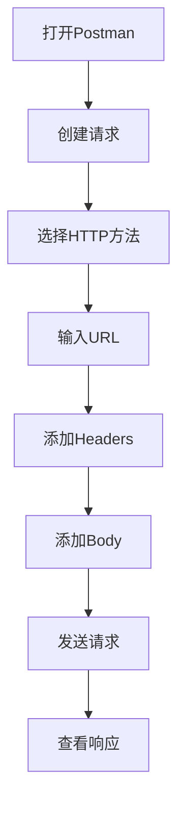

# API（应用程序编程接口）

> 小白先读：API 是软件之间的“点菜窗口”。你不用知道后厨怎么炒菜，只要按菜单格式下单，后厨就按规则返回结果。
>
> 学这篇时先抓 3 个问题：请求发给谁？带什么参数？返回结果怎么被程序继续使用？

## 先用一句生活话理解

调用 AI API 就像在外卖软件点餐：你填地址、选菜、备注口味，平台返回订单状态和菜品。程序调用 API 也是这样：发出请求，等待服务返回结构化结果。

API 的重点不是“会写请求代码”，而是**定义清楚两个系统之间怎么说话**。

## 一、什么是 API

**API**（Application Programming Interface，应用程序编程接口）是不同软件组件之间的通信协议，允许一个应用程序访问另一个应用程序的功能或数据。

**生动比喻**：如果把软件系统比作一个餐厅，API 就是餐厅的"菜单"。顾客（其他程序）通过菜单（API）来点餐（调用功能），而不需要知道厨房（内部实现）是如何工作的。

## 二、API 的核心概念

### 2.1 基本术语

| 术语 | 说明 |
|------|------|
| **端点（Endpoint）** | API 的访问地址 |
| **请求（Request）** | 客户端向服务器发送的消息 |
| **响应（Response）** | 服务器返回给客户端的消息 |
| **HTTP 方法** | GET、POST、PUT、DELETE 等 |
| **状态码** | 表示请求结果的数字代码 |
| **认证** | 验证用户身份的机制 |

### 2.2 API 类型

| 类型 | 说明 | 示例 |
|------|------|------|
| **REST API** | 基于 HTTP 协议的 RESTful 风格 | Web 服务 |
| **GraphQL API** | 基于 GraphQL 查询语言 | Facebook API |
| **SOAP API** | 基于 SOAP 协议 | 企业服务 |
| **gRPC API** | 基于 HTTP/2 的高性能 API | 微服务 |
| **WebSocket API** | 双向实时通信 | 聊天应用 |

## 三、REST API 详解

### 3.1 REST 原则

| 原则 | 说明 |
|------|------|
| **无状态** | 每个请求独立，服务器不保存状态 |
| **统一接口** | 使用标准的 HTTP 方法和状态码 |
| **资源导向** | 以资源为中心，通过 URL 访问 |
| **可缓存** | 响应可以被缓存 |
| **分层系统** | 可以通过代理、网关等分层 |

### 3.2 HTTP 方法

| 方法 | 用途 | 示例 |
|------|------|------|
| **GET** | 获取资源 | `GET /users` 获取所有用户 |
| **POST** | 创建资源 | `POST /users` 创建新用户 |
| **PUT** | 更新资源 | `PUT /users/1` 更新用户1 |
| **DELETE** | 删除资源 | `DELETE /users/1` 删除用户1 |
| **PATCH** | 部分更新 | `PATCH /users/1` 部分更新 |

### 3.3 状态码

| 状态码 | 类别 | 说明 |
|--------|------|------|
| **2xx** | 成功 | 请求成功处理 |
| **200** | OK | 请求成功 |
| **201** | Created | 资源创建成功 |
| **3xx** | 重定向 | 需要进一步操作 |
| **301** | Moved Permanently | 永久重定向 |
| **4xx** | 客户端错误 | 请求有问题 |
| **400** | Bad Request | 请求格式错误 |
| **401** | Unauthorized | 未授权 |
| **403** | Forbidden | 禁止访问 |
| **404** | Not Found | 资源不存在 |
| **5xx** | 服务器错误 | 服务器端问题 |
| **500** | Internal Server Error | 服务器内部错误 |

## 四、API 的工作原理

### 4.1 请求流程



### 4.2 请求结构

```
GET /api/users?page=1&limit=10 HTTP/1.1
Host: api.example.com
Authorization: Bearer token123
Content-Type: application/json
```

### 4.3 响应结构

```json
{
  "status": "success",
  "data": [
    {
      "id": 1,
      "name": "张三",
      "email": "zhang@example.com"
    },
    {
      "id": 2,
      "name": "李四",
      "email": "li@example.com"
    }
  ],
  "pagination": {
    "page": 1,
    "limit": 10,
    "total": 100
  }
}
```

## 五、API 的认证方式

### 5.1 常见认证方式

| 方式 | 说明 | 适用场景 |
|------|------|----------|
| **API Key** | 在请求头或参数中传递密钥 | 服务器间通信 |
| **Bearer Token** | 使用 JWT 等令牌 | 前后端分离 |
| **Basic Auth** | 用户名密码 Base64 编码 | 简单场景 |
| **OAuth 2.0** | 第三方授权 | 社交登录 |
| **API Signature** | 请求签名验证 | 金融交易 |

### 5.2 JWT 认证流程



## 六、如何使用 API

### 6.1 使用 curl

```bash
# GET 请求
curl -X GET "https://api.example.com/users" \
  -H "Authorization: Bearer token123" \
  -H "Content-Type: application/json"

# POST 请求
curl -X POST "https://api.example.com/users" \
  -H "Authorization: Bearer token123" \
  -H "Content-Type: application/json" \
  -d '{"name": "张三", "email": "zhang@example.com"}'

# PUT 请求
curl -X PUT "https://api.example.com/users/1" \
  -H "Authorization: Bearer token123" \
  -H "Content-Type: application/json" \
  -d '{"name": "张三四"}'

# DELETE 请求
curl -X DELETE "https://api.example.com/users/1" \
  -H "Authorization: Bearer token123"
```

### 6.2 使用 Python

```python
import requests

# GET 请求
response = requests.get(
    "https://api.example.com/users",
    headers={"Authorization": "Bearer token123"},
    params={"page": 1, "limit": 10}
)
print(response.json())

# POST 请求
data = {"name": "张三", "email": "zhang@example.com"}
response = requests.post(
    "https://api.example.com/users",
    headers={"Authorization": "Bearer token123"},
    json=data
)
print(response.json())
```

### 6.3 使用 JavaScript

```javascript
// GET 请求
fetch('https://api.example.com/users', {
  method: 'GET',
  headers: {
    'Authorization': 'Bearer token123',
    'Content-Type': 'application/json'
  }
})
.then(response => response.json())
.then(data => console.log(data));

// POST 请求
fetch('https://api.example.com/users', {
  method: 'POST',
  headers: {
    'Authorization': 'Bearer token123',
    'Content-Type': 'application/json'
  },
  body: JSON.stringify({
    name: '张三',
    email: 'zhang@example.com'
  })
})
.then(response => response.json())
.then(data => console.log(data));
```

## 七、API 设计最佳实践

### 7.1 设计原则

| 原则 | 说明 |
|------|------|
| **使用名词而非动词** | `/users` 而非 `/getUsers` |
| **使用复数名词** | `/users` 而非 `/user` |
| **使用嵌套资源** | `/users/1/posts` 表示用户1的帖子 |
| **提供分页** | 使用 `page`、`limit` 参数 |
| **提供过滤和排序** | 使用 `filter`、`sort` 参数 |

### 7.2 错误处理

```json
{
  "status": "error",
  "error": {
    "code": "USER_NOT_FOUND",
    "message": "用户不存在",
    "details": "用户ID为1的用户不存在"
  }
}
```

### 7.3 版本控制

```
/v1/users    # 版本1
/v2/users    # 版本2
```

## 八、API 测试工具

### 8.1 常用工具

| 工具 | 说明 | 特点 |
|------|------|------|
| **Postman** | 功能强大的API测试工具 | 可视化界面 |
| **curl** | 命令行工具 | 轻量级 |
| **Insomnia** | API设计和测试工具 | 美观界面 |
| **Swagger UI** | 自动生成API文档 | 交互式测试 |
| **Thunder Client** | VS Code扩展 | 集成开发环境 |

### 8.2 使用 Postman



## 九、总结

API 是现代软件开发的核心，具有以下特点：

1. **标准化**：使用统一的协议和格式
2. **解耦合**：客户端和服务端独立开发
3. **可复用**：一个API可以被多个应用使用
4. **可扩展**：易于添加新功能

**使用建议**：
- 遵循 RESTful 设计原则
- 提供清晰的文档
- 实现适当的认证和授权

---

## 十、和当前比赛项目的关系

AI API 是连接 LLM、Agent、RAG、工具服务的基础设施。你的项目里可以用 API 思想理解这些接口：

- 上层应用请求模型推理结果。
- BootSupervisor 调用测试、构建、报告模块。
- Agent 通过工具接口读取文件、执行命令、查询资料。
- 如果云边协同，边缘设备也需要通过 API 和云端服务通信。

答辩时可以说：**API 把复杂能力封装成稳定入口，让不同模块可以低耦合协作。**

---

**参考链接**：
- RESTful API 设计指南：[https://restfulapi.net](https://restfulapi.net)
- OpenAPI 规范：[https://www.openapis.org](https://www.openapis.org)
- Postman：[https://www.postman.com](https://www.postman.com)
