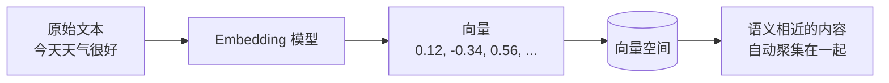
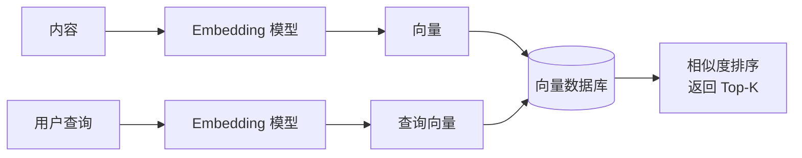
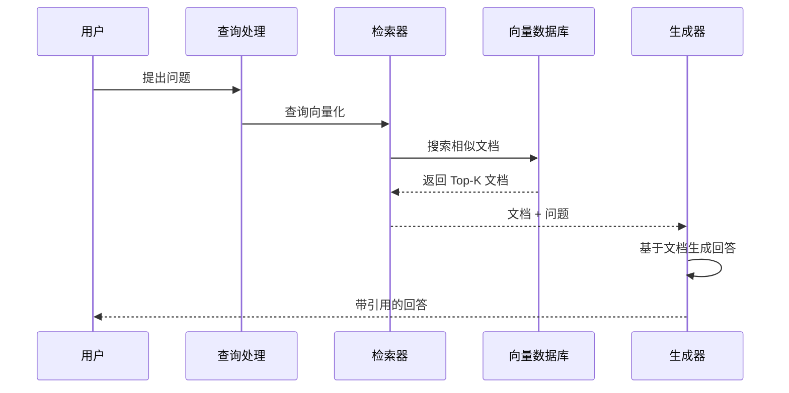
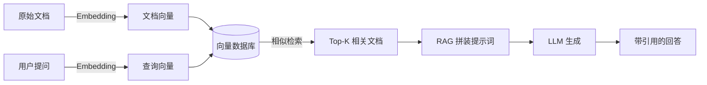

# 知识与检索：Embedding、向量数据库与 RAG

> AI 要落地业务必须解决三件事：理解语义、存储知识、检索引用。本文讲解 Embedding（把内容变成数字）、向量数据库（存储并检索这些数字）、RAG（让大模型在回答时引用检索到的资料）三项相互衔接的核心技术，三者串起来让 AI"看懂意思、记住资料、有据可答"。

**关键词**：Embedding、向量数据库、RAG、语义检索、知识库、上下文增强

## 抽象类比

- Embedding 像"智能标签"——图书馆给每本书贴标签，标签越接近主题越像；AI 自动给内容贴上数字标签，让"开心"和"快乐"能匹配上
- 向量数据库像"图书管理员"——你描述"想找一本讲孤独的小说"，它能按意思从书架上取出最匹配的几本，而不是只按书名精确匹配
- RAG 像"开卷考试"——模型答题前先去资料库查相关段落，再结合查到的资料组织答案，而不是凭记忆硬答

三者串起来，AI 才能"看懂意思、记住资料、有据可答"。

## 适合人群与学习路径

- 适合人群：刚接触 AI 应用开发的小白，想搞清楚语义检索和 RAG 的底层链路
- 预备知识：了解大模型基本概念、知道"向量是一串数字"即可
- 学习路径：Embedding（理解语义）→ 向量数据库（存储检索）→ RAG（引用生成）→ 三者协作 → 应用与面试

---

## 一、Embedding：把内容变成数字

### 核心原理

Embedding（嵌入向量）是将文字、图片、音频等内容映射为一串数字（向量）的技术，使语义相似的内容在向量空间中距离更近。计算机只能算数字，不能直接懂文字，Embedding 就是把"意思"翻译成"坐标"。

- 输入：一段文本（或图片、音频）
- 输出：一个固定长度的向量（如 384 维、768 维、1536 维）
- 关键性质：语义越相似，向量距离越近

### 类比：智能标签

图书馆给每本书贴标签，标签越接近，主题越像。Embedding 就是 AI 自动给内容贴的"智能标签"——不是人工分类，而是模型学出来的数字表示。

- 没有 Embedding：像用字典查词，只能精确匹配
- 有 Embedding：像按意思找书，"开心"和"快乐"能匹配上

### 向量空间的语义关系

规则只有三条：

- 距离近 = 语义相似（苹果与梨）
- 距离远 = 语义不同（苹果与汽车）
- 方向一致 = 关系相同（猫→狗 ≈ 苹果→梨，都是同类）

### Mermaid 图：从文本到向量空间

### 关键术语

- 维度：向量的长度，维度越高表达力越强，但计算更慢
- 语义相似度：通常用余弦相似度衡量，越接近 1 越相似
- 常见模型：OpenAI text-embedding-ada-002（1536 维）、BGE（中文优化）、Sentence-BERT（句子级搜索）
- 经典能力：向量可做数学运算，如"国王 - 男人 + 女人 ≈ 女王"

### 与上下游的关系

- 上游：原始内容（文本、图片、音频）
- 下游：向量数据库（存储）、RAG（应用）

### Embedding 的典型应用

- 语义搜索：搜"怎么学习编程"能找到"编程入门教程"
- 推荐系统：基于内容向量推荐相似商品或文章
- 文本分类：情感分析、主题分类、垃圾邮件识别
- 聚类分析：把用户反馈、新闻自动按主题分组
- 知识库检索：RAG 的前置步骤，把文档和问题都转向量

---

## 二、向量数据库：存储与检索

### 核心原理

向量数据库是专门存储高维向量并支持快速相似性检索的数据库。它不查"精确匹配"，而查"语义相似"——给它一个查询向量，它能毫秒级返回最接近的若干个向量。

- 存储：百万到亿级向量
- 检索：近似最近邻搜索（ANN），在可接受误差内换取速度
- 度量：余弦相似度（看方向）、欧氏距离（看位置）、点积（推荐系统常用）

### 类比：图书管理员

普通数据库像字典，按拼音或部首查字，必须知道准确名字；向量数据库像图书管理员，你描述"想看关于太空冒险的故事"，它能找出《星际穿越》《火星救援》《地心引力》。

### 与普通数据库的对比（列表形式）

- 查询方式：普通数据库做精确匹配，向量数据库做语义相似检索
- 数据类型：普通数据库存结构化字段，向量数据库存高维浮点向量
- 返回结果：普通数据库返回完全匹配的行，向量数据库返回按相似度排序的 Top-K
- 性能特点：普通数据库用 B+ 树索引，向量数据库用 HNSW、IVF 等图或聚类索引
- 适用场景：普通数据库擅长统计、过滤、Join；向量数据库擅长语义搜索、推荐、去重
- 关系：互补而非替代，很多系统同时使用（先用元数据过滤，再做向量检索）

### 核心能力

- 高维存储：支持几百到几千维向量
- 快速检索：百万级数据毫秒级返回
- 元数据过滤：可结合时间、类别等条件过滤后再检索
- 实时更新：支持向量动态增删改

### 常见产品

- 专用向量数据库：Milvus（开源分布式）、Pinecone（云端托管）、Weaviate、Qdrant、Chroma（轻量本地）
- 传统数据库的向量扩展：PostgreSQL + pgvector、Elasticsearch 向量搜索、Redis RediSearch

### Mermaid 图：向量数据库的核心流程

---

## 三、RAG：让 AI 引用资料

### 核心原理

RAG（Retrieval-Augmented Generation，检索增强生成）是将信息检索与生成模型结合的技术。LLM 回答前先从知识库检索相关文档，再基于这些文档生成回答，从而减少幻觉、提升可追溯性。

### 类比：开卷考试

不开 RAG 的 LLM 像闭卷考试，全靠记忆，可能记错或编造；RAG 像开卷考试，先翻资料再作答，答案更贴近真实资料，还能标注来源页码。

### RAG 解决的问题

- 幻觉问题：基于真实文档生成，而非凭记忆编造
- 时效性问题：可接入最新资料，不受训练截止时间限制
- 领域知识问题：可接入企业私有知识库、专业文档
- 可追溯性：回答可附带引用来源，便于核对

### RAG 的核心组件

- 文档加载器：读取 PDF、Word、网页等多种格式
- 文本分割器：把长文档切成小块（chunk），便于检索
- 嵌入模型：把文本和查询都转向量
- 向量数据库：存储并检索文档向量
- 检索器：执行相似度搜索，取 Top-K 文档
- 生成器：LLM 基于检索到的文档生成回答

### Mermaid 图：RAG 工作流程

### RAG 的常见类型

- Basic RAG：直接检索相似文档，适合简单问答
- Hybrid RAG：关键词检索 + 语义检索结合，适合复杂查询
- Multi-modal RAG：支持文本、图像等多模态数据
- Self-RAG：模型自动决定是否需要检索
- RAG Fusion：融合多次检索结果，提升准确性

### 优化方向

- 文档分割：调整 chunk 大小和重叠度，提高检索精度
- 嵌入模型：选择更适合领域语义的模型
- 检索策略：混合检索、查询改写、多路召回
- 重排序（Reranking）：对初筛结果二次排序，提升相关性
- 提示词：约束 LM 必须基于文档回答并引用来源

---

## 四、三者如何协作

整个链路可以概括为一句话：文本经 Embedding 变成向量，存入向量数据库；用户提问同样经 Embedding 变成查询向量，在向量数据库中检索出相似文档；RAG 把这些文档连同问题交给 LLM，生成有据可查的回答。

### Mermaid 图：完整协作链路

### 链路拆解

- 第 1 步 Embedding：把文档和查询都翻译成向量，让机器能比较"意思"
- 第 2 步 向量数据库：高效存储海量向量，并支持毫秒级相似检索
- 第 3 步 RAG：把检索到的文档作为上下文喂给 LLM，约束其基于资料回答
- 三者关系：Embedding 是基础，向量数据库是基础设施，RAG 是应用层

---

## 五、常见应用场景

- 企业知识库问答：员工提问，AI 检索内部文档后回答
- 智能客服：基于产品手册、FAQ 自动应答，可附带来源
- 语义搜索：搜索意思相近的内容，而非关键词精确匹配
- 推荐系统：基于内容向量推荐相似商品、文章、视频
- 图像检索：以图搜图、相似款式推荐、人脸识别
- 文档去重与聚类：新闻去重、论文查重、用户反馈自动分组
- 学术研究辅助：基于论文库生成综述、对比分析
- 个人知识助手：基于 Obsidian、Notion 等笔记库做问答与复盘

---

## 六、面试 Q&A

- Q1：Embedding 是什么？为什么能让机器理解语义？
  - A：Embedding 把离散内容映射为连续向量，语义相似的内容在向量空间距离更近，从而支持相似度计算和语义检索。

- Q2：向量数据库和普通数据库有什么区别？
  - A：普通数据库做精确匹配，用 B+ 树索引结构化字段；向量数据库做相似检索，用 HNSW/IVF 等索引高维向量，返回按相似度排序的 Top-K。两者互补，常配合使用。

- Q3：RAG 解决了 LLM 的什么问题？
  - A：主要解决幻觉、时效性、领域知识和可追溯性四个问题，让回答基于真实文档、可附带引用来源。

- Q4：RAG 的典型流程是什么？
  - A：文档加载 → 文本分割 → Embedding → 存入向量数据库；查询时：查询向量化 → 向量检索 → 取 Top-K 文档 → LLM 基于文档生成回答。

- Q5：如何优化 RAG 效果？
  - A：从文档分割、嵌入模型、检索策略（混合检索、查询改写）、重排序、提示词约束五个方向优化；常见问题是检索不到、上下文过长、回答不引用文档。

---

## 七、如何向他人解释

用一个完整的故事把三者串起来：

- 第 1 步（Embedding）：想象图书馆给每本书贴一串"智能数字标签"，标签越接近，主题越像。AI 也是这样把文字变成数字，才能算"意思相近"。
- 第 2 步（向量数据库）：这些标签太多了，需要一个"图书管理员"专门存和找。你说"想看太空冒险"，管理员能立刻拿出最像的几本书——这就是向量数据库。
- 第 3 步（RAG）：现在让一个学者（LLM）回答你的问题。闭卷考试他可能记错，开卷考试他先翻资料再作答，还能告诉你"这段来自第几页"——这就是 RAG。
- 一句话总结：Embedding 把意思变成数字，向量数据库帮 AI 快速找到相关资料，RAG 让 AI 像开卷考试一样有据可答。

### 关键词

Embedding、嵌入向量、语义相似度、向量数据库、相似检索、近似最近邻、RAG、检索增强生成、开卷考试、知识库问答
