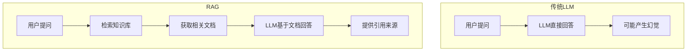
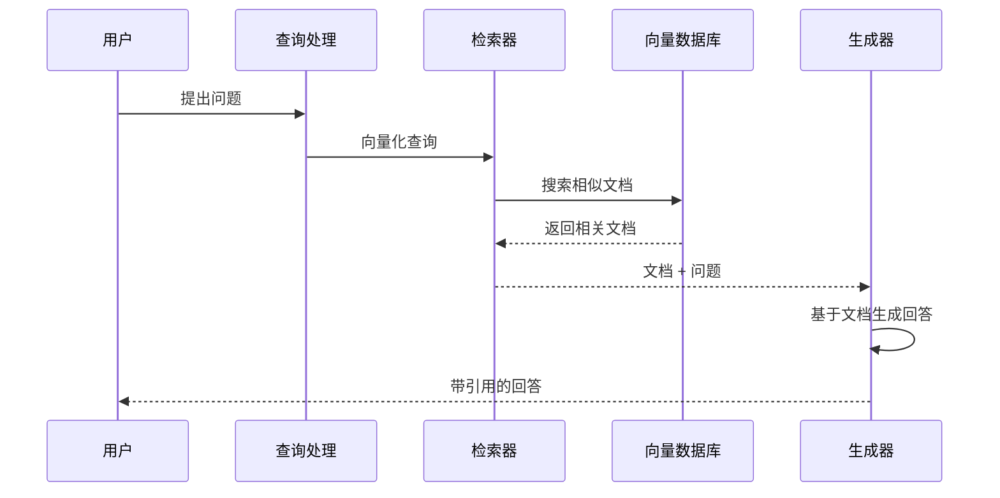
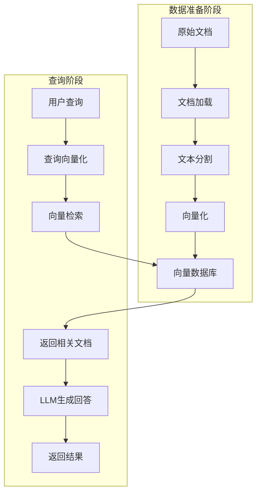
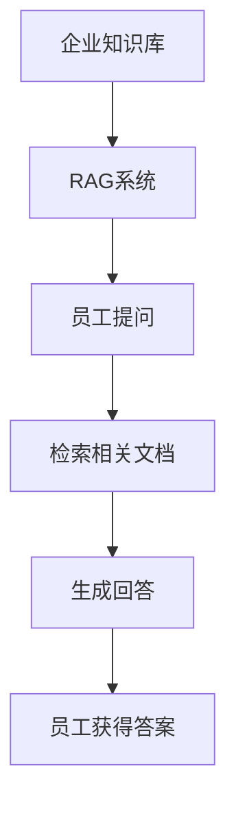
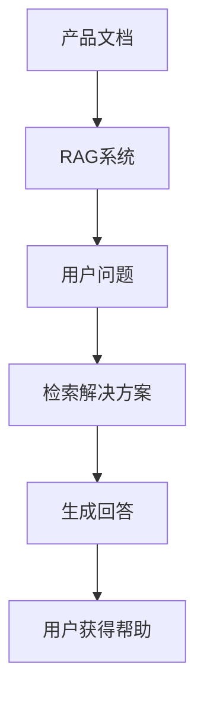
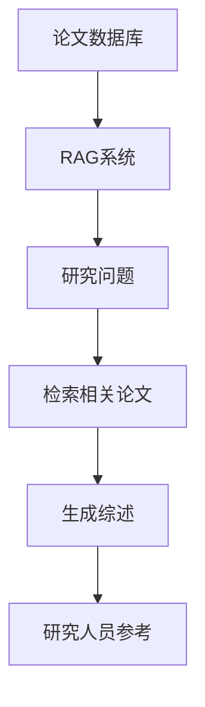
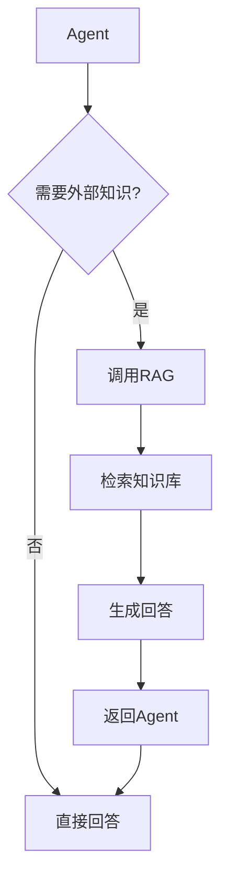

# RAG（检索增强生成）

> 小白先读：RAG 是给 AI 配一个“可翻资料的书架”。模型回答前先去资料库查证，再基于查到的内容回答。
>
> 学这篇时先抓 3 个问题：资料从哪里来？怎么找到相关资料？回答里怎么体现依据？

## 先用一句生活话理解

不开 RAG 的 LLM 像闭卷考试，全靠记忆，可能记错。RAG 像开卷考试，先翻资料再作答，答案更容易贴近真实资料。

RAG 的核心价值是：**让 AI 的回答更可追溯、更贴近你的私有知识库。**

## 一、什么是 RAG

**RAG**（Retrieval-Augmented Generation，检索增强生成）是一种将**信息检索**与**生成模型**相结合的技术，能够让 AI 在生成回答时引用外部知识库。

**生动比喻**：如果把 LLM 比作一个"记忆力很好但可能记错的学者"，那么 RAG 就是给这个学者配备了一个"图书馆"，让他在回答问题时可以查阅资料，确保回答的准确性。

## 二、RAG 的核心价值

### 2.1 解决的问题

| 问题 | 传统LLM | RAG解决方案 |
|------|---------|-------------|
| **幻觉问题** | 可能生成错误信息 | 引用真实资料 |
| **时效性** | 知识截止到训练时间 | 可以获取最新信息 |
| **领域知识** | 通用知识为主 | 可以接入专业知识库 |
| **可追溯性** | 无法验证来源 | 提供引用来源 |

### 2.2 RAG vs 传统方法



## 三、RAG 的工作原理

### 3.1 核心流程



### 3.2 架构组件

| 组件 | 功能 | 说明 |
|------|------|------|
| **文档加载器** | 加载各种格式的文档 | PDF、Word、网页等 |
| **文本分割器** | 将文档分割成小块 | 便于检索 |
| **嵌入模型** | 将文本转换为向量 | 计算相似度 |
| **向量数据库** | 存储和检索向量 | FAISS、Pinecone等 |
| **检索器** | 执行相似度搜索 | 找到相关文档 |
| **生成器** | 基于文档生成回答 | LLM |

### 3.3 技术架构图



## 四、RAG 的实现步骤

### 4.1 数据准备

```python
# 伪代码示例：加载和处理文档
from langchain.document_loaders import PDFLoader
from langchain.text_splitter import RecursiveCharacterTextSplitter
from langchain.embeddings import OpenAIEmbeddings
from langchain.vectorstores import FAISS

# 1. 加载文档
loader = PDFLoader("document.pdf")
documents = loader.load()

# 2. 分割文档
text_splitter = RecursiveCharacterTextSplitter(
    chunk_size=1000,
    chunk_overlap=200
)
splits = text_splitter.split_documents(documents)

# 3. 创建向量数据库
embeddings = OpenAIEmbeddings()
vector_db = FAISS.from_documents(splits, embeddings)

# 4. 保存向量数据库
vector_db.save_local("faiss_index")
```

### 4.2 查询流程

```python
# 伪代码示例：查询RAG系统
from langchain.chains import RetrievalQA
from langchain.llms import OpenAI

# 加载向量数据库
vector_db = FAISS.load_local("faiss_index", embeddings)

# 创建检索器
retriever = vector_db.as_retriever(
    search_kwargs={"k": 4}  # 返回4个最相关的文档
)

# 创建QA链
qa_chain = RetrievalQA.from_chain_type(
    llm=OpenAI(),
    chain_type="stuff",
    retriever=retriever,
    return_source_documents=True
)

# 查询
result = qa_chain({"query": "什么是RAG?"})
print(result["result"])
print("引用来源:", [doc.metadata["source"] for doc in result["source_documents"]])
```

## 五、RAG 的类型

### 5.1 按检索策略分类

| 类型 | 说明 | 适用场景 |
|------|------|----------|
| **Basic RAG** | 直接检索相似文档 | 简单问答 |
| **Hybrid RAG** | 结合关键词和语义检索 | 复杂查询 |
| **Multi-modal RAG** | 支持文本、图像等 | 多模态数据 |
| **Self-RAG** | 自动决定是否检索 | 灵活场景 |
| **RAG Fusion** | 融合多个检索结果 | 提升准确性 |

### 5.2 按文档处理方式分类

| 类型 | 说明 | 特点 |
|------|------|------|
| **Stuff** | 将所有文档塞进提示词 | 简单但受限 |
| **Map-Reduce** | 分别处理再汇总 | 处理长文档 |
| **Refine** | 迭代优化回答 | 高质量回答 |
| **Map-Rerank** | 分别评分再选择 | 快速准确 |

## 六、RAG 的优化策略

### 6.1 优化方向

| 优化方向 | 方法 | 效果 |
|----------|------|------|
| **文档分割** | 优化chunk大小 | 提高检索精度 |
| **嵌入模型** | 使用更好的模型 | 提高语义理解 |
| **检索策略** | 混合检索 | 提高召回率 |
| **提示词** | 优化提示词 | 提高生成质量 |
| **Reranking** | 重新排序结果 | 提高相关性 |

### 6.2 常见问题与解决方案

| 问题 | 解决方案 |
|------|----------|
| **检索不到相关文档** | 调整chunk大小、使用更好的嵌入模型 |
| **文档太多导致提示词过长** | 使用Map-Reduce或Refine策略 |
| **回答不引用文档** | 优化提示词，强制引用 |
| **文档过时** | 定期更新知识库 |

## 七、RAG 的应用场景

### 7.1 企业知识管理



### 7.2 客服系统



### 7.3 学术研究



## 八、RAG 与其他技术的结合

### 8.1 RAG + Agent



### 8.2 RAG + Fine-tuning

| 方法 | 优点 | 缺点 |
|------|------|------|
| **仅RAG** | 灵活、无需重新训练 | 可能不如微调精确 |
| **仅微调** | 精确、快速 | 需要大量数据 |
| **RAG+微调** | 结合两者优点 | 复杂度高 |

## 九、总结

RAG 是提升 LLM 准确性和实用性的重要技术，具有以下特点：

1. **解决幻觉问题**：基于真实文档生成回答
2. **支持最新知识**：可以接入实时数据
3. **可追溯性**：提供引用来源
4. **灵活扩展**：易于添加新的知识库

**使用建议**：
- 根据场景选择合适的RAG类型
- 优化文档分割和检索策略
- 结合提示词工程提升效果

---

## 十、和当前比赛项目的关系

你的 Obsidian 文档库非常适合做 RAG 知识源：

- 比赛规则、评分标准、提交要求可以作为答辩问答资料。
- StarryOS、RK3588、NPU、QEMU 文档可以作为技术问答资料。
- 会议记录、过程记录可以作为项目复盘资料。

如果后续做 Asking Star 或项目助手，可以让它先检索你的文档，再回答“当前项目做到哪了”“PPT 应该怎么讲”“某个模块有什么风险”。这比让模型凭记忆回答可靠得多。
