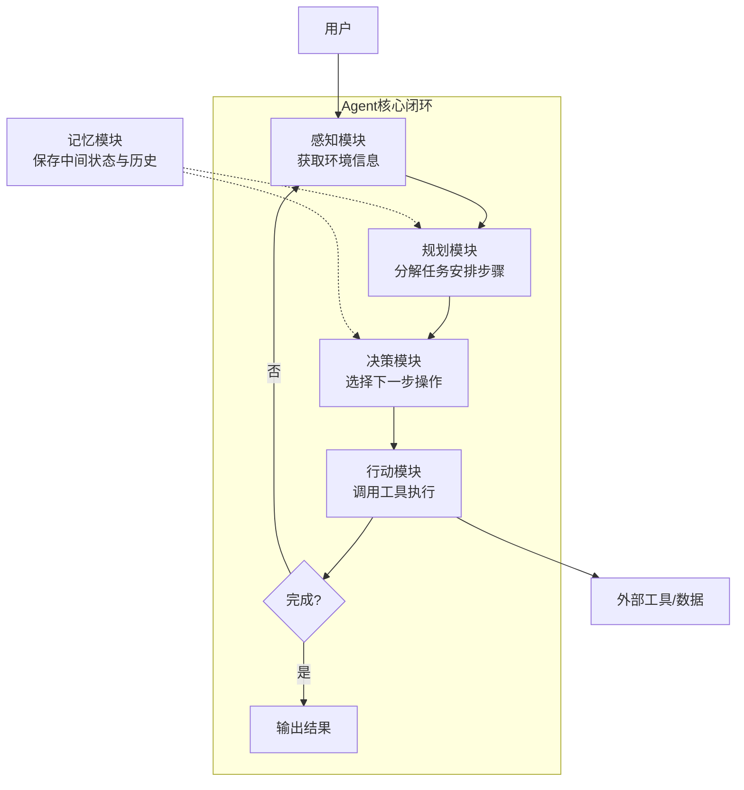
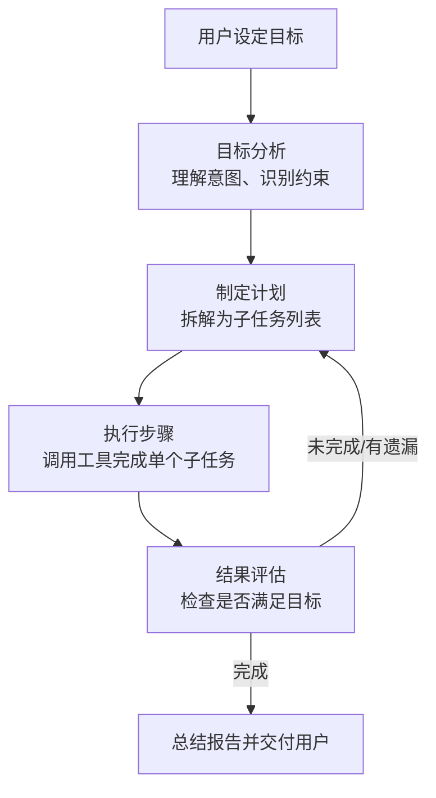
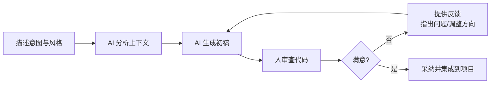

# Agent 与 VibeCoding：AI 的两大应用形态

> Agent 是"AI 自己干"，给个目标就能自主推进任务；VibeCoding 是"AI 帮人干"，人和 AI 一起写代码、改文档。两者是 AI 落地最典型的两种形态——一个走向自主，一个走向协作。本文分别讲解两者的特征、架构与适用场景。

**关键词**：Agent、VibeCoding、智能代理、人机协作、自主任务、工具调用

## 抽象类比

- 普通 LLM 像一个"知识渊博的顾问"——你问什么，它答什么，但不会主动干活
- Agent 像一个"能自己干活的助理"——你说"帮我准备答辩"，它会主动找资料、写大纲、查遗漏、再交付，自己拆任务、用工具、检查结果
- VibeCoding 像"结对编程的搭档"——你和 AI 一起写代码，你描述思路、AI 写实现、你提反馈、AI 改代码，节奏由你们的"默契"决定

普通 LLM 从"回答问题"出发，Agent 从"完成任务"出发，VibeCoding 从"协作生产"出发。

## 适合人群 / 预备知识 / 学习路径

- **适合人群**：刚开始接触 AI 应用的开发者、产品经理、办公用户
- **预备知识**：了解 LLM（大语言模型）的基本概念即可
- **学习路径**：
  1. 先理解 Agent 的"自主行动"特征
  2. 再理解 VibeCoding 的"人机协作"思路
  3. 最后通过对比，弄清什么场景该用哪种

---

# 第一部分：Agent 智能代理

## 一、什么是 Agent

**Agent**（智能代理）是一种能够**自主感知、决策和行动**的 AI 系统。你给它一个目标，它会自己拆任务、查资料、用工具、检查结果，最后把成果交付给你。

**生动比喻**：普通 AI 像一个"知识渊博的顾问"——你问什么，它答什么；Agent 像一个"能干的助理"——你说"帮我准备答辩"，它会主动找资料、写大纲、查遗漏、再交付。

**核心区别**：普通 LLM 从"回答问题"出发，Agent 从"完成任务"出发。

### Agent 的核心特征

- **自主性**：无需人类每步干预，自动推进任务（如自动搜索信息、生成报告）
- **感知能力**：能从环境获取信息（读文件、网络搜索、读取传感器）
- **决策能力**：能根据目标选择下一步该做什么
- **行动能力**：能执行具体操作（调用工具、写入文件、发邮件）
- **反思能力**：执行后能评估结果，失败时调整策略再试

## 二、Agent 的架构

Agent 的核心是一个"感知—规划—执行"的闭环，配合记忆模块支撑长期任务。

各模块职责：

- **感知模块**：读取用户输入、文件、网络信息
- **规划模块**：把大目标拆成可执行的小步骤
- **决策模块**：在多个候选方案中选一个
- **行动模块**：调用工具、写入文件、触发外部系统
- **记忆模块**：保存中间结果、历史对话，避免重复劳动

## 三、Agent 的工作流程

Agent 收到目标后，会按"分析—计划—执行—评估"循环推进，直到任务完成。

**举例**：用户说"帮我写一份本周销售周报"

1. 目标分析：识别"本周""销售""周报"等关键信息
2. 制定计划：读销售数据 → 统计指标 → 找异常 → 写初稿
3. 执行步骤：依次调用数据接口、统计函数、模板生成
4. 结果评估：检查是否覆盖核心指标、有无遗漏
5. 完成交付：把周报返回给用户

## 四、Agent = LLM + MCP + RAG + Skill

Agent 不是单一模型，而是多个能力组合而成：

- **LLM（大语言模型）**：Agent 的"大脑"，负责理解、推理、决策
- **MCP（模型上下文协议）**：Agent 的"标准接口"，让 Agent 能连接各种外部工具和数据源，像 USB 一样即插即用
- **RAG（检索增强生成）**：Agent 的"长期记忆"，从知识库检索相关资料再生成答案，避免胡编
- **Skill（技能）**：Agent 的"专业能力包"，封装好的工具集（如代码执行、文档解析、网页抓取），可按需加载

一句话理解：LLM 想事，MCP 连外设，RAG 查资料，Skill 出力气。

## 五、多 Agent 协作

复杂任务单靠一个 Agent 难以完成，可以由多个 Agent 分工协作：

- **任务分工**：每个 Agent 专注一个角色（如规划 Agent、执行 Agent、评审 Agent）
- **通信协调**：Agent 之间通过消息传递共享状态和结果
- **典型模式**：
  - 规划者 + 执行者：一个负责拆任务，一个负责干活
  - 主 Agent + 子 Agent：主 Agent 调度，子 Agent 专精不同领域
  - 评审闭环：一个写、一个查，互相校验
- **优势**：模块化、可并行、各司其职；难点是通信成本和一致性保证

---

# 第二部分：VibeCoding 氛围编码

## 六、什么是 VibeCoding

**VibeCoding** 是一种人机协作的编程范式：人把目标、风格、约束说清楚，AI 快速生成初稿，人再审查、反馈、迭代。

**生动比喻**：

- 传统编程像"照着菜谱做菜"——每一步都精确按步骤来
- VibeCoding 像"跟着感觉做菜"——你描述想要的口味和氛围，AI 帮你把食材和做法搭出来，你再尝尝咸淡、调整火候

**核心不是偷懒**，而是把人从重复打字里解放出来，把注意力放到**判断、设计和验证**上。

### VibeCoding 的核心思想

- **意图优先**：先说"要什么效果"，再让 AI 写"怎么实现"
- **风格感知**：AI 理解项目既有代码风格，保持一致
- **协同创作**：人和 AI 反复来回，逐步逼近想要的结果
- **实时反馈**：每次反馈立刻体现到下一版代码里
- **风格迁移**：可以把代码从一种风格改成另一种（如命令式 → 函数式）

## 七、工作流程

VibeCoding 是一个"描述—生成—反馈—迭代"的循环过程。

**实用技巧**：

- 用形容词描述风格（简洁、优雅、函数式、防御式）
- 给一段示例代码作为风格参考
- 一次只改一个点，迭代多次而不是一次要全部
- 生成后必看必跑，不能直接交付

## 八、典型工具

主流 VibeCoding 工具：

- **Cursor**：AI 优先的代码编辑器，深度集成主流大模型，支持整库上下文
- **GitHub Copilot**：AI 代码补全与对话，嵌入 VS Code、JetBrains 等 IDE
- **Claude Code / Codex CLI**：命令行 Agent 式编码助手，可执行多步任务
- **Trae / 通义灵码 / 文心快码**：国内主流 AI 编程助手，支持中文场景
- **CodeLlama / StarCoder**：开源代码模型，可本地部署、自主微调

选择建议：日常补全用 Copilot，整库改造用 Cursor，命令行任务用 Claude Code，本地私有化用开源模型。

---

# 第三部分：对比与联系

## 九、Agent vs VibeCoding

两者都是 AI 落地形态，但定位不同：

- **自主性**
  - Agent：高度自主，给目标就能跑完整个流程
  - VibeCoding：人主导每一步，AI 辅助生成
- **人参与度**
  - Agent：人主要在开头设目标和最后看结果
  - VibeCoding：人全程参与，反复反馈
- **适用场景**
  - Agent：目标明确、可自动化的任务（报告生成、数据分析、运维巡检）
  - VibeCoding：需要创意和判断的创作（写代码、改文档、做原型）
- **失败成本**
  - Agent：要警惕跑偏，需要设置边界和检查点
  - VibeCoding：每步都有人审，风险较低
- **本质区别**：Agent 把人从流程中后撤，VibeCoding 把人和 AI 拉得更近

一句话总结：**Agent 把活儿接走，VibeCoding 把活儿变快**。

## 十、面试 Q&A

**Q1：Agent 和普通 LLM 聊天机器人有什么区别？**

- 普通 LLM：一问一答，只输出文本，不执行动作
- Agent：有目标、能规划、能调用工具、能检查结果并自我修正
- 类比：LLM 是顾问，Agent 是助理；顾问给建议，助理把事办完

**Q2：VibeCoding 会不会让开发者变菜？**

- 不会取代判断力，但会改变技能结构：从"会写"转向"会审、会设计、会调"
- 重复劳动交给 AI，人专注架构、需求、验证
- 关键风险：盲目采纳、不审代码、不跑测试，反而埋下隐患

**Q3：什么场景该用 Agent，什么场景该用 VibeCoding？**

- 目标清晰、步骤可自动化、人参与成本高 → 用 Agent
- 创作性强、需要人的判断和审美、需要多次迭代 → 用 VibeCoding
- 复杂项目里两者常配合：Agent 跑流程性任务，VibeCoding 处理创造性部分

## 十一、如何向他人解释

给完全不懂的人讲，可以用一句话加一个对比例子：

- **一句话**：Agent 是"AI 自己干"，VibeCoding 是"AI 帮人干"
- **对比例子**：
  - Agent：你说"帮我订明早 7 点去北京的票"，它自己查航班、比价格、下单、回你结果
  - VibeCoding：你说"我想写个登录页面，简洁现代风"，AI 给你初稿，你看了说"按钮再大点、配色再柔和点"，来回几轮改到满意
- **强调重点**：两者不是对立，而是互补——能自动化的交给 Agent，需要人判断的用 VibeCoding 协作

---

**参考链接**：

- MCP 协议：https://modelcontextprotocol.io
- Cursor：https://www.cursor.com
- GitHub Copilot：https://github.com/features/copilot
