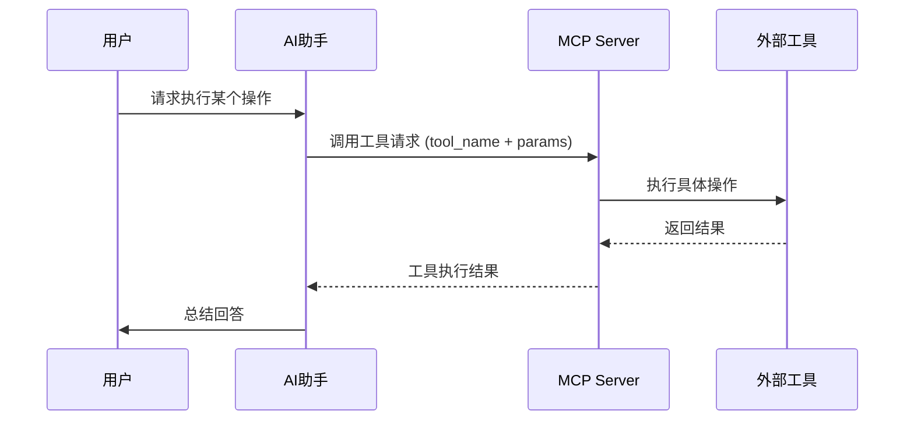
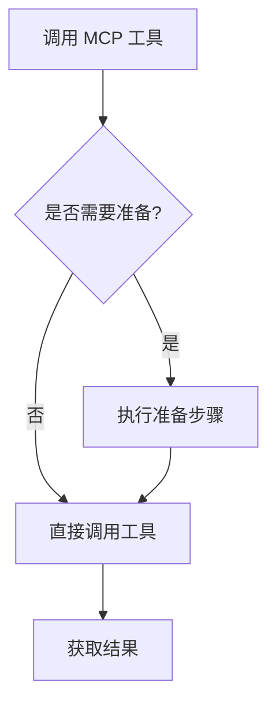

# MCP (Model Context Protocol) 

> 小白先读：MCP 可以理解成“AI 使用工具的插座标准”。有了统一接口，不同 AI 应用就能更方便地连接文件、数据库、浏览器、命令行、业务系统。
>
> 学这篇时先抓 3 个问题：AI 要连接什么外部能力？谁提供工具？谁来调用工具？

## 先用一句生活话理解

如果每个电器都用不同插头，家里会乱成一团。MCP 的作用类似统一插座：工具提供方按标准暴露能力，AI 客户端按标准接入能力。

所以 MCP 的核心不是“某个工具”，而是：**让 AI 连接外部世界时有统一协议。**

## 一、什么是 MCP

**MCP**是一种**插件机制**，允许 AI 助手调用外部工具来扩展能力。

**生动比喻**：如果把 AI 助手比作一个聪明的大脑，那么 MCP 就是连接大脑和外部世界的"手臂"，让 AI 能够执行实际操作。

## 二、MCP 的工作原理

### 2.1 核心概念

| 概念 | 说明 |
|------|------|
| **MCP Server** | MCP 服务提供者，运行在本地或远程 |
| **MCP Tool** | 具体的工具函数，如文件操作、浏览器控制、数据库查询等 |
| **Tool Call** | AI 助手调用 MCP 工具的过程 |
| **Context** | 工具执行所需的上下文信息 |

### 2.2 工作流程



### 2.3 调用流程详解

1. **用户提问**：用户提出需要工具执行的请求
2. **AI 分析**：AI 识别需求，决定调用哪个 MCP 工具
3. **参数准备**：AI 准备工具所需的参数
4. **发送请求**：通过 MCP 协议发送工具调用请求
5. **工具执行**：MCP Server 执行实际操作
6. **返回结果**：工具执行完成后返回结果
7. **结果总结**：AI 总结结果并回复用户

## 三、常用 MCP 工具分类

### 3.1 文件操作类

| 工具 | 功能 | 示例 |
|------|------|------|
| `Read` | 读取文件内容 | `Read(file_path="e:\docs\test.txt")` |
| `Write` | 写入文件内容 | `Write(file_path="e:\docs\test.txt", content="hello")` |
| `Edit` | 修改文件内容 | `Edit(file_path="e:\docs\test.txt", old="a", new="b")` |
| `DeleteFile` | 删除文件 | `DeleteFile(file_paths=["e:\docs\test.txt"])` |
| `Glob` | 文件匹配 | `Glob(pattern="*.md")` |
| `LS` | 列出目录 | `LS(path="e:\docs")` |

### 3.2 命令执行类

| 工具 | 功能 | 示例 |
|------|------|------|
| `RunCommand` | 执行系统命令 | `RunCommand(command="git status", cwd="e:\project")` |
| `CheckCommandStatus` | 检查命令状态 | `CheckCommandStatus(command_id="xxx")` |
| `StopCommand` | 停止命令 | `StopCommand(command_id="xxx")` |

### 3.3 浏览器控制类

| 工具 | 功能 | 示例 |
|------|------|------|
| `browser_navigate` | 导航到网页 | `browser_navigate(url="https://www.example.com")` |
| `browser_click` | 点击页面元素 | `browser_click(selector="button")` |
| `browser_type` | 输入文本 | `browser_type(text="hello")` |
| `browser_snapshot` | 获取页面快照 | `browser_snapshot()` |

### 3.4 搜索查询类

| 工具 | 功能 | 示例 |
|------|------|------|
| `SearchCodebase` | 搜索代码库 | `SearchCodebase(information_request="authentication")` |
| `Grep` | 文本搜索 | `Grep(pattern="func", path="e:\project")` |
| `WebSearch` | 网络搜索 | `WebSearch(query="AI最新进展")` |
| `WebFetch` | 获取网页内容 | `WebFetch(url="https://example.com")` |

### 3.5 其他工具

| 工具 | 功能 |
|------|------|
| `AskUserQuestion` | 向用户提问获取信息 |
| `TodoWrite` | 管理任务列表 |
| `GetDiagnostics` | 获取代码诊断信息 |
| `OpenPreview` | 打开预览 |

## 四、如何使用 MCP

### 4.1 基本调用格式

```python
# MCP 工具调用的标准格式
tool_result = run_mcp(
    server_name="server_name",
    tool_name="tool_name",
    args={
        "param1": "value1",
        "param2": "value2"
    }
)
```

### 4.2 使用示例

**示例1：读取文件**
```python
# 读取代码文件
result = Read(file_path="e:\project\main.py")
print(result.content)
```

**示例2：执行命令**
```python
# 构建项目
result = RunCommand(
    command="cargo build --release",
    cwd="e:\rust_project",
    blocking=True,
    requires_approval=False
)
print(result.output)
```

**示例3：搜索代码**
```python
# 在代码库中搜索认证相关代码
results = SearchCodebase(
    information_request="authentication token handling",
    target_directories=["e:\project\src"]
)
```

### 4.3 调用前的准备

在调用某些 MCP 工具前，需要先进行准备工作：



**需要准备的工具示例**：
- **browser_* 工具**：需要先获取页面快照了解元素
- **某些驱动工具**：需要先初始化连接

## 五、推荐的 MCP 使用场景

### 5.1 代码开发

| 场景 | 使用工具 |
|------|----------|
| 查看项目结构 | `LS`, `Glob` |
| 读取源代码 | `Read` |
| 搜索代码 | `Grep`, `SearchCodebase` |
| 修改代码 | `Edit`, `Write` |
| 运行测试 | `RunCommand` |

### 5.2 文档处理

| 场景 | 使用工具 |
|------|----------|
| 创建文档 | `Write` |
| 修改文档 | `Edit` |
| 搜索文档 | `Grep` |
| 网络搜索 | `WebSearch`, `WebFetch` |

### 5.3 系统管理

| 场景 | 使用工具 |
|------|----------|
| 执行命令 | `RunCommand` |
| 监控进程 | `CheckCommandStatus` |
| 任务管理 | `TodoWrite` |

### 5.4 自动化测试

| 场景 | 使用工具 |
|------|----------|
| 浏览器自动化 | `browser_*` 系列工具 |
| 命令行测试 | `RunCommand` |
| 结果验证 | `GetDiagnostics` |

## 六、常见问题与解决方案

### 6.1 权限问题

**问题**：执行命令时提示权限不足

**解决方案**：
- 使用 `requires_approval` 参数
- 在命令前添加 `sudo`（Linux）或以管理员身份运行（Windows）

### 6.2 路径问题

**问题**：文件路径错误导致读取失败

**解决方案**：
- 使用绝对路径
- 注意路径分隔符（Windows 使用 `\`，Linux/Mac 使用 `/`）
- 使用 `Glob` 工具先确认文件存在

### 6.3 工具不存在

**问题**：调用工具时提示不存在

**解决方案**：
- 确认 MCP Server 已启动
- 确认工具名称拼写正确
- 检查工具是否已安装

### 6.4 网络问题

**问题**：WebSearch 或 WebFetch 失败

**解决方案**：
- 检查网络连接
- 确认网址正确
- 尝试使用其他搜索引擎

### 6.5 命令执行超时

**问题**：长时间运行的命令超时

**解决方案**：
- 设置 `blocking=False` 以非阻塞方式运行
- 使用 `CheckCommandStatus` 轮询状态

## 七、最佳实践

### 7.1 参数验证

调用工具前验证参数：

```python
# 伪代码示例
def safe_read_file(file_path):
    # 验证路径
    if not file_path or not isinstance(file_path, str):
        raise ValueError("file_path must be a non-empty string")
    
    # 检查文件是否存在
    files = Glob(pattern=file_path)
    if not files:
        raise FileNotFoundError(f"File not found: {file_path}")
    
    return Read(file_path=file_path)
```

### 7.2 错误处理

```python
# 伪代码示例
try:
    result = RunCommand(command="rm -rf /", cwd="/")
except Exception as e:
    print(f"Command failed: {e}")
    # 回滚或重试逻辑
```

### 7.3 日志记录

```python
# 伪代码示例
def log_tool_call(tool_name, args, result):
    print(f"Tool: {tool_name}")
    print(f"Args: {args}")
    print(f"Result: {result}")
    print(f"Timestamp: {datetime.now()}")
```

## 八、总结

MCP 是 Trae 平台的核心扩展机制，具有以下特点：

1. **功能强大**：支持文件操作、命令执行、浏览器控制等多种能力
2. **易于使用**：提供统一的调用接口
3. **安全可控**：通过权限控制确保操作安全
4. **灵活扩展**：可以添加自定义 MCP Server

**使用建议**：
- 熟悉常用工具的功能和参数
- 遵循最佳实践，做好错误处理
- 根据场景选择合适的工具

---

## 九、和当前比赛项目的关系

你的 Obsidian 文档库、项目代码、测试脚本、QEMU 输出、构建产物都可以看成 AI 需要访问的外部上下文。MCP 思想可以帮助你把这些资源整理成可调用工具：

- 文件读取：让 AI 自动分析文档和代码。
- 命令执行：让 AI 帮你跑构建、测试、日志检查。
- 报告生成：把测试结果转成 Markdown 或 PPT 内容。
- 项目管理：把待办、风险、过程记录自动串起来。

可以这样讲：**MCP 让 AI 不只是聊天窗口，而是能安全调用项目工具的协作者。**
