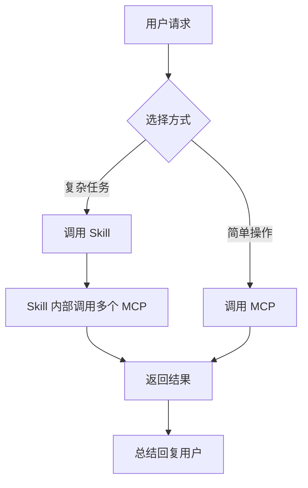
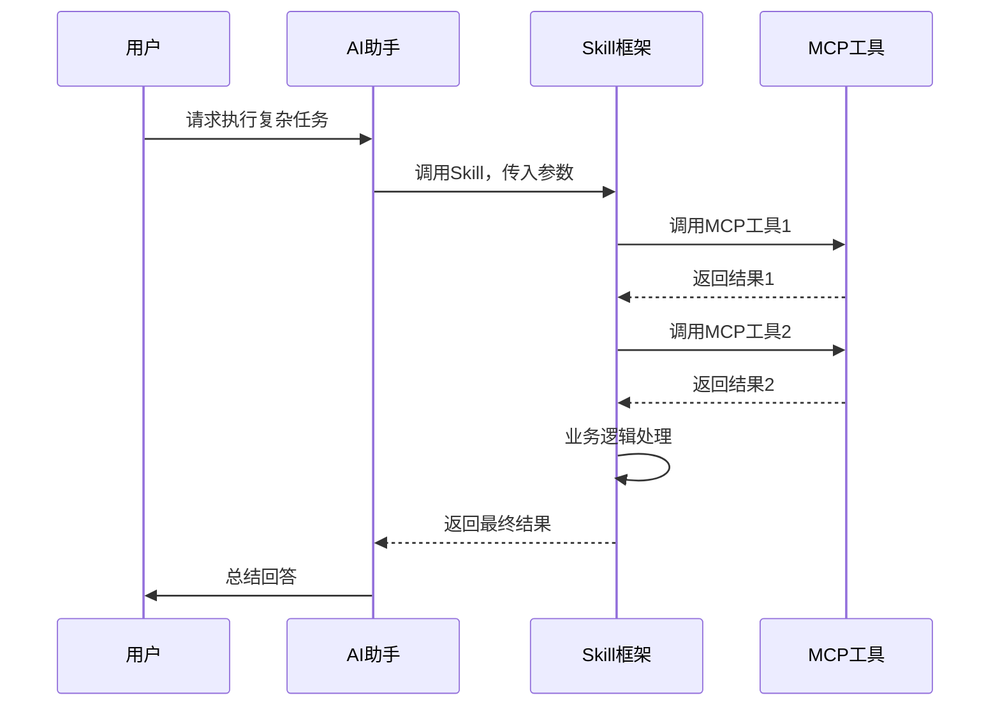
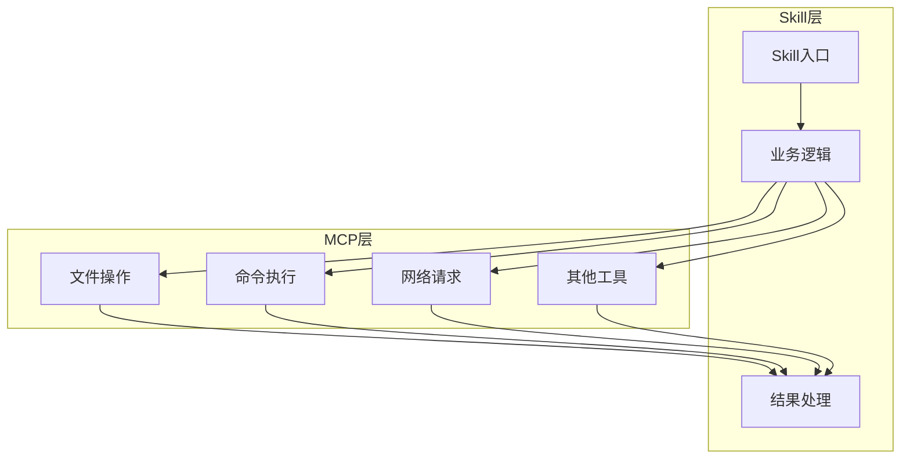
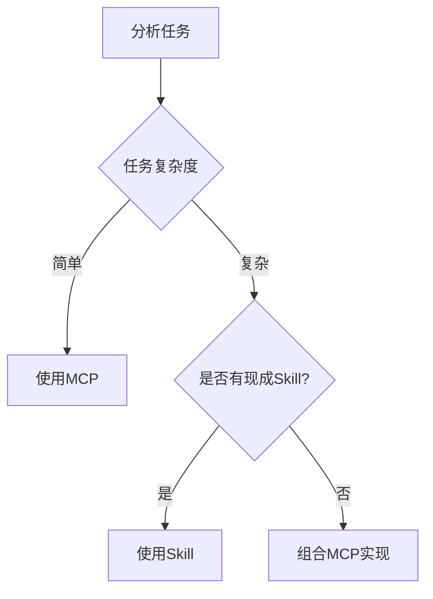

# Skill（技能）

> 小白先读：Skill 是给 AI 装上的“专业工作流程”。普通工具只会做一个动作，Skill 会把一组动作组织成可复用的方法。
>
> 学这篇时先抓 3 个问题：这个技能解决什么任务？它调用哪些工具？它输出什么可用结果？

## 先用一句生活话理解

工具像锤子、螺丝刀；Skill 像“会装书架的手艺”。有工具不等于会干活，Skill 把工具、步骤、经验和标准组合起来。

所以 Skill 的核心是：**把一次次成功经验沉淀成可重复调用的能力。**

## 一、什么是 Skill

**Skill**（技能）是一种**高级能力扩展机制**，与 MCP 不同，Skill 是更高层次的封装，通常包含复杂的业务逻辑。

**生动比喻**：如果 MCP 是"工具"，那么 Skill 就是"技能"。MCP 是螺丝刀、锤子等工具，而 Skill 是"组装家具"、"修理汽车"等完整技能。

## 二、Skill 与 MCP 的区别

| 特性 | MCP | Skill |
|------|-----|-------|
| **层次** | 底层工具 | 高层技能 |
| **复杂度** | 简单操作 | 复杂流程 |
| **封装程度** | 单一功能 | 多个工具组合 |
| **调用方式** | 直接调用 | 通过 Skill 框架 |
| **适用场景** | 基础操作 | 完整任务 |



## 三、常用 Skill 列表

### 3.1 已安装的 Skill

| Skill 名称 | 功能描述 | 适用场景 |
|------------|----------|----------|
| `TRAE-code-review` | 代码审查 | 审查合并请求、代码差异 |
| `TRAE-debugger` | 运行时调试 | 复杂问题调试、收集日志 |
| `TRAE-generate-mini-app` | 生成小程序 | 创建微信小程序、跨端应用 |
| `TRAE-security-review` | 安全扫描 | 代码安全审查、漏洞检测 |
| `skill-creator` | 创建 Skill | 开发自定义技能 |
| `web-artisan` | 网页开发 | 创建网页、游戏、可视化 |
| `web-design-docs` | 设计文档 | 生成技术文档、PRD |
| `web-dev` | Web 开发 | 创建完整网站、应用 |

### 3.2 Skill 详细介绍

#### TRAE-code-review（代码审查）

**功能**：审查代码质量、正确性和最佳实践

**使用场景**：
- 代码合并前的审查
- 代码质量检查
- 团队代码规范检查

**调用方式**：
```python
# 伪代码
Skill("TRAE-code-review").invoke({
    "file_path": "e:\project\main.py",
    "check_style": True,
    "check_security": True
})
```

#### TRAE-debugger（调试器）

**功能**：运行时调试，收集日志

**使用场景**：
- 复杂 Bug 诊断
- 性能问题分析
- 运行时错误追踪

**调用方式**：
```python
# 伪代码
Skill("TRAE-debugger").invoke({
    "mode": "debug",
    "target_process": "app.exe",
    "log_level": "debug"
})
```

#### TRAE-generate-mini-app（小程序生成）

**功能**：生成基于 Taro 框架的小程序

**使用场景**：
- 创建微信小程序
- 跨端小程序开发
- 快速原型开发

**调用方式**：
```python
# 伪代码
Skill("TRAE-generate-mini-app").invoke({
    "name": "我的小程序",
    "template": "blank",
    "features": ["tabs", "router"]
})
```

#### TRAE-security-review（安全审查）

**功能**：代码安全扫描和漏洞检测

**使用场景**：
- 安全漏洞检测
- 敏感信息泄露检查
- 安全最佳实践检查

**调用方式**：
```python
# 伪代码
Skill("TRAE-security-review").invoke({
    "target_dir": "e:\project",
    "scan_type": "full",
    "report_format": "html"
})
```

#### web-artisan（网页工匠）

**功能**：创建网页、游戏、可视化应用

**使用场景**：
- 创建交互式游戏
- 数据可视化仪表盘
- 实用工具网页

**调用方式**：
```python
# 伪代码
Skill("web-artisan").invoke({
    "type": "game",
    "theme": "pixel",
    "features": ["score", "levels"]
})
```

#### web-design-docs（设计文档）

**功能**：生成技术设计文档

**使用场景**：
- 生成 PRD 文档
- 技术架构文档
- UI 设计规范

**调用方式**：
```python
# 伪代码
Skill("web-design-docs").invoke({
    "type": "prd",
    "title": "用户管理系统",
    "sections": ["需求", "设计", "接口"]
})
```

## 四、Skill 的工作原理

### 4.1 Skill 执行流程



### 4.2 Skill 架构



## 五、如何使用 Skill

### 5.1 调用方式

```python
# 标准调用格式
result = Skill("skill_name").invoke({
    "param1": "value1",
    "param2": "value2"
})
```

### 5.2 使用示例

**示例1：代码审查**
```python
# 审查整个项目
result = Skill("TRAE-code-review").invoke({
    "target_dir": "e:\my_project",
    "output_file": "review_report.md"
})
```

**示例2：创建网页**
```python
# 创建一个计算器网页
result = Skill("web-artisan").invoke({
    "type": "utility",
    "name": "科学计算器",
    "features": ["basic_ops", "scientific"]
})
```

**示例3：生成小程序**
```python
# 生成电商小程序
result = Skill("TRAE-generate-mini-app").invoke({
    "name": "电商商城",
    "template": "ecommerce",
    "pages": ["首页", "商品列表", "购物车", "订单"]
})
```

### 5.3 调用时机

**何时使用 Skill**：
- 任务复杂，需要多个步骤
- 需要专业领域知识
- 需要生成复杂输出（如文档、代码）

**何时使用 MCP**：
- 简单的文件操作
- 执行单个命令
- 快速搜索

## 六、创建自定义 Skill

### 6.1 Skill 开发流程


### 6.2 Skill 结构示例

```python
# 伪代码示例
class MySkill:
    def __init__(self):
        self.name = "my-skill"
        self.description = "自定义技能"
    
    def invoke(self, params):
        # 步骤1: 解析参数
        input_file = params.get("input_file")
        output_file = params.get("output_file")
        
        # 步骤2: 调用MCP工具
        content = Read(file_path=input_file).content
        
        # 步骤3: 业务处理
        processed = self.process_content(content)
        
        # 步骤4: 输出结果
        Write(file_path=output_file, content=processed)
        
        return {"status": "success"}
    
    def process_content(self, content):
        # 自定义处理逻辑
        return content.upper()
```

### 6.3 使用 skill-creator

```python
# 使用 skill-creator 创建新技能
Skill("skill-creator").invoke({
    "name": "我的技能",
    "description": "描述我的技能",
    "entry_point": "main.py",
    "requirements": ["requests", "pandas"]
})
```

## 七、常见问题与解决方案

### 7.1 Skill 未找到

**问题**：调用 Skill 时提示不存在

**解决方案**：
- 确认 Skill 名称拼写正确
- 检查 Skill 是否已安装
- 检查网络连接（部分 Skill 需要在线服务）

### 7.2 参数错误

**问题**：传入参数不正确导致失败

**解决方案**：
- 查看 Skill 的参数说明
- 使用 `AskUserQuestion` 确认参数
- 添加参数验证逻辑

### 7.3 执行超时

**问题**：Skill 执行时间过长

**解决方案**：
- 优化 Skill 内部逻辑
- 拆分任务为多个步骤
- 使用异步方式执行

### 7.4 结果不符合预期

**问题**：Skill 返回结果不符合预期

**解决方案**：
- 检查输入参数是否正确
- 查看 Skill 的详细日志
- 尝试调整参数

## 八、最佳实践

### 8.1 选择合适的工具



### 8.2 错误处理

```python
# 伪代码示例
try:
    result = Skill("my-skill").invoke(params)
except Exception as e:
    print(f"Skill执行失败: {e}")
    # 回滚操作或提示用户
```

### 8.3 参数验证

```python
# 伪代码示例
def validate_params(params):
    required = ["input", "output"]
    for param in required:
        if param not in params:
            raise ValueError(f"缺少参数: {param}")
    return True
```

## 九、总结

Skill 是 Trae 平台的高级能力扩展机制，具有以下特点：

1. **高层次封装**：将复杂任务封装为简单调用
2. **业务逻辑集成**：包含专业领域知识
3. **多工具组合**：内部调用多个 MCP 工具
4. **易于扩展**：支持自定义 Skill 开发

**使用建议**：
- 根据任务复杂度选择合适的工具类型
- 熟悉常用 Skill 的功能和参数
- 掌握自定义 Skill 的开发方法

---

## 十、和当前比赛项目的关系

你可以把比赛中的重复工作沉淀成 Skill 思想：

- 文档整理 Skill：把会议记录整理成过程记录。
- 测试分析 Skill：读取 QEMU 日志并输出问题定位。
- 答辩准备 Skill：根据评分标准生成 PPT 大纲和问答。
- 代码审查 Skill：检查 StarryOS/测试框架改动风险。

这样讲会更落地：**Skill 不是魔法，而是把项目里反复出现的工作流程标准化。**

---

**参考链接**：
- Trae Skill 文档：[https://trae.cn/docs/skill](https://trae.cn/docs/skill)
- Skill 市场：[https://trae.cn/skills](https://trae.cn/skills)
