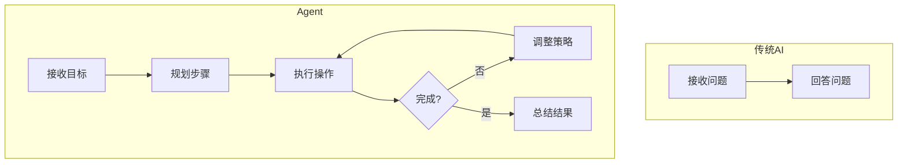
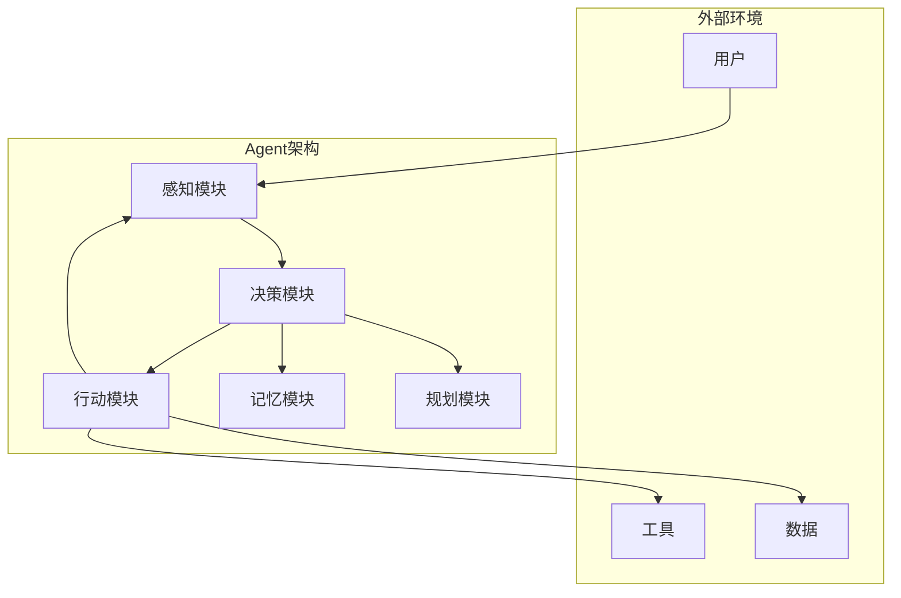
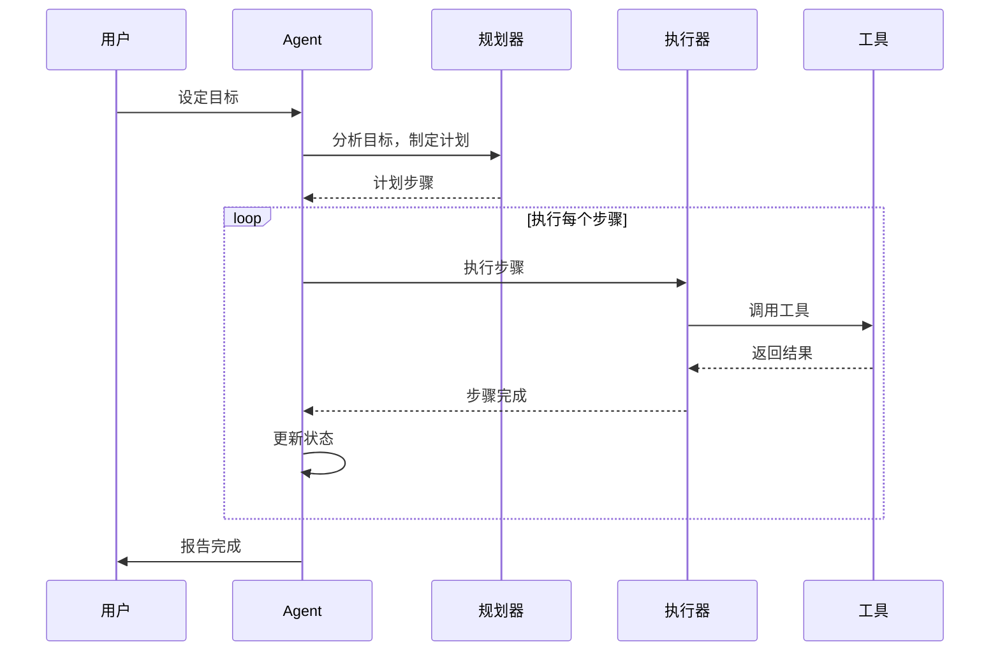
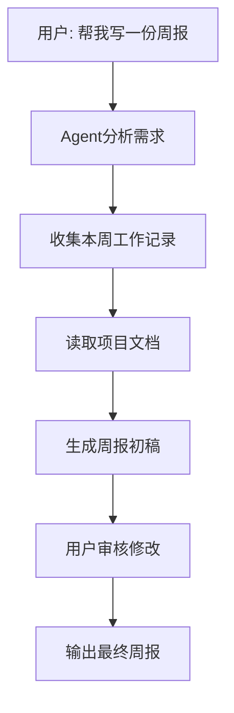
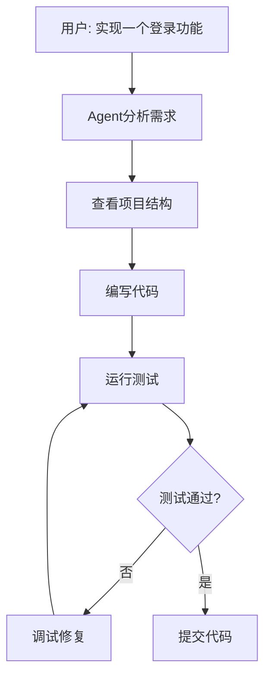
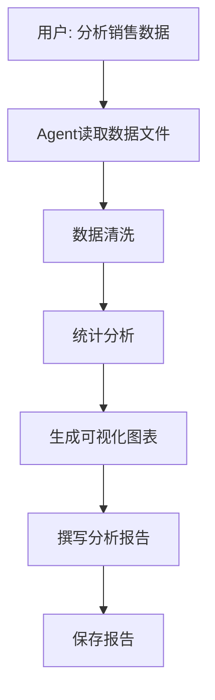

# Agent

> 小白先读：Agent 是“带目标、会规划、能用工具、会检查结果”的 AI。它和普通聊天机器人的区别是：普通 AI 回答你，Agent 帮你推进任务。
>
> 学这篇时先抓 3 个问题：目标是什么？它有哪些工具？它怎么判断任务完成？

## 先用一句生活话理解

普通 LLM 像顾问：你问什么，它答什么。Agent 像助理：你说“帮我准备答辩”，它会拆任务、找资料、写大纲、检查遗漏、再交付结果。

Agent 的核心是：**从回答问题，升级到完成任务。**

## 一、什么是 Agent

**Agent**（智能代理）是一种能够**自主感知、决策和行动**的 AI 系统。它可以根据用户的目标，自动规划并执行一系列操作来完成任务。

**生动比喻**：如果把普通 AI 比作一个"知识渊博的顾问"，那么 Agent 就是一个"能干的助理"。顾问只能回答问题，而助理可以主动帮你完成任务。

## 二、Agent 的核心特征

### 2.1 四大特征

| 特征 | 说明 | 示例 |
|------|------|------|
| **自主性** | 无需人类干预，自主完成任务 | 自动搜索信息、生成报告 |
| **感知能力** | 能获取环境信息 | 读取文件、网络搜索 |
| **决策能力** | 能根据目标做出决策 | 选择下一步操作 |
| **行动能力** | 能执行具体操作 | 调用工具、写入文件 |

### 2.2 Agent vs 传统 AI



## 三、Agent 的工作原理

### 3.1 核心架构



### 3.2 执行流程



### 3.3 关键组件

| 组件 | 功能 | 说明 |
|------|------|------|
| **感知模块** | 获取信息 | 读取文件、网络搜索 |
| **规划模块** | 制定计划 | 分解任务、安排顺序 |
| **决策模块** | 做出决策 | 选择下一步操作 |
| **行动模块** | 执行操作 | 调用工具、写入文件 |
| **记忆模块** | 存储信息 | 保存中间结果、历史记录 |

## 四、Agent 的类型

### 4.1 根据能力分类

| 类型 | 特点 | 示例 |
|------|------|------|
| **任务型 Agent** | 专注完成特定任务 | 代码生成、报告撰写 |
| **对话型 Agent** | 持续对话交互 | 聊天机器人、客服助手 |
| **探索型 Agent** | 主动探索学习 | 科研助手、知识发现 |
| **协作型 Agent** | 多 Agent 协作 | 团队工作流管理 |

### 4.2 根据应用场景分类

| 场景 | Agent 类型 | 功能 |
|------|-----------|------|
| **代码开发** | 代码 Agent | 编写代码、调试、测试 |
| **文档处理** | 文档 Agent | 生成文档、分析文档 |
| **数据分析** | 数据 Agent | 数据处理、可视化 |
| **网络搜索** | 搜索 Agent | 信息检索、汇总 |
| **任务管理** | 管理 Agent | 日程安排、待办事项 |

## 五、Agent 的应用场景

### 5.1 日常办公



### 5.2 软件开发



### 5.3 数据分析



## 六、如何使用 Agent

### 6.1 基本交互模式

```python
# 伪代码示例
from agent import Agent
# 创建 Agent
agent = Agent(name="我的助手")
# 设置目标
agent.set_goal("帮我完成以下任务：1. 读取销售数据 2. 生成报表")
# 执行任务
result = agent.execute()
# 获取结果
print(result.summary)
```

### 6.2 对话式交互

```python
# 伪代码示例
agent = Agent(name="对话助手")
# 开始对话
response = agent.chat("你好，帮我查一下今天的天气")
print(response)
# 继续对话
response = agent.chat("那明天呢？")
print(response)
```

### 6.3 工具调用示例

```python
# 伪代码示例
agent = Agent(name="代码助手")
# Agent 内部会自动调用工具
result = agent.execute_task("分析这个Python文件的性能问题", {
    "file_path": "e:\project\main.py"
})
```

## 七、常见问题与解决方案

### 7.1 任务执行失败

**问题**：Agent 无法完成任务

**解决方案**：
- 检查目标是否清晰明确
- 确保 Agent 有足够的权限
- 提供更多上下文信息

### 7.2 执行效率低

**问题**：Agent 执行速度慢

**解决方案**：
- 简化任务目标
- 提供更多提示信息
- 使用更高效的工具

### 7.3 结果不符合预期

**问题**：Agent 输出不符合预期

**解决方案**：
- 明确目标描述
- 提供示例输出
- 增加反馈循环

### 7.4 权限不足

**问题**：Agent 无法访问某些资源

**解决方案**：
- 授予必要的权限
- 使用代理方式访问
- 提供替代资源

## 八、Agent 的未来发展

### 8.1 发展趋势

| 趋势             | 说明                |
| -------------- | ----------------- |
| **多模态能力**      | 支持文本、图像、语音等多种输入输出 |
| **长时记忆**       | 具备长期记忆能力，记住历史对话   |
| **自我反思**       | 能够反思错误并改进         |
| **多 Agent 协作** | 多个 Agent 协同完成复杂任务 |
| **领域专业化**      | 针对特定领域优化          |

### 8.2 挑战

| 挑战 | 说明 |
|------|------|
| **可靠性** | 确保输出的准确性 |
| **安全性** | 防止恶意使用 |
| **可解释性** | 理解 Agent 的决策过程 |
| **效率** | 提高执行速度 |

## 九、总结

Agent 是 AI 发展的重要方向，具有以下特点：
1. **自主性**：能够自主完成任务
2. **智能化**：具备感知、决策、行动能力
3. **灵活性**：适应不同场景
4. **扩展性**：可调用各种工具

**使用建议**：
- 明确目标描述
- 提供必要的上下文
- 利用 Agent 的自动规划能力

---

## 十、和当前比赛项目的关系

你的项目天然适合用 Agent 思想组织工作：

- 项目管理 Agent：跟踪待办、风险、截止日期。
- 测试 Agent：运行 QEMU、分析日志、生成报告。
- 文档 Agent：整理 Obsidian 知识库、生成答辩材料。
- 代码 Agent：根据目标修改代码、运行验证、总结改动。

但比赛里要强调安全边界：**Agent 可以提高效率，但关键技术判断、代码合入、AI 使用披露仍需要人负责。**
