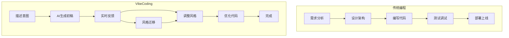
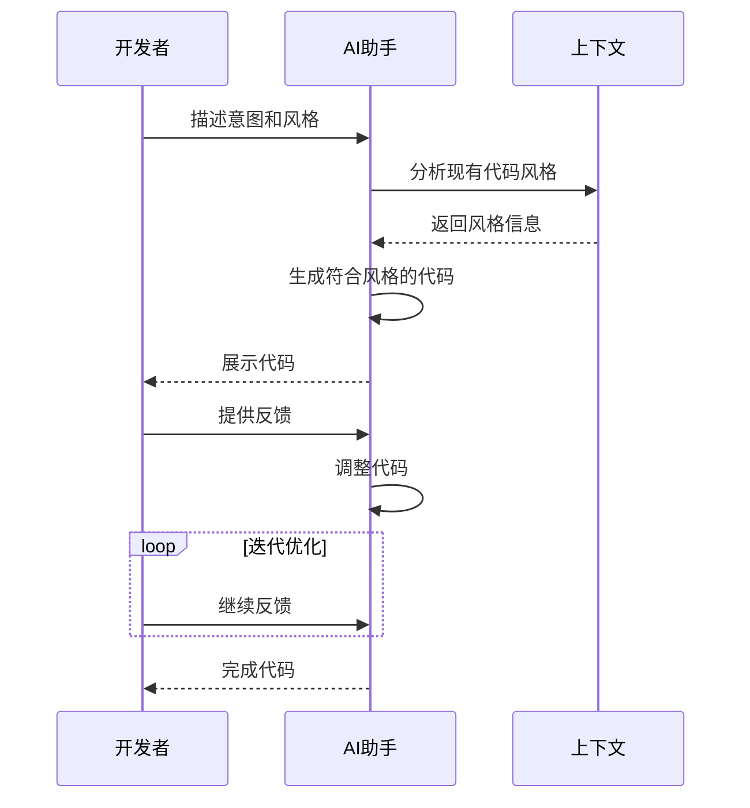
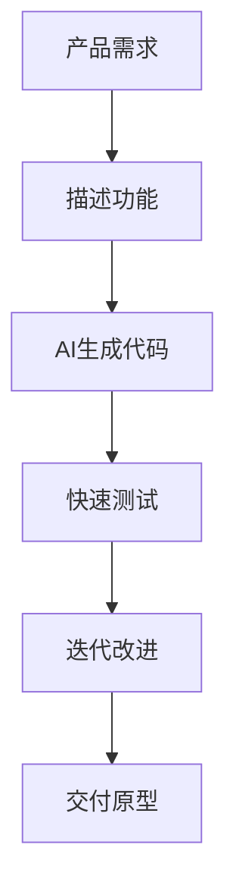
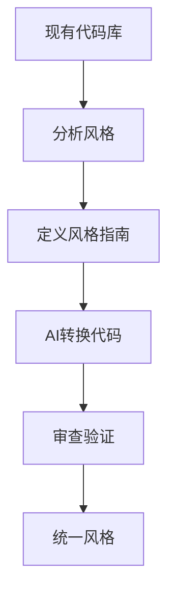

# VibeCoding（氛围编码）

> 小白先读：VibeCoding 不是“让 AI 乱写代码”，而是人把目标、风格、约束说清楚，AI 快速生成初稿，人再审查和迭代。
>
> 学这篇时先抓 3 个问题：我要什么结果？哪些地方不能乱改？怎么验证 AI 写的是对的？

## 先用一句生活话理解

VibeCoding 像请一个手很快的实习生帮你打草稿。你不能只说“做个好看的东西”，要说清楚用途、边界、风格、验收标准。最后还得你自己检查。

它的核心不是偷懒，而是：**把人从重复打字里解放出来，把注意力放到判断、设计和验证上。**

## 一、什么是 VibeCoding

**VibeCoding**是一种新兴的编程范式，强调在编码过程中利用 AI 的"直觉"和"风格感知"能力，让代码不仅能正确运行，还能体现特定的"氛围"或"风格"。

**生动比喻**：传统编程像"照着菜谱做菜"，而 VibeCoding 像是"跟着感觉做菜"。前者注重步骤的准确性，后者注重整体的味道和感觉。

## 二、VibeCoding 的核心概念

### 2.1 核心思想

| 概念 | 说明 |
|------|------|
| **风格感知** | AI 理解代码的风格和"感觉" |
| **直觉编码** | 基于上下文和意图生成代码 |
| **协同创作** | 人与 AI 的创造性合作 |
| **动态反馈** | 实时调整代码风格 |
| **风格迁移** | 将一种风格转换为另一种 |

### 2.2 VibeCoding vs 传统编程



## 三、VibeCoding 的工作原理

### 3.1 核心流程



### 3.2 关键技术

| 技术 | 说明 |
|------|------|
| **代码风格分析** | 分析现有代码的风格特征 |
| **意图理解** | 理解开发者的意图和目标 |
| **风格迁移** | 将代码从一种风格转换为另一种 |
| **实时反馈** | 基于反馈实时调整代码 |
| **代码补全** | 根据上下文补全代码 |

## 四、VibeCoding 的特点

### 4.1 优点

| 优点 | 说明 |
|------|------|
| **提高效率** | 快速生成代码初稿 |
| **保持风格一致** | 自动匹配项目代码风格 |
| **降低门槛** | 让新手也能写出专业代码 |
| **激发创意** | AI 提供新的思路 |
| **减少重复劳动** | 自动化重复任务 |

### 4.2 挑战

| 挑战 | 说明 |
|------|------|
| **风格理解** | AI 可能误解意图 |
| **代码质量** | 生成的代码需要审查 |
| **依赖网络** | 需要联网使用 AI |
| **学习曲线** | 需要学习新的工作方式 |
| **安全性** | 代码安全性需要验证 |

## 五、如何进行 VibeCoding

### 5.1 基本流程

```python
# 伪代码示例：VibeCoding 工作流

# 1. 描述意图和风格
prompt = """
我需要一个用户管理系统的API接口。
风格：简洁现代，使用 FastAPI。
要求：RESTful，支持 CRUD 操作。
"""

# 2. AI 生成代码
code = generate_code(prompt)

# 3. 查看并调整
print(code)

# 4. 提供反馈
feedback = "请添加分页功能，并使用 SQLAlchemy"
code = refine_code(code, feedback)

# 5. 最终代码
final_code = code
```

### 5.2 实际示例

**示例1：生成函数**
```
开发者：帮我写一个计算斐波那契数列的函数，风格要简洁优雅

AI：
def fibonacci(n):
    a, b = 0, 1
    for _ in range(n):
        yield a
        a, b = b, a + b

开发者：改成递归方式

AI：
def fibonacci(n):
    if n <= 1:
        return n
    return fibonacci(n-1) + fibonacci(n-2)
```

**示例2：风格迁移**
```
开发者：把这段代码改成函数式风格

原始代码：
result = []
for item in items:
    if item > 0:
        result.append(item * 2)

AI：
result = list(map(lambda x: x * 2, filter(lambda x: x > 0, items)))
```

### 5.3 实用技巧

| 技巧 | 说明 |
|------|------|
| **描述风格** | 使用形容词描述风格（简洁、优雅、函数式等） |
| **提供示例** | 给出一段示例代码作为风格参考 |
| **迭代优化** | 通过多次反馈逐步改进 |
| **使用模板** | 使用现有的代码模板 |
| **审查代码** | 生成后仔细审查代码质量 |

## 六、VibeCoding 的应用场景

### 6.1 应用场景

| 场景 | 说明 |
|------|------|
| **快速原型** | 快速生成项目原型 |
| **代码重构** | 将旧代码转换为新风格 |
| **学习编程** | 初学者学习不同风格 |
| **团队协作** | 保持团队代码风格一致 |
| **跨语言开发** | 将代码从一种语言转换为另一种 |

### 6.2 场景示例

**场景1：快速原型开发**


**场景2：代码风格统一**


## 七、VibeCoding 工具

### 7.1 常用工具

| 工具 | 说明 | 特点 |
|------|------|------|
| **GitHub Copilot** | AI 代码补全工具 | 支持多种语言 |
| **Cursor** | AI 优先的代码编辑器 | 集成 GPT-4 |
| **CodeLlama** | Meta 的代码模型 | 开源免费 |
| **StarCoder** | Hugging Face 代码模型 | 开源 |
| **Amazon CodeWhisperer** | AWS 的代码助手 | 云端服务 |

### 7.2 工具对比

| 工具 | 支持语言 | 价格 | 特色 |
|------|----------|------|------|
| **GitHub Copilot** | 多种 | 付费 | 深度集成 IDE |
| **Cursor** | 多种 | 免费/付费 | GPT-4 集成 |
| **CodeLlama** | 多种 | 免费 | 开源 |
| **StarCoder** | 多种 | 免费 | 开源 |
| **CodeWhisperer** | 多种 | 免费/付费 | AWS 集成 |

## 八、VibeCoding 的未来发展

### 8.1 发展趋势

| 趋势 | 说明 |
|------|------|
| **更智能的风格理解** | AI 更好地理解代码风格 |
| **实时协作** | 实时协同编码 |
| **多模态支持** | 支持语音、图像等输入 |
| **个性化定制** | 根据个人风格定制 |
| **代码质量保证** | 自动检测和修复问题 |

### 8.2 挑战与展望

| 挑战 | 展望 |
|------|------|
| **代码安全性** | 加强安全检测 |
| **版权问题** | 明确版权归属 |
| **依赖AI** | 保持人类控制 |
| **学习曲线** | 简化使用方式 |

## 九、总结

VibeCoding 是一种新兴的编程方式，具有以下特点：

1. **强调风格**：让代码不仅正确，还要有风格
2. **人机协作**：人与 AI 的创造性合作
3. **高效迭代**：快速生成和优化代码
4. **降低门槛**：让编程更易上手

**使用建议**：
- 明确描述意图和风格
- 迭代优化代码
- 仔细审查生成的代码
- 保持学习新工具和技术

---

## 十、和当前比赛项目的关系

你已经在用 AI 辅助整理文档和项目分析。比赛允许合理使用 AI 工具，但要求披露使用场景和成果边界。

建议把 VibeCoding 用在这些地方：

- 快速生成文档初稿、PPT 大纲、测试计划。
- 辅助分析日志、解释代码、整理架构。
- 生成样板代码后由人审查、运行、验证。

最重要的不是“用了 AI”，而是讲清楚：**AI 帮我们提高效率，人负责目标定义、技术判断、测试验证和原创贡献说明。**

---

**参考链接**：
- GitHub Copilot：[https://github.com/features/copilot](https://github.com/features/copilot)
- Cursor：[https://www.cursor.sh](https://www.cursor.sh)
- CodeLlama：[https://ai.meta.com/code-llama](https://ai.meta.com/code-llama)
