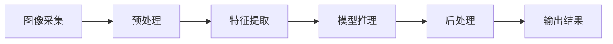
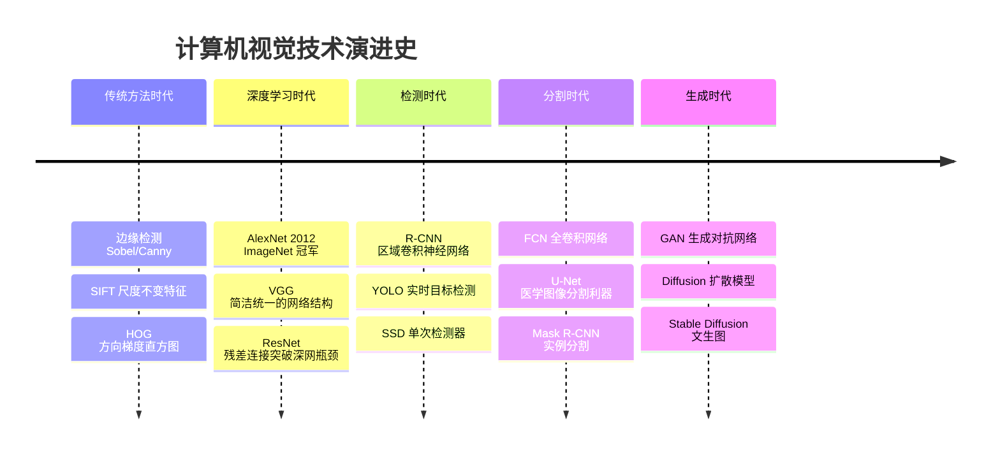

# 计算机视觉 CV

> 计算机视觉（Computer Vision, CV）是人工智能的一个重要分支，目标是让计算机能够"看懂"图像和视频内容。它解决的是"让机器拥有视觉理解能力"的问题，覆盖人脸识别、自动驾驶、医学影像、AI 绘画等场景。本文将介绍 CV 的核心任务、图像表示、处理流程与模型演进。

**关键词**：图像分类、目标检测、卷积神经网络、图像分割、图像生成

## 抽象类比

计算机视觉就像"教一个盲人认物"：他得先学会用手摸出形状（采集图像），再记住每种东西的特征（特征提取），最后才能叫出名字（识别分类）。不仅要知道"有什么"，还要知道"在哪里"、"在做什么"，甚至能自己画出一张新图。

进一步类比：像素相当于"画面的最小颗粒"，卷积相当于"用放大镜扫描画面"，池化相当于"把画面缩小但保留重点"，特征图相当于"网络眼中的画面草图"。从看到、到认到、再到画出，就是 CV 的完整能力链路。

## 适合人群 / 预备知识

- 适合人群：
  - 软件工程专业学生
  - AI 入门者
  - 对人脸识别、自动驾驶、AI 绘画原理好奇的同学
- 预备知识：
  - 掌握一门编程语言（推荐 Python）
  - 了解基本机器学习概念（特征、模型、训练）
  - 知道什么是矩阵（图像本质就是数字矩阵）
  - 对神经网络有模糊印象即可，不要求精通

## 一、CV 的核心任务

CV 的所有工作可以归为几大类，从"认东西"到"画东西"层层递进：

- **图像分类 Image Classification**：这是什么
  - 类比：看一眼判断是猫还是狗
  - 例子：判断 X 光片是否有异常
- **目标检测 Object Detection**：有什么、在哪里
  - 类比：用方框把画面里的每只猫狗圈出来
  - 例子：自动驾驶识别前方车辆、行人、交通标志
- **图像分割 Image Segmentation**：每个像素属于什么
  - 语义分割：区分"猫"和"背景"
  - 实例分割：区分"猫 A"和"猫 B"
  - 例子：医学影像中精确勾画肿瘤边界
- **图像生成 Image Generation**：画出新图像
  - 类比：让 AI 像画家一样创作
  - 例子：Stable Diffusion、Midjourney 文生图
- **关键点检测 Keypoint Detection**：找出人体或物体的关键点
  - 类比：给人偶标上关节位置
  - 例子：人脸 68 个关键点、人体骨骼姿态估计

## 二、图像在计算机中如何表示

计算机不认识"画面"，只认识数字。理解图像的数字化表示是入门 CV 的第一步：

- **像素矩阵 Pixel Matrix**：一张图由许多小方格（像素）组成，每个像素是一个数字
  - 一张 512×512 的图就是 512 行 × 512 列的数字矩阵
- **RGB 三通道**：彩色图像每个像素由 R（红）、G（绿）、B（蓝）三个值组成
  - 每个通道值范围通常是 0~255
  - 类比：画家用三原色调出所有颜色
- **分辨率 Resolution**：图像的宽×高，比如 1920×1080
  - 分辨率越高，细节越清晰，但计算量越大
- **位深 Bit Depth**：每个通道用多少比特存储
  - 8 位图：每个通道 0~255，常见格式
  - 16 位图：色彩更细腻，用于专业摄影

一句话总结：**图像在计算机里就是一摞数字矩阵，CV 做的就是在这些数字里找规律**。

## 三、CV 处理流程

一张图片从拍摄到被理解，通常经过以下步骤：

各步骤说明：

- 图像采集：摄像头、手机、医疗设备拍下原始图像
- 预处理：缩放、归一化、去噪、增强对比度
- 特征提取：传统方法手工设计，深度学习让网络自动学
- 模型推理：把特征送入神经网络，得到预测结果
- 后处理：非极大值抑制、阈值过滤、结果整合
- 输出：分类标签、边界框坐标、分割掩码等

## 四、技术演进

CV 技术的发展可以分成几个时代，每个时代都有里程碑式的突破：

- **传统方法时代**：靠人工设计特征，效果有限，但对算力要求低
- **深度学习时代**：CNN 革命让效果飞跃，2012 年 AlexNet 是分水岭
- **检测时代**：从两阶段（R-CNN）到单阶段（YOLO），速度越来越快
- **分割时代**：从图像级到像素级理解，医学、自动驾驶广泛应用
- **生成时代**：GAN 之后 Diffusion 模型崛起，催生 AI 绘画热潮

## 五、核心网络与模型

这些是 CV 工程师必须了解的"明星模型"：

- **CNN 卷积神经网络**：图像任务的标配，通过卷积核自动提取特征
  - 类比：用放大镜扫描画面，先看边缘，再看形状，最后认出物体
- **ResNet 残差网络**：通过"跳跃连接"解决深网退化问题，让网络可以堆到上百层
  - 类比：快递直接抄近道送达，不用每一站都中转
- **YOLO（You Only Look Once）**：单阶段实时目标检测，速度快
  - 类比：一眼扫过去就能说出画面里所有物体和位置
- **U-Net**：编码器-解码器结构，医学图像分割的王者
  - 形状像字母 U，先压缩再还原，保留细节
- **Vision Transformer ViT**：把 Transformer 搬到图像领域，把图切成小块当 token 处理
  - 详见 AI概念 目录对应文档（Transformer 部分）
- **CLIP**：用对比学习对齐图像和文本，让模型"看图说话"和"听字画图"
  - 详见 AI概念 目录对应文档（多模态 AI 部分）

## 六、数据与标注

深度学习三要素：数据、算法、算力。CV 对数据尤其依赖：

- **经典数据集**：
  - ImageNet：1400 万张图，1000 类，分类任务的"考试题"
  - COCO：含目标检测、分割、关键点标注，综合性强
  - CIFAR-10/100：小图数据集，适合教学和快速实验
- **标注工具**：
  - LabelImg：目标检测方框标注
  - Labelme：多边形分割标注
  - CVAT：开源团队级标注平台
- **数据增强**：通过翻转、旋转、裁剪、变色等方式扩充数据
  - 类比：把一张猫的照片翻转、调色，模型就能学到"翻转的猫也是猫"
  - 作用：缓解数据不足，提升模型泛化能力

## 七、典型应用

CV 已经渗透到生活的方方面面：

- **人脸识别**：手机解锁、门禁、支付验证
- **自动驾驶**：识别车道线、行人、车辆、交通标志
- **医学影像**：辅助诊断肺结节、眼底病变、肿瘤分割
- **安防监控**：异常行为检测、人群密度估计、车辆轨迹追踪
- **AR / VR**：SLAM 定位、手势识别、虚实叠加
- **工业质检**：检测电路板缺陷、产品外观瑕疵
- **农业**：病虫害识别、果实成熟度判断
- **零售**：无人超市商品识别、货架盘点

## 八、挑战

CV 虽然进步巨大，但仍有很多未解决的问题：

- **光照变化**：白天和黑夜、顺光和逆光，同一物体看起来差异巨大
- **遮挡**：物体被部分挡住时难以完整识别
- **视角变化**：正面和侧面、俯视和仰视，特征差异大
- **小样本**：标注数据稀缺时，模型容易过拟合
- **实时性**：自动驾驶要求毫秒级响应，算力和速度是硬约束
- **可解释性**：模型为什么这么判断？医生不敢用"黑盒"做诊断
- **对抗样本**：人眼看不出的微小扰动，可能让模型彻底误判

## 九、面试 Q&A

**Q1：CNN 为什么适合处理图像？**

- 卷积核能提取局部特征（边缘、纹理），符合视觉"从局部到整体"的认知规律
- 权值共享：同一个卷积核扫过整张图，参数量大幅减少
- 平移不变性：物体出现在画面任何位置都能被识别
- 层次化特征：浅层学边缘，深层学语义，自动构建从低级到高级的特征表示
- 一句话总结：CNN 的卷积和池化机制天生为图像设计

**Q2：YOLO 为什么快？**

- YOLO 把检测当成回归问题，一次前向传播就输出所有框的位置和类别
- 不像 R-CNN 要先用算法生成上千个候选区域再逐个分类
- 单阶段 vs 两阶段：YOLO 牺牲一点精度换取大幅速度提升
- 一句话总结：YOLO 一眼看完就出结果，不用反复扫描

**Q3：图像分类和目标检测有什么区别？**

- 图像分类：整张图给一个标签，回答"这是什么"
- 目标检测：图中每个物体给一个框 + 标签，回答"有什么、在哪里"
- 难度差异：检测要同时解决"定位"和"识别"两个问题
- 一句话总结：分类只认东西，检测还要找到东西的位置

## 十、如何向他人解释

> "你想想，如果你要教一个盲人认东西，他得先学会用手摸出形状，再记住每种东西的特征，最后才能叫出名字。计算机视觉就是教计算机干这些事——把图像变成数字，再用算法从数字里认出物体。你手机的人脸解锁、路上的摄像头、医院的 AI 看片子，背后都是 CV 在工作。"

进一步类比：

- 像素 = 画面的最小颗粒
- 卷积 = 用放大镜扫描画面
- 池化 = 把画面缩小但保留重点
- 特征图 = 网络眼中的"画面草图"
- 检测框 = 用方框圈出目标
- 分割掩码 = 给每个像素涂色

记住一句话：**CV 就是让机器学会"看东西、认东西、画东西"**。
