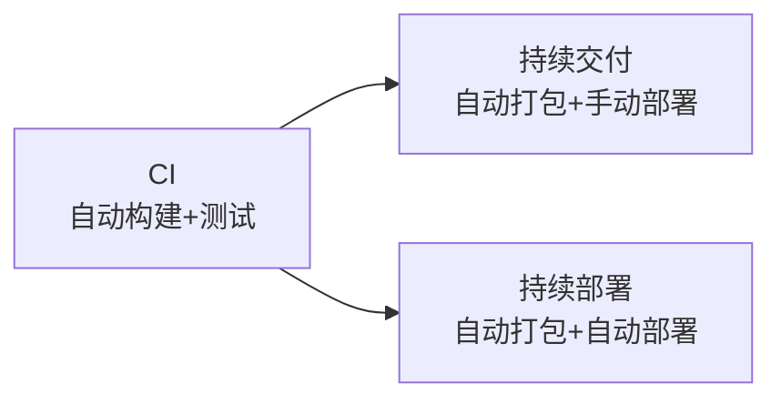

# CI/CD 完全图解

> **一句话定义**：CI/CD 是一种 **自动化的软件工程实践**，让你每次修改代码后，系统自动帮你完成检查、测试、打包甚至发布，无需手动操作。

> 小白先读：CI/CD 可以理解成“代码生产线”。你每提交一次代码，流水线就自动检查它有没有坏、能不能构建、测试过不过。
>
> 学这篇时先抓 3 个问题：谁触发流水线？流水线检查什么？失败后怎么反馈给开发者？

如果你从未接触过 CI/CD，不用担心。本文将从最基础的概念讲起，用生活化的例子和清晰的图示，带你理解 CI/CD 是什么、为什么需要它、以及它如何工作。

---

## 0. 先用一句生活话理解

没有 CI/CD 的项目像手工作坊：每个人都说“我这边没问题”，最后一合并才发现到处冲突。CI/CD 像工厂质检线：零件一进来就检查尺寸、强度、外观，不合格马上退回。

对团队项目来说，CI/CD 的意义不是炫技，而是**让问题尽早暴露**。

---

## 1. 什么是 CI/CD？一个餐厅比喻

想象你开了一家餐厅，每天都有厨师研发新菜品（写代码）。如果没有 CI/CD，流程可能是这样：

1. 厨师把菜做好（代码写完）
2. 你亲自试吃（手动测试）
3. 检查有没有毒、味道对不对、摆盘是否美观（各种检查）
4. 如果没问题，你才把这道菜加到菜单上（部署）

每天重复几十次，而且不止一个厨师。你会非常累，而且容易出错。

**现在，有了 CI/CD**：你设置了一条**自动流水线**。厨师把菜谱（代码）一提交，系统自动：

- 拉取最新菜谱（拉取代码）
- 检查食材是否过期（静态分析）
- 用小锅试做一份（编译 + 单元测试）
- 请机器人试吃（集成测试）
- 测量热量和味道（性能测试）
- 生成试吃报告（测试报告）
- 如果通过，自动把菜谱更新到菜单（部署）

整个过程不需要你干预。这就是 CI/CD 的核心价值：**自动化 + 标准化 + 快速反馈**。

---

## 2. 核心概念拆解

CI/CD 实际上包含三个紧密相关的概念：

### 2.1 持续集成（Continuous Integration，CI）

- **做什么**：开发人员频繁地将代码变更合并到主干（例如每天多次）。每次合并前，自动触发构建和测试，尽早发现集成错误。
- **核心动作**：代码 → 自动构建 → 自动测试 → 生成报告。
- **解决什么问题**：避免"在我电脑上是好的，别人那里就不行"的尴尬，减少合并冲突。

### 2.2 持续交付（Continuous Delivery，CD）

- **做什么**：在 CI 的基础上，自动将经过测试的代码打包成**可发布的版本**（如安装包、镜像文件），但**手动决定何时上线**。
- **核心动作**：CI + 自动打包 → 手动触发部署到生产环境。
- **适用场景**：业务要求人工审批才能上线（如金融、医疗）。

### 2.3 持续部署（Continuous Deployment，也是 CD）

- **做什么**：更进一步的自动化。代码通过所有测试后，**自动部署到生产环境**，无需人工干预。
- **核心动作**：CI + 自动打包 → 自动部署上线。
- **适用场景**：对自动化非常有信心的团队（如互联网 SaaS 服务）。

**三者关系**：

> **生活类比**：持续部署就像电梯——你按了楼层，电梯自动送你过去，中间不需要再按"确认"。

---

## 3. CI/CD 流水线长什么样？

一条典型的 CI/CD 流水线（Pipeline）由多个阶段（Stage）组成，每个阶段包含若干个作业（Job），作业里是具体的步骤（Step）。

每个阶段可以并行运行多个任务（例如同时跑单元测试和代码风格检查），也可以串行依赖（必须先编译成功才能测试）。

---

## 4. 为什么需要 CI/CD？

没有 CI/CD 的团队经常遇到这些问题：
- **集成地狱**：多人各自开发，最后合并时冲突成堆，修复几天。
- **手动测试易遗漏**：每次发布前，测试人员要花大量时间回归测试，重复劳动。
- **部署复杂**：手动拷贝文件、重启服务，容易出错。
- **反馈周期长**：一个问题可能要等到集成测试阶段才发现，离写代码已经过去几周。

CI/CD 带来的好处：

| 好处          | 说明                      |
| ----------- | ----------------------- |
| **快速发现错误**  | 每次提交都自动测试，几分钟内就知道是否坏了   |
| **降低集成风险**  | 频繁合并，冲突少，问题小            |
| **自动化重复工作** | 编译、测试、打包、部署全自动，解放人力     |
| **提高交付信心**  | 每次部署的都是经过完整测试的版本，减少线上事故 |
| **可审计可回滚**  | 每次构建和部署都有记录，出问题轻松回退     |

---

## 5. 常见 CI/CD 工具

| 工具                 | 类型        | 特点                   | 适合人群      |
| ------------------ | --------- | -------------------- | --------- |
| **GitHub Actions** | 云服务（SaaS） | 与 GitHub 深度集成，免费公开仓库 | 个人、开源项目   |
| **GitLab CI**      | 云服务/自托管   | 一体化 DevOps 平台        | 团队、企业     |
| **Jenkins**        | 自托管       | 功能强大，插件丰富，需自己维护      | 大型项目、定制需求 |
| **CircleCI**       | 云服务       | 速度快，配置简单             | 中小团队      |

对于个人学习或开源项目，**GitHub Actions** 是最易上手的，因为只要你有 GitHub 账号就可以免费用。

---

## 6. 核心术语表

|术语|含义|类比|
|---|---|---|
|**Pipeline（流水线）**|一个完整的工作流程，由多个阶段组成|就像一条汽车生产线|
|**Stage（阶段）**|流水线中的逻辑分组，例如"测试阶段"|生产线的某一环节（如喷漆）|
|**Job（作业）**|阶段中的一个独立任务，可以并行执行|环节中的一个工位|
|**Step（步骤）**|作业内的最小执行单元，如一个命令|工位上的一个动作|
|**Runner（运行器）**|执行作业的虚拟或物理机器|干活的工人|
|**Artifact（产物）**|流水线产生的文件（如编译后的二进制、测试报告）|生产线产出的零件|
|**Trigger（触发器）**|启动流水线的事件（如 push、定时、手动）|按开始按钮|
|**Secret（密钥）**|存储敏感信息（如密码、API token），在日志中隐藏|保险箱密码|

---

## 7. CI/CD 最佳实践（新手版）

1. **从小开始**：不要一开始就搭建完整的部署流水线。先做"提交后自动运行单元测试"，熟练后再加打包、部署。
2. **保持流水线快速**：如果每次测试要跑 30 分钟，没人愿意等。分离快速测试（PR 必跑）和慢速测试（定时或手动）。
3. **失败快速返回**：一旦某个关键步骤失败，后续步骤应该停止，避免浪费时间。
4. **使用缓存**：如依赖包目录缓存起来，能大幅加速构建。
5. **保护敏感信息**：密钥（如部署服务器的私钥）不要写死在配置里，使用 CI 系统的"Secrets"功能。
6. **可视化报告**：让测试结果（通过/失败、覆盖率）以直观的形式呈现，方便查看。

---

## 深入理解（进阶）

> 💡 如果只想了解 CI/CD 的概念，读到这里就够了。下面是技术细节。

---

## 总结

### 三句话讲清楚 CI/CD

1. CI/CD 是自动化的软件工程实践，每次修改代码后系统自动检查、测试、打包
2. CI（持续集成）保证代码合入前健康，CD（持续交付）让软件快速可靠发布
3. 核心思想是自动化一切可重复的事情，让开发者专注于写代码

### 核心类比

> 没有 CI/CD 像手工作坊每个人都说没问题最后一合并才发现到处冲突，CI/CD 像工厂质检线零件一进来就检查不合格马上退回。

### 关键词

**CI/CD、持续集成、持续交付、自动化、流水线、质量控制**
