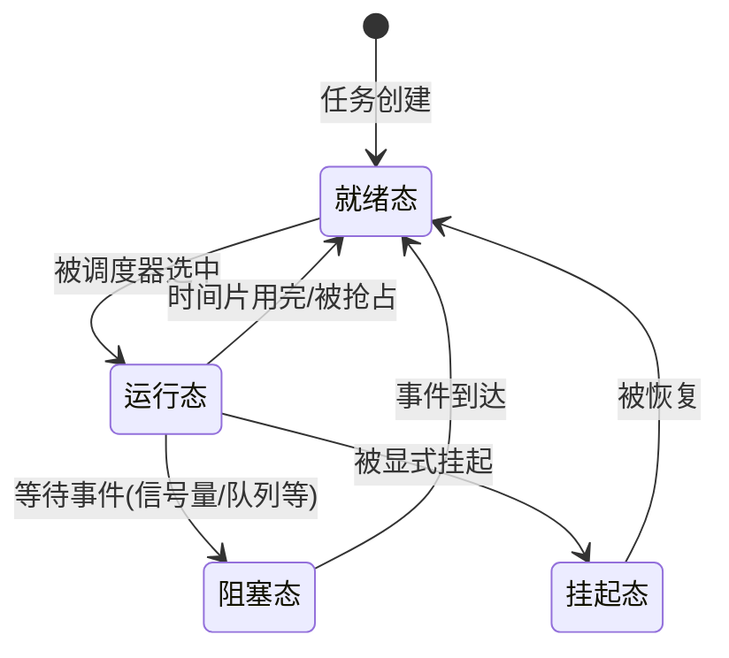
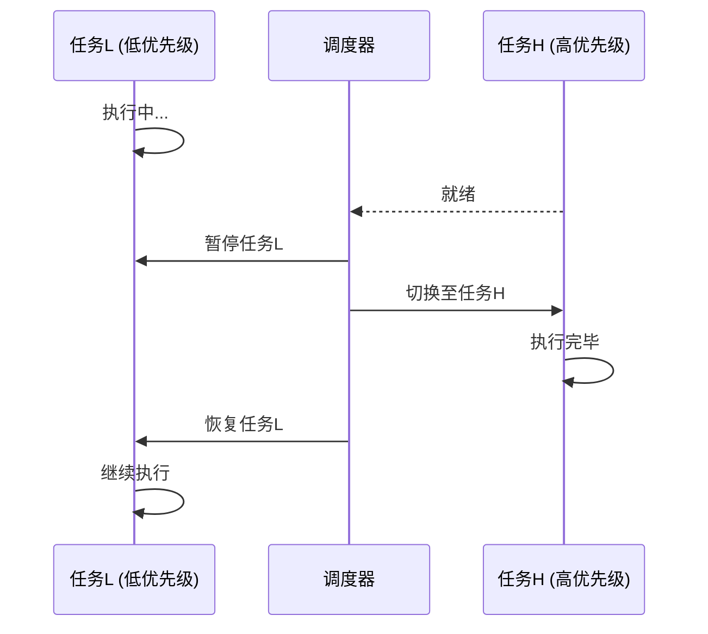

# 实时操作系统（RTOS）

> 小白先读：RTOS 的重点不是“跑得最快”，而是“该什么时候响应，就一定什么时候响应”。它像一个守时到近乎严苛的调度员。
>
> 学这篇时先抓 3 个问题：什么叫实时？为什么高优先级任务能插队？为什么嵌入式设备经常需要 RTOS？

**关键词**：RTOS、实时性、确定性、优先级调度、抖动、IPC

## 抽象类比

普通操作系统像食堂：大家排队，整体效率高就行，偶尔等久一点还能接受。RTOS 像急诊室：谁更紧急谁先处理，而且必须在规定时间内处理。

举个机器人场景：

- 摄像头识别网球可以晚一点，最多画面卡顿。
- 电机急停不能晚，晚了可能撞墙。
- 安全气囊不能晚，晚了就失去意义。

所以 RTOS 关心的是**最坏情况下能不能按时完成**，不是平均速度看起来多漂亮。

## 什么是实时操作系统？

**一句话定义**：实时操作系统（Real-Time Operating System）是**专为满足严格时间要求而设计的操作系统**，能保证在规定的时间内完成指定任务，其核心特征是**确定性**和**可预测性**。

### 比喻：RTOS vs 普通OS

想象两间餐厅：
- **普通OS（如Linux）**：顾客点餐后，服务员按顺序把单子递给厨房，厨房也按顺序做。如遇到加塞大单（复杂计算），后面所有菜都会延迟。餐厅追求"一天能服务多少顾客"。
- **RTOS**：顾客点餐后，系统会立即判断："VIP客户（高优先级任务）的菜必须在5分钟内上桌"，厨房会暂停当前的普通菜，优先做VIP的菜。餐厅追求的是"承诺的一定要做到"。

**简单说**：RTOS核心不是"快"，而是**"确定"**——10毫秒响应的任务，就必须在10毫秒内完成，不能早也不能晚。

---

## RTOS的核心特征

| 特征       | 说明                                    | 通俗理解                |
| :------- | :------------------------------------ | :------------------ |
| **确定性**  | 任务执行**时间可预测**，系统行为的每一个时间点都是确定的        | 就像火车到站，每天都是同一时间     |
| **可抢占**  | **高**优先级任务可以**随时打断低**优先级任务，立即获得CPU控制权 | 就像老板来了，员工必须停下手中的活   |
| **低延迟**  | 中断响应时间通常极短（微秒级别）                    | 就像闪电反应，瞬间响应         |
| **资源高效** | 内核可精简到极小体积，适合资源受限的微控制器               | 就像微型公寓，麻雀虽小五脏俱全     |
| **任务隔离** | 不同任务之间**相互独立**，一个任务的崩溃不会直接影响其他任务      | 就像不同的房间，一间出事不影响其他房间 |

> 衡量RTOS实时性的关键指标是**抖动**——任务完成时间的波动范围。抖动越小，实时性越好。

**类比**：RTOS就像一个**纪律严明的军队**，每个士兵（任务）都有明确的优先级，高级军官（高优先级任务）可以随时命令士兵停下手中的活去执行更重要的任务。

---

## RTOS核心组件

### 1. 任务（Task）管理

**类比**：任务就像餐厅里的**服务员**，每个服务员负责特定的工作（如点菜、上菜、打扫），他们各司其职，互不干扰。

**任务状态**：

- **就绪态（Ready）**：准备好了，等待CPU分配（服务员站在待命区等待分配任务）
- **运行态（Running）**：正在使用CPU（服务员正在上菜）
- **阻塞态（Blocked）**：等待某个事件（服务员在等厨房做好菜）
- **挂起态（Suspended）**：被显式挂起，不参与调度（服务员被临时叫去休息）

---

### 2. 调度算法

**类比**：调度器就像餐厅的**经理**，决定哪个服务员什么时候工作。

#### 优先级抢占式调度（Priority Preemptive Scheduling）

**原理**：CPU总是执行当前就绪态中优先级最高的任务。当高优先级任务就绪时，可以立即中断正在运行的低优先级任务。

**生动比喻**：就像老板来了，不管员工在做什么，都要停下手中的活去接待老板。这是RTOS实现实时响应的关键机制。

#### 时间片轮转调度（Round-Robin）

**原理**：多个相同优先级的任务处于就绪态时，系统为每个任务分配一个时间片，轮流执行。

**生动比喻**：就像几个服务员轮流休息，每人工作10分钟就换班。

#### 优先级继承（Priority Inheritance）

**问题**：高优先级任务需要的资源被低优先级任务占用，导致高优先级任务等待——这就是"优先级反转"。

**解决方案**：当高优先级任务等待低优先级任务释放资源时，系统临时将低优先级任务的优先级提升到高优先级，防止中等优先级任务抢占。

**生动比喻**：就像一个普通员工拿着老板需要的文件，这时他就相当于老板的级别，其他人不能打扰他。

#### 速率单调调度（Rate Monotonic Scheduling, RMS）

**原理**：任务的周期越短（执行频率越高），分配的优先级越高。

**生动比喻**：就像心脏跳动比呼吸频率高，所以心脏的优先级更高。

---

### 3. 中断管理（Interrupt Management）

**类比**：中断就像**火警警报**，一旦响起，所有人都要停下手中的活去灭火。

**核心原则**：中断服务程序（ISR）要尽量短小，只做最紧急的事——就像火警来了先报警，灭火的事之后再处理。耗时处理交给普通任务。

**中断嵌套**：高优先级中断可以打断低优先级中断——就像火灾警报响了，正在处理漏水的人也要先去灭火。

---

### 4. 任务间通信（IPC, Inter-Process Communication）

**类比**：IPC机制就像**办公室里的沟通方式**，不同部门之间需要通过特定方式交流。

| 机制 | 作用 | 典型场景 | 生动比喻 |
| :--- | :--- | :--- | :--- |
| **信号量** | 同步与互斥 | 保护共享资源（如外设访问）、任务间通知 | 就像会议室钥匙，只有拿到钥匙才能进去 |
| **互斥量** | 解决优先级反转 | 比信号量更安全，支持优先级继承 | 就像老板的办公室，进去需要预约 |
| **消息队列** | 数据传递 | 生产者-消费者模式，如传感器数据传递 | 就像快递系统，把包裹从一个地方送到另一个地方 |
| **事件标志组** | 等待多个条件 | 等待"A事件B事件C事件"全部发生后才执行 | 就像集齐所有龙珠才能召唤神龙 |
| **邮箱** | 发送指针 | 轻量级数据传递 | 就像发送一封简短的邮件 |

> 这些IPC组件通常是**阻塞型**的——任务试图从空队列读取数据时会进入阻塞状态，直到数据到达。这正是RTOS实现事件驱动响应的重要机制。

---

### 5. 内存管理

**类比**：内存管理就像**办公室的储物空间**，需要合理分配才能高效利用。

RTOS通常提供两种内存管理方式：
- **内存堆（Heap）**：动态分配任意大小的内存块，但可能产生碎片（就像办公室里随意放东西，时间长了会很乱）
- **内存池/内存块（Memory Pool/Block）**：分配固定大小的内存块，无碎片，速度快，适合实时系统（就像每个员工有固定的储物柜）

> 在硬实时系统中，通常建议**尽量使用静态内存分配**或**内存池**，因为动态分配的执行时间不确定。

---

### 6. 时间管理

**类比**：时间管理就像**办公室的时钟**，每个人都按照时钟来安排工作。

- **时钟节拍（Tick）**：系统的心脏跳动，来自硬件定时器的周期性中断
- **任务延时**：任务主动让出CPU一段时间（就像员工休息一会儿）
- **软件定时器**：在指定时间后执行回调函数（就像闹钟提醒）

---

## 设计哲学

RTOS 的设计哲学可以浓缩为一句话：**确定性优先于吞吐量**——宁可整体慢一点，也要保证关键时刻按时响应。

### 解决的核心问题

在嵌入式系统中，多个任务往往同时存在，且重要性不同：电机急停比日志打印紧急，安全气囊比摄像头识别紧急。如果没有统一调度，开发者只能用复杂的中断和状态机手工管理，系统一复杂就失控。RTOS 解决的核心问题是：**如何在资源受限的 MCU 上，让多个任务按优先级有序执行，并保证高优先级任务的响应时间可预测？**

### 关键设计取舍

| 取舍维度 | 选择 | 放弃 | 类比 |
| :--- | :--- | :--- | :--- |
| **确定性 vs 吞吐量** | 保证最坏情况响应时间 | 平均处理速度 | 像救护车准点到达，而不是公交车多载人 |
| **抢占 vs 公平** | 高优先级随时打断低优先级 | 所有任务平等轮流 | 像急诊室按病情排序，不是按挂号顺序 |
| **精简 vs 功能** | 内核极小（几 KB） | 丰富的通用功能 | 像跑车只保留发动机和方向盘 |
| **静态 vs 动态** | 优先静态内存分配 | 灵活的动态分配 | 像固定储物柜，不会找不到位置 |
| **实时 vs 通用** | 微秒级中断响应 | 图形界面、网络栈 | 像秒表 vs 智能手机 |

### 设计哲学的深层逻辑

1. **承诺必须做到**：RTOS 的核心不是"快"，而是"确定"。承诺 10ms 响应，就一定 10ms 内响应——这就是确定性的本质。
2. **优先级即秩序**：通过优先级抢占调度，RTOS 让"最重要的事"永远先做，而不是"最先来的事"先做。
3. **极简主义**：RTOS 内核只做调度和 IPC，其他功能（文件系统、网络栈）作为可选组件。这保证了内核本身不会成为实时性的瓶颈。
4. **事件驱动**：任务大部分时间在阻塞等待事件，而不是轮询消耗 CPU——这让系统既省电又高效。

**核心类比**：通用 OS 像一个**食堂**——大家排队，整体效率高就行；RTOS 像一个**急诊室**——谁更紧急谁先处理，而且必须在规定时间内处理完。食堂追求"一天服务多少人"，急诊室追求"承诺的必须做到"。

---

## ⚖️ RTOS vs 裸机 vs 通用OS

### RTOS vs 裸机

**类比**：RTOS就像**有组织的团队**，裸机就像**一个人单打独斗**。

| 维度       | RTOS               | 裸机（Bare Metal）          | 通俗理解 |
| :------- | :----------------- | :---------------------- | :--- |
| **实时性**  | 确定性，可预测            | 依赖手动编写的中断和状态机，复杂任务时容易失控 | RTOS像训练有素的军队，裸机像散兵游勇 |
| **开发效率** | 模块化，多任务并行          | 复杂系统开发周期长               | RTOS像团队协作，裸机像单打独斗 |
| **代码复用** | 高，任务可独立迁移          | 低，与硬件紧密耦合               | RTOS像积木，裸机像一次性用品 |
| **调试难度** | 高（任务嵌套、优先级）        | 低（逻辑顺序清晰）               | RTOS像解复杂的拼图，裸机像拼简单的积木 |
| **资源占用** | 极小（几KB到几十KB）        | 最小（只有应用代码）              | RTOS像带家具的房子，裸机像空房子 |
| **学习曲线** | 需要理解任务、调度、同步       | 低，直接写main循环             | RTOS像学开汽车，裸机像学骑自行车 |

### RTOS vs 通用OS（如Linux）

**类比**：RTOS就像**救护车**，Linux就像**公交车**。

| 维度       | RTOS                 | 通用OS（Linux）              | 通俗理解 |
| :------- | :------------------- | :----------------------- | :--- |
| **核心目标** | 时间确定性                | 平均吞吐量                    | RTOS像救护车要准时，Linux像公交车要多载人 |
| **调度策略** | 优先级抢占                | 完全公平调度（CFS）              | RTOS像优先处理紧急情况，Linux像大家轮流来 |
| **实时性**  | 硬实时（微秒级响应）           | 软实时（需要额外补丁）              | RTOS像闪电反应，Linux像慢动作 |
| **内核架构** | 通常为微内核或精简宏内核         | 宏内核                      | RTOS像小巧的跑车，Linux像庞大的卡车 |
| **内存管理** | 可选无MMU               | 依赖MMU虚拟内存                | RTOS像小仓库，Linux像大商场 |
| **资源需求** | 极低（几KB到几MB）           | 较高（几MB到几百MB）             | RTOS像小公寓，Linux像大别墅 |
| **驱动生态** | 需要自行移植或开发            | 非常成熟                     | RTOS像小公司，Linux像大集团 |
| **典型应用** | 工业控制、汽车电子、医疗设备       | 服务器、桌面、复杂嵌入              | RTOS像专业工具，Linux像多功能工具 |

> 关键区别：RTOS追求的是"给定输入，每次都按时产生相同的结果"，而Linux追求的是"单位时间内完成尽可能多的任务"。

---

## 常见RTOS对比

### 主流RTOS一览

| OS            | 类型    | 许可证        | 特点 | 典型应用               |
| :------------ | :---- | :--------- | :--- | :----------------- |
| **FreeRTOS**  | 开源    | MIT        | 极轻量，生态成熟，资料最多 | 物联网、MCU设备、低功耗嵌入式   |
| **Zephyr**    | 开源    | Apache 2.0 | 微内核架构，安全隔离好 | 工业自动化、多核嵌入式、IoT    |
| **RT-Thread** | 开源    | Apache 2.0 | 国产主流，组件丰富 | 消费电子、工业控制        |
| **NuttX**     | 开源    | BSD        | POSIX兼容，像迷你Linux | 无人机、RTOS学习 |
| **QNX**       | 商业    | 商业         | **微内核**标杆，安全认证 | 汽车数字仪表、医疗、核电 |
| **VxWorks**   | 商业    | 商业         | 老牌可靠 | 航空航天、国防、工业 |

### 快速选型建议

| 需求场景 | 推荐RTOS | 原因 |
| :--- | :--- | :--- |
| 初学者学习RTOS | FreeRTOS, RT-Thread | 资料多，上手快 |
| STM32/ESP32等主流MCU | FreeRTOS, RT-Thread | 官方支持好 |
| 汽车电子（需功能安全认证） | QNX, SafeRTOS | 有安全认证 |
| 航空航天与国防 | VxWorks | 可靠性验证充分 |
| IoT与低功耗设备 | Zephyr, FreeRTOS | 省电、轻量 |
| 国产自主可控 | RT-Thread | 国产生态 |

---

## Rust RTOS：新兴的安全实时系统

**类比**：传统RTOS就像**用木头建房子**（C语言），Rust RTOS就像**用钢筋混凝土建房子**——更安全耐用。

| OS           | 架构   | 特点                                           |
| :----------- | :--- | :------------------------------------------- |
| **Tock OS**  | 微内核  | 最安全稳定的Rust OS，支持应用隔离和任务沙箱 |
| **Drone OS** | 宏内核  | 提供实时性调度保证，接近传统RTOS |
| **Hubris**   | 微内核  | 强调多核并发和类型安全 |
| **RTIC**     | 实时框架 | 基于硬件中断，效率最高，体积最小，填补裸机与RTOS之间的空白 |

**Rust OS vs 传统RTOS**：

| 对比维度 | 传统RTOS（C） | Rust OS | 通俗理解 |
| :--- | :--- | :--- | :--- |
| 生态成熟度 | 成熟、驱动多 | 新兴，活跃度提升中 | 传统RTOS像老品牌，Rust OS像新品牌 |
| 安全性 | 手动内存管理，容易出bug | **编译时保障内存安全** | 传统像手工制作，Rust像机器质检 |
| 扩展性 | 多任务、可裁剪 | 原生异步并发 | 传统像平房，Rust像高楼 |

---

## RTOS的优缺点

### 优点
✅ **确定性实时响应**：高优先级任务可立即抢占CPU，响应时间可预测
✅ **任务模块化**：每个任务独立开发，团队可并行工作
✅ **资源高效**：内核极简，可在极小RAM上运行
✅ **丰富的IPC机制**：信号量、队列等降低任务间耦合
✅ **中断延迟极低**：硬实时RTOS中断延迟可达微秒级

### 缺点
❌ **调试困难**：任务嵌套、优先级反转等问题使执行时序难以分析
❌ **堆栈内存估算困难**：因任务抢占，最大堆栈需求难以准确预测
❌ **功能有限**：一般无图形界面，缺少网络浏览器等高级功能
❌ **学习曲线陡**：需要理解任务调度、同步机制、优先级等概念
❌ **低优先级任务可能饿死**：高优先级任务持续运行可能导致低优先级任务长时间得不到CPU

---

## 调试RTOS的方法

**类比**：调试RTOS就像**侦探破案**，需要收集线索找出问题。

| 方法 | 说明 | 通俗理解 |
| :--- | :--- | :--- |
| **打印日志** | 在关键点打印任务状态、切换时间戳 | 就像在关键路口装监控 |
| **任务执行时间监控** | 用GPIO引脚在任务进入/退出时触发高低电平，用示波器精确测量 | 就像用秒表计时 |
| **CPU利用率计算** | RTOS通常提供API获取空闲任务运行时间占比 | 就像计算工作效率 |
| **堆栈溢出检测** | 在任务堆栈末尾填充特定模式，周期性检查是否被覆盖 | 就像检查仓库有没有装满 |
| **Trace工具** | 记录整个系统的执行序列，事后分析 | 就像看完整的监控录像 |

---

## RTOS开发常见误区

### 1. 优先级设置不合理
- **问题**：高优先级任务太多，低优先级任务长期得不到执行
- **类比**：一个团队里所有人都是"老板"，没人干活了
- **解决**：合理分配优先级，大部分任务用同一优先级+时间片轮转

### 2. 中断服务程序过长
- **问题**：ISR执行时间太长，阻塞其他任务
- **类比**：接电话的人在电话里聊了一小时，其他人的电话全打不进来
- **解决**：ISR只做必要的事情，耗时操作交给任务处理

### 3. 死锁
- **问题**：两个任务互相等待对方释放资源
- **类比**：两个人过独木桥，都等着对方先退回去
- **解决**：按顺序获取资源，使用超时机制

### 4. 堆栈溢出
- **问题**：任务堆栈太小，导致数据覆盖
- **类比**：往行李箱里塞了太多东西，拉链崩开了
- **解决**：合理估算堆栈大小，使用堆栈检测工具

### 5. 忙等待
- **问题**：任务在循环中等待某个条件，浪费CPU资源
- **类比**：一直站在门口盯着，等人来了才开门——不如装个门铃
- **解决**：使用阻塞型IPC机制（如信号量、队列）

---

## 深入理解（进阶）

> 💡 如果只想了解 RTOS 的概念，读到这里就够了。下面是技术细节。

---

## 总结

### 三句话讲清楚 RTOS

1. RTOS 是专为满足严格时间要求设计的操作系统，核心是确定性和可预测性
2. 它保证高优先级任务能在规定时间内完成，而不是追求平均速度
3. 通过优先级调度、中断管理、IPC 机制实现任务的确定性执行

### 核心类比

> 普通 OS 像食堂大家排队整体效率高就行，RTOS 像急诊室谁更紧急谁先处理而且必须在规定时间内处理。

### 关键词

**RTOS、实时性、确定性、优先级调度、中断、抖动**

## 面试速答

### Q: RTOS 和通用 OS（如 Linux）的核心区别是什么？
A: RTOS 追求**确定性**——保证高优先级任务在规定时间内响应（微秒级，抖动极小）；通用 OS 追求**吞吐量**——单位时间处理更多任务，但不保证单个任务的响应时间。类比：RTOS 像救护车必须准点到达，Linux 像公交车追求多载人。

### Q: 什么是优先级反转？如何解决？
A: 优先级反转是指高优先级任务因等待低优先级任务占用的资源而被阻塞，期间中等优先级任务反而先执行的现象。解决方案是**优先级继承**——当高优先级任务等待资源时，临时把持有资源的低优先级任务的优先级提升到高优先级，防止中等优先级任务抢占。类比：普通员工拿着老板需要的文件，这时他就临时拥有"老板级别"，其他人不能打扰他。

### Q: RTOS 中断服务程序（ISR）为什么不能太长？
A: ISR 太长会阻塞其他中断和任务调度，破坏系统的实时性保证。正确做法是 ISR 只做最紧急的事（如清除中断标志、读取数据、发送信号量），耗时处理交给普通任务完成。类比：火警来了先报警，灭火的事之后再处理——不要在警报器旁边聊天。

### Q: 什么时候用 RTOS，什么时候用裸机？
A: 任务简单、单一循环就能搞定时用裸机（如点亮 LED、读取温度）；任务复杂、需要并发处理、有明确优先级关系时用 RTOS（如同时处理通信、控制、显示）。RTOS 带来的好处是模块化和可维护性，代价是占用几 KB 到几十 KB 内存和一定的学习成本。

### Q: 什么是抖动（Jitter）？为什么它对 RTOS 很重要？
A: 抖动是任务执行时间的**波动范围**——同一个任务每次执行时间的差异。抖动越小，实时性越好。RTOS 的核心目标不是"平均快"，而是"抖动小"——承诺 10ms 响应，实际可能在 9.8~10.2ms 之间，而不是平均 8ms 但偶尔 20ms。

## 如何给别人讲

1. **一句话定位**：RTOS 是"守时到严苛的调度员"，核心不是跑得快，而是该什么时候响应就一定什么时候响应。
2. **核心特征**：确定性、可抢占、低延迟、资源高效、任务隔离——关键词是"可预测"。
3. **设计取舍**：用吞吐量换确定性，用公平换优先级，用功能换精简——核心是"承诺必须做到"。
4. **生活类比**：通用 OS 像食堂大家排队整体效率高就行，RTOS 像急诊室谁更紧急谁先处理且必须在规定时间内处理完。
5. **面试一句话**：RTOS 的核心是"确定性"——保证高优先级任务在最坏情况下也能按时响应，关键词是**实时、抢占、优先级、抖动**。
