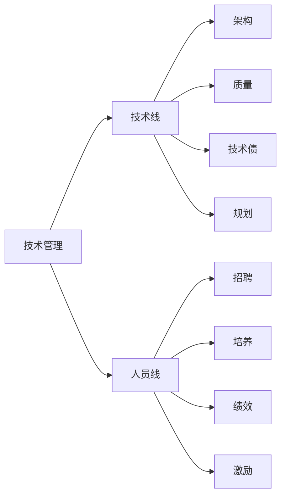
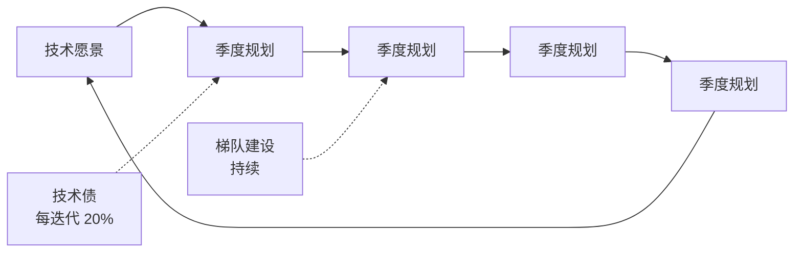

# 技术管理入门

> 技术管理（Technical Management）是指通过技术决策和团队协作，让技术和人都能够高效产出价值的工作方式。它不是"放下代码去管人"，而是用更大的杠杆放大自己与团队的产出。本文讲解技术管理的核心职责、团队建设与决策方法。

**关键词**：技术管理、团队协作、技术决策、领导力、人才培养

## 抽象类比

技术管理可以用"乐队指挥"来类比：指挥自己不演奏任何乐器，但通过节奏、信号、情绪的把控，让整个乐队奏出和谐的乐章。技术管理者既要懂乐理（技术），又要懂乐手（人），还要懂作品（业务）。

如果说一线工程师是独奏演员，只要把自己的曲子练好就行；技术管理者就是指挥，自己不上场演奏，但要让每个人在正确的时机发声，整体合奏出超过单人叠加的效果。指挥的杠杆在于：一个人的演奏能力有上限，而一支乐队的能力只取决于指挥能把大家组织到什么程度。

## 适合人群 / 预备知识

- 有 3 年以上开发经验，即将或刚晋升为 Team Leader 的工程师
- 对"带人成事"有兴趣，想提前储备认知的开发者
- 预备知识：熟悉软件研发全流程，参与过至少一个完整项目周期
- 心态准备：接受"自己写代码时间会变少"这件事

---

## 一、技术管理的两条线

技术管理是"两条腿走路"，缺一不可。

- 技术线
  - 架构设计：选型、模块划分、技术边界
  - 质量把控：Code Review、测试规范、上线标准
  - 技术债管理：识别、评估、规划偿还
  - 技术规划：路线图、技术栈演进
- 人员线
  - 招聘：JD 编写、面试、Offer 谈判
  - 培养：新人落地、梯队建设、晋升通道
  - 绩效：目标设定、过程辅导、周期评估
  - 激励：物质与精神、短期与长期结合

## 二、技术 Leader 的核心职责

技术 Leader 是"事"和"人"之间的桥梁。

- 技术决策与架构：对重大技术选型拍板，承担后果
- Code Review 把关质量：不仅是看代码对错，更是知识传递
- 团队培养与梯队建设：让团队成员的能力持续提升
- 跨团队协作沟通：对齐目标、解决依赖、化解冲突
- 技术规划与路线图：把业务目标翻译成技术路径
- 风险预判：上线前想到可能挂的点，提前布防
- 文化建设：建立透明、复盘、持续改进的氛围

## 三、Code Review

Code Review 是技术 Leader 最日常也最有杠杆的工作之一。

### 为什么做 Code Review

- 保证质量：多一双眼睛就少一个 Bug
- 知识共享：代码不再是某个人专属，团队都能看懂
- 规范统一：风格、命名、设计模式逐渐趋同
- 人才培养：通过具体代码给反馈，比说教有效十倍

### 怎么做 Code Review

- 小批量：一次 PR 不要超过 400 行，太大了拆
- 针对性：聚焦设计、边界、安全，而非风格细节
- 建设性反馈：先肯定再提建议，避免否定式语气
- 及时响应：24 小时内给出反馈，不阻塞开发
- 区分"必须改"和"建议改"：用 comment 区分严重程度

### Code Review 的常见误区

- 抠风格不抠设计：纠结空格和命名，却放过架构问题
- 攻击性评论："这都写不好？"会摧毁团队信任
- 走过场：LGTM（Looks Good To Me）敷衍了事
- 一个人把关：所有 PR 都压在 Leader 身上，成为瓶颈

## 四、技术规划与路线图

技术规划是"以终为始"地思考技术演进路径。

- 技术愿景：1-2 年后系统应该长成什么样
- 季度规划：把愿景拆成 3 个月可交付的里程碑
- 技术债偿还计划：每个迭代预留时间，不让债务失控
- 人才梯队规划：谁负责哪块、培养谁接班
- 风险预案：关键依赖挂了怎么办、核心人员离职怎么办

## 五、团队管理基础

团队管理是"通过别人拿结果"，而不是"自己把活干完"。

- 1v1 沟通
  - 频率：每周或每两周一次
  - 内容：工作进展、困惑、成长、情绪
  - 原则：倾听多于说教，保密承诺要兑现
- 目标管理
  - OKR：目标 + 关键结果，强调挑战和方向
  - KPI：指标导向，强调考核和达成
  - 选择：创新型团队适合 OKR，成熟业务适合 KPI
- 绩效反馈
  - 定期而非年终突击
  - 基于事实和具体事例，避免泛泛而谈
  - 表扬公开、批评私下
- 招聘面试
  - 看潜力而非只看当前能力
  - 文化匹配比技术细节更重要
  - 不要降低标准凑人数，代价更大

## 六、沟通与协作

技术 Leader 60% 的时间都在沟通，这是放大器。

- 向上汇报（给老板）
  - 结论先行，老板时间宝贵
  - 带方案而非只带问题
  - 量化结果，用数据说话
- 横向协作（与其他团队）
  - 主动对齐目标，避免各干各的
  - 明确边界和依赖，落到文档
  - 冲突时找共同上级或数据裁决
- 向下传达（给团队）
  - 背景 → 目标 → 路径 → 节奏
  - Why 比 What 更重要
  - 重要信息书面留痕，避免口头失真
- 跨部门沟通（产品/设计/运营）
  - 用对方听得懂的语言，少说术语
  - 共情对方 KPI，寻找共赢点
  - 把"我们 vs 你们"变成"我们 vs 问题"

## 七、从开发到管理的转型

从"自己写好代码"到"让团队写好代码"，是一次思维大换血。

### 常见坑

- 事必躬亲：核心代码自己写，团队成员没机会成长
- 不敢授权：怕下属搞砸，事事过问
- 还在写代码：用代码量衡量自己的价值，逃避管理工作
- 不会拒绝：业务方提需求都答应，团队加班到崩溃
- 老好人：怕得罪人，绩效打分一团和气

### 思维转变

- 自己干 → 让别人干好：价值不在于产出多少行代码
- 解决问题 → 培养解决问题的人：授人以渔
- 技术最优 → 整体最优：技术只是手段，业务和团队都是考量
- 个人成就 → 团队成就：下属的成功就是你的成功

### 时间管理

管理者的时间会被碎片化，应对策略：

- 主动安排日程，而不是被动响应
- 把同类事务合并处理（如集中开会、集中 Review）
- 给自己留"深度工作"时间，关闭即时通讯
- 学会说"不"，对低价值会议和需求果断拒绝

## 八、技术管理的常见误区

- 微观管理：盯到每行代码，扼杀团队主动性
- 不写代码就脱离一线：架构决策拍脑袋，失去团队信任
- 把管理等同于行政：只做排期、报工时，忽略"成事"
- 用统一标准要求所有人：忽视个体差异和成长阶段
- 重业务轻技术：长期欠技术债，最终拖垮业务
- 重技术轻业务：技术自嗨，做出的东西业务用不上
- 把团队当工具：只派活不培养，人才流失后无人可用

## 九、面试 Q&A

### Q1：技术 Leader 和架构师有什么区别？

回答思路：两者关注点不同。架构师偏"技术深度"，核心是系统设计、技术选型、性能瓶颈；技术 Leader 偏"全局杠杆"，除了技术决策还要管人、管协作、管业务对齐。架构师的价值在"做出对的决策"，技术 Leader 的价值在"让团队一起做出对的决策并落地"。很多场景下两者重叠，但纯架构师可以不管人，纯管理 Leader 可以不做架构，最理想的是两者兼具。

### Q2：你怎么做 Code Review？

回答思路：分三步。一看设计，模块划分是否合理、有没有过度设计；二看边界，空指针、并发、异常处理这些容易出 Bug 的地方；三看可读性，命名是否清晰、复杂度是否过高。给反馈时遵循"对事不对人"，用建议而非命令的语气，重要问题设为"必须改"，次要建议用 comment 即可。同时把 Review 当作教学场景，解释为什么这么改，让团队成员有成长。

### Q3：如何平衡技术债和新功能开发？

回答思路：先承认"零技术债"是不现实的，关键是有意识地管理。具体做法：把技术债显性化，登记到看板上；和业务方对齐，让他们理解技术债对迭代速度的长期影响；每个迭代固定 15%-20% 时间还债；大版本上线后预留专门的技术优化周；定期做架构评审，识别"高利息"债务优先偿还。本质上是"短期速度"和"长期速度"的权衡，不还得债务最终会拖垮业务。

## 十、如何向他人解释

技术管理不是"不写代码的管理员"，而是"让团队高效产出的放大器"。就像乐队指挥：自己不演奏乐器，但通过节奏、信号、情绪把控，让整个乐队奏出和谐乐章。好的技术管理者，让 10 个人的产出超过 10 个独立开发的产出总和；差的技术管理者，让 10 个人的产出还不如 5 个人独立干活。判断一个技术管理者是否合格，不看他自己写了多少代码，而看他带的团队是否能持续、稳定、高质量地交付价值。
