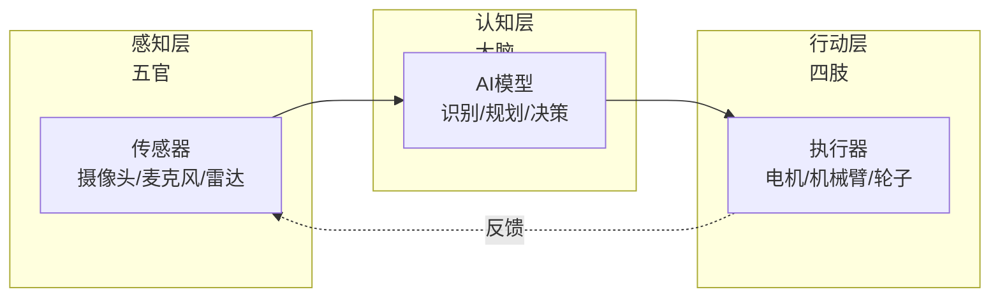

# 具身智能：有身体的 AI

> 小白先读：具身智能不是"关在服务器里的 AI"，而是"有身体、能感知环境、能实际行动的 AI"。它不仅能思考，还能通过机械臂、轮子、摄像头等与物理世界互动。
>
> 学这篇时先抓 3 个问题：为什么 AI 需要身体？有身体和没身体有什么区别？具身智能难在哪？

## 先用一句生活话理解

传统 AI 像下棋高手——能算出最优解，但只能告诉你"应该这么走"。具身智能像机器人——不仅能算出最优解，还能自己伸出手去走那步棋。

关键区别：**传统 AI 只负责"思考"，具身智能要"思考 + 感知 + 行动"三位一体**。

## 什么是具身智能？

**一句话定义**：具身智能（Embodied AI）是**具有物理身体、能通过传感器感知环境、通过执行器与环境交互的智能系统**。

### 生活比喻

- **传统 AI**：像天气预报专家，能预测天气但不能帮你撑伞
- **具身智能**：像智能雨伞管家，能感知下雨、判断你是否需要伞、自动把伞递给你
- **区别**：一个只"知道"，一个能"做到"

**简单说**：具身智能 = 感知（传感器）+ 思考（AI 算法）+ 行动（执行器）

---

## 为什么 AI 需要身体？

### 传统 AI 的局限

| 能力 | 传统 AI | 具身智能 | 区别 |
|------|---------|----------|------|
| **感知** | 只能处理给定数据 | 主动感知环境 | 一个是被动接收，一个是主动探索 |
| **理解** | 基于数据统计 | 基于物理交互 | 一个靠记忆，一个靠体验 |
| **决策** | 输出建议 | 直接执行 | 一个"说"，一个"做" |
| **学习** | 需要大量标注数据 | 通过试错学习 | 一个靠看书，一个靠实践 |
| **适应** | 环境变了要重新训练 | 实时适应变化 | 一个死板，一个灵活 |

### 核心价值

1. **从"认知"到"行动"**：不只是识别物体，还要能抓取、移动、操作
2. **从"离线"到"在线"**：不只是处理历史数据，还要实时响应环境变化
3. **从"单一"到"多模态"**：不只是看或听，还要结合触觉、力觉、位置等
4. **从"虚拟"到"物理"**：不只是在电脑里跑，还要在真实世界中工作

**类比**：传统 AI 像学开车的理论课——知道所有规则但不会开；具身智能像实际上路——要感知路况、操控方向盘、应对突发情况。

---

## 具身智能的核心组成

### 三大支柱

```
        ┌──────────────┐
        │   感知系统    │
        │  (传感器)     │
        └──────┬───────┘
               │
               ▼
        ┌──────────────┐
        │   决策系统    │
        │  (AI 大脑)    │
        └──────┬───────┘
               │
               ▼
        ┌──────────────┐
        │   执行系统    │
        │  (执行器)     │
        └──────────────┘
```

### 1. 感知系统（眼睛和耳朵）

**作用**：收集环境信息

| 传感器 | 感知内容 | 类比 |
|--------|----------|------|
| **摄像头** | 视觉信息（颜色、形状、距离） | 像眼睛 |
| **激光雷达** | 精确距离和 3D 结构 | 像蝙蝠的回声定位 |
| **超声波** | 近距离障碍物 | 像盲人的手杖 |
| **IMU（惯性测量）** | 姿态、加速度、角速度 | 像人的前庭（平衡感） |
| **力传感器** | 受力大小和方向 | 像人的触觉 |
| **温度/湿度** | 环境参数 | 像人的皮肤感觉 |

### 2. 决策系统（大脑）

**作用**：理解环境、制定计划、做出决策

| 能力 | 说明 | 例子 |
|------|------|------|
| **环境理解** | 识别物体、判断距离、理解场景 | "前面有个网球，距离 1 米" |
| **路径规划** | 计算如何到达目标 | "向左转 30 度，前进 1 米" |
| **动作规划** | 计算如何执行动作 | "机械臂角度、抓取力度" |
| **实时决策** | 根据变化调整策略 | "球滚走了，重新追踪" |
| **学习优化** | 从经验中改进 | "上次抓太紧，这次轻一点" |

### 3. 执行系统（手脚）

**作用**：将决策转化为物理动作

| 执行器 | 功能 | 类比 |
|--------|------|------|
| **电机** | 驱动轮子、关节 | 像肌肉 |
| **机械臂** | 抓取、放置、操作 | 像手臂和手 |
| **舵机** | 精确角度控制 | 像关节 |
| **扬声器** | 发声、报警 | 像嘴巴 |
| **LED** | 指示状态 | 像表情 |

---

## 具身智能的工作流程

### 典型循环

```
感知环境 → 理解场景 → 制定计划 → 执行动作 → 观察结果 → 调整策略
   ↑                                                        │
   └────────────────────────────────────────────────────────┘
                    （持续循环）
```

### 以"拾取网球"为例

| 步骤 | 感知 | 决策 | 执行 |
|------|------|------|------|
| **1. 发现球** | 摄像头看到黄色圆形物体 | 判断这是网球，计算距离 | 调整朝向 |
| **2. 接近球** | 实时追踪球的位置 | 规划移动路径 | 轮子转动，向前移动 |
| **3. 准备抓取** | 判断球的大小和位置 | 计算机械臂角度和力度 | 机械臂展开 |
| **4. 执行抓取** | 力传感器反馈接触力 | 判断是否抓牢 | 闭合爪子 |
| **5. 验证结果** | 摄像头确认球在爪子里 | 判断成功 | 抬起机械臂 |

**关键**：整个过程是连续的、实时的、需要不断调整的。

---

## 具身智能的挑战

### 为什么难？

| 挑战 | 说明 | 类比 |
|------|------|------|
| **实时性** | 必须在毫秒级做出反应 | 像接飞盘，不能想太久 |
| **不确定性** | 环境随时变化，不能完美预测 | 像在人群中穿行 |
| **多模态融合** | 要同时处理视觉、力觉、位置等 | 像边开车边看导航边听语音 |
| **硬件限制** | 计算资源、功耗、重量都受限 | 像用小电脑处理复杂任务 |
| **安全性** | 动作错误可能损坏设备或伤人 | 像拿刀，力度控制很重要 |
| **泛化能力** | 在一个场景学会，要能用到其他场景 | 像学会在厨房做饭，也要能在户外做饭 |

### 与传统 AI 的对比

| 维度 | 传统 AI（如 ChatGPT） | 具身智能 |
|------|----------------------|----------|
| **运行环境** | 服务器/云端 | 嵌入式设备/机器人 |
| **计算资源** | 几乎无限 | 严重受限 |
| **响应时间** | 秒级可接受 | 毫秒级要求 |
| **错误容忍** | 可以道歉重来 | 可能造成物理损坏 |
| **数据来源** | 互联网文本 | 实时传感器数据 |
| **输出方式** | 文字/图片 | 物理动作 |

---

## 具身智能的应用场景

### 1. 工业机器人

**场景**：生产线上的装配、焊接、搬运

**特点**：
- 环境相对可控
- 任务重复性高
- 精度要求高

**例子**：汽车制造中的机械臂

### 2. 服务机器人

**场景**：酒店送餐、清洁、导览

**特点**：
- 环境动态变化
- 需要与人交互
- 安全性要求高

**例子**：酒店送餐机器人

### 3. 自动驾驶

**场景**：汽车、无人机、配送车

**特点**：
- 高速移动
- 环境复杂
- 安全关键

**例子**：无人配送车

### 4. 家用机器人

**场景**：扫地、做饭、整理

**特点**：
- 环境非结构化
- 任务多样化
- 成本敏感

**例子**：扫地机器人

### 5. 医疗机器人

**场景**：手术辅助、康复训练

**特点**：
- 精度要求极高
- 安全要求极高
- 需要人机协作

**例子**：手术机器人

---

## 深入理解（进阶）

> 💡 如果只想了解具身智能的概念，读到这里就够了。下面是技术细节。

### 技术栈

```
应用层：机器人控制逻辑、任务规划
  ↓
AI 层：视觉识别、路径规划、动作生成
  ↓
系统层：操作系统（StarryOS）、驱动、调度
  ↓
硬件层：处理器（RK3588）、传感器、执行器
```

### LeRobot 框架

LeRobot 是 Hugging Face 开源的具身智能框架：
- 提供预训练的机器人策略模型
- 支持多种机器人硬件
- 简化具身智能应用开发

### 边缘 AI 的挑战

| 挑战 | 说明 | 解决思路 |
|------|------|----------|
| **算力限制** | NPU 算力有限 | 模型轻量化、量化 |
| **内存限制** | 无法加载大模型 | 模型压缩、分层加载 |
| **功耗限制** | 电池供电 | 动态功耗管理 |
| **延迟要求** | 实时响应 | 优化推理链路 |

---

## 总结

### 三句话讲清楚具身智能

1. 具身智能是有物理身体的 AI，能通过传感器感知环境、通过执行器与环境互动
2. 它不只是"思考"，而是"感知 + 思考 + 行动"的完整闭环
3. 与传统 AI 相比，具身智能要应对实时性、不确定性、硬件限制等挑战

### 核心类比

> 传统 AI 像下棋高手只能告诉你"应该这么走"，具身智能像机器人能自己伸出手去走那步棋。

### 关键词

**具身智能、感知、决策、执行、实时性、多模态、机器人**

### 与比赛项目的关系

网球拾取机器人项目是典型的具身智能应用，需要 StarryOS 提供实时调度、资源管理和驱动支持，实现从视觉感知到机械臂抓取的完整闭环。
# 具身智能：让机器人"活"起来

> 小白先读：具身智能不是“会聊天的 AI”，而是“能在真实世界里看见、判断、移动、操作的 AI”。它的难点在于，真实世界会变化、会出错、会反过来影响机器人。
>
> 学这篇时先抓 3 个问题：AI 的身体是什么？它怎么感知世界？它怎么把判断变成动作？

## 先用一句生活话理解

只会回答问题的 AI 像坐在书桌前的学霸；具身智能像会做实验的学生。它不仅知道“杯子在桌上”，还要知道怎么伸手、怎么避开障碍、怎么抓住杯子、抓歪了怎么修正。

具身智能最重要的词是**闭环**：

感知世界 → 做出决策 → 执行动作 → 观察动作造成的新变化 → 再调整。

## 什么是具身智能？

具身智能（Embodied Intelligence），简单说，就是让人工智能拥有**身体**，通过与物理世界的**互动**来学习和理解世界。

**生动比喻**：如果说传统AI是"只会看书的学霸"，那么具身智能就是"既能看书，又能动手实践的探索者"。它不是坐在云端空想，而是走进真实世界，用眼睛看、用耳朵听、用手触摸，通过亲身经历来学习。

---

## 为什么需要具身智能？

传统AI有个致命局限：它只活在"数字世界"里。

| 传统AI能做的 | 传统AI做不到的 |
| :--- | :--- |
| 识别图片里的猫 | 伸手摸一下猫 |
| 分析棋局最优解 | 拿起棋子放在棋盘上 |
| 预测天气趋势 | 出门感受一下冷不冷 |
| 翻译一段文字 | 帮你搬一个箱子 |

**具身智能填补了这个空白**——它让AI从"纯思考"变成"能动手"。就像一个人，光看书学不会骑自行车，必须亲自上去骑，摔两次才会。

---

## 核心特征

### 1. 具身性（Embodiment）
- AI不再是抽象的代码，而是**有了物理载体**（机器人身体）
- 通过身体感知和行动来理解世界
- **类比**：就像人类通过双手触摸物体来感受它的温度、质地和形状

### 2. 情境性（Situatedness）
- AI处于**真实的物理环境**中，而不是虚拟世界
- 它的感知和行动都受环境影响，并影响环境
- **类比**：就像你在厨房做饭，你的动作会改变食材状态，同时食材状态也会影响你的下一步动作

### 3. 自主性（Autonomy）
- 能在没有人类干预的情况下，**自主感知、决策和行动**
- 可以独立完成复杂任务
- **类比**：就像一只小狗，看到球会自己跑过去捡起来，而不需要主人一步步指挥

### 4. 适应性（Adaptation）
- 能够从与环境的互动中**学习和进化**
- 根据经验调整自己的行为
- **类比**：就像你第一次骑自行车会摔倒，但通过不断尝试，最终学会保持平衡

---

## 生活中的例子

### 1. 家庭服务机器人
- **任务**：打扫房间、整理物品
- **具身智能体现**：避障导航、识别不同物体、用机械臂抓取和放置物品
- **为什么需要具身智能**：需要在真实环境中执行物理操作

### 2. 工业装配机器人
- **任务**：在生产线上组装产品
- **具身智能体现**：精确抓取零件、按照顺序组装、检测装配质量
- **为什么需要具身智能**：需要高精度的物理操作能力

### 3. 自动驾驶汽车
- **任务**：在道路上安全行驶
- **具身智能体现**：用摄像头和雷达感知周围环境、实时做出驾驶决策、控制车辆加速、刹车、转向
- **为什么需要具身智能**：需要与物理世界实时互动

### 4. 救援机器人
- **任务**：在灾难现场搜索幸存者
- **具身智能体现**：在复杂地形中移动、探测生命信号、搬运障碍物
- **为什么需要具身智能**：需要在危险环境中自主完成任务

---

## 具身智能 vs 传统AI

| 特性 | 具身智能 | 传统AI |
| :--- | :--- | :--- |
| **存在形式** | 有物理身体 | 纯软件/数据 |
| **学习方式** | 通过与环境互动学习 | 通过大数据训练 |
| **知识来源** | 亲身体验 | 数据输入 |
| **行动能力** | 能直接影响物理世界 | 只能输出信息 |
| **应用场景** | 物理世界交互任务 | 数据分析、预测 |
| **灵活性** | 适应动态环境 | 依赖固定数据 |

**生动比喻**：
- **具身智能**就像**一个探险家**，亲自去探索未知世界，通过亲身经历学习成长
- **传统AI**就像**一个图书馆管理员**，通过阅读大量书籍来获取知识，但自己从不亲身实践

---

## 具身智能的技术架构



**这是一个闭环**：感知→认知→行动→再感知。和人类完全一样——你伸手拿杯子时，眼睛一直在看手的位置，随时微调。

### 关键能力

| 能力 | 说明 | 类比 |
| :--- | :--- | :--- |
| **计算机视觉** | 让机器人"看见"世界 | 眼睛 |
| **强化学习** | 通过"试错"学习 | 小孩子学走路 |
| **运动规划** | 规划移动路径 | 脑子里想路线 |
| **精确控制** | 精确执行动作 | 手眼协调 |
| **人机交互** | 理解人类指令和意图 | 听懂话、会表达 |

---

## 具身智能的应用场景

### 1. 智能家居
- **清洁机器人**：自动打扫房间
- **陪伴机器人**：与老人孩子互动
- **智能助手**：帮你取物、开关电器

### 2. 智能交通
- **自动驾驶**：无需人类干预的汽车
- **配送机器人**：自动送货上门
- **无人机**：快递配送、环境监测

### 3. 工业制造
- **装配机器人**：高精度组装产品
- **质检机器人**：检测产品质量
- **搬运机器人**：在仓库间运送货物

### 4. 医疗健康
- **手术机器人**：辅助医生进行精密手术
- **康复机器人**：帮助病人恢复运动能力
- **护理机器人**：照顾病人日常起居

### 5. 探索救援
- **太空探索机器人**：探索火星等星球
- **深海探测机器人**：探索海底世界
- **灾难救援机器人**：在危险环境中搜救

---

## 具身智能的优缺点

### 优点
✅ **实用性强**：能够直接解决现实世界的物理问题
✅ **适应性好**：可以在动态环境中自主适应
✅ **学习能力**：通过互动不断学习和进化
✅ **应用广泛**：涵盖生活、工业、医疗等多个领域
✅ **用户友好**：更自然的人机交互方式

### 缺点
❌ **技术复杂**：涉及感知、认知、控制等多个领域——造一个"能干活的身体"比写一个"会思考的程序"难得多
❌ **成本较高**：硬件设备和开发成本都很高
❌ **安全挑战**：物理机器人可能对人类造成伤害
❌ **环境限制**：受物理环境条件限制
❌ **能耗较高**：需要持续供电和维护

---

## 具身智能的发展趋势

### 1. 更智能的感知系统
- 多传感器融合技术
- 更准确的环境感知和理解

### 2. 自主学习能力增强
- 从少量数据中快速学习
- 无监督学习和自监督学习

### 3. 人机协作更自然
- 语音、手势、表情等多种交互方式
- 理解人类意图并主动配合

### 4. 轻量化和低成本
- 降低硬件成本
- 让更多人能够使用具身智能设备

### 5. 安全性提升
- 完善的安全机制
- 确保机器人不会伤害人类

---

## 和当前比赛项目的关系

Desktop-Wanderer 网球拾取机器人就是一个具身智能例子：

- 摄像头负责“看见”网球。
- YOLO/RKNN 负责“识别”网球。
- LeRobot/控制器负责“移动”和“抓取”。
- StarryOS/RK3588 负责给上层智能应用提供运行环境。

答辩时可以用“感知-决策-动作闭环”来讲项目架构，比单独罗列技术栈更容易让人听懂。

## 总结

具身智能是一种**让AI拥有身体**的技术，它通过与物理世界的互动来学习和工作。

**设计哲学**：真正的智能不能只活在数据和代码里——就像你不能通过看书学会游泳，AI也不能只靠数据训练就学会在真实世界中行动。具身智能的核心信念是：**理解世界的最好方式，是走进世界**。

**核心优势**：实用性强、适应性好、学习能力强
**应用场景**：智能家居、智能交通、工业制造、医疗健康、探索救援等
**未来趋势**：随着技术的发展，具身智能将变得更加智能、更加安全、更加普及，走进我们生活的方方面面。

> **最后一句话**：具身智能让机器人从"冰冷的机器"变成"有感知、会学习的伙伴"！
