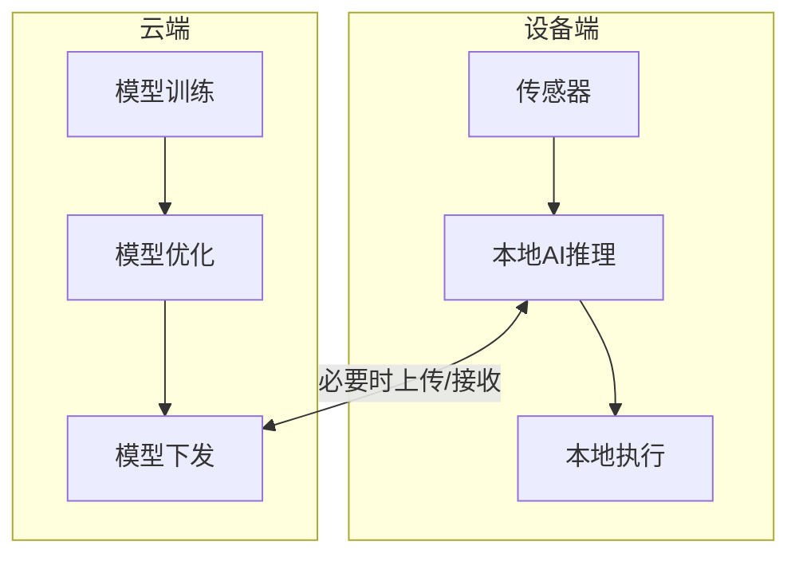

# 边缘智能：让设备自己"思考"

> 小白先读：边缘智能的核心不是“AI 很高级”，而是“有些决定必须在设备身边马上做”。离现场越近，响应越快，隐私越好，断网时也越可靠。
>
> 学这篇时先抓 3 个问题：为什么不能全靠云？什么任务适合放在边缘？边缘设备资源不够时怎么办？

## 先用一句生活话理解

云计算像总部专家，知识多、算力强，但你得打电话过去问。边缘智能像现场师傅，能力可能没总部强，但他就在现场，能马上判断、马上处理。

比如机器人看到前面有障碍，不能先把视频传到云端等分析结果再刹车。它必须在本地识别、本地决策、本地执行。

## 什么是边缘智能？

边缘智能，简单说，就是让设备在**本地**进行数据分析和决策，而**不必随时依赖云端**。

**生动比喻**：边缘智能就像让你的手机拥有了"超级大脑"，它不再需要每次都打电话问云端"该怎么做"，而是可以自己思考和做决定。

---

## 为什么需要边缘智能？

传统物联网的模式是"端-云"模型：设备采集数据，全部传到云端处理，云端返回结果。但这个模式有几个硬伤：

| 痛点 | 场景 | 后果 |
| :--- | :--- | :--- |
| **网络延迟** | 自动驾驶需要毫秒级响应 | 等云端返回结果，车已经撞了 |
| **带宽成本** | 工厂每天产生TB级视频数据 | 全传云端，带宽费比设备还贵 |
| **隐私风险** | 家庭摄像头数据上传云端 | 谁也不想自己家被"直播" |
| **断网不可用** | 地下车库、偏远地区 | 没网络设备就变"砖" |

**边缘智能的答案**：把一部分AI算力从云端"下放"到设备端，让设备在本地就能做分析和决策。

---

## 核心特征

### 1. 低延迟
- 数据无需上传云端，处理速度可以达到**毫秒级**
- **类比**：就像你在家自己做饭，而不是每次都点外卖等送到家

### 2. 数据隐私
- 敏感数据（如人脸、语音）在本地处理，不上传到云端
- **类比**：就像你在自己家里说悄悄话，而不是在公共场合大声说

### 3. 节省带宽
- 设备只把本地处理后的结论（而非原始数据）发送到云端
- **类比**：就像你只告诉朋友"我吃完饭了"，而不是把整个吃饭过程都拍下来发给朋友

### 4. 离线可用
- 即使断网，设备也能依靠本地的AI能力继续工作
- **类比**：就像你即使没有网络，也能自己看书学习，而不是必须上网查资料

---

## 生活中的例子

### 1. 自动驾驶汽车
- 汽车通过多个摄像头和激光雷达感知周围环境
- 必须在**毫秒级**内完成对行人、车辆的识别并做出驾驶决策
- **为什么需要边缘智能**：这个过程不可能依赖云端，网络延迟可能导致事故

### 2. 智慧交通路口
- 每个路口都部署了"边缘计算单元"
- 实时分析摄像头画面，智能调节红绿灯时间，优化车流
- **为什么需要边缘智能**：避免将所有视频流上传到云端，节省带宽

### 3. 扫地机器人
- 根据传感器采集的数据，判断哪里灰尘多、如何规划清扫路线
- 断网了也能自主工作
- **为什么需要边缘智能**：用户不希望扫地机器人因为断网就罢工

### 4. 智能音箱
- 简单的语音指令（如"播放音乐"）在设备本地就能处理完毕
- 响应速度更快，保护用户隐私
- **为什么需要边缘智能**：提升用户体验，保护隐私

### 5. 工业机器人
- 在生产线上实时检测产品质量，发现缺陷立即处理
- 不需要等待云端指令，提高生产效率
- **为什么需要边缘智能**：工业生产对实时性要求极高

---

## 边缘智能 vs 云计算

| 特性 | 边缘智能 | 云计算 |
| :--- | :--- | :--- |
| **处理位置** | 本地设备 | 远程数据中心 |
| **延迟** | 低（毫秒级） | 高（网络延迟） |
| **数据隐私** | 高（本地处理） | 低（上传云端） |
| **带宽消耗** | 低（只传结论） | 高（传原始数据） |
| **离线能力** | 支持 | 不支持 |
| **计算能力** | 有限（设备资源） | 强大（云端资源） |
| **成本** | 设备成本高 | 网络和服务成本高 |

**生动比喻**：
- **边缘智能**就像**你自己在家做饭**——方便快捷，但受限于家里的厨房条件
- **云计算**就像**去高级餐厅吃饭**——菜品丰富，但需要出门、排队、花钱

**设计思想**：边缘智能不是要替代云计算，而是和云计算**分工协作**——边缘负责"快"和"隐私"，云端负责"重"和"全局"。

---

## 边缘智能的技术架构

### 分工逻辑

| 做什么 | 在哪做 | 为什么 |
| :--- | :--- | :--- |
| **实时推理** | 边缘端 | 延迟低，保护隐私 |
| **模型训练** | 云端 | 需要大量算力和数据 |
| **模型更新** | 云端→边缘 | 云端训练好，下发到设备 |
| **全局分析** | 云端 | 需要汇总所有设备数据 |

---

## 边缘智能的关键技术

### 1. 轻量化AI模型
- 将大型AI模型压缩，使其能在资源受限的边缘设备上运行
- **类比**：就像把一本百科全书缩编成一本口袋书——保留核心知识，去掉冗余

### 2. 模型量化
- 把"高精度"的计算变成"够用"的计算，大幅减少计算量
- **类比**：就像你要算账，精确到"分"就够了，不需要精确到小数点后十位

### 3. 边缘-云端协同
- **边缘处理**：实时、低延迟的任务
- **云端处理**：复杂、大规模的任务
- **类比**：就像门店收银员负责快速结账（边缘），财务总部负责做年度报表（云端）

---

## 边缘智能的应用场景

### 1. 智能交通
- 自动驾驶：实时感知和决策
- 智能路灯：根据环境自动调节亮度
- 交通监控：实时分析车流，优化信号灯

### 2. 工业互联网
- 质量检测：实时检测产品缺陷
- 设备预测维护：提前发现设备故障
- 生产优化：实时调整生产参数

### 3. 智能家居
- 智能安防：本地人脸识别，实时报警
- 智能家电：根据用户习惯自动调节
- 能源管理：实时优化能源消耗

### 4. 医疗健康
- 可穿戴设备：实时监测健康数据
- 远程诊断：本地初步诊断，云端专家会诊
- 手术机器人：实时控制，低延迟响应

---

## 边缘智能的优缺点

### 优点
✅ **低延迟**：实时响应，适合对时间敏感的场景
✅ **数据隐私**：敏感数据本地处理，保护用户隐私
✅ **节省带宽**：减少数据传输，降低网络成本
✅ **离线可用**：断网也能工作，提高可靠性
✅ **分布式处理**：减轻云端压力，提高系统稳定性

### 缺点
❌ **设备成本**：边缘设备需要一定的计算能力，成本较高
❌ **资源受限**：边缘设备的计算和存储能力有限
❌ **模型更新**：需要定期更新本地AI模型
❌ **管理复杂**：大量边缘设备的管理和维护复杂

---

## 边缘智能的发展趋势

### 1. 更强大的边缘硬件
- 专门为AI优化的边缘芯片（如NVIDIA Jetson、Google Coral）
- 更高的计算能力，支持更复杂的AI模型

### 2. 自适应AI模型
- 根据设备资源动态调整模型复杂度
- 实现性能和精度的平衡

### 3. 边缘-云端深度协同
- 边缘负责实时推理，云端负责模型训练和更新
- 实现"训练在云端，推理在边缘"

### 4. 边缘AI生态完善
- 更多的开发工具和框架
- 丰富的预训练模型库

---

## 深入理解（进阶）

> 💡 如果只想了解边缘智能的概念，读到这里就够了。下面是技术细节。

---

## 总结

### 三句话讲清楚边缘智能

1. 边缘智能是让设备在本地进行 AI 推理和决策，而不是依赖云端
2. 它解决了云 AI 的延迟高、带宽大、隐私差、断网不可用等问题
3. 通过模型压缩和硬件加速，让资源受限的设备也能运行 AI

### 核心类比

> 云计算像总部专家知识多但得打电话问，边缘智能像现场师傅能力可能没总部强但就在现场能马上判断。

### 关键词

**边缘智能、本地推理、低延迟、模型压缩、NPU、离线可用**
