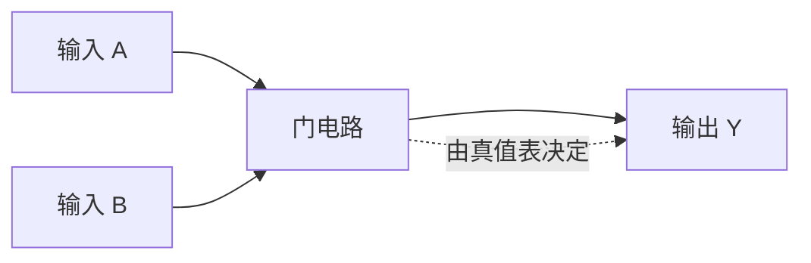
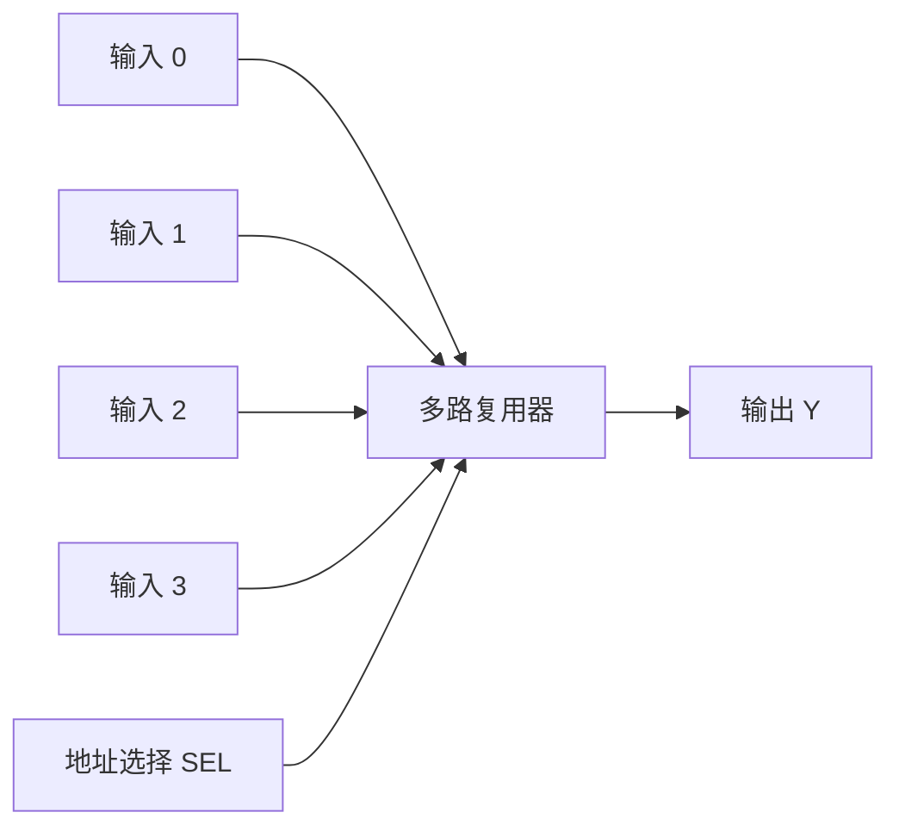
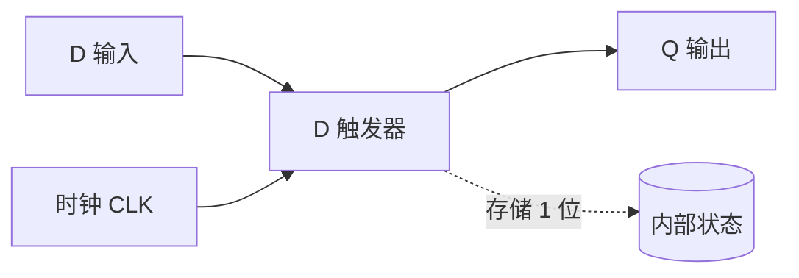
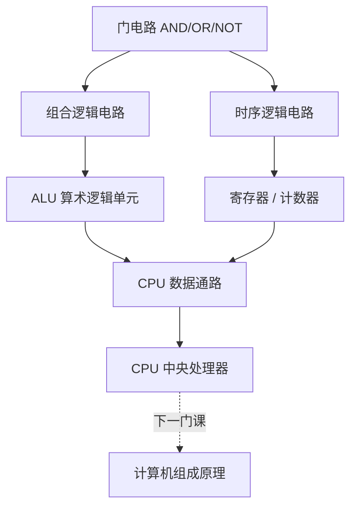

# 数字电路

> 数字电路是用 0 和 1 处理信息的硬件基础。把成千上万个开关按规则组合起来，就能完成加减运算、存储数据、控制流程，这正是 CPU 和整台计算机的物理根基。本文从开关到 CPU，梳理数字电路的核心概念与设计思路。

**关键词**：数字电路、逻辑门、组合逻辑、时序逻辑、触发器、有限状态机

## 抽象类比

数字电路可以类比成"用开关的开/关来表示信息"——一个开关按下代表 1，松开代表 0，把成千上万个这样的开关按照规则组合起来，就能完成加减运算、存储数据、控制流程，这就是 CPU 和整台计算机的物理根基。理解数字电路，就等于拿到了通往计算机底层的钥匙。就像搭积木：每块积木（门电路）只能做一件简单的事，但按规则拼起来就能搭出城堡（CPU）。

## 适合人群 / 预备知识

- 软件工程专业大一、大二学生，想搞清楚代码背后硬件在做什么
- 有 Basic 数学基础：知道二进制、布尔代数更好，不知道也能看懂
- 不需要先修电路分析，但学完电路分析再来学会更顺
- 适合对"计算机是怎么从零搭起来的"有好奇心的同学

## 一、为什么学数字电路

- 理解计算机底层：明白 0 和 1 是怎么变成加减乘除和逻辑判断的
- 硬件基础：是学习计算机组成原理、嵌入式系统的前置课程
- 与计算机组成原理衔接：ALU、寄存器、CPU 控制单元都建立在数字电路之上
- 培养"工程思维"：用基本元件组合出复杂功能，是软件设计的同款思路
- 为 FPGA / ASIC / 嵌入式开发铺路
- 搞懂"代码是怎么跑起来的"：从高级语言到机器指令再到电平翻转

## 二、基础概念

- 模拟信号 vs 数字信号
  - 模拟信号：连续的波浪，像水银温度计的读数，可以在任意时刻取任意值
  - 数字信号：离散的台阶，只有 0 和 1 两种状态，像开关的"开/关"
  - 数字信号抗干扰能力强，便于存储和处理，所以计算机选择数字电路
- 高低电平
  - 高电平（约 5V 或 3.3V）表示 1
  - 低电平（约 0V）表示 0
  - 电平是物理电压，逻辑是 0/1 抽象，二者通过约定对应起来
- 时钟信号
  - 类比"乐队节拍器"，所有电路按节拍同步工作
  - 没有 clock，电路里各元件会各干各的，输出乱套
  - 时钟频率（如 3.0GHz）就是节拍器的速度
- 上升沿 / 下降沿
  - 上升沿：时钟信号从 0 跳到 1 的瞬间
  - 下降沿：时钟信号从 1 跳到 0 的瞬间
  - 很多触发器只在边沿时刻"采样"输入，保证数据稳定
- 同步 vs 异步
  - 同步电路：所有触发器共用同一个时钟，状态统一更新，设计相对简单
  - 异步电路：没有统一时钟，靠元件之间信号握手，速度快但设计难
- 组合逻辑 vs 时序逻辑（预告）
  - 组合逻辑：只看当前输入，没有记忆
  - 时序逻辑：有记忆、依赖时钟，是 CPU 能"记住"数据的根本

## 三、逻辑运算与门电路

- 与门 AND：两个输入都为 1 才输出 1，类比"两个开关串联，同时按下才通电"
- 或门 OR：任一输入为 1 就输出 1，类比"两个开关并联，按下任意一个就通电"
- 非门 NOT：输入取反，0 变 1，1 变 0
- 与非门 NAND：先与后非，是"万能门"，用它能搭出任意逻辑
- 或非门 NOR：先或后非
- 异或门 XOR：两输入不同时输出 1，是加法器的核心
- 同或门 XNOR：两输入相同时输出 1，常用于比较两位是否相等
- 真值表：把所有输入组合和对应输出列成一张表，是分析逻辑电路的标准工具
  - 以两输入与门为例：(0,0)→0、(0,1)→0、(1,0)→0、(1,1)→1
  - 真值表是逻辑函数最直白的"说明书"

## 四、组合逻辑电路

组合逻辑电路的特点是：输出只取决于当前输入，没有记忆。任何时刻输入一变，输出立即跟着变（不考虑延迟）。

- 编码器：把多条输入线中"有效的那一条"转成二进制编码，例如 8 线变 3 线
- 译码器：编码器的逆过程，把二进制编码还原成对应的一条输出线
- 多路复用器 MUX：类比"多选一开关"，从多路输入里按地址选出一路输出
- 半加器：能加两个 1 位数，输出"和"与"进位"，但不考虑低位来的进位
- 全加器：在半加器基础上多了"低位进位输入"，是真正能拼接成多位加法器的单元
- 比较器：比较两个二进制数的大小
- 三态门：输出除了 0、1 还能是"高阻态"，用于总线共享

## 五、时序逻辑电路

时序逻辑电路的特点是：有记忆、依赖时钟。输出不仅取决于当前输入，还取决于电路当前的状态。

- 触发器：能存储 1 位信息的最小单元，类比"有记忆的开关"
  - RS 触发器：最基础，有置位（S）、复位（R）两个输入
  - D 触发器：最常见的"数据触发器"，时钟沿一到就把 D 锁存到 Q
  - JK 触发器：RS 的升级版，解决了非法状态
  - T 触发器：每来一个时钟就翻转一次，常用于计数器
- 寄存器：把多个触发器并排起来，存储一个多位二进制数，CPU 里的"通用寄存器"就是它
- 计数器：每个时钟脉冲自动加 1（或减 1），用于分频、定时、程序计数器 PC
- 移位寄存器：能在时钟驱动下把数据逐位左移或右移，用于串并转换

## 六、从门电路到 CPU

从最底层的晶体管和门电路，一步步向上搭，最终就能拼出一颗 CPU。这条路径正好对应"数字电路 → 计算机组成原理"的学习顺序。

- 第一步：用晶体管搭出与、或、非等基本门电路
- 第二步：用门电路组合出加法器、多路复用器等组合逻辑
- 第三步：加上触发器和寄存器，让电路拥有记忆
- 第四步：组合逻辑 + 寄存器组成 ALU 和数据通路
- 第五步：加上控制单元、时钟、总线，封装成 CPU

关于 CPU 的完整结构、指令执行流程、流水线等内容，详见 [[计算机组成原理]]。

## 七、硬件描述语言 HDL

HDL 是用代码描述硬件的语言，写出来的代码会被综合成真实的电路。

- Verilog：语法像 C，国内高校和公司用得最多
- VHDL：语法更严谨，强类型，欧洲和美国军工常用
- FPGA：现场可编程门阵列，可以反复"烧录"不同电路，适合原型验证
- ASIC：专用集成电路，一旦流片就固定不变，性能高、成本高、用于量产
- 仿真与综合：先在软件里仿真验证逻辑，再综合成真实电路连线

举一段 Verilog 描述与门的思路：声明两个输入 a、b 和一个输出 y，用 `assign y = a & b;` 一行就能描述一个与门。HDL 代码不是"顺序执行"，而是描述"电路长什么样"，这是它和 C 语言最大的区别。

## 八、与上层课程的衔接

- 计算机组成原理：直接在数字电路基础上搭 CPU、内存、总线
- 操作系统：理解中断、时钟、DMA 等概念时要用到硬件知识
- 嵌入式系统：直接操作 GPIO、定时器、SPI/I2C，离不开数字电路
- 计算机体系结构：流水线、缓存、并行都建立在时序逻辑之上
- 编译原理：高级语言最终要落到机器指令，再由数字电路执行
- 数字信号处理：从数字电路延伸出去，处理更复杂的信号变换
- 硬件安全：理解侧信道攻击、物理不可克隆函数 PUF 等前沿话题
- 集成电路设计：从数字电路走向芯片设计、版图布局

## 九、面试 Q&A

- Q1：组合逻辑和时序逻辑有什么区别？
  - A：组合逻辑的输出只看当前输入，没有记忆；时序逻辑有记忆，输出依赖当前状态和时钟，需要时钟驱动才能稳定工作。

- Q2：什么是触发器？
  - A：触发器是能存储 1 位二进制信息的最小时序单元，依靠时钟边沿锁存数据。常见的有 D、JK、T、RS 四种，CPU 里的寄存器就是由多个 D 触发器组成的。

- Q3：时钟信号在数字电路里起什么作用？
  - A：时钟就像节拍器，让所有时序元件在同一时刻同步更新状态，避免数据在传输过程中被错误采样，保证电路工作稳定有序。

- Q4：什么是建立时间和保持时间？
  - A：建立时间指时钟沿到来前数据必须稳定的最短时间，保持时间指时钟沿到来后数据还要保持稳定的最短时间。不满足这两个条件，触发器可能进入亚稳态，输出不可靠。

## 十、如何向他人解释

跟不懂技术的朋友解释数字电路，可以这样打比方：

把数字电路想象成一间只有"开/关"两种状态的开关工厂。每个开关要么亮要么灭，工厂里没有"半亮"。我们用"开"代表 1、"关"代表 0，然后把开关像电路一样连起来：

- 两个开关串联，都按下了灯才亮——这是"与"
- 两个开关并联，按一个灯就亮——这是"或"
- 把信号反过来，开变关、关变开——这是"非"

把这些基本组合拼成更复杂的电路，就能做加法器（算术）、触发器（记忆）、计数器（计时）。把成千上万个这样的小电路按规则连起来，最后就变成 CPU。所以数字电路就是"用最简单的开关，搭出最复杂的大脑"。
