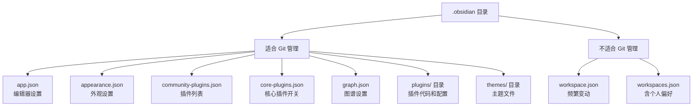

# .obsidian 目录详解

> Obsidian 的配置都存放在根目录下的 `.obsidian` 文件夹中。了解这些文件，有助于备份配置、排查问题、以及跨设备同步。

---

## 目录总览

```
.obsidian/
├── app.json                  # 编辑器核心设置
├── appearance.json           # 外观设置（主题、字体、配色）
├── community-plugins.json    # 已启用的社区插件列表
├── core-plugins.json         # 核心插件的开关状态
├── graph.json                # 关系图谱的显示设置
├── workspace.json            # 当前工作区状态（打开的标签页等）
├── workspaces.json           # 保存的工作区预设
├── plugins/                  # 社区插件目录
│   ├── templater-obsidian/
│   │   ├── manifest.json     # 插件元数据
│   │   ├── main.js           # 插件主程序代码
│   │   ├── data.json         # 插件配置数据
│   │   └── styles.css        # 插件样式
│   ├── obsidian-excalidraw-plugin/
│   │   ├── manifest.json
│   │   ├── main.js
│   │   ├── data.json
│   │   └── styles.css
│   └── obsidian-style-settings/
│       ├── manifest.json
│       ├── main.js
│       ├── data.json
│       └── styles.css
└── themes/                   # 主题目录
    └── Border/
        ├── manifest.json     # 主题元数据
        └── theme.css         # 主题样式（约9200行）
```

---

## 一、根目录配置文件

### 1.1 app.json — 编辑器核心设置

**作用**：控制 Obsidian 编辑器的基本行为。

**当前配置**：

| 字段 | 当前值 | 含义 |
|------|--------|------|
| `promptDelete` | `false` | 删除文件时不弹确认框 |
| `newFileLocation` | `"current"` | 新建笔记在当前文件夹 |
| `attachmentFolderPath` | `"./attachments"` | 附件存放在笔记同级的 `attachments` 文件夹 |
| `alwaysUpdateLinks` | `true` | 重命名文件时自动更新链接 |
| `deleteUnlinkedAttachments` | `"always"` | 删除笔记时同时删除其独占的附件 |
| `showLineNumber` | `true` | 显示行号 |
| `readableLineLength` | `false` | 关闭可读行宽（行宽占满编辑区） |
| `showInlineTitle` | `false` | 不显示内联标题 |
| `focusNewTab` | `true` | 新建标签页时自动聚焦 |
| `showIndentGuide` | `false` | 不显示缩进参考线 |
| `smartIndentList` | `true` | 智能列表缩进 |
| `vimMode` | `false` | 关闭 Vim 模式 |
| `autoConvertHtml` | `true` | 自动转换 HTML |
| `strictLineBreaks` | `false` | 关闭严格换行 |
| `spellcheck` | `false` | 关闭拼写检查 |
| `autoPairBrackets` | `true` | 自动配对括号 |

---

### 1.2 appearance.json — 外观设置

**作用**：控制 Obsidian 的视觉外观。

**当前配置**：

| 字段 | 当前值 | 含义 |
|------|--------|------|
| `baseFontSize` | `16` | 基础字号 16px |
| `cssTheme` | `"Border"` | 使用 Border 主题 |
| `accentColor` | `"#75b2e1"` | 强调色：天空蓝 |
| `theme` | `"system"` | 跟随系统亮/暗模式 |
| `enabledCssSnippets` | `[]` | 没有启用的 CSS 片段 |
| `textFontFamily` | `"霞鹜文楷"` | 正文字体 |
| `monospaceFontFamily` | `"JetBrains Mono"` | 等宽字体（代码） |
| `interfaceFontFamily` | `"霞鹜文楷"` | 界面字体 |
| `showViewHeader` | `true` | 显示视图标题栏 |
| `showRibbon` | `true` | 显示左侧功能区 |
| `nativeMenus` | `false` | 使用自定义菜单而非系统原生菜单 |

---

### 1.3 community-plugins.json — 社区插件列表

**作用**：记录已启用的社区插件 ID 列表。

**当前配置**：

```json
[
  "templater-obsidian",           // Templater 模板插件
  "obsidian-excalidraw-plugin",   // Excalidraw 手绘插件
  "obsidian-style-settings"       // Style Settings 主题配置插件
]
```

> **注意**：这个文件只记录「已启用」的插件。已安装但未启用的插件不会出现在这里。插件的实际文件在 `plugins/` 目录中。

---

### 1.4 core-plugins.json — 核心插件开关

**作用**：控制 Obsidian 自带的核心功能开关。

**当前配置**：

| 核心插件 | 状态 | 含义 |
|---------|------|------|
| `file-explorer` | ✅ 开 | 文件资源管理器 |
| `global-search` | ✅ 开 | 全局搜索 |
| `switcher` | ❌ 关 | 快速切换器（Ctrl+O） |
| `graph` | ✅ 开 | 关系图谱 |
| `backlink` | ✅ 开 | 反向链接面板 |
| `canvas` | ✅ 开 | 白板 |
| `outgoing-link` | ✅ 开 | 正向链接面板 |
| `tag-pane` | ✅ 开 | 标签面板 |
| `footnotes` | ✅ 开 | 脚注 |
| `properties` | ✅ 开 | 属性面板 |
| `page-preview` | ✅ 开 | 页面预览（悬停预览） |
| `daily-notes` | ❌ 关 | 每日笔记 |
| `templates` | ❌ 关 | 核心模板（被 Templater 替代） |
| `note-composer` | ❌ 关 | 笔记组合器 |
| `command-palette` | ✅ 开 | 命令面板（Ctrl+P） |
| `slash-command` | ✅ 开 | 斜杠命令 |
| `editor-status` | ✅ 开 | 编辑器状态 |
| `bookmarks` | ✅ 开 | 书签 |
| `markdown-importer` | ✅ 开 | Markdown 导入器 |
| `zk-prefixer` | ❌ 关 | Zettelkasten 前缀器 |
| `random-note` | ❌ 关 | 随机笔记 |
| `outline` | ✅ 开 | 大纲面板 |
| `word-count` | ✅ 开 | 字数统计 |
| `slides` | ❌ 关 | 幻灯片 |
| `audio-recorder` | ❌ 关 | 音频录制 |
| `workspaces` | ✅ 开 | 工作区 |
| `file-recovery` | ❌ 关 | 文件恢复 |
| `publish` | ❌ 关 | Obsidian Publish |
| `sync` | ❌ 关 | Obsidian Sync |
| `bases` | ❌ 关 | Bases（数据库） |
| `webviewer` | ✅ 开 | 网页查看器 |

> **设计思路**：关闭了 `templates`（用 Templater 替代）、关闭了 `daily-notes`（可通过 Templater 实现）、关闭了 `sync` 和 `publish`（用 Git 同步）。

---

### 1.5 graph.json — 关系图谱设置

**作用**：保存关系图谱的显示参数。

**当前配置**：

| 字段 | 当前值 | 含义 |
|------|--------|------|
| `showTags` | `false` | 不显示标签节点 |
| `showAttachments` | `false` | 不显示附件节点 |
| `hideUnresolved` | `false` | 显示未解析的链接 |
| `showOrphans` | `true` | 显示孤立节点 |
| `showArrow` | `false` | 不显示箭头方向 |
| `textFadeMultiplier` | `0` | 文字淡出系数 |
| `nodeSizeMultiplier` | `1` | 节点大小 |
| `lineSizeMultiplier` | `1` | 连线粗细 |
| `centerStrength` | `0.519` | 中心引力强度 |
| `repelStrength` | `10` | 节点斥力 |
| `linkStrength` | `1` | 连线引力 |
| `linkDistance` | `250` | 连线长度 |

---

### 1.6 workspace.json — 当前工作区状态

**作用**：记录当前打开了哪些文件、面板布局如何。

**特点**：
- 每次 Obsidian 关闭时自动保存
- 下次打开时恢复上次的界面状态
- 包含：打开的标签页、左右侧边栏状态、分屏布局等
- **经常变动**，不适合版本管理（建议加入 `.gitignore`）

---

### 1.7 workspaces.json — 工作区预设

**作用**：保存用户自定义的工作区布局预设。

**当前状态**：`{"workspaces": {}, "active": ""}`（空，尚未保存任何预设）

> **使用场景**：你可以保存多个工作区，比如「写作模式」（只留编辑区）、「研究模式」（左侧文件树+右侧大纲+中间编辑），一键切换。

---

## 二、plugins/ 目录 — 社区插件

### 2.1 目录结构（每个插件通用）

```
plugins/
└── 插件ID/
    ├── manifest.json   # 插件元数据（名称、版本、作者等）
    ├── main.js         # 插件主程序代码（编译后的 JavaScript）
    ├── data.json       # 插件配置数据（用户的设置）
    └── styles.css      # 插件样式（可选）
```

### 2.2 当前已安装的插件

| 插件 ID | 名称 | 版本 | 作用 |
|---------|------|------|------|
| `templater-obsidian` | Templater | 2.20.6 | 高级模板引擎 |
| `obsidian-excalidraw-plugin` | Excalidraw | 2.25.3 | 手绘图 |
| `obsidian-style-settings` | Style Settings | 1.0.9 | 主题可视化配置 |

### 2.3 各文件说明

#### manifest.json — 插件身份证

```json
{
    "id": "templater-obsidian",        // 唯一标识符（和文件夹名一致）
    "name": "Templater",               // 显示名称
    "version": "2.20.6",               // 版本号
    "description": "...",              // 描述
    "minAppVersion": "1.12.2",         // 最低支持的 Obsidian 版本
    "author": "SilentVoid",            // 作者
    "isDesktopOnly": false             // 是否仅桌面端
}
```

> **重要**：`id` 必须和文件夹名完全一致，否则 Obsidian 无法识别。

#### main.js — 插件程序

- 插件的全部逻辑代码，编译后的 JavaScript
- 文件通常较大（Excalidraw 的 main.js 超过 1MB）
- **不要手动编辑**，更新插件会覆盖

#### data.json — 插件配置

- 用户在设置页面修改的配置都存在这里
- 删除此文件 = 恢复插件默认设置
- 不同插件的格式完全不同

#### styles.css — 插件样式

- 插件自带的 CSS 样式
- 主题可以通过覆盖这些样式来适配插件

---

## 三、themes/ 目录 — 主题

### 3.1 目录结构

```
themes/
└── 主题名/
    ├── manifest.json   # 主题元数据
    └── theme.css       # 主题样式
```

### 3.2 当前已安装的主题

| 主题 | 版本 | 作者 |
|------|------|------|
| Border | 1.13.7 | Akifyss |

### 3.3 文件说明

#### manifest.json

```json
{
    "name": "Border",           // 主题名（和文件夹名一致）
    "version": "1.13.7",        // 版本号
    "minAppVersion": "0.16.0",  // 最低支持的 Obsidian 版本
    "author": "Akifyss",        // 作者
    "authorUrl": "..."          // 作者主页
}
```

#### theme.css

- 主题的全部样式代码
- Border 主题约 9200 行
- 前 3600 行是 `/* @settings */` 块，定义 Style Settings 的配置面板
- 后面的行是实际的 CSS 样式

---

## 四、其他可能出现的文件/目录

以下文件/目录在你的 Vault 中暂时不存在，但 Obsidian 运行过程中可能会创建：

| 文件/目录 | 作用 | 何时出现 |
|----------|------|---------|
| `snippets/` | CSS 代码片段目录 | 当你创建 CSS Snippet 时 |
| `hotkeys.json` | 自定义快捷键 | 当你修改快捷键时 |
| `core-plugins-migration.json` | 核心插件迁移记录 | Obsidian 版本升级后 |
| `daily-notes.json` | 每日笔记设置 | 开启每日笔记核心插件时 |
| `templates.json` | 核心模板设置 | 开启核心模板插件时 |
| `bookmarks.json` | 书签数据 | 使用书签功能时 |
| `canvas.json` | 白板设置 | 使用白板功能时 |
| `plugins/插件ID/main.js.map` | Source Map | 部分插件包含 |
| `plugins/插件ID/lib/` | 插件依赖库 | 部分插件包含 |

---

## 五、配置文件分类

按「是否适合版本管理」分类：



### 建议的 .gitignore

```
# 频繁变动，不需要同步
.obsidian/workspace.json
.obsidian/workspaces.json

# 插件缓存（可选）
.obsidian/plugins/*/main.js.map
```

---

## 六、备份与迁移指南

### 6.1 完整备份

备份整个 `.obsidian` 目录即可完整还原所有配置。

### 6.2 最小化备份

如果只想备份配置，不备份插件代码（可以重新下载）：

```
app.json              # 编辑器设置
appearance.json       # 外观设置
community-plugins.json # 插件列表
core-plugins.json     # 核心插件开关
graph.json            # 图谱设置
plugins/*/data.json   # 各插件的配置数据
plugins/*/manifest.json # 各插件的版本信息
themes/*/manifest.json # 主题版本信息
```

### 6.3 跨设备同步

1. 在新设备安装 Obsidian
2. 复制 `.obsidian` 目录到新 Vault
3. 重启 Obsidian
4. 社区插件可能需要重新下载（如果没有复制 `main.js`）

---

## 七、故障排查

| 问题 | 排查方法 |
|------|---------|
| 主题不生效 | 检查 `appearance.json` 的 `cssTheme` 字段 |
| 插件不显示 | 检查 `community-plugins.json` 是否包含插件 ID |
| 插件配置丢失 | 检查 `plugins/插件ID/data.json` 是否存在 |
| 字体不对 | 检查 `appearance.json` 的 `textFontFamily` 字段 |
| 界面布局错乱 | 删除 `workspace.json`，重启 Obsidian |
| 核心功能消失 | 检查 `core-plugins.json` 对应项是否为 `true` |
