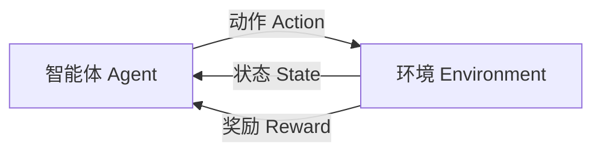
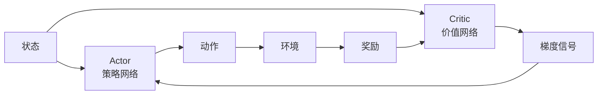

# 强化学习

> 强化学习（Reinforcement Learning, RL）研究智能体通过与环境交互、试错、获得奖励来学习最优策略的方法。它不同于监督学习"有标准答案"，也不同于无监督学习"无任何反馈"，而是依靠"延迟奖励"在序列决策中找到长期收益最大的行为方式，是 AlphaGo、ChatGPT 的 RLHF、机器人控制等背后的核心技术。

**关键词**：智能体、马尔可夫决策过程、策略梯度、Q-Learning、PPO

## 抽象类比

强化学习就像"训狗"：你不会给狗讲解"坐下"的语义，而是在它做对时给一块肉、做错时不给或呵斥，狗通过不断尝试摸索出"什么动作能换来最多奖励"。智能体就是这只狗，环境就是它的主人，奖励信号就是肉或呵斥。

也可以类比"学骑自行车"：没人能靠看书学会骑车，必须亲自上车摔几次。每一次摔倒都是负奖励，每一次稳稳前行都是正奖励，大脑在不断"试错—修正"中学会平衡。强化学习的精髓正在于此——通过亲身经历的后果来学习，而不是依赖人工标注的"正确答案"。这种"延迟反馈"特性让 RL 在序列决策（如下棋、投资、控制）中独树一帜。

## 适合人群

- 已对 [[机器学习]]、[[深度学习]] 有基础了解
- 想理解 AlphaGo、ChatGPT RLHF、机器人控制背后的原理
- 从事游戏 AI、自动驾驶、推荐系统、量化交易
- 对序列决策、控制论、最优控制感兴趣
- 希望了解 LLM 对齐与推理增强中的 RL 应用

## 预备知识

- 概率论与随机过程基础
- 马尔可夫链与贝尔曼方程概念
- 神经网络与梯度下降
- 建议先阅读 [[机器学习]]、[[深度学习]]
- 了解 [[具身智能]] 有助于理解机器人 RL

## 一、强化学习是什么

### 核心思想

- 智能体（Agent）在环境（Environment）中观察状态（State），采取动作（Action），获得奖励（Reward）
- 目标：学习一个策略 π(a|s)，使长期累积奖励最大化
- 区别于监督学习：没有"标准答案"，只有"好坏反馈"
- 区别于无监督学习：有明确的奖励信号，目标是优化而非发现结构

### 与监督/无监督学习的对比

- 监督学习：有标签、即时反馈、独立样本
- 无监督学习：无标签、无反馈、发现结构
- 强化学习：延迟反馈、序列决策、样本相关、试错探索
- 共同点：都是通过数据优化目标函数

### 适用场景

- 序列决策：下棋、游戏、规划
- 控制问题：机器人、自动驾驶
- 交互式学习：对话系统、推荐系统
- 长期收益优化：投资、资源调度

## 二、核心概念

### 基本要素

- Agent 智能体：做决策的主体
- Environment 环境：智能体交互的对象
- State 状态 s：环境的描述
- Action 动作 a：智能体可执行的操作
- Reward 奖励 r：标量反馈信号
- Policy 策略 π(a|s)：状态到动作的映射
- Episode 回合：从开始到结束的一次完整交互

### 价值函数

- 状态价值 V(s)：从状态 s 出发，遵循策略 π 的期望累积奖励
- 动作价值 Q(s,a)：在状态 s 执行动作 a 后，遵循策略 π 的期望累积奖励
- 优势函数 A(s,a) = Q(s,a) - V(s)：动作相对平均水平的超额收益

### 折扣与回报

- 回报 G_t = r_t + γ·r_{t+1} + γ²·r_{t+2} + ...
- 折扣因子 γ ∈ [0,1]：权衡短期与长期收益
- γ 接近 0：近视，只看眼前奖励
- γ 接近 1：远视，重视长期收益
- 数学作用：保证无穷级数收敛

### 探索与利用

- Exploration 探索：尝试新动作，发现潜在更优策略
- Exploitation 利用：使用已知最优动作，最大化当前收益
- ε-Greedy：以 ε 概率随机探索，1-ε 概率利用
- UCB：置信上界策略，平衡不确定性与收益
- 熵正则化：在策略梯度中加入熵鼓励探索

## 三、MDP 马尔可夫决策过程

### MDP 五元组

- ⟨S, A, P, R, γ⟩
- S：状态空间
- A：动作空间
- P(s'|s,a)：状态转移概率
- R(s,a)：奖励函数
- γ：折扣因子
- 马尔可夫性：下一步只依赖当前状态与动作，与历史无关

### Bellman 方程

- 状态价值：V^π(s) = E[r + γ·V^π(s')]
- 动作价值：Q^π(s,a) = E[r + γ·V^π(s')]
- 最优 Bellman：V*(s) = max_a E[r + γ·V*(s')]
- 求解方法：值迭代、策略迭代
- 维度灾难：状态空间大时表格法不可行，需函数逼近

### 贝尔曼方程的意义

- 把长期累积奖励分解为"即时奖励 + 下一状态价值"
- 提供递归求解的数学基础
- 是 Q-Learning、DQN 等算法的理论根基
- 让"长期最优"问题转化为"局部递推"问题

## 四、基于价值的方法

### Q-Learning

- 经典 off-policy 算法，学习 Q*(s,a)
- 更新规则：Q(s,a) ← Q(s,a) + α[r + γ·max_a' Q(s',a') - Q(s,a)]
- TD 目标：r + γ·max_a' Q(s',a')
- 适合离散、小状态空间
- 局限：表格法无法处理大状态空间

### SARSA

- on-policy 算法，学习当前策略的 Q
- 更新规则：Q(s,a) ← Q(s,a) + α[r + γ·Q(s',a') - Q(s,a)]
- 与 Q-Learning 区别：用实际执行的动作 a' 而非 max
- 更保守，考虑探索成本

### DQN

- Deep Q-Network：用神经网络逼近 Q 函数
- 关键技巧：
  - Experience Replay：经验回放，打破样本相关性
  - Target Network：目标网络，稳定训练
  - Frame Stack：堆叠多帧处理部分可观测
- 突破：在 Atari 游戏上达到人类水平
- 参考 https://arxiv.org/abs/1312.5602

### DQN 变体

- Double DQN：解决 Q 值过高估计问题
- Dueling DQN：分解 V(s) 与 A(s,a)
- Prioritized Experience Replay：优先回放重要样本
- Rainbow：集成多种改进的综合算法
- Noisy DQN：参数空间探索替代 ε-Greedy

## 五、基于策略的方法

### Policy Gradient 策略梯度

- 直接参数化策略 π_θ(a|s)
- 目标：最大化期望回报 J(θ) = E[Σ γ^t · r_t]
- 梯度：∇J(θ) = E[∇log π_θ(a|s) · G_t]
- 直觉：增大产生高回报动作的概率，减小低回报动作的概率
- 优势：可处理连续动作空间、随机策略

### REINFORCE

- 最简单的策略梯度算法
- 蒙特卡洛采样完整 episode 后更新
- 方差大、收敛慢
- 改进：引入 baseline 减小方差

### Actor-Critic

- Actor：策略网络，决定动作
- Critic：价值网络，评估动作好坏
- 结合策略梯度与价值方法的优势
- Critic 提供 baseline 降低方差
- A2C/A3C：Advantage Actor-Critic，同步/异步多线程版本

## 六、先进算法

### DDPG

- Deep Deterministic Policy Gradient
- 适合连续动作空间
- 借鉴 DQN 的经验回放与目标网络
- 确定性策略：输出动作而非概率分布
- 问题：探索能力弱、超参敏感

### TD3

- Twin Delayed DDPG
- 双 Q 网络取最小值，缓解过高估计
- 策略延迟更新：Critic 更新多次后再更新 Actor
- 目标策略平滑：对目标动作加噪声
- 性能比 DDPG 显著提升

### SAC

- Soft Actor-Critic
- 最大熵强化学习：最大化奖励 + 策略熵
- 自动温度系数调节
- 探索与利用的优雅平衡
- 当前连续控制 SOTA 之一

### PPO

- Proximal Policy Optimization
- 截断目标函数：限制策略更新幅度
- Clip 比率：ratio ∈ [1-ε, 1+ε]
- 优点：稳定、易调参、样本效率适中
- ChatGPT RLHF 阶段的默认算法
- 参考 https://arxiv.org/abs/1707.06347

### TRPO

- Trust Region Policy Optimization
- 用 KL 散度约束策略更新幅度
- 理论严格但实现复杂
- PPO 是其简化版本

### GRPO

- Group Relative Policy Optimization
- DeepSeek-R1 使用
- 用组内相对优势替代 Critic
- 减少 Critic 网络开销，适合 LLM 推理增强
- 在推理任务上表现出色

## 七、基于模型的方法

### Model-based RL

- 学习环境模型（状态转移 P、奖励 R）
- 用模型规划未来，样本效率高
- 优点：数据效率高，适合样本昂贵的场景
- 缺点：模型误差会累积放大
- 代表：MuZero、Dreamer

### Dyna

- 结合 Model-free 与 Model-based
- 真实经验训练模型 + 模拟经验训练策略
- 在线学习加速

### MCTS 蒙特卡洛树搜索

- 选择、扩展、模拟、回溯四步
- UCB 选择节点平衡探索利用
- AlphaGo 系列的核心组件
- 适合离散决策、可仿真环境

### AlphaGo / AlphaZero

- AlphaGo：CNN 策略网络 + 价值网络 + MCTS，战胜李世石
- AlphaGo Zero：无人类数据，自我对弈学习
- AlphaZero：统一框架适用于围棋、国际象棋、将棋
- MuZero：不显式建模规则，学习隐式表示
- 关键启示：RL + 深度学习 + 自我对弈 = 超越人类

## 八、深度强化学习的挑战

### 稀疏奖励 Sparse Reward

- 大部分状态无奖励信号，难以学习
- 解决：奖励 shaping、课程学习、好奇心驱动
- 例：Montezuma's Revenge 等探索困难游戏

### 探索-利用困境

- 过度利用陷入局部最优
- 过度探索无法收敛
- 解决：ε-Greedy 衰减、UCB、熵正则、ICM 内在奖励

### 信用分配 Credit Assignment

- 长序列中，哪个动作导致最终结果？
- 解决：TD(λ)、资格迹 Eligibility Traces、Hindsight Experience Replay

### 样本效率

- 深度 RL 通常需要海量交互样本
- 解决：Model-based、离线 RL、模仿学习预训练
- 真实环境成本高时尤为关键

### 稳定性与复现性

- 超参敏感、随机种子影响大
- 解决：目标网络、经验回放、Pendulum 评估套件
- 同一算法不同实现差异巨大

## 九、应用场景

### 游戏

- Atari：DQN 突破性成果
- 围棋：AlphaGo 击败李世石、柯洁
- 星际争霸：AlphaStar 达到职业水平
- Dota 2：OpenAI Five 击败人类冠军
- 麻将：Suphx 达到职业水平
- Minecraft：VPT 通过 YouTube 视频学习

### 机器人与具身智能

- 机械臂控制：抓取、操作、装配
- LeRobot：HuggingFace 开源机器人 RL 框架
- 具身智能：视觉 + 控制 + 语言
- 四足机器人：ANYmal、Spot 强化学习运动
- Sim-to-Real：仿真训练迁移到真实机器人

### LLM 对齐与推理

- RLHF：ChatGPT 对齐人类偏好的核心
- DeepSeek-R1：GRPO 强化学习增强推理能力
- 推理增强：通过 RL 让模型学会长链推理
- Agent 训练：用 RL 优化工具调用与多步规划

### 其他领域

- 推荐系统：列表推荐、长期收益优化
- 量化交易：组合优化、执行算法
- 自动驾驶：路径规划、决策控制
- 资源调度：数据中心、电网、交通信号
- 药物设计：分子序列生成与优化

## 十、工具与框架

### 环境与基准

- OpenAI Gym / Gymnasium：经典 RL 环境库，参考 https://gymnasium.farama.org
- Atari Learning Environment：游戏基准
- MuJoCo / Isaac Gym / Genesis：物理仿真
- Procgen、NetHack：泛化性基准
- LeRobot：机器人 RL 框架

### 算法库

- Stable Baselines3：主流算法的稳定实现
- Ray RLlib：分布式 RL 框架
- CleanRL：单文件实现，便于学习与调试
- Tianshou：模块化、灵活的中文友好框架
- Acme：DeepMind 出品
- Verl、TRL：LLM RLHF 训练框架

### 选择建议

- 入门学习：Gymnasium + Stable Baselines3
- 研究实验：CleanRL、Tianshou
- 工业部署：Ray RLlib
- LLM 对齐：Verl、TRL、OpenRLHF
- 机器人：Isaac Gym + LeRobot

## 面试速答

- Q1：Q-Learning 和 SARSA 的区别？
  - Q-Learning 是 off-policy，用 max_a' Q(s',a') 作 TD 目标
  - SARSA 是 on-policy，用实际执行的 Q(s',a') 作 TD 目标
  - Q-Learning 更激进，SARSA 更保守
  - 在"悬崖行走"等探索代价高的任务中 SARSA 表现更稳
- Q2：什么是 PPO？为什么流行？
  - Proximal Policy Optimization，截断策略更新幅度
  - Clip 比率限制 θ 更新在 [1-ε, 1+ε] 范围内
  - 稳定、易调参、性能均衡
  - ChatGPT RLHF 默认算法，工业界广泛采用
- Q3：Policy Gradient 为什么需要 baseline？
  - 直接用 G_t 作权重方差极大，训练不稳定
  - 减去 baseline b(s) 不改变期望但显著降低方差
  - 常用 baseline：V(s)，即用优势 A(s,a) = Q - V
  - Actor-Critic 框架的核心思想
- Q4：RLHF 中为什么用 PPO 而不是 DPO？
  - PPO 可在线采样、动态调整，理论上限更高
  - PPO 可结合 KL 正则、奖励模型迭代
  - DPO 是离线方法，简单但灵活性差
  - 现代 LLM 也用 GRPO 等新算法替代 PPO
- Q5：基于模型 vs 无模型 RL 的取舍？
  - Model-based 样本效率高，适合真实环境昂贵的场景（机器人）
  - Model-free 易实现、无模型误差，但样本效率低
  - Model-based 受模型误差累积影响
  - 趋势：MuZero 等隐式模型方法兼顾二者优势

## 相关文档

- [[机器学习]]
- [[深度学习]]
- [[具身智能]]
- [[生成式AI]]
