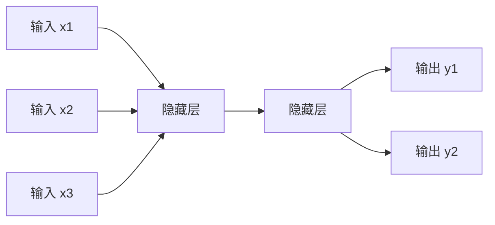
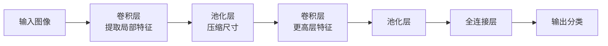

# 深度学习

> 深度学习（Deep Learning）是机器学习的一个子集，使用多层神经网络从数据中自动学习"多层抽象特征"。它解决了传统机器学习依赖人工特征工程的痛点，能端到端地完成从原始数据到最终结果的学习。本文将介绍神经网络基础、核心网络结构、训练技巧与典型应用。

**关键词**：神经网络、反向传播、卷积神经网络、循环神经网络、Transformer

## 抽象类比

深度学习就像一架"多层放大镜"逐级提取特征：第一层只看到像素和边缘，第二层把边缘拼成形状，第三层把形状认成部件，越往深处越接近"这是一张人脸"这样的抽象概念。每一层都在前一层的基础上做更高一级的抽象，所以叫"深"度学习。

也可以类比人脑认物的过程：小孩认猫，并不是先记住"猫是耳朵尖、有胡须"的规则，而是看过大量猫之后，大脑自动层层提炼出"猫"的概念。深度学习正是模拟了这种"由浅入深、逐层抽象"的学习方式，因此比传统机器学习更擅长处理图像、文本、语音等非结构化数据。

## 适合人群与预备知识

- 已对机器学习基本概念（监督学习、过拟合、损失函数）有了解
- 建议先阅读 [[机器学习]]
- 掌握 Python 编程基础
- 了解矩阵运算、链式求导等基础数学概念
- 对神经网络有初步兴趣

## 一、神经网络基础

### 神经元

神经元是神经网络的最小单元，可以类比为一个"小决策者"：接收多个输入信号，加权求和后再通过一个激活函数决定是否"激活"输出。

### 前馈神经网络

前馈神经网络由三层组成：

- 输入层：接收原始特征
- 隐藏层：在输入与输出之间做多层变换
- 输出层：给出最终预测结果

### 激活函数

如果没有激活函数，多层神经网络等价于单层线性模型。激活函数引入非线性，使网络能拟合复杂关系：

- **ReLU**：简单高效，x > 0 时输出 x，否则输出 0，最常用
- **Sigmoid**：将输出压缩到 (0, 1)，适合输出概率
- **Tanh**：将输出压缩到 (-1, 1)，常用于隐藏层
- 为什么需要非线性：纯线性堆叠再多层仍等价于一层，无法拟合曲线边界

### 反向传播

反向传播是训练神经网络的核心算法，类比"纠错反馈"：

- 前向传播：数据从输入流向输出，得到预测
- 计算损失：对比预测与真实答案的差距
- 反向传播：从输出层往回逐层算梯度
- 参数更新：用梯度下降调整权重

## 二、为什么"深"

- **层次化特征学习**：浅层学简单特征（边缘、颜色），深层学复杂概念（人脸、物体）
- **表达能力更强**：相同参数量下，深层网络比宽浅网络表达力更强
- **端到端学习**：从原始数据直接学出最终结果，省去人工特征工程
- **可复用性强**：底层特征可迁移到不同任务
- **抽象层次更丰富**：每一层都是对世界的更高一级抽象

## 三、核心网络结构

### 全连接网络 FNN

每个神经元与上一层所有神经元相连。适合结构化表格数据，但参数量大、易过拟合。

### 卷积神经网络 CNN

图像领域专用网络，核心思想是"局部感知 + 权值共享"，可以类比为一架"滑动放大镜"在图片上扫过，识别局部特征。

适用场景：图像分类、目标检测、人脸识别。

### 循环神经网络 RNN / LSTM / GRU

处理序列数据，类比"有记忆的阅读者"——读到一个新词时，会结合之前读过的内容理解。

- RNN：基础版，存在长距离遗忘问题
- LSTM：引入门控机制，能记住长期依赖
- GRU：LSTM 的简化版，参数更少

适用场景：文本生成、机器翻译、时间序列预测、语音识别。

### Transformer

摒弃循环结构，采用并行注意力机制处理序列。是当前 NLP 和多模态的主流架构。详见 [[01_Transformer]]。

### 生成对抗网络 GAN

由生成器和判别器两个网络相互博弈组成，类比"造假者 vs 鉴定师"：

- 生成器：尽量造出逼真样本骗过判别器
- 判别器：尽量分辨出真样本和假样本
- 二者对抗训练，共同进步

适用场景：图像生成、风格迁移、数据增强。

### 自编码器 AutoEncoder

通过"压缩—重建"过程学习数据的紧凑表示，类比"压缩包"——先编码到低维，再解码还原。

适用场景：数据降噪、特征提取、异常检测。

## 四、训练技巧

- **批归一化 BatchNorm**：对每层输入做归一化，让训练更稳定、能使用更大学习率
- **Dropout**：训练时随机丢弃部分神经元，强迫网络学到更鲁棒的特征，防止过拟合
- **学习率调度**：训练初期大步走，后期小步走，常见有 Step、Cosine、Warmup 等策略
- **迁移学习**：拿别人预训练好的模型微调，小数据集也能取得好效果
- **早停 Early Stopping**：验证集表现下降时停止训练，避免过拟合
- **数据增强**：通过翻转、裁剪、加噪等手段扩充训练数据

## 五、深度学习 vs 传统机器学习

- **数据量**：深度学习吃数据，数据越多越强；传统机器学习在中小数据上更稳
- **特征工程**：传统机器学习依赖人工特征；深度学习自动学特征
- **硬件需求**：深度学习需要 GPU 等专用硬件；传统算法 CPU 即可
- **可解释性**：传统机器学习更易解释；深度学习常被视为"黑盒"
- **训练时间**：深度学习训练动辄数小时到数天；传统算法通常更快
- **适用场景**：图像、文本、语音等非结构化数据深度学习占优；表格数据传统方法仍有竞争力

## 六、主流框架

- **PyTorch**：动态图、易调试，学术界主流
- **TensorFlow**：Google 出品，工业部署生态完善
- **Keras**：高层 API，简单易用，常作为 TensorFlow 的上层接口
- **PaddlePaddle**：百度出品，中文生态友好，国产化首选
- **JAX**：函数式自动微分，新晋研究热门

## 七、硬件加速

- **GPU**：擅长大规模并行矩阵运算，深度学习训练主力
- **TPU**：Google 专为深度学习设计的芯片，在云上针对 TensorFlow 优化
- **NPU**：嵌入式和移动端 AI 推理芯片，功耗低
- **量化（Quantization）**：把模型权重从 32 位浮点压缩到 8 位整数，让模型更小、推理更快，是硬件部署的关键技术
- 量化与硬件的关系：低精度模型在 NPU 上能跑得更快、更省电

## 八、常见应用场景

- 计算机视觉：人脸识别、自动驾驶感知、医学影像分析
- 自然语言处理：机器翻译、问答系统、文本生成
- 语音：语音识别、语音合成、声纹识别
- 推荐系统：基于深度学习的召回与排序
- 生成式 AI：ChatGPT、文生图、文生视频
- 游戏与决策：AlphaGo、机器人控制

## 面试速答

- Q1：CNN 为什么适合处理图像？
  - 图像具有局部相关性，卷积核正好捕捉局部特征
  - 权值共享让参数量大幅减少，训练更高效
  - 层次化结构天然契合"边缘→部件→物体"的视觉规律
  - 平移不变性：物体位置变了也能识别
- Q2：RNN 为什么有记忆？
  - RNN 隐藏层不仅输出，还会把状态传给下一步
  - 每一步的计算都依赖前一步的隐藏状态，相当于"短期记忆"
  - LSTM / GRU 通过门控机制控制记忆的写入和遗忘
- Q3：深度学习为什么需要大量数据？
  - 深度学习参数量巨大，小数据容易过拟合
  - 大量数据能覆盖更多分布，让模型学到真正通用规律
  - 数据不足时可用迁移学习、数据增强等技巧缓解
  - 大模型尤其需要大数据，否则记忆多于泛化
- Q4：为什么神经网络需要激活函数？
  - 没有激活函数，多层线性堆叠仍等价于单层线性模型，无法拟合曲线边界
  - 激活函数引入非线性，让网络能学习复杂关系
  - 常用激活函数：ReLU（最常用）、Sigmoid（输出概率）、Tanh（隐藏层）
- Q5：什么是反向传播？
  - 训练神经网络的核心算法，类比"纠错反馈"
  - 前向传播得到预测，计算损失，再反向逐层算梯度
  - 用梯度下降更新权重，让损失逐步减小
