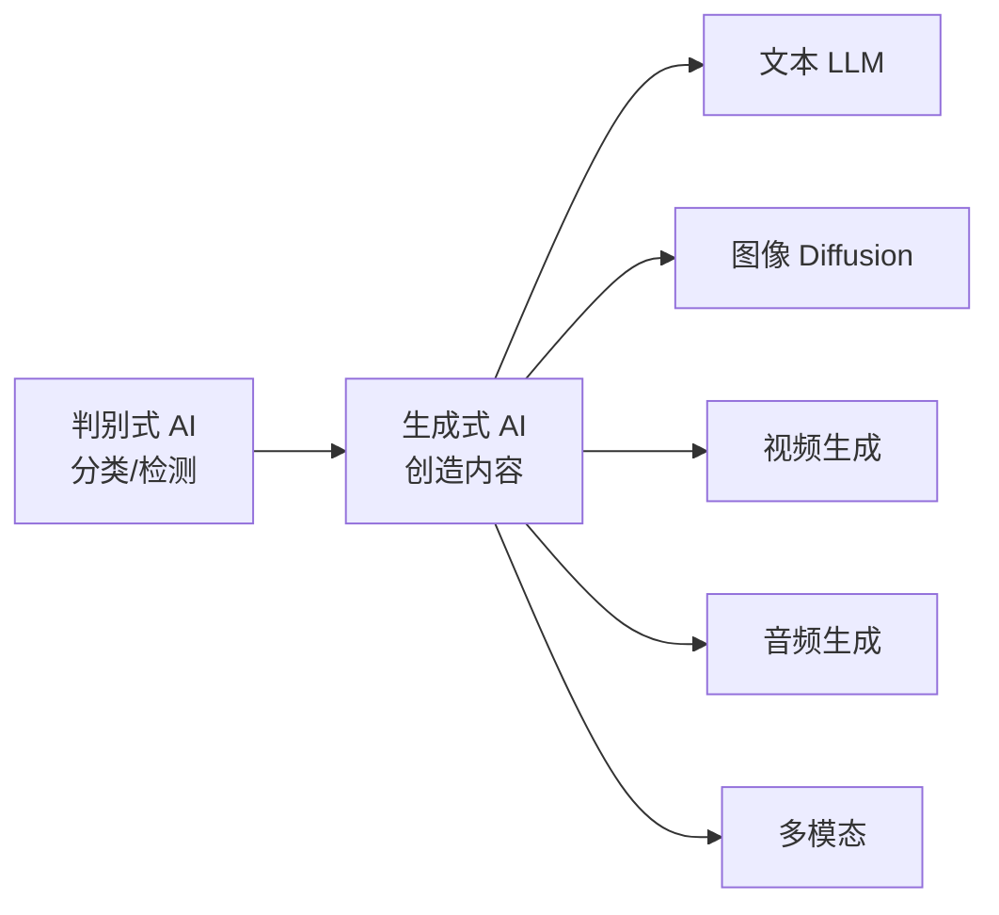
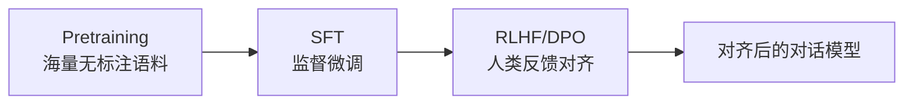
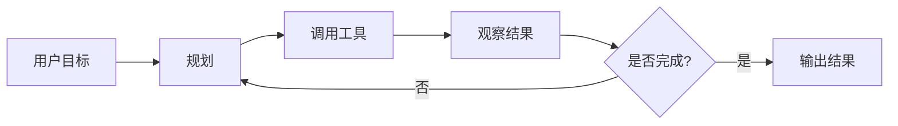

# 生成式AI

> 生成式 AI（Generative AI）通过大模型从海量数据中学习数据分布，能够"创造"出新的文本、图像、音频与视频内容，标志着 AI 从"判别"走向"生成"、从"专用"走向"通用"的新时代。本文聚焦大模型时代的新内容，与 [[深度学习]]、[[自然语言处理]] 互补。

**关键词**：大语言模型、Transformer、扩散模型、Prompt 工程、AI 对齐

## 抽象类比

判别式 AI 像一位"质检员"，看一眼就能告诉你这是猫还是狗；生成式 AI 则像一位"画家"，不仅能识别，还能凭想象画出一只从未见过的猫。前者在做"选择题"，后者在做"创作题"——前者把输入映射到一个有限标签集合，后者从模型学到的分布中采样生成新样本。

也可以把它类比成"读万卷书后下笔如有神"：模型先在海量互联网文本和图像上做预训练，把世界的统计规律"压缩"到参数里，再通过提示词激发出对应的能力。Prompt 就是给它出的"作文题目"，模型根据题目从记忆中调用相关知识"写"出新内容。这种"先广博吸收、再针对性输出"的方式，与传统监督学习"一题一答"有本质区别。

## 适合人群

- 已对 [[深度学习]]、[[自然语言处理]] 有基础了解
- 希望理解 ChatGPT、Midjourney、Sora 等背后原理
- 想从事大模型应用开发、Prompt 工程或模型训练
- 关注 AI 产品落地与对齐安全
- 想了解 AIGC 时代技术版图全貌

## 预备知识

- 神经网络与反向传播基础
- Transformer 自注意力机制
- Python 编程与 PyTorch 基础
- 概率论与统计基础
- 建议先阅读 [[深度学习]]、[[自然语言处理]]、[[计算机视觉]]

## 一、生成式 AI 是什么

### 从判别到生成

- 判别式模型：学习 P(y|x)，给定输入预测标签，如分类、检测
- 生成式模型：学习 P(x) 或 P(x|y)，能采样生成新样本
- 趋势：从"专用小模型"到"通用大模型"，从"监督学习"到"自监督预训练 + 提示学习"
- 关键变化：模型不再为单一任务训练，而是通过预训练获得通用能力，再以 Prompt 适配各种任务

### AIGC 主要模态

- 文本：GPT、Claude、LLaMA、Qwen、DeepSeek
- 图像：Stable Diffusion、DALL-E、Midjourney、Flux
- 视频：Sora、Runway、Pika、Kling
- 音频：Suno、Bark、VALL-E
- 多模态：GPT-4V/4o、Gemini、Qwen-VL、Claude 3.5 Sonnet

### 与传统深度学习的关系

- 传统深度学习以"特定任务 + 标注数据"为主
- 生成式 AI 以"通用预训练 + 提示学习"为主
- 底层都依赖神经网络与梯度下降，但范式从"任务定制"变为"能力涌现"
- 算力、数据、模型规模共同推动质变

## 二、Transformer 是基础

### Self-Attention 自注意力

- 核心思想：每个 token 与序列中所有 token 计算"注意力权重"，加权求和得到新表示
- 公式：Attention(Q, K, V) = softmax(QK^T / √d_k) · V
- 缩放因子 √d_k：防止点积过大导致 softmax 饱和
- 多头注意力 Multi-Head：多个注意力头并行，捕获不同子空间的模式
- 复杂度：O(n²·d)，序列长度的平方，长上下文成本高

### Encoder 与 Decoder

- Encoder-only（BERT）：理解类任务，双向注意力，适合分类、句向量
- Decoder-only（GPT 系列）：生成类任务，因果掩码，主流 LLM 选择
- Encoder-Decoder（T5、BART）：翻译、摘要等 seq2seq 任务
- 趋势：Decoder-only 架构因 Scaling Law 友好成为大模型事实标准

### 位置编码

- 正弦位置编码：原始 Transformer 使用，可外推
- 可学习位置编码：BERT、GPT-2 使用，外推性差
- RoPE 旋转位置编码：LLaMA、Qwen 等主流 LLM 采用，支持长度外推
- ALiBi：基于相对偏置的外推方案
- 长上下文：YaRN、NTK-aware 插值等扩展 RoPE 到 100K+ 长度

### Scaling Law 缩放定律

- 模型性能随参数量 N、数据量 D、算力 C 呈幂律提升
- Kaplan 法则：早期 OpenAI 提出，强调参数规模
- Chinchilla 法则：数据量与参数量应大致按 20:1 token/参数比例扩展
- 涌现能力 Emergent Abilities：超过某个规模后，模型突然表现出新能力（少样本学习、推理、指令遵循）
- 实践意义：训练前可根据 Scaling Law 估算最优资源配置

## 三、大语言模型 LLM

### 主流模型谱系

- GPT 系列：OpenAI，GPT-3/3.5/4/4o，开启 LLM 时代
- Claude 系列：Anthropic，强调对齐与安全，长上下文能力强
- LLaMA 系列：Meta 开源，推动开源生态繁荣
- Qwen 通义千问：阿里，中文与多模态能力强
- DeepSeek：深度求索，MoE 架构与推理增强代表
- GLM 系列：智谱，中英双语均衡
- Mistral：欧洲代表，Mixtral MoE 开源

### 训练三阶段

- **Pretraining 预训练**：自回归预测下一 token，学习通用语言能力，消耗 90% 以上算力
- **SFT 监督微调**：用"指令-回答"对教会模型遵循指令，少量高质量数据即可
- **RLHF 人类反馈强化学习**：训练奖励模型 + PPO 对齐人类偏好
- **DPO 直接偏好优化**：无需奖励模型，直接用偏好对优化策略，工程更简单
- **后训练 Post-training**：现代 LLM 还包括推理增强（如 RLVR）、安全对齐、能力激活等

### 关键技术

- Tokenizer：BPE、SentencePiece、tiktoken，决定词表与编码效率
- 上下文窗口：从 2K 到 1M+，长上下文是重要竞争力
- MoE 混合专家：DeepSeek、Mixtral 采用，参数大但激活稀疏，推理高效
- Function Calling：原生支持工具调用结构化输出
- 多模态融合：视觉编码器 + LLM，统一理解与生成

## 四、Prompt 工程

### 基础范式

- Zero-shot：不给示例，直接提问，依赖模型已有能力
- Few-shot：给几个示例引导模型按格式输出
- Instruction Tuning：把任务描述为自然语言指令
- Chain-of-Thought CoT：让模型"一步步思考"，显著提升推理能力

### 推理增强范式

- Self-Consistency：多次采样取多数票，提升答案稳定性
- Tree-of-Thoughts ToT：树形搜索思路，适合复杂规划与博弈
- Graph-of-Thoughts GoT：图结构组织思路
- Self-Refine：模型自我批评并修正输出

### 行动范式

- ReAct：Reason + Act 交替，结合推理与工具调用
- Reflexion：失败后反思并重试
- Plan-and-Execute：先规划再执行
- LATS：语言智能体树搜索

### Prompt 设计技巧

- 角色设定：明确身份与任务边界
- 结构化输出：要求 JSON/Markdown 格式
- Few-shot 示例：覆盖边界情况
- 限制与约束：明确禁止与必做项
- 思维链引导："让我们一步步思考"
- 分解任务：复杂问题拆成子任务

## 五、检索增强生成 RAG

### 为什么需要 RAG

- LLM 知识有截止日期，无法回答最新信息
- 企业内部知识未在预训练数据中
- 直接微调成本高、更新慢、易幻觉
- 需要可追溯的来源以增强可信度

### RAG 流程

### 核心组件

- Embedding 模型：把文本编码为向量，如 BGE、E5、OpenAI ada、GTE
- 向量数据库：FAISS、Milvus、Pinecone、Chroma、Qdrant、Weaviate
- 检索策略：稠密检索、稀疏检索 BM25、混合检索、重排序 Rerank
- 生成融合：将检索到的文档拼到 Prompt 中
- 分块 Chunking：文档切分策略影响检索质量

### 进阶 RAG

- Query Rewriting：改写查询提升检索召回
- HyDE：假设性文档嵌入
- Multi-Query：多角度查询并行检索
- Self-RAG：模型自主决定是否检索
- GraphRAG：结合知识图谱的检索增强

### RAG vs Fine-tuning

- RAG：知识可动态更新、来源可追溯、成本低，适合知识问答
- Fine-tuning：内化能力、改变风格、私有数据无法公开时使用
- 趋势：二者结合，先微调能力再用 RAG 注入知识
- 决策维度：知识频率、更新频率、数据量、是否公开

## 六、Agent 与工具调用

### 核心概念

- Agent = LLM + 工具 + 记忆 + 规划
- 能自主拆解任务、调用工具、反思修正
- 与传统聊天机器人的区别：能"动手"完成多步任务
- 关键能力：理解指令、规划、工具选择、结果解析、错误恢复

### 工具调用机制

- Function Calling：OpenAI 提出的结构化工具调用协议
- MCP 模型上下文协议：Anthropic 提出的统一工具接入标准，参考 https://modelcontextprotocol.io
- Tool Use：模型生成工具调用 JSON，框架执行后回传结果
- 工具描述：自然语言说明 + JSON Schema 参数定义

### Multi-Agent 多智能体

- AutoGPT 思路：自主设定子目标、循环执行
- MetaGPT：模拟软件团队角色协作
- LangGraph：基于状态机的 Agent 编排框架
- CrewAI、AutoGen：多角色协作框架
- Swarm：OpenAI 提出的轻量多 Agent 编排思路

### 典型工作流

- ReAct 循环：思考 → 行动 → 观察 → 思考
- Plan and Execute：先制定计划再分步执行
- Human-in-the-loop：关键节点人工确认
- Reflection：任务完成后总结经验

## 七、扩散模型 Diffusion

### 核心思想

- 前向过程：逐步给图像加噪，直至变成纯高斯噪声
- 反向过程：训练神经网络逐步去噪，从噪声生成图像
- 数学基础：DDPM（Denoising Diffusion Probabilistic Models）
- 与 GAN 相比：训练稳定、样本多样性好、模式崩溃少

### 关键改进

- Latent Diffusion 潜空间扩散：在 VAE 编码后的低维潜空间扩散，大幅降低算力，Stable Diffusion 基于此
- Classifier-Free Guidance CFG：无需分类器即可控制生成质量与多样性
- 加速采样：DDIM、DPM-Solver、Consistency Model，从 1000 步降到 4-20 步
- 条件控制：ControlNet、IP-Adapter、T2I-Adapter

### 代表模型

- Stable Diffusion：开源生态，社区模型丰富
- DALL-E 系列：OpenAI，DALL-E 3 与 GPT-4 融合
- Midjourney：艺术风格突出
- Sora：OpenAI 视频生成，基于 DiT 架构
- Flux：Black Forest Labs，新一代开源文生图
- 国产：可灵、即梦、通义万相

### 视频生成

- 帧间一致性：保持角色、背景在多帧间的连贯
- 时序注意力：扩展 2D 注意力到 3D 时空
- DiT 架构：Transformer 替代 U-Net，Sora 采用
- 长视频：分块生成、滑动窗口、关键帧插值

## 八、模型压缩与部署

### 量化

- INT8 量化：权重从 FP32 压到 INT8，体积 1/4，速度提升 2-3 倍
- INT4 量化：进一步压缩，配合 GPTQ/AWQ 算法保持精度
- GGUF 格式：llama.cpp 生态，CPU/GPU 混合推理
- 动态量化 vs 静态量化：权重量化 vs 权重+激活量化
- 量化感知训练 QAT：训练时模拟量化误差，精度更高

### 参数高效微调 PEFT

- LoRA：低秩适配器，只训练少量参数
- QLoRA：4bit 量化 + LoRA，单卡可微调大模型
- Adapter、Prefix Tuning、P-Tuning 等变体
- MoLoRA、DoRA：LoRA 改进变体

### 蒸馏

- Teacher-Student：大模型蒸馏到小模型
- Black-box distillation：用 GPT-4 输出训练小模型
- 蒸馏目标：logits、中间层特征、输出序列

### 推理加速框架

- vLLM：PagedAttention，高吞吐推理，参考 https://docs.vllm.ai
- TensorRT-LLM：NVIDIA 官方优化
- llama.cpp：CPU/边缘端推理
- TGI：HuggingFace 推理服务
- SGLang：结构化生成优化
- 推理优化：KV Cache、PagedAttention、Continuous Batching、Speculative Decoding

## 九、AI 对齐与安全

### 对齐方法

- RLHF：奖励模型 + PPO，ChatGPT 采用
- DPO：直接偏好优化，无需奖励模型，简化流程
- Constitutional AI：用 AI 自我批评改进，Claude 采用
- GRPO：DeepSeek-R1 使用的群体相对策略优化
- RLAIF：用 AI 反馈代替人类反馈

### 安全风险

- 幻觉 Hallucination：模型一本正经地编造事实
- 越狱 Jailbreak：通过特殊 Prompt 绕过安全限制
- 提示注入：在数据中嵌入恶意指令
- 偏见与毒性：训练数据中的偏见被放大
- 数据泄露：训练数据中的隐私信息被回忆
- 误用：生成钓鱼邮件、虚假信息、恶意代码

### 防护手段

- 系统提示与角色设定
- 输入输出过滤：关键词、分类器
- RLHF 对齐人类价值观
- 红队测试：主动发现漏洞
- 宪法 AI：让模型按既定原则自我审查
- 水印与检测：在输出中嵌入水印便于识别

### 价值观对齐的挑战

- 谁的价值观：不同文化、群体存在分歧
- 对齐税 Alignment Tax：对齐可能损失能力
- 越对齐越易被绕过：过度对齐反而激发越狱
- 透明度与可解释性：如何让模型决策可审计

## 十、生成式 AI 的应用场景

### 生产力工具

- Copilot 类：GitHub Copilot、Cursor、代码助手
- 办公助手：文档生成、邮件起草、PPT 制作
- 搜索增强：Perplexity、Bing Chat、搜索摘要

### 行业落地

- 客服：智能问答、工单分类、坐席辅助
- 内容创作：写作、营销文案、剧本、广告
- 代码生成：函数级、模块级代码生成与解释
- 图像视频：设计稿、配图、广告创意、视频生成
- 教育：个性化辅导、解题、语言学习
- 医疗：病历生成、医学影像辅助、知识问答
- 金融：研报摘要、风控辅助、投研助手
- 法律：合同审查、案例检索、文书生成

### Agent 工作流

- 自动化办公：日程管理、邮件处理、报表生成
- 数据分析：自然语言查询数据库、自动出图
- 研究助手：文献检索、综述生成
- 软件开发：需求拆解、代码实现、测试、部署
- 客户运营：营销文案、用户分群、A/B 测试设计

### 前沿探索

- 具身智能：机器人 + LLM 大脑
- 科学发现：AlphaFold、材料设计、药物发现
- 自动化科研：论文阅读、实验设计、假设验证
- 多 Agent 协作：模拟社会、组织行为研究

## 面试速答

- Q1：什么是 Scaling Law？为什么重要？
  - 模型性能随参数量、数据量、算力呈幂律提升
  - Chinchilla 法则指出数据与参数应按 20:1 token/参数比例扩展
  - 它解释了为什么大模型不断变大、为什么数据质量至关重要
  - 是大模型时代资源配置与训练规划的理论基础
- Q2：RAG 和 Fine-tuning 该选哪个？
  - 知识更新频繁、需追溯来源 → RAG
  - 改变模型风格、能力或内化私有数据 → Fine-tuning
  - 实际项目中常结合使用：微调能力 + RAG 注入知识
  - 成本：RAG 低，Fine-tuning 高
- Q3：RLHF 和 DPO 有什么区别？
  - RLHF 需训练奖励模型 + PPO，流程复杂、训练不稳定
  - DPO 直接用偏好对优化策略，无需奖励模型，简化流程
  - DPO 数学上等价于某种奖励模型 + 损失函数
  - 工程上 DPO 更易实现，但 RLHF 上限可能更高
- Q4：为什么扩散模型能生成高质量图像？
  - 前向加噪是确定性马尔可夫过程，理论清晰
  - 反向去噪用神经网络逐步逼近真实分布
  - Latent Diffusion 在低维潜空间运算，效率高
  - CFG 等技巧让生成质量与可控性兼得
- Q5：LLM 为什么会幻觉？如何缓解？
  - 训练目标是"统计上像人话"，不保证事实正确
  - 知识压缩在参数中，回忆时易混淆或编造
  - 缓解：RAG 提供外部知识、引用来源、RLHF 对齐、温度调低、自检
  - 完全消除幻觉仍是开放问题

## 相关文档

- [[深度学习]]
- [[自然语言处理]]
- [[计算机视觉]]
- [[强化学习]]
