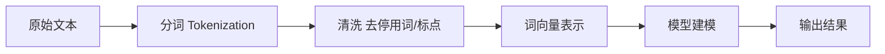
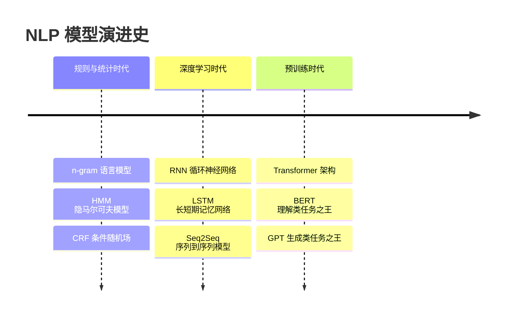

# 自然语言处理 NLP

> 自然语言处理（Natural Language Processing, NLP）是人工智能的一个重要分支，目标是让计算机能够理解、解释和生成人类语言。它解决的是"让人和机器用自然语言直接沟通"的问题，覆盖机器翻译、智能客服、语音助手等场景。本文将介绍 NLP 的核心任务、处理流程、词表示方法与模型演进。

**关键词**：分词、词向量、语义理解、Transformer、大语言模型

## 抽象类比

NLP 就像"教一个不懂中文的外国人读懂中文"：他得先认识每个字（分词），再把字组成词（词性标注），然后理解句子的意思（语义），最后还要能开口说出来（生成）。每一步都对应 NLP 流程中的一个核心环节，缺一不可。

再细化一些类比：分词相当于"认字组词"，词向量相当于"给每个词贴一个身份证号"，句法分析相当于"划分句子成分"，语义理解相当于"真正听懂意思"，语言生成相当于"自己开口说"。从听懂到会说，就是 NLP 的全部使命。

## 适合人群 / 预备知识

- 适合人群：
  - 软件工程专业学生
  - AI 入门者
  - 对聊天机器人、翻译工具原理好奇的同学
- 预备知识：
  - 掌握一门编程语言（推荐 Python）
  - 了解基本机器学习概念（特征、模型、训练）
  - 知道什么是向量、矩阵（高中数学即可）
  - 对神经网络有模糊印象即可，不要求精通

## 一、NLP 的两大任务

NLP 的所有工作可以归为两大类，对应"听懂"和"会说"：

- **自然语言理解 NLU（Natural Language Understanding）**：让机器"读懂"意思
  - 文本分类：判断一封邮件是不是垃圾邮件
  - 信息抽取：从合同里抽出甲方、乙方、金额
  - 问答系统：回答"今天天气怎么样"
  - 情感分析：判断评论是正向还是负向
- **自然语言生成 NLG（Natural Language Generation）**：让机器"写出"文字
  - 文本摘要：把长文章压成一句话
  - 机器翻译：把中文翻成英文
  - 对话生成：聊天机器人回复消息
  - 内容创作：自动写新闻、写代码、写诗

一句话区分：NLU 是"听懂"，NLG 是"会说"。现代大模型（如 GPT）两者都做，界限越来越模糊。

## 二、NLP 处理流程

一段文字从输入到被理解，通常经过以下步骤：

各步骤说明：

- 原始文本：用户输入或爬取的语料，可能含错别字、乱码
- 分词：把句子切成词，是中文 NLP 的第一步
- 清洗：去掉无意义的"的、了、是"等停用词和标点
- 词向量：把词变成机器能计算的数字
- 建模：用模型学习语言规律，完成具体任务
- 输出：分类标签、翻译结果、摘要、答案等

## 三、核心基础技术

这些是 NLP 工程师的"基本功"，即使大模型时代也常被用到：

- **分词 Tokenization**：把句子切成词。英文按空格切，中文要用专门工具（如 jieba）
- **词性标注 POS Tagging**：标注每个词是名词、动词还是形容词，帮助理解句子结构
- **命名实体识别 NER**：识别人名、地名、机构名等专有名词，比如从"马云在杭州创立阿里"中抽出"马云/人名、杭州/地名、阿里/机构"
- **句法分析 Syntactic Parsing**：分析句子的主谓宾结构，类似语文课上的"划分句子成分"
- **依存分析 Dependency Parsing**：分析词与词之间的修饰关系，比如"红色的苹果"中"红色"修饰"苹果"

这些技术通常作为 NLP 流程的"前置工序"，传统方法用规则和统计模型实现，现在更多交给神经网络自动学习，但理解原理依然重要。

## 四、词的表示方法

计算机不认识字，只认识数字。怎么把词变成数字，是 NLP 的核心问题，方法一路演进：

- **独热编码 One-Hot**：每个词用一个超长向量表示，只有一位是 1，其余是 0
  - 缺点：维度爆炸、稀疏、无法表达词与词的相似度
  - 类比：每个人发一张只写自己名字的卡片，卡片之间毫无关联
- **词袋模型 Bag of Words**：把文档看作"一袋词"，统计每个词出现次数
  - 缺点：丢失语序，"我爱你"和"你爱我"无法区分
- **TF-IDF**：在词频基础上加权，越稀有的词权重越高
  - 适合关键词提取，但仍无语义信息
- **Word2Vec / GloVe**：把词映射成稠密的低维向量（比如 300 维），意思相近的词向量也相近
  - 经典例子：向量空间里"国王 - 男人 + 女人 ≈ 女王"
  - 详见 AI概念 目录对应文档（Embedding 部分）
- **上下文向量 ELMo / BERT / GPT**：同一个词在不同句子里向量不同，解决"苹果"是水果还是公司的问题
  - 一词多义终于能被正确区分

演进趋势：从"无语义"到"有语义"，从"固定向量"到"上下文感知"。

## 五、经典模型演进

NLP 模型的发展可以分成三个时代，每一代都比上一代效果飞跃：

- **规则与统计时代**：靠人工规则和概率统计，效果有限，但可解释性强
- **深度学习时代**：用神经网络自动学特征，能处理变长序列，但需要大量标注数据
- **预训练时代**：先在海量文本上预训练，再在小数据上微调，效果飞跃
  - Transformer / BERT / GPT 的原理详见 AI概念 目录对应文档

## 六、典型应用

- **机器翻译**：Google 翻译、DeepL、百度翻译
- **情感分析**：判断电商评论是好评还是差评，监控舆情
- **智能问答与对话**：ChatGPT、Siri、小爱同学
  - 详见 AI概念 目录对应文档（LLM 部分）
- **文本摘要**：新闻一键摘要、会议纪要自动生成
- **信息抽取**：从简历里抽姓名、学历、工作经历
- **拼写纠错**：输入法自动纠错、Word 红色波浪线
- **语音助手**：语音转文字后再做 NLP 理解

## 七、中文 NLP 的特殊挑战

中文和英文差异大，做中文 NLP 会遇到一些"特产"问题：

- **分词歧义**："结婚的和尚未结婚的"可以切出"尚未"或"和尚"两种意思
- **没有空格**：英文天然用空格分词，中文必须靠算法
- **一词多义**："苹果"可以是水果也可以是公司，"打"可以有几十种意思
- **成语与典故**："画蛇添足"不能按字面理解，得懂背后的故事
- **网络新词**："绝绝子""yyds""xswl"词典里查不到，需要动态更新
- **缺少形态变化**：英文有复数、时态变化，中文靠语境判断

## 八、学习路径建议

给初学者一条循序渐进的路线，避免一上来就被大模型劝退：

- 第一步：打好基础
  - 学会 Python 和 jieba 分词
  - 理解 TF-IDF、词袋模型
  - 跑通一个文本分类小 demo
- 第二步：进入深度学习
  - 了解 Word2Vec、RNN、LSTM 的原理
  - 用 PyTorch 或 TensorFlow 实现一个情感分析模型
  - 学习 Seq2Seq 和注意力机制
- 第三步：拥抱预训练
  - 理解 Transformer 架构（详见 AI概念 目录对应文档）
  - 学会调用 HuggingFace 的 BERT / GPT 模型
  - 尝试微调一个预训练模型完成具体任务
- 第四步：实战项目
  - 做一个简单的聊天机器人
  - 复现一篇经典论文
  - 关注最新大模型进展

## 面试速答

**Q1：Word2Vec 和 BERT 有什么区别？**

- Word2Vec：每个词对应一个固定向量，不考虑上下文，"苹果"在所有句子里向量都一样
- BERT：根据上下文动态生成向量，"苹果"在"吃苹果"和"苹果公司"里向量不同
- 一句话总结：Word2Vec 是静态词向量，BERT 是动态上下文向量，BERT 解决了一词多义问题

**Q2：NLU 和 NLG 有什么区别？**

- NLU 偏"输入→理解"：把非结构化文本变成结构化结果（分类、抽取、匹配）
- NLG 偏"理解→输出"：把结构化信息变成自然语言文本（摘要、翻译、对话）
- 现代大模型（如 GPT）两者都做，NLU 和 NLG 的界限越来越模糊
- 一句话总结：NLU 是听懂，NLG 是会说

**Q3：为什么中文要分词，英文不用？**

- 英文单词之间天然有空格，分词几乎是免费的
- 中文是连续的字串，"我喜欢编程"可以是"我/喜欢/编程"，也可能被错误切成"我喜/欢编/程"
- 分词是中文 NLP 的第一步，直接决定后续所有任务的效果
- 一句话总结：英文用空格天然分词，中文需要算法切词，切错了后面全错

**Q4：Transformer 对 NLP 有什么意义？**

- 摒弃 RNN 串行结构，实现并行计算，训练速度大幅提升
- 注意力机制让模型轻松捕捉长距离依赖
- 是 BERT、GPT 等预训练模型的底层架构，开启了 NLP 预训练时代

**Q5：什么是命名实体识别（NER）？**

- 从文本中识别人名、地名、机构名等专有名词
- 例如从"马云在杭州创立阿里"中抽出"马云/人名、杭州/地名、阿里/机构"
- 是信息抽取的基础任务，常用于知识图谱构建、简历解析
