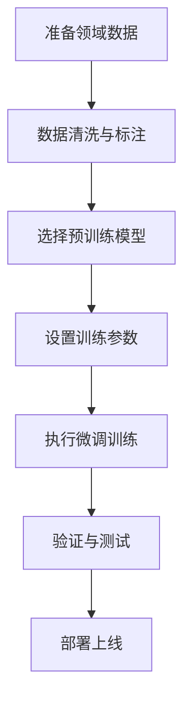
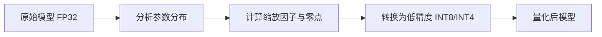
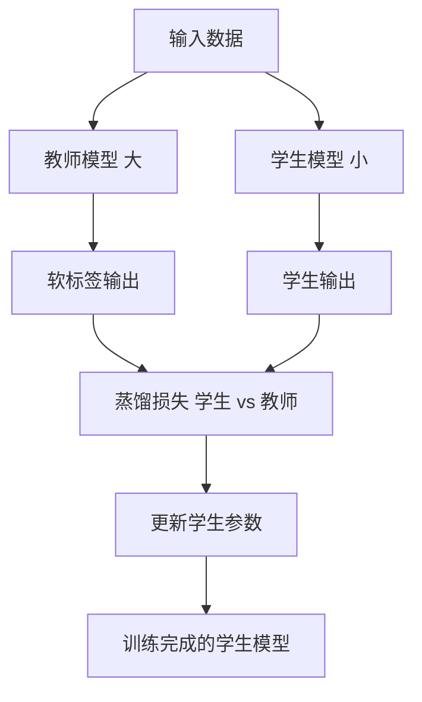
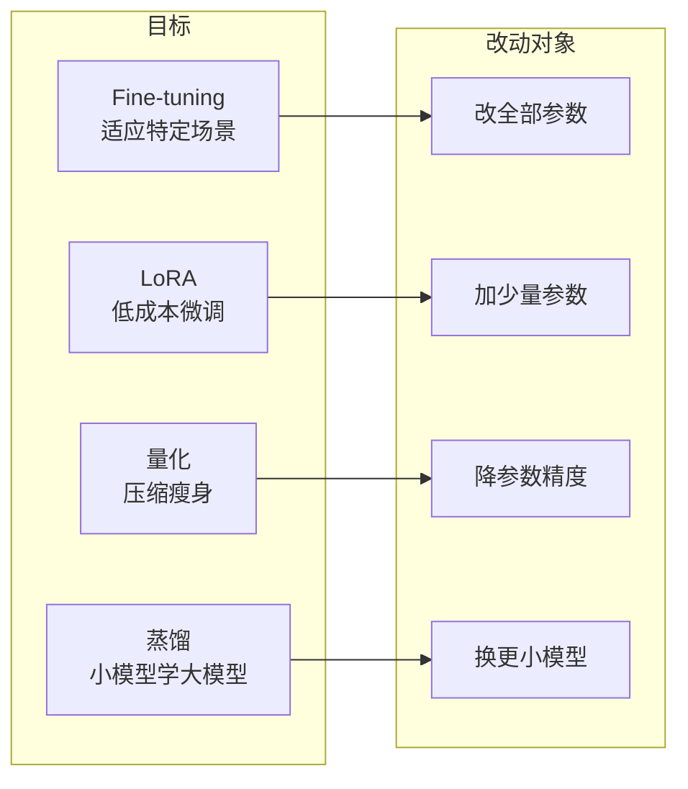

# 模型优化：Fine-tuning、LoRA、量化、蒸馏

> 预训练好的大模型虽然通用，但落地时往往要解决四个问题——能不能适应我的场景？能不能低成本微调？能不能压缩瘦身？能不能让小模型学到大模型的本事？本文用 Fine-tuning、LoRA、量化、蒸馏四个技术分别回答这四个问题。

**关键词**：Fine-tuning、LoRA、量化、蒸馏、模型压缩、低秩自适应

## 抽象类比

把预训练大模型想象成一个"刚毕业的通才员工"，落地到具体业务要经过四步打磨：

- **Fine-tuning 微调**：像"岗前培训"——让通用模型适应特定场景，解决"懂不懂行"的问题
- **LoRA 低秩自适应**：像"只补几本专业书"——用极低成本完成微调，解决"微调贵不贵"的问题
- **量化**：像"把厚书压缩成小抄"——把高精度参数压成低精度，解决"模型大不大、推理快不快"的问题
- **蒸馏**：像"师傅带徒弟"——让小模型学习大模型的行为，解决"小模型能不能学到大模型本事"的问题

一句话概括：**Fine-tuning 让模型更专，LoRA 让微调更省，量化让模型更轻，蒸馏让小模型更强。**

## 适合人群 / 预备知识 / 学习路径

- **适合人群**：刚接触大模型应用、想知道怎么把通用模型用到自己业务上的开发者或产品同学
- **预备知识**：知道什么是大模型、参数、推理；对矩阵和浮点数有基本印象即可
- **学习路径**：先读 Fine-tuning 理解"为什么要改模型" → 再读 LoRA 理解"怎么改得便宜" → 接着读量化理解"怎么跑得快" → 最后读蒸馏理解"怎么让小模型也能干"

---

## 一、Fine-tuning 模型微调

### 原理

在预训练模型的基础上，用特定领域的数据继续训练，让模型更好地适应特定任务或场景。它不是从头训练，而是在已有基础上"进修"。

公式化表达：微调 = 预训练模型 + 领域数据 + 继续训练 → 领域专家

### 类比：通才员工经培训变专家

- 预训练模型：像大学毕业的通才，什么都知道一点
- 微调后：像经过公司培训的员工，懂行业术语和公司流程

基础知识已经有了，现在补的是专业知识。

### 工作流程

### 数据要求

- 数量：通常 1000-10000 条
- 质量：高质量、准确、一致
- 格式：输入-输出对
- 覆盖：覆盖各种业务场景

### 主要方法

- **全量微调**：更新所有参数，效果最好但成本高，可能遗忘旧知识（灾难性遗忘）
- **LoRA**：只训练少量附加参数，成本极低，是 Fine-tuning 的高效实现
- **指令微调**：用指令-响应对训练，让模型更听话、任务完成率更高

### 与 RAG 的对比

- **微调改的是参数**：知识"内化"进模型，但更新需要重训
- **RAG 改的是检索库**：随时更新知识库，不修改模型
- **经验法则**：只是补充知识用 RAG；要改变行为或风格用微调；二者也可以叠加使用

### 什么时候用

- 适合：需要固定输出风格、任务模式固定、有足够高质量数据、需要模型"内化"知识
- 不适合：知识频繁变化、数据很少或质量差、只需补充最新信息、预算有限

---

## 二、LoRA 低秩自适应

### 原理

LoRA（Low-Rank Adaptation）是一种参数高效的微调方法。它冻结原模型参数不变，只在旁边添加一对小型可训练矩阵 A × B，新权重变为 W' = W + A × B。

核心发现：模型适应新任务时，参数变化是"低秩"的——大部分变化可以用少量参数表示。

### 类比：加装智能家居模块不动原结构

- 全量微调：像重新装修整栋房子，成本高、时间长
- LoRA：像给房子加装智能家居模块，不动原有结构，只增加新功能，还能随时拆除

另一个类比：LoRA 像给手机装 APP——不改变操作系统，只增加新功能。

### 关键参数

- **Rank（秩）**：低秩矩阵的维度，常用 4、8、16、32。越大表达能力越强但参数越多
- **Alpha**：缩放因子，控制 LoRA 的影响程度，通常设为 Rank 的 2 倍
- **Target Modules**：对哪些层应用 LoRA，通常只对注意力层（q_proj、v_proj）加就够

### 参数压缩效果

以 768 × 768 的权重为例：

- 原始参数：768 × 768 = 589,824 个
- LoRA 参数（Rank=8）：768 × 8 + 8 × 768 = 12,288 个
- 训练参数减少约 98%；在大模型上整体可减少上千倍

### 与全量微调的对比

- **训练成本**：全量微调要更新所有参数，LoRA 只训练小矩阵，显存和算力需求大幅下降
- **存储占用**：全量微调每个版本要存完整模型（GB 级），LoRA 只存附加参数（MB 级）
- **切换灵活性**：换领域时 LoRA 可热切换不同小矩阵，全量微调要重新加载整个模型
- **遗忘问题**：LoRA 不改原模型，原有能力保留；全量微调可能灾难性遗忘
- **效果**：LoRA 略逊于全量微调，但多数场景差距很小

### 典型应用

- 一个基础模型挂多个 LoRA：医疗、法律、客服、编程，按需加载
- 个性化定制：每个用户一个小型 LoRA，成本极低
- 快速实验：训练快、可随时放弃，适合试错
- 资源受限环境：消费级 GPU 就能微调大模型

---

## 三、量化模型压缩

### 原理

将模型的高精度参数（如 32 位浮点数 FP32）转换为低精度表示（如 8 位整数 INT8 或 4 位整数 INT4），从而减小模型体积、加快推理速度、降低功耗。

核心思想：用"够用"的精度换"更快"的速度。

### 类比：用整数代替小数

测身高时说"约 175cm"通常够用，不需要说"175.238491cm"。量化就是这个道理——精度降一点，资源省一大截。

另一个类比：量化像给模型"瘦身"，不是砍掉功能，而是用更精简的方式表达。

### 精度等级对比

- **FP32**（4 字节）：极高精度，类比"175.238491cm"
- **FP16**（2 字节）：高精度，类比"175.24cm"
- **INT8**（1 字节）：中等精度，类比"175cm"
- **INT4**（0.5 字节）：低精度，类比"约 175cm"

### 量化过程

关键概念：

- **缩放因子（Scale）**：原始范围与量化范围的比例，如 [-10, 10] → [0, 255]，scale = 20/255
- **零点（Zero Point）**：原始零点对应的量化值，用于最小化误差

### 两种主要方法

- **训练后量化（PTQ）**：模型训练完后直接量化，简单快速、无需重训，但精度可能略损，适合快速部署
- **量化感知训练（QAT）**：训练时就模拟量化过程，精度损失小、性能更好，但需要重训、成本更高，适合对精度要求高的生产环境
- 另有动态量化：推理时动态量化激活值，灵活但速度提升有限

### 效果数据（FP32 → INT8 典型值）

- 模型大小：100 MB → 25 MB，缩小 75%
- 推理速度：100 ms → 30 ms，提升约 3 倍
- 内存占用：降低 75%
- 精度损失：通常 1-2%，可接受

规律：精度越低，速度越快，但精度损失越大。INT4 通常保留 90-95% 性能。

---

## 四、蒸馏知识迁移

### 原理

知识蒸馏（Knowledge Distillation）是让小模型（学生）学习大模型（教师）的输出和行为，从而在较小体积下获得接近大模型性能的技术。

公式化表达：蒸馏 = 大模型（教师）→ 教 → 小模型（学生）→ 学 → 获得能力

### 类比：名师带徒弟

名师带徒弟——徒弟不一定知道所有原理，但能学会关键方法。大模型是名师，小模型是徒弟，通过学习大模型的"解题思路"而不是死记硬背，小模型也能变得很强。

另一个类比：蒸馏像把百科全书浓缩成精华手册，内容精简了，但核心知识都在。

### 软标签 vs 硬标签

- **硬标签（传统训练）**：只有"是什么"。例：输入"今天天气真好" → 标签"正面情感（1）"
- **软标签（蒸馏）**：还包括"有多确定"和"像什么"。例：输入"今天天气真好" → 教师输出 正面 0.85 / 中性 0.10 / 负面 0.05

软标签包含更多信息，让学生模型不仅学到正确答案，还学到教师对各类别的判断分布。

### 教师-学生模型流程

### 关键技术

- **温度参数（Temperature）**：控制软标签的"柔软度"，常用 1-10。温度高学更多关系，温度低接近硬标签
- **损失函数**：总损失 = α × 蒸馏损失 + (1-α) × 任务损失，α 通常 0.5-0.9
- **中间层蒸馏**：学生不仅学输出，还学中间层表示，效果更好但要求师生结构相似

### 效果数据

- 模型缩小：10-100 倍
- 推理速度提升：5-20 倍
- 能力保留：80-95%
- 学生参数量：通常是教师的 1/10 到 1/100
- 蒸馏数据量：通常 10 万 - 100 万条

---

## 五、四种技术对比总览

四种技术从四个维度对比：

- **Fine-tuning 微调**
  - 目标：让模型适应特定场景
  - 原理：用领域数据继续训练，更新模型参数
  - 效果：风格统一、任务优化，需要 1000-10000 条数据
  - 适用：固定风格、固定任务、有内化知识需求
- **LoRA 低秩自适应**
  - 目标：用极低成本完成微调
  - 原理：冻结原模型，只训练旁挂的小矩阵
  - 效果：训练参数减少 98% 以上，存储 MB 级
  - 适用：资源有限、多领域切换、快速实验
- **量化**
  - 目标：让模型更小更快更省电
  - 原理：FP32 → INT8 / INT4，降低参数精度
  - 效果：体积缩小 4 倍，速度提升 2-4 倍，精度损失 1-2%
  - 适用：边缘部署、实时推理、大规模服务降本
- **蒸馏**
  - 目标：让小模型获得大模型能力
  - 原理：学生模型学习教师的软标签和行为
  - 效果：缩小 10-100 倍，速度提升 5-20 倍，保留 80-95% 能力
  - 适用：边缘 AI、实时推理、降低云端服务成本

记忆口诀：**微调改"专"、LoRA 改"省"、量化改"轻"、蒸馏改"小而强"。**

---

## 六、常见组合使用

四种技术并不互斥，常常组合使用以达到最佳效果：

- **QLoRA = 量化 + LoRA**
  - 把基座模型量化到 4bit 加载，再在量化模型上做 LoRA 微调
  - 优势：显存占用极低，单卡可训练 70B 大模型
  - 场景：消费级 GPU 微调大模型的标配方案
- **蒸馏 + 量化**
  - 先用大模型蒸馏出小模型，再把小模型量化
  - 优势：双重压缩，体积和速度叠加收益
  - 场景：边缘设备部署
- **微调 + 量化**
  - 先全量或 LoRA 微调让模型适应业务，再量化部署
  - 优势：先专后轻，业务效果与推理成本兼顾
  - 场景：生产环境上线
- **蒸馏 + 微调**
  - 先把大模型能力蒸馏到小模型，再针对具体任务微调
  - 优势：小模型既有大模型底子，又贴合具体业务
  - 场景：领域专用小模型

组合顺序经验：先让模型"变专"（微调/LoRA）或"变小变强"（蒸馏），最后再"变轻"（量化）用于部署。

---

## 面试速答

### Q1：量化和蒸馏都是压缩模型，区别是什么？

- 量化：同一个模型，把参数从高精度压成低精度，模型结构不变、参数数量不变
- 蒸馏：换一个更小的模型，让小模型学习大模型的行为，模型结构和参数数量都变了
- 一句话：量化是"同一辆车换更省油的油"，蒸馏是"换一辆更小的车但学会老司机的开法"

### Q2：LoRA 为什么便宜？

- 原模型参数全部冻结，只训练旁挂的两个小矩阵 A × B
- 训练参数减少 98% 以上，显存占用大幅下降
- 存储只存小矩阵（MB 级），不存完整模型（GB 级）
- 推理时小矩阵可合并回原模型，零额外延迟
- 类比：不动整栋房子，只加装几个智能模块

### Q3：Fine-tuning 和 RAG 怎么选？

- 改行为/风格 → 微调；补知识 → RAG
- 微调把知识内化进参数，更新要重训；RAG 改检索库即可，灵活但每次推理要检索
- 二者可以叠加：先微调让模型懂业务，再用 RAG 补充实时知识

### Q4：什么时候用 PTQ，什么时候用 QAT？

- PTQ：模型已训练好，快速量化上线，对精度要求不高，适合原型和一般场景
- QAT：训练时就模拟量化，精度损失最小，适合对精度敏感的生产环境，但需要重训

### Q5：灾难性遗忘是什么，怎么避免？

- 现象：模型学了新知识，忘了旧知识
- 避免：用 LoRA（不改原参数）、混合新旧数据训练、控制学习率、使用验证集监控

---

## 关键词

Fine-tuning、LoRA、低秩自适应、QLoRA、量化、PTQ、QAT、FP32、INT8、INT4、知识蒸馏、教师模型、学生模型、软标签、灾难性遗忘、边缘 AI
