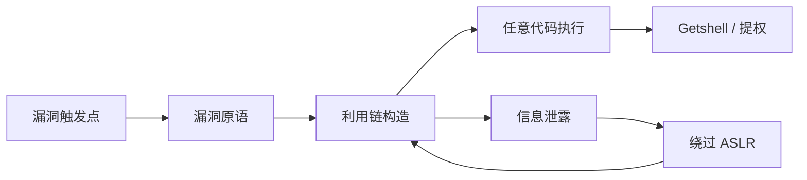
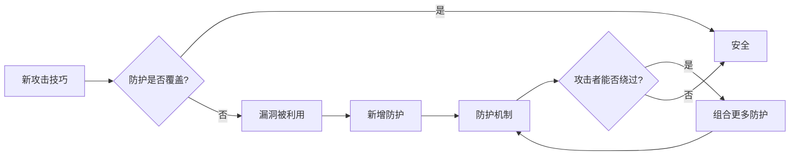

# 二进制安全

> 二进制安全研究的是程序在运行时内存层面的漏洞利用与防护，是 CTF Pwn 题的主战场。与 [[网络安全]] 关注 Web 攻防、[[密码学]] 关注算法不同，本文聚焦二进制层面的栈溢出、堆漏洞、ROP 等内存破坏漏洞。

**关键词**：栈溢出、ROP、堆漏洞、格式化字符串、防护绕过

## 抽象类比

二进制安全像拆一座精密的保险柜：程序就是柜子，函数调用栈是柜子里一层层的抽屉，返回地址是每个抽屉的"回到上一格"的路标。攻击者只要把某个抽屉塞得过满，让路标被覆盖成"通往金库的密道"，就能在程序毫不知情时跳到任意地方执行代码。

防御方则在抽屉上加各种锁：金库区域标记为"不可执行"（NX）、抽屉位置每天随机摆放（ASLR）、每个抽屉贴防篡改封条（Canary）。但攻击者总能找到新的撬锁工具——ROP 把金库里现成的小动作拼成完整动作链，堆漏洞则利用柜子背后垃圾桶里被遗忘的旧钥匙。这是一场永不停歇的猫鼠游戏。

## 一、二进制安全是什么

### 1.1 定义与边界

二进制安全（Binary Security）研究编译后的二进制程序在运行时由于内存破坏导致的漏洞，包括如何利用这些漏洞执行任意代码（攻击），以及如何防止漏洞被利用（防御）。CTF 中对应的赛道叫 Pwn。

它与相邻方向的区别：

- [[网络安全]]：关注 Web 应用层攻击（SQL 注入、XSS、CSRF）
- [[密码学]]：关注加密算法与协议
- 二进制安全：关注编译产物本身的内存安全

### 1.2 漏洞的根源

绝大多数二进制漏洞都源于 C/C++ 这类"信任程序员"的语言：

- 内存操作不检查边界（`strcpy`、`gets`、`memcpy` 长度可控）
- 释放后仍使用指针（UAF）
- 同一块内存被释放两次（Double Free）
- 整数运算溢出导致长度检查失效
- 格式化字符串函数把用户输入当作格式控制

### 1.3 攻击目标

- 任意代码执行（ACE）：在目标进程注入并运行 Shellcode
- 任意地址读写（Arbitrary R/W）：构造原语后改写关键数据
- 提权：从普通用户跳到 root，或绕过沙箱限制
- 信息泄露：泄露内存布局绕过 ASLR



### 1.4 Pwn 发展简史

二进制安全随着防护机制的演进不断升级，攻防双方螺旋上升：

- 1996：Aleph One《Smashing The Stack For Fun And Profit》奠基，栈溢出加 Shellcode 几乎无防护
- 2003：NX/DEP 进入主流操作系统，ret2libc 与早期 ROP 崛起
- 2007：ASLR 在 Linux/Windows 全面启用，信息泄露成为利用前置步骤
- 2010：Phrack 重新提出 SROP，ret2csu 等高级 gadget 技巧普及
- 2017：glibc 2.26 引入 tcache，堆漏洞利用门槛大幅降低
- 2020+：CFI、Intel CET、ARM PAC 普及，攻击转向逻辑漏洞与内核利用

CTF Pwn 题目也跟随这条演进线：从早年裸栈溢出到现代 Full Mitigation 加内核题，难度持续上升。厂商与开源社区也开始转向内存安全语言，例如 Linux 内核逐步引入 Rust 代码。

## 二、程序的内存布局

### 2.1 进程地址空间

Linux x64 进程的虚拟地址空间从高到低：

- 内核空间（高地址，用户态不可访问）
- 栈 Stack：函数局部变量、返回地址，向低地址增长
- 共享库映射区 mmap：libc、ld.so 加载位置
- 堆 Heap：malloc 分配，向高地址增长
- BSS 段：未初始化的全局/静态变量
- Data 段：已初始化的全局/静态变量
- Text 段：代码指令，通常只读可执行

### 2.2 ELF 文件格式

ELF（Executable and Linkable Format）是 Linux 下的可执行文件格式：

- ELF Header：魔数 `\x7fELF`、入口地址、目标架构
- Program Header：运行时视图，描述段（Segment）加载信息
- Section Header：链接视图，包括 `.text`、`.data`、`.bss`、`.rodata`、`.got`、`.plt`
- 符号表 `.symtab`、动态符号表 `.dynsym`

### 2.3 动态链接 GOT/PLT

动态链接把库函数地址在运行时才填入：

- PLT（Procedure Linkage Table）：跳板代码，第一次调用时通过 ld.so 解析
- GOT（Global Offset Table）：存放库函数真实地址的表
- 第一次调用走懒解析，之后直接从 GOT 取地址跳转
- ret2plt 攻击就是利用 PLT 中已有的库函数跳板

### 2.4 函数调用栈

x86-64 调用约定下函数调用过程：

- 调用方把参数放入寄存器 `rdi rsi rdx rcx r8 r9`，多余参数压栈
- `call func` 把返回地址压栈并跳转
- 被调用方保存 `rbp`，建立新栈帧
- 局部变量在 `rbp` 下方分配
- 函数返回时执行 `leave; ret`，恢复栈帧并跳回返回地址

## 三、栈溢出基础

### 3.1 经典栈溢出

栈溢出是最经典的二进制漏洞：当向栈上缓冲区写入的数据超过其容量，多出来的字节会覆盖后续的栈数据，包括保存的 rbp 和返回地址。

```mermaid
graph TB
    A[高地址] --> B[返回地址 ret addr]
    B --> C[保存的 rbp]
    C --> D[局部变量 buf[64]]
    D --> E[低地址]
    F[写入 80 字节] -.覆盖.-> B
```

经典示例代码：

```c
#include <stdio.h>
#include <string.h>
void vuln() {
    char buf[64];
    gets(buf);  // 不检查长度，致命漏洞
}
```

### 3.2 返回地址覆盖

通过控制写入长度，让返回地址被覆盖成任意值。当函数返回执行 `ret` 指令时，CPU 会从栈顶弹出地址并跳转。攻击者只要把栈顶改成目标地址，就能控制执行流。

### 3.3 Shellcode 注入

早期 NX 未开启时，可以把机器码（Shellcode）写入栈上缓冲区，再把返回地址覆盖为缓冲区地址，实现执行任意代码。典型 Shellcode 调用 `execve("/bin/sh", 0, 0)`。

### 3.4 ret2text

当栈不可执行时，跳到程序自身 Text 段中已有的代码：

- 程序里有 `system("/bin/sh")` 的调用就跳过去
- 或跳到 `__libc_csu_init` 中的通用 gadget（ret2csu）
- 利用程序自带的后门函数（CTF 题常见）

### 3.5 实战利用流程

一个完整的栈溢出利用通常包含以下步骤：

- 信息收集：`file`、`checksec` 查看程序属性与防护
- 漏洞定位：IDA 反编译找到 `gets`、`read` 等危险函数
- 偏移计算：cyclic 工具生成模式串，gdb 调试确定返回地址偏移
- 朴素利用：尝试 ret2text 跳到程序内现成的后门函数
- 升级利用：构造 ret2libc 或 ROP，先泄露 libc 地址再调用 system
- Getshell：执行 `execve("/bin/sh")` 或调用 one_gadget

利用过程中 pwntools 是核心工具：

```python
from pwn import *
io = process('./vuln')
elf = ELF('./vuln')
libc = ELF('./libc.so.6')
pop_rdi = 0x401233  # ROPgadget 查到
# 第一次输入：泄露 puts 的真实地址
io.sendline(b'A'*72 + p64(pop_rdi) + p64(elf.got['puts']) + p64(elf.plt['puts']) + p64(elf.symbols['main']))
leak = u64(io.recv(6).ljust(8, b'\x00'))
libc.address = leak - libc.symbols['puts']
# 第二次输入：调用 system("/bin/sh")
io.sendline(b'A'*72 + p64(pop_rdi) + p64(next(libc.search(b'/bin/sh'))) + p64(libc.symbols['system']))
io.interactive()
```

这种"两次输入"的利用模式是 ret2libc 的经典套路：第一次泄露 libc 地址，第二次触发 `system("/bin/sh")`。真实场景中还可能需要处理 Canary 泄露、栈对齐、gadget 约束等问题。

## 四、ROP 返回导向编程

### 4.1 ROP 原理

ROP（Return-Oriented Programming）通过串联多个以 `ret` 结尾的短指令片段（gadget）实现图灵完备的执行逻辑。每个 gadget 执行完后从栈顶取下一个返回地址，于是整条 ROP 链就像一个由栈数据驱动的"虚拟机"。

### 4.2 gadget 与 ROP 链

gadget 通常是几条指令加一个 ret，例如：

- `pop rdi ; ret`：设置 rdi 寄存器（第一个参数）
- `pop rsi ; ret`：设置 rsi 寄存器（第二个参数）
- `syscall ; ret`：触发系统调用

构造一个 `system("/bin/sh")` 的 ROP 链：

- 填充 padding 到返回地址
- 写入 `pop rdi ; ret` 的地址
- 写入 `/bin/sh` 字符串地址
- 写入 `system` 函数地址

### 4.3 ret2libc

由于 libc 几乎存在于所有 Linux 进程中，且包含 `system`、`execve` 等强大函数，ret2libc 是最常用的 ROP 形式：

- 泄露 libc 中某函数的真实地址（如 puts 的 GOT 表项）
- 计算 libc 基址（泄露地址减去已知偏移）
- 在 libc 中找 `system`、`/bin/sh` 字符串、`pop rdi ; ret` gadget
- 构造 ROP 链调用 `system("/bin/sh")`

### 4.4 工具自动化

- ROPgadget：扫描二进制中所有 gadget
- ropper：功能更丰富的 gadget 查找工具
- pwntools 的 `ROP` 类：自动构造简单 ROP 链
- one_gadget：直接在 libc 中找"一句话 getshell"的地址

## 五、堆漏洞

### 5.1 堆块结构

glibc malloc 把堆划分为多个 chunk，每个 chunk 头部包含：

- prev_size：上一个 chunk 的大小（若已释放）
- size：当前 chunk 大小及标志位（PREV_INUSE、IS_MMAPPED、NON_MAIN_ARENA）
- 数据区：用户数据

释放后的 chunk 根据大小进入不同的 bin：fastbin、smallbin、largebin、unsortedbin。tcache 是 glibc 2.27 引入的线程本地缓存。

### 5.2 Double Free

同一个 chunk 被释放两次会导致链表环：

- 第一次 free：chunk 进入 fastbin/tcache 链表
- 第二次 free：再次进入链表，链表出现循环
- 后续两次 malloc 会返回同一块内存
- 攻击者写入伪造数据，下一次 malloc 返回任意地址

### 5.3 Use-After-Free

释放后的内存被再次分配给其他用途，但原指针仍可使用：

- 释放一个结构体但未清空指针
- 触发分配让原内存被用作其他对象
- 通过旧指针修改新对象，造成类型混淆
- 经典场景：C++ 虚表覆盖，把虚函数指针改成 Shellcode 地址

### 5.4 Heap Overflow

堆溢出是向堆缓冲区写入超过其大小的数据，覆盖相邻 chunk 的头部或数据：

- 覆盖下一个 chunk 的 size 字段造成 chunk overlapping
- 覆盖 fd/bk 指针实现任意地址写（unlink 攻击）
- 覆盖 fastbin 链表头实现任意地址分配

### 5.5 tcache 与 fastbin attack

glibc 2.27 之后 tcache 成为最常用的攻击面：

- tcache 没有太多完整性检查，Double Free 极易利用
- tcache poison：覆盖 tcache 链表的 fd 指针，让 malloc 返回任意地址
- fastbin attack 原理类似，但需要绕过 size 检查
- 利用 `__free_hook` 或 `__malloc_hook` 写入 system 或 one_gadget

### 5.6 tcache poison 利用流程

tcache poison 是 glibc 2.27+ 最常用的堆利用原语，典型流程：

- 申请若干相同大小的 chunk，并按 A B C 顺序释放
- 此时 tcache 链表为 C -> B -> A
- 二次释放 C（Double Free），链表变成 C -> B -> C
- 第一次 malloc 拿到 C，攻击者写入伪造的 fd 指针（如指向 `__free_hook`）
- 此时链表变成 B -> C -> __free_hook
- 第二次 malloc 拿到 B，第三次 malloc 拿到 C，第四次 malloc 拿到 `__free_hook`
- 攻击者往 `__free_hook` 写入 `system` 或 one_gadget 地址
- 触发 free，实际跳转执行 `system("/bin/sh")`

利用代码片段：

```python
add(0x40); add(0x40); add(0x40)  # 申请 A B C
delete(0); delete(1); delete(0)  # C->B->C 双释放
add(0x40, p64(free_hook))         # 拿到 C，写 fd
add(0x40)                          # 拿到 B
add(0x40)                          # 拿到 C
add(0x40, p64(system))             # 拿到 __free_hook，写 system
add(0x20, b'/bin/sh\x00')
delete(0)                          # free("/bin/sh") -> system("/bin/sh")
```

glibc 2.32+ 引入 tcache safe-linking，对 fd 指针做异或保护，需要泄露 heap 基址后才能伪造，利用门槛有所上升。

## 六、格式化字符串漏洞

### 6.1 漏洞原理

`printf` 系列函数在格式串由用户控制时会出现漏洞：

```c
printf(user_input);   // 危险
printf("%s", user_input);   // 安全
```

当 `user_input` 包含 `%x`、`%n` 等格式符，printf 会从栈上取参数执行：

- `%x` / `%p`：泄露栈上数据
- `%n`：把已输出字符数写入参数指向的地址

### 6.2 任意读

利用 `%N$x` 可以读取栈上第 N 个参数位置的值。配合 `%s` 可以读取指针指向的字符串。常见利用：

- 泄露栈上的 canary
- 泄露 libc 函数地址绕过 ASLR
- 泄露程序代码段地址绕过 PIE

### 6.3 任意写

`%n` 把已输出字节数写入指定地址。配合 `%Nc`（输出 N 个字符）可以写入任意值：

- `%10c%8$n`：往栈上第 8 个参数指向的地址写入 10
- 分多次写 `hn`（2 字节）、`hhn`（1 字节）避免一次输出过多字符
- 常用于改写 GOT 表项、`__malloc_hook`、返回地址

## 七、整数溢出与类型混淆

### 7.1 整数溢出

C 语言的整数溢出行为因有符号/无符号而异：

- 有符号整数溢出是未定义行为（UB），编译器可能优化掉检查
- 无符号整数溢出是回绕（wrap around）
- 经典漏洞：`if (a + b < SIZE) malloc(a+b)`，当 a+b 溢出回绕成小值后通过检查，但实际分配不足

### 7.2 截断与符号扩展

- 截断：把 64 位值赋给 32 位变量时高位丢失
- 符号扩展：有符号负数扩展时高位补 1
- 经典漏洞：`int len = get_len(); memcpy(buf, src, (unsigned short)len);` 当 len = 65536 + 100 时被截断为 100

### 7.3 类型混淆

C++ 中通过基类指针操作派生类对象，如果对象生命周期管理混乱：

- 把基类指针 cast 到错误的派生类
- 虚表（vtable）被覆盖后调用虚函数跳到任意地址
- 堆 UAF 配合虚表覆盖是 C++ 二进制漏洞的高发场景

## 八、防护机制与绕过

### 8.1 NX / DEP

- 原理：把数据段（栈、堆）标记为不可执行
- 绕过：ret2libc、ROP 不需要执行栈上代码

### 8.2 ASLR

- 原理：每次启动随机化栈、堆、共享库的加载地址
- 绕过：信息泄露获取真实地址，或 32 位下爆破概率较高

### 8.3 PIE

- 原理：程序自身的代码段地址也随机化
- 绕过：泄露程序内某个地址，计算基址

### 8.4 Canary

- 原理：函数序言在 rbp 上方插入随机值，返回前检查
- 绕过：
  - 格式化字符串泄露 Canary
  - 暴力爆破（fork 子进程时 Canary 不变）
  - 覆盖 TLS 中 Canary 的副本

### 8.5 RELRO

- Partial RELRO：GOT 表仍可写
- Full RELRO：GOT 表只读，绑定在加载时完成
- 绕过：Full RELRO 后无法改 GOT，需用 `__malloc_hook`、`__free_hook`（旧版本）、栈上的返回地址

### 8.6 Fortify

- 原理：编译时替换 `strcpy` 等为 `__strcpy_chk`，附带缓冲区大小
- 绕过：寻找未受 Fortify 保护的函数

### 8.7 防护组合与攻防博弈

实际部署中多种防护组合使用，对应不同的攻击门槛：

- 仅 NX：ret2libc/ROP 即可绕过
- NX + ASLR：必须先信息泄露再 ROP
- NX + ASLR + Canary：还需泄露或爆破 Canary
- NX + ASLR + Canary + PIE：双泄露（libc + 程序基址）
- NX + ASLR + Canary + PIE + Full RELRO：放弃 GOT 改写，转向 hook 与栈
- 全开 + CFI/CET：传统 ROP 受限，需 JOP 或逻辑漏洞

攻防博弈的关键是"成本对称"：防御方成本低于攻击方时才有效。例如 ASLR 几乎零成本但显著提高攻击门槛，而 CFI 有运行时开销但限制 ROP。



现代防御策略是"纵深防御 + 最低权限"：单一防护都可被绕过，多层防护叠加才能让攻击成本指数上升。

## 九、利用技巧

### 9.1 one_gadget

libc 中存在一些"直接 getshell"的地址，只要满足寄存器/内存约束即可触发 `execve("/bin/sh")`。通过 `one_gadget` 工具可自动查找。

### 9.2 ret2csu

`__libc_csu_init` 函数中有一段通用的 gadget，可以同时控制 `rdi rsi rdx` 三个参数寄存器，在没有更好 gadget 时使用。

### 9.3 SROP

Sigreturn Oriented Programming：利用 `sigreturn` 系统调用一次性恢复所有寄存器，攻击者构造伪造的 Signal Frame 实现任意寄存器控制。

### 9.4 BOP / JOP

- BOP（Block-oriented）：以基本块为单位的 ROP 变种
- JOP（Jump-oriented）：用 `jmp rax` 等间接跳转替代 ret

### 9.5 沙箱 seccomp 绕过

seccomp 限制可用的系统调用集合。常见绕过：

- 禁用 `execve` 时用 `open/read/write` 读 flag
- 禁用 `open` 时用 `openat`
- 利用 ORW（open-read-write）链

### 9.6 内核 Pwn 简介

内核漏洞利用与用户态类似但有特殊性：

- 利用对象：Linux 内核模块、驱动、syscall
- 利用目标：提权（`commit_creds(prepare_kernel_cred(0))`）从普通用户到 root
- 关键结构：task_struct、cred、tty_struct、seq_operations
- 利用原语：modprobe_path 覆盖、pt_regs 修改、msg_msg 任意读写

常见内核 CTF 题类型：

- KERNROP：内核 ROP，绕过 SMEP/SMAP/KPTI
- ret2usr：早期利用，跳到用户态代码执行，SMEP 后失效
- modprobe_path：覆盖 modprobe_path 字符串，触发执行任意脚本
- msg_msg：利用消息队列实现任意地址读写

防护机制：

- SMEP：内核态不可执行用户态代码
- SMAP：内核态不可访问用户态内存
- KPTI：内核页表隔离，缓解 Meltdown
- KASLR：内核地址随机化

## 十、工具链

### 10.1 反汇编与反编译

- IDA Pro：业界标准反汇编器，含反编译器 Hex-Rays
- Ghidra：NSA 开源反编译工具，免费且支持脚本
- Binary Ninja：现代化 UI，API 友好
- radare2/rizin：命令行开源逆向框架

### 10.2 动态调试

- pwndbg：gdb 的安全插件，提供堆可视化、ROP gadget 提示
- gef：另一个流行的 gdb 插件
- peda：老牌 gdb 插件
- strace/ltrace：系统调用与库函数追踪

### 10.3 利用开发

- pwntools：Python 利用开发框架，封装 socket、ROP、shellcode 等
- checksec：检查二进制启用的防护机制
- ROPgadget / ropper：gadget 查找
- one_gadget：libc 一句话 gadget 查找

### 10.4 高级分析

- angr：符号执行框架，可自动求解简单 CTF 题
- AFL/AFL++：覆盖率引导的 Fuzzing 工具
- libFuzzer：函数级 Fuzzing

### 10.5 实战工具组合

实际漏洞利用开发中常用工具组合：

- 静态分析：IDA Pro 反编译 + Ghidra 脚本批量处理
- 动态调试：pwndbg 配合 pwntools 的 gdb.attach
- gadget 查找：ROPgadget 找短 gadget，ropper 找复杂序列
- 自动化利用：pwntools 编写完整 exploit 脚本
- 符号执行：angr 求解简单 CTF 题
- 模糊测试：AFL++ + qemu-user 模式跑 stripped 二进制
- 内存调试：ASan 编译版本快速定位溢出点

典型 pwntools 工作流：

```python
from pwn import *
context.arch = 'amd64'
context.log_level = 'debug'
io = remote('host', 1337)
# 自动查找 gadget、构造 ROP 链
rop = ROP(elf)
rop.call(elf.plt['puts'], [elf.got['puts']])
rop.call(elf.symbols['main'])
io.sendline(flat({offset: rop.chain()}))
```

不同场景的工具选型：

- CTF Pwn：IDA + pwndbg + pwntools + ROPgadget + one_gadget
- 真实漏洞挖掘：AFL++ + ASan + angr + IDA
- 固件 Pwn：QEMU user/system + gdb-multiarch + ROPgadget
- 内核 Pwn：QEMU + gdb + kernel symbols + 自己写 kernel ROP

## 十一、二进制安全防御

### 11.1 地址空间随机化

- ASLR + PIE 把地址预测难度提升到接近随机
- 32 位下熵不足仍是问题，64 位下相对安全

### 11.2 控制流完整性 CFI

- CFI（Control Flow Integrity）：运行时校验间接跳转目标合法性
- Intel CET：硬件支持的 shadow stack 与间接分支跟踪
- ARM PAC：指针认证，签名返回地址

### 11.3 内存安全语言

- Rust：编译期保证内存安全，无数据竞争
- Go：带 GC，无手动内存管理
- C++ 智能指针：RAII 减少手动 new/delete 错误
- C 的 sanitizer（ASan/UBSan/MSan）：开发期发现漏洞

### 11.4 软件工程实践

- 编译期开启所有 stack protector、Fortify、Full RELRO
- 使用 ASan/UBSan 进行 Fuzzing
- 静态分析（CodeQL、Coverity）查找可疑模式
- 及时升级 libc、openssl 等基础库

### 11.5 持续演进

二进制安全没有终点，是一场持续的猫鼠游戏：

- 防御方引入新的硬件防护（CET、PAC、MPK）
- 攻击方发展新的利用技巧（数据导向攻击、逻辑漏洞）
- 编程语言向内存安全迁移（Rust 进入 Linux 内核）
- 漏洞赏金与红队演练推动攻防双方共同进步

对于开发者，理解二进制安全的本质不是为了成为攻击者，而是写出更健壮的代码。从这种角度看，二进制安全知识是系统程序员的"必修课"。

## 面试速答

**Q1：NX 和 ASLR 有什么区别？**

NX 是数据段不可执行（栈/堆不能跑代码），ASLR 是地址随机化（每次启动位置不同）。NX 迫使攻击者用 ROP 而非 Shellcode，ASLR 迫使攻击者先泄露地址。两者通常组合开启。

**Q2：栈溢出的本质是什么？Canary 怎么防？**

栈溢出是向栈上缓冲区写入超过其长度，覆盖返回地址。Canary 在 rbp 上方放一个随机值，函数返回前检查是否被改，被改就调用 `__stack_chk_fail` 退出。绕过方法包括格式化字符串泄露、fork 进程爆破、覆盖 TLS 副本。

**Q3：什么是 ROP？为什么需要它？**

ROP 是返回导向编程，串联多个以 ret 结尾的 gadget 实现任意逻辑。需要它是因为 NX 使栈上代码不可执行，攻击者只能复用程序/libc 中已有的代码片段。通过控制栈上的返回地址序列，可以驱动 ROP 链执行任意操作。

**Q4：Double Free 怎么利用？**

同一 chunk 释放两次后，tcache/fastbin 链表中出现该 chunk 两次。两次 malloc 后该 chunk 既在用户手中又在链表中，覆盖其 fd 字段后下次 malloc 会返回任意地址。在 glibc 2.27+ tcache 检查最弱，是最常用的攻击面。

**Q5：Full RELRO 解决了什么问题？**

Full RELRO 在程序加载时完成所有符号解析并把 GOT 表标记为只读，防止攻击者通过改 GOT 表劫持库函数调用。代价是启动稍慢，但消除了 GOT overwrite 这一类攻击。绕过方法是改写其他可写函数指针，如 `__malloc_hook`、栈上返回地址、虚表指针。