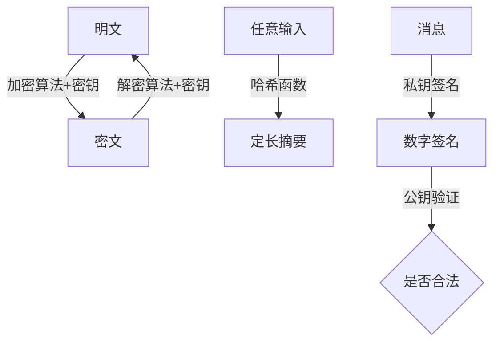
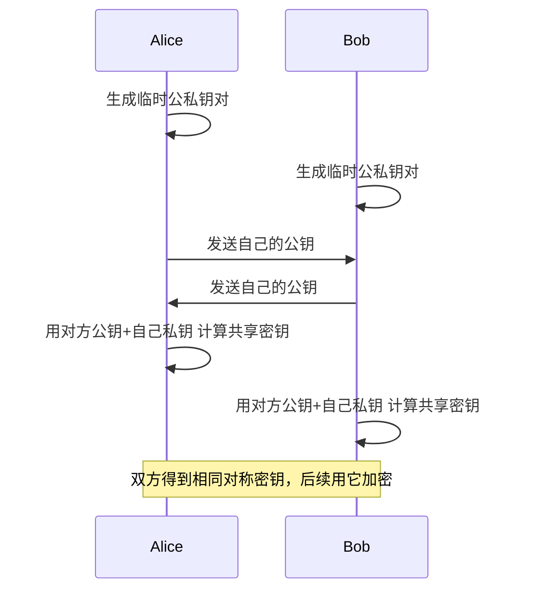
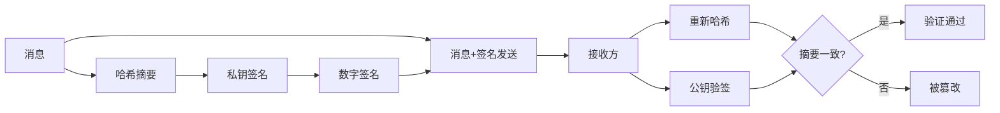
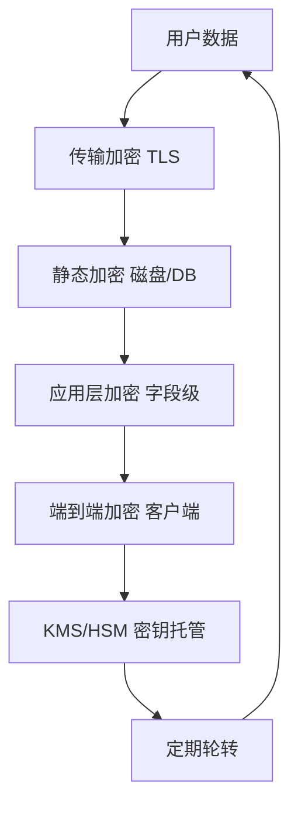

# 密码学

> 密码学研究的是"如何在不可信信道上保证信息的机密性、完整性与不可抵赖性"。本文聚焦算法与协议本身——从古典密码到后量子，从对称加密到零知识证明。攻击手法与防御体系请参考 [[网络安全]]。

**关键词**：对称加密、非对称加密、哈希、数字签名、PKI

## 抽象类比

密码学像两个身处敌营的将军传令：信使随时可能被截、被替换、被篡改。他们要让敌人看不懂信（加密）、要能发现信被改过（完整性）、还要确认信真是对方写的（签名）。几千年来，这套博弈从未停止，只是把蜡封、火漆换成了 RSA、椭圆曲线与零知识证明。

密码学最反直觉的一点是：算法必须公开，安全性只依赖密钥。这叫柯克霍夫原则——敌人知道你用了 AES-256 也没用，因为他们不知道你的 256 位密钥。

## 一、密码学是什么

### 1.1 四要素

- 明文（Plaintext）：原始可读信息
- 密文（Ciphertext）：加密后看似随机的内容
- 密钥（Key）：加解密使用的秘密参数
- 算法（Algorithm）：明文与密文之间的转换规则

### 1.2 三大目标

- 机密性：只有持有密钥的人能读懂，靠加密实现
- 完整性：数据没被悄悄修改，靠哈希与 MAC 实现
- 不可抵赖性：发送方不能否认自己发过，靠数字签名实现

### 1.3 三大分支

- 对称密码：加解密用同一把密钥，快但密钥分发难
- 非对称密码：公钥加密私钥解密，慢但解决密钥分发
- 哈希与签名：单向函数 + 非对称签名，做完整性 / 不可抵赖

## 二、密码学的发展史

### 2.1 古典密码（公元前—19 世纪）

- 凯撒密码：字母表移位，`A→D, B→E`，密钥空间只有 25，暴力秒破
- 替换密码：字母一对一替换，可被频率分析攻破（英文中 E 最常见）
- 维吉尼亚密码：多表替换，密钥循环使用，曾被误认为"不可破"
- 中国古代"反切码"、希腊 Skytale 棒 cipher 都是早期尝试

### 2.2 近代密码（20 世纪初—1949）

- Enigma 机：二战德军转子密码机，每天换密钥
- 图灵与布莱切利园团队破译 Enigma，缩短战争
- 香农 1949 年论文《保密系统的通信理论》奠定现代密码学数学基础，提出"混淆"与"扩散"

### 2.3 现代密码（1949—至今）

- 1976 年 Diffie-Hellman 论文：公钥革命开端，解决密钥分发
- 1977 年 RSA 算法发布：第一个可用的公钥加密
- 1977 年 DES 成为美国标准：56 位密钥现已不安全
- 2001 年 AES 取代 DES：128/192/256 位密钥，至今主流
- 1985 年椭圆曲线密码 ECC 提出：相同安全强度下密钥更短

### 2.4 后量子密码（2016—至今）

- Shor 算法理论可破 RSA / ECC，量子计算机一旦成熟就完蛋
- NIST 后量子密码标准化：2024 年公布首批标准
  - ML-KEM（Kyber）：密钥封装
  - ML-DSA（Dilithium）：数字签名
  - SLH-DSA（SPHINCS+）：基于哈希的签名
- 现在部署的系统应开始规划 PQC 迁移

## 三、对称加密

### 3.1 分组密码

把明文切成固定长度块，逐块加密。

- DES：56 位密钥、64 位块，已被暴力破解，不再安全
- 3DES：三重 DES，过渡方案，已被 NIST 淘汰
- AES：128/192/256 位密钥，128 位块，全球通用
  - 替换（S 盒）+ 行移位 + 列混淆 + 轮密钥加，多轮迭代
  - 硬件指令 AES-NI 让其性能极快
- SM4：中国国密分组密码，128 位密钥，国密合规场景必选

### 3.2 流密码

用密钥流与明文逐位异或，速度快、适合流式数据。

- RC4：曾经流行，现已不安全
- ChaCha20：现代主流，纯软件实现比 AES-256-GCM 还快
- Salsa20：ChaCha20 的前作

### 3.3 分组模式

ECB、CBC、CTR、GCM 是常见模式，选择决定生死：

- ECB（电子密码本）：每块独立加密，相同明文 → 相同密文，泄露模式，禁止使用
- CBC（密文块链接）：每块与前一块密文异或，需 IV，串行处理
- CTR（计数器）：把计数器加密得到密钥流，可并行
- GCM（Galois/Counter Mode）：CTR + 认证标签，AEAD，现代首选
- CCM：CBC-MAC + CTR，无线场景常用

要点：现代场景应优先选 AEAD 模式（GCM、ChaCha20-Poly1305），同时提供加密与完整性。

### 3.4 密钥分发问题

对称密码最大痛点：双方如何安全地共享密钥？

- 离线交换：物理交付，成本高
- KDC（密钥分发中心）：Kerberos 思路，单点信任
- 非对称密码协商：用 RSA / DH 临时协商对称密钥（TLS 思路）

## 四、非对称加密

### 4.1 RSA

- 基于"大整数分解困难"假设
- 公钥 = (n, e)，私钥 = (n, d)
- 加密：`c = m^e mod n`，解密：`m = c^d mod n`
- 推荐 2048 位起步，新系统建议 3072 位
- 加密慢，通常只用来加密对称密钥，不直接加密大块数据

### 4.2 Diffie-Hellman 密钥交换

- 基于"离散对数困难"假设
- 双方在公开信道上协商出共享密钥，即使全程被偷听也无法推算
- 经典 DH 在素数域，ECDH 在椭圆曲线域，更短更快
- TLS 1.3 强制使用 ECDHE（临时密钥），实现前向安全

### 4.3 ECC 椭圆曲线密码

- 基于"椭圆曲线离散对数困难"假设
- 同等安全强度下密钥更短：
  - 256 位 ECC ≈ 3072 位 RSA
  - 384 位 ECC ≈ 7680 位 RSA
- 常见曲线：NIST P-256、Curve25519、SM2（中国国密）
- 已成为现代系统首选：WireGuard、Signal、比特币都用 ECC

### 4.4 其他非对称算法

- ElGamal：基于离散对数，可加密可签名
- DSA：数字签名专用，已被 ECDSA / EdDSA 取代
- SM2：中国国密椭圆曲线算法

### 4.5 公钥分发与信任

公钥加密解决密钥分发，但又带来新问题：你怎么确认这把公钥就是 Bob 的？

- 公开信道发布公钥容易被中间人替换
- 解决方案：数字证书，把"公钥 + 身份"打包由可信第三方（CA）签名
- 这就是 PKI（公钥基础设施）的起点，详见第七节

## 五、哈希函数

### 5.1 哈希的性质

- 单向：从摘要推不出原文
- 定长输出：无论输入多长，输出固定长度
- 雪崩效应：输入改 1 位，输出几乎全变
- 抗碰撞：找不到两个不同输入产生相同输出

### 5.2 常见哈希算法

- MD5：128 位，已被破解，不再用于安全场景
- SHA-1：160 位，已被破解（2017 Google SHAttered），停止使用
- SHA-256 / SHA-512：SHA-2 家族，目前主流
- SHA-3：Keccak 算法，结构与 SHA-2 完全不同，作为备份方案
- BLAKE2 / BLAKE3：现代快速哈希，比 SHA-2 快几倍
- SM3：中国国密哈希，256 位

### 5.3 哈希的攻击

- 碰撞攻击：找到两个不同输入产生相同哈希，MD5 / SHA-1 已沦陷
- 原像攻击：从哈希反推原文，目前主流算法仍安全
- 长度扩展攻击：SHA-1 / SHA-2 系列都受影响，导致可伪造 `H(key || message)` 形式的 MAC
  - 防御：用 HMAC 结构而不是简单拼接

### 5.4 HMAC

HMAC = Hash(key, Hash(key, message))，把密钥与消息一起哈希，提供消息认证。

- 优点：不依赖哈希函数抗碰撞，只依赖抗原像
- 用于 JWT 签名、API 请求签名、TLS 记录层
- 算法选择：HMAC-SHA256 最常用

### 5.5 密码存储

用户密码绝不能明文存数据库，正确做法：

- 不要用 MD5 / SHA-256 直接哈希——彩虹表秒破
- 加盐（salt）：每个用户独立随机盐，挡彩虹表
- 慢哈希：bcrypt、scrypt、Argon2，故意慢到爆破不划算
- 加 pepper：全局密钥再哈希一次，挡数据库泄露

## 六、消息认证与数字签名

### 6.1 MAC vs 签名

- MAC（消息认证码）：对称密钥生成，能验证完整性 + 来源，但无法对抗内部抵赖
- 数字签名：非对称私钥签，公钥验，可对外证明不可抵赖

### 6.2 主流签名算法

- RSA 签名：基于大整数分解，传统主流
- DSA：基于离散对数，老一代签名算法
- ECDSA：椭圆曲线版 DSA，比特币 / 以太坊使用
- Ed25519：Edwards 曲线签名，速度极快、抗侧信道、抗确定性失误
  - 现代系统首选：SSH、Signal、Tor 都在迁移
- SM2 签名：国密场景必选

### 6.3 PGP / GPG

- PGP：1991 年 Phil Zimmermann 设计的".pretty good privacy"
- GPG：开源实现，广泛用于代码签名、邮件加密、软件包签名
- Web of Trust：去中心化信任网络，与 PKI 的 CA 链相对
- Git commit 签名常用 GPG

## 七、证书与 PKI

### 7.1 X.509 证书

X.509 证书包含：

- 版本、序列号、签名算法
- 持有者主体（Subject）：CN、O、OU 等
- 持有者公钥
- 颁发者（Issuer）
- 有效期：not before / not after
- 扩展：SAN（Subject Alternative Name）、密钥用途
- CA 签名

### 7.2 CA 证书链

- 根 CA（Root CA）：自签名，浏览器 / 操作系统预装
- 中间 CA：被根 CA 签名，隔离风险
- 叶子证书：网站实际使用
- 验证过程：叶子 → 中间 → 根，逐级签名校验
- 任一环节失败即证书无效

### 7.3 证书吊销

- CRL（吊销列表）：CA 定期发布被吊销证书清单，体积大、更新慢
- OCSP（在线证书状态协议）：实时查询某证书是否吊销
- OCSP Stapling：服务器主动获取 OCSP 响应附带在 TLS 握手中，省一次客户端查询

### 7.4 Let's Encrypt

- 免费、自动化的证书颁发机构，2015 年上线
- 推动 HTTPS 普及最大功臣
- 使用 ACME 协议自动签发与续期
- 证书有效期 90 天，鼓励自动化

### 7.5 TLS 握手过程

TLS 1.2 典型握手（RSA 密钥交换已废弃，这里以 ECDHE 为例）：

1. ClientHello：客户端发送支持的密码套件、随机数、SNI
2. ServerHello：服务端选定套件、随机数
3. Certificate：服务端发送证书链
4. ServerKeyExchange：服务端发送 ECDHE 参数与签名
5. ServerHelloDone
6. ClientKeyExchange：客户端发送 ECDHE 公共值
7. 双方各自计算预主密钥，再派生出会话密钥
8. Finished：双方用会话密钥加密握手摘要互相验证

TLS 1.3 简化到 1-RTT，强制 ECDHE 前向安全，删除所有弱算法。

## 八、密码学协议

### 8.1 TLS / SSL

- 在 TCP 之上提供加密、完整性、身份认证
- SSL 已废弃（SSLv2、SSLv3 都不安全），现在统一叫 TLS
- HTTPS = HTTP over TLS
- 应用：网页、API、邮件（IMAPS/SMTPS）、数据库连接

### 8.2 SSH

- 远程登录与文件传输协议
- 基于非对称密钥认证（也可密码）
- 端口转发：把本地端口通过 SSH 隧道转发到远端
- 现代推荐 Ed25519 密钥

### 8.3 IPSec

- 网络层加密，与具体应用无关
- AH（认证头）提供完整性，ESP（封装安全载荷）提供加密 + 完整性
- 传输模式：端到端加密
- 隧道模式：站点到站点 VPN 常用

### 8.4 Kerberos

- 网络认证协议，基于对称密码 + KDC
- 用户拿 TGT（票据授予票据），再换 ST（服务票据）访问具体服务
- Windows 域环境标准
- 优点：用户密码不在线传输；缺点：KDC 是单点

### 8.5 Signal 协议

- 端到端加密即时通讯协议
- 双棘轮（Double Ratchet）：前向安全 + 后向安全
- X3DH（扩展三方 Diffie-Hellman）：异步密钥协商
- WhatsApp、Facebook Messenger、Skype 私密对话都基于 Signal

### 8.6 比特币的椭圆曲线签名

- 用 secp256k1 曲线（不是 NIST P-256）
- 私钥 → 公钥 → 地址的派生链
- ECDSA 签名交易，签名验证靠椭圆曲线运算
- 每笔交易用一次性密钥，详见 [[区块链]]

## 九、密码学攻击

### 9.1 暴力破解与字典攻击

- 暴力：枚举所有可能密钥，密钥长度决定难度
  - 56 位 DES 几小时破，128 位 AES 当前算力不可行
- 字典攻击：用常见密码字典试，破解"密码"这种弱口令
- 防御：长密钥、慢哈希、限速、MFA

### 9.2 彩虹表

- 预计算"哈希 → 明文"巨大查找表，针对固定哈希函数
- 经典例子：用 100GB 表秒破 Windows LM 哈希
- 防御：加盐让预计算失效，每个用户独立盐

### 9.3 侧信道攻击

不攻击算法本身，攻击实现过程泄露的信息：

- 时间攻击：运算时间不同推断密钥位
- 功耗分析：测芯片功耗曲线
- 缓存时序攻击：测 CPU 缓存命中
- 防御：常数时间实现、盲化、掩码

### 9.4 Padding Oracle 攻击

- 利用解密时"填充错误" vs "MAC 错误"的不同响应推断明文
- 经典案例：CBC 模式 + MAC-then-Encrypt 的旧 TLS
- 防御：AEAD 模式（GCM）、Encrypt-then-MAC、统一错误响应

### 9.5 生日攻击

- 利用生日悖论：找碰撞比找原像快
- 对 n 位哈希，碰撞只需约 2^(n/2) 次运算
- 64 位哈希早已不安全，128 位哈希碰撞难度才够

### 9.6 量子威胁

- Shor 算法：多项式时间分解大整数与离散对数，RSA / ECC 全部沦陷
- Grover 算法：把对称密钥搜索复杂度从 2^n 降到 2^(n/2)
- 应对：AES-256 仍可抵抗 Grover，RSA / ECC 必须迁到后量子算法

## 十、密码学的新方向

### 10.1 同态加密

- 在密文上直接计算，结果解密后等于明文计算结果
- 全同态加密（FHE）由 Gentry 2009 年首次实现
- 应用：医疗 / 金融数据外包计算、隐私机器学习
- 痛点：性能仍慢几个数量级，工程化在早期

### 10.2 零知识证明

- 证明者向验证者证明"我知道某秘密"而不泄露秘密本身
- zk-SNARK：简洁、非交互、零知识
- zk-STARK：抗量子、无需可信设置
- 应用：Zcash 隐私交易、以太坊 Rollup 扩容、身份证明

### 10.3 安全多方计算（MPC）

- 多方共同计算一个函数，各自输入互不泄露
- 经典问题：姚期智"百万富翁问题"——两个富翁比谁富而不透露具体数字
- 应用：联合建模、隐私广告归因、密钥分片托管

### 10.4 后量子密码

- NIST 2024 年公布首批 PQC 标准
  - ML-KEM（Kyber）：基于格的密钥封装
  - ML-DSA（Dilithium）：基于格的签名
  - SLH-DSA（SPHINCS+）：基于哈希的签名，更保守
- 迁移挑战：密钥与签名比现在大很多，协议要重新设计
- "现在收割，未来解密"攻击意味着今天加密的数据也要立刻换

### 10.5 其他前沿

- 属性密码（ABE）：用属性策略决定解密权限
- 代理重加密：让中转代理把密文从 A 的公钥换到 B 的公钥而看不到明文
- 可搜索加密：在密文上做关键字搜索

## 十一、工程实践注意事项

### 11.1 不要自己造密码

- 自研算法几乎一定有漏洞，密码学是数学不是工程
- 用经过公开审计的标准库：OpenSSL、libsodium、BoringSSL、Tink
- "Don't roll your own crypto" 是行业铁律

### 11.2 随机数源

- 密码学强度随机数是安全基石
- CSPRNG（密码学安全伪随机数生成器）必须用：
  - Linux：`/dev/urandom`、`getrandom()`
  - Windows：`CryptGenRandom`、`BCryptGenRandom`
  - Java：`SecureRandom`
- 不要用 `rand()` / `Math.random()` 做密钥或 token
- 历史教训： Debian OpenSSL 漏洞（CVE-2008-0166）让所有密钥空间缩到 2^15

### 11.3 密钥管理 KMS

- 密钥不能写死在代码或配置里
- KMS（Key Management Service）统一管理：AWS KMS、HashiCorp Vault、阿里云 KMS
- 主密钥永不离开 KMS，业务侧只拿到数据加密密钥（DEK）的密文
- HSM（硬件安全模块）：物理隔离的密钥存储与运算

### 11.4 密钥轮转

- 长期使用同一密钥增加泄露风险
- 定期轮转：每月 / 每季度换数据密钥
- 双密钥期（old + new 并存）让平滑切换可行
- TLS 证书现在推荐 90 天有效期，倒逼自动化

### 11.5 Salt 与 Pepper

- Salt：每用户独立的随机值，与密码一起哈希，挡彩虹表
- Pepper：全局服务端密钥，存配置或 KMS，挡数据库单独泄露
- 推荐组合：`Argon2id(password, salt) + pepper`
- Salt 可明文存数据库，Pepper 绝不能进库

### 11.6 加密层级

- 传输中加密：TLS，挡中间人
- 静态加密：磁盘加密、数据库字段加密，挡物理失窃
- 端到端加密：客户端加密、服务端看不到明文，挡服务商
- 应用层加密：业务字段加密，挡 DBA 越权

## 面试速答

**Q1：对称加密与非对称加密有什么区别？**
A：对称加密加解密同一把密钥，速度快、适合大数据量，但密钥分发难；非对称加密用公钥加密私钥解密，解决分发问题，但速度慢几个数量级。实际系统二者结合：非对称协商对称密钥，对称加密实际数据，典型例子就是 TLS。

**Q2：AES 的 ECB 模式为什么不能用？**
A：ECB 模式每个明文块独立加密，相同的明文块产生相同的密文块，会泄露数据模式。经典例子：加密一张企鹅图片，密文里仍能看出企鹅轮廓。应改用 CBC、CTR 或 AEAD 模式（如 GCM、ChaCha20-Poly1305），后者还能提供完整性。

**Q3：什么是数字签名？它和 MAC 有何区别？**
A：数字签名是用私钥对消息哈希加密，公钥验签；MAC 是用对称密钥生成的认证标签。两者都提供完整性，但签名能对外证明不可抵赖（任何人都能用公钥验证），MAC 只能在共享密钥的双方间验证，无法解决内部抵赖。

**Q4：HTTPS 握手为什么用非对称，又用对称？**
A：握手阶段用非对称（RSA / ECDHE）协商出会话密钥，因为非对称能解决"双方从未见过面也能安全协商"的问题；之后用对称加密传输数据，因为对称速度快几个数量级。这种"非对称建通道、对称传数据"是密码学工程的标准模式。

**Q5：什么是前向安全？为什么 TLS 1.3 强制使用？**
A：前向安全（Forward Secrecy）指即使长期私钥泄露，过去的会话密钥也无法被解密。实现方式是每次握手都用临时 Diffie-Hellman 密钥（DHE / ECDHE），会话结束后丢弃。如果用 RSA 直接交换密钥，私钥泄露等于所有历史流量被解密。TLS 1.3 删除了 RSA 密钥交换，强制 ECDHE，因此默认前向安全。

## 参考与延伸

- 内部链接：[[网络安全]]、[[计算机网络]]、[[区块链]]
- 密码学经典教材 Boneh & Shoup：<https://toc.cryptobook.us/>
- NIST 后量子密码标准化：<https://csrc.nist.gov/projects/post-quantum-cryptography>
- RFC 8446 TLS 1.3：<https://datatracker.ietf.org/doc/html/rfc8446>
- libsodium 文档：<https://libsodium.gitbook.io/doc/>
- Let's Encrypt：<https://letsencrypt.org/>

---

## 理解与验证闭环

- **关键连接**：工程问题通常不是算法不存在，而是随机数、密钥生命周期、参数、协议组合或实现侧信道出错。
- **最小验证**：使用成熟库完成 AEAD 加密、密码哈希和签名验证，测试篡改、重放与密钥轮换。
- **取舍边界**：不要复用 nonce、硬编码密钥或自创协议；算法名正确不代表使用方式安全。

复习时先画出核心对象和数据流，再用一个反例解释边界，最后用实验数据或可观察证据校正直觉。
