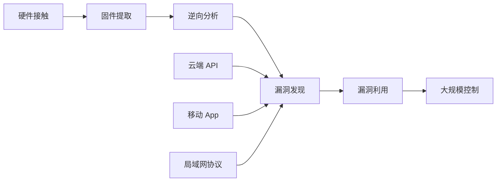
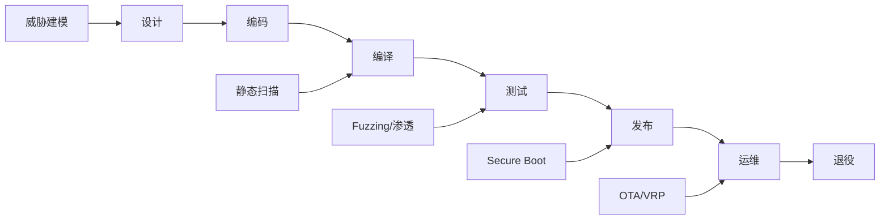

# 物联网安全

> 物联网安全研究 IoT 设备从硬件到云端的整条攻击链。与 [[网络安全]] 关注 Web 协议、[[密码学]] 关注算法不同，本文聚焦智能家居、车联网、工控系统等"物"的特殊攻防。相关二进制层面利用参考 [[二进制安全]]，通信协议参考 [[通信协议]]。

**关键词**：固件提取、硬件攻击、车联网、工控安全、Secure Boot

## 抽象类比

物联网安全像保护一座带很多门的房子：每个智能设备都是一扇通向内网的门，门锁却各不相同——有的是密码锁（云端认证），有的是机械锁（硬件接口），有的根本没锁（明文协议）。攻击者只要撬开任何一扇门，就能进入家庭内网，甚至通过云端控制所有同类设备。

更麻烦的是，这些"门"装上去就可能用十年八年，厂商倒闭后就再也没人修补锁芯；而攻击者可以买一台设备回家慢慢拆解，研究锁的内部结构。这种"攻击者拥有设备、防御者无法更新"的不对称，是 IoT 安全与互联网安全最本质的区别。

## 一、物联网安全是什么

### 1.1 定义与范围

物联网安全（IoT Security）研究各类"物"设备在感知层、网络层、应用层的安全攻防，覆盖：

- 智能家居：路由器、摄像头、门锁、扫地机器人
- 车联网：T-Box、IVI、OBD 接口、V2X 通信
- 工业控制：PLC、SCADA、传感器、执行器
- 智慧城市：智能电表、交通信号、楼宇自控
- 医疗 IoT：起搏器、胰岛素泵、监护设备

### 1.2 与传统安全的区别

- 设备资源受限：CPU 弱、内存小、功耗敏感，难以部署复杂防护
- 生命周期长：动辄 5-10 年，但厂商通常只维护 1-2 年
- 物理可接触：攻击者可以拆机、焊线、读 Flash
- 协议多样：Zigbee、BLE、LoRa、Modbus、CAN 等几十种
- 部署规模大：单型号设备动辄百万台，漏洞影响巨大

### 1.3 IoT 攻击链

### 1.4 IoT 安全发展史

IoT 安全随硬件与协议演进经历了几个阶段：

- 2010 前：嵌入式设备普遍无安全设计，UART 默认开启、固件明文存放
- 2014：Heartbleed、Shellshock 暴露 IoT 设备底座 OpenSSL/Bash 漏洞
- 2016：Mirai 蠕虫通过默认密码控制百万摄像头，引发美国东海岸断网
- 2017：Kr00k 漏洞影响数亿 Broadcom WiFi 芯片
- 2018：Stuxnet 揭开工控安全冰山一角，国家级行动者入场
- 2020+：车联网 UN R155/R156 法规生效，强制网络安全合规
- 当下：AIoT 与边缘智能带来模型窃取、模型逆向等新攻击面

每一次大规模事件都推动了法规与防护的升级，但海量存量设备仍长期暴露在风险中。这是 IoT 安全难以根治的根源。

## 二、IoT 安全的特殊性

### 2.1 资源受限

低端 IoT 设备往往只有几 KB 到几 MB 内存，几十 MHz 主频：

- 无法运行完整的 TLS 栈，常自实现弱加密
- 无 OTA 空间，固件无法更新
- 无安全区，密钥明文存放

### 2.2 长生命周期

工业设备生命周期通常 15-30 年，消费设备 5-10 年，但：

- 厂商维护周期短，通常 1-2 年后停止固件更新
- 厂商倒闭后设备彻底失维
- 老旧固件积累大量已知漏洞

### 2.3 物理可接触

与云服务不同，IoT 设备常部署在不可控环境：

- 攻击者可购买同型号设备离线研究
- 可拆机焊线连接 UART、JTAG、SWD
- 可读取 Flash 芯片获取固件与密钥
- 可注入故障信号绕过保护

### 2.4 协议碎片化

IoT 通信协议几十种，每种都有自己的安全模型：

- 短距离：Zigbee、BLE、Thread、Z-Wave
- 长距离：LoRa、NB-IoT、Sigfox、4G/5G
- 工控：Modbus、Profibus、OPC UA、DNP3
- 车载：CAN、LIN、FlexRay、SOME/IP
- IP 层：CoAP、MQTT、HTTP

## 三、IoT 攻击面

### 3.1 硬件接口

未关闭的调试接口是 IoT 设备最直接的入口：

- UART 串口：常默认开启，可直接拿到 root shell
- JTAG / SWD：调试接口，可单步调试、读写 Flash
- I2C / SPI：可直接与传感器、Flash 通信
- 防御：硬件熔丝烧断调试口、物理封装

### 3.2 固件提取

- 从厂商官网下载升级包
- 通过 UART/USB 触发升级模式 dump
- 拆 Flash 芯片用编程器读取
- 通过 JTAG/SWD 在线读取
- Side channel 推测存储内容

### 3.3 Web 后台

- 路由器、摄像头的管理界面常存在命令注入、默认密码
- CGI 程序用 C 写，易出栈溢出
- UPnP、TR-069 等协议历史漏洞众多

### 3.4 移动 App

- 反编译 App 提取硬编码 API Key、加密密钥
- 抓包分析通信协议与云端 API
- App 中的调试接口、后门账号

### 3.5 云端 API

- 设备身份伪造：硬编码 device key 提取后伪造任意设备
- 越权控制：通过 device ID 控制他人设备
- 接口未鉴权：直接调用云端 API 控制

### 3.6 局域网协议

- mDNS / SSDP 信息泄露
- UPnP 内网端口自动转发
- 私有协议明文传输、无认证

### 3.7 攻击链案例

以一个典型路由器从外网到 root 的攻击链为例：

- 信息收集：扫描发现目标开放 80、443、23 端口
- Web 漏洞：管理界面命令注入，获得 web shell
- 提权：固件中 sudo 配置错误或 setuid 程序漏洞，提权到 root
- 持久化：写入开机自启脚本、修改固件
- 横向移动：通过 UPnP 探测内网其他设备，扫描弱口令
- 数据外泄：上传完整配置到 C2 服务器
- 大规模扩散：通过云端账号横向控制同厂商其他设备

整个流程体现了攻击面逐层突破的思路。每一步的成功都依赖前一步的成果，防御方只要在任一环节建立有效检测与拦截，攻击链就会断裂。这也是纵深防御（Defense in Depth）的核心思想：不要依赖单点防护。

## 四、固件安全

### 4.1 固件提取与解包

binwalk 是固件分析的标准工具：

- `binwalk firmware.bin`：识别嵌入的文件系统、压缩数据
- `binwalk -e firmware.bin`：自动解包
- 常见文件系统：squashfs、jffs2、ubifs、cramfs
- 加密固件需先逆向解密逻辑

### 4.2 文件系统分析

解包后重点检查：

- `/etc/passwd` `/etc/shadow`：默认账号密码
- `/etc/config/`：配置文件，可能含密钥
- `/usr/bin/` `/usr/sbin/`：可执行文件，分析 web 服务、守护进程
- web 根目录：cgi 脚本、php 代码
- 启动脚本 `/etc/init.d/`：开机自启服务

### 4.3 硬编码凭据

最常见的固件漏洞：

- 后门账号 `admin/admin`、`root/123456`
- 硬编码 API Key、加密密钥
- 私钥文件直接放在 `/etc/ssl/`
- 设备间共享密钥（一泄露全网遭殃）

### 4.4 敏感信息泄露

- 调试日志输出到串口或 syslog
- web 服务详细错误信息
- 错误码直接暴露内部状态
- 配置文件注释中写明架构信息

### 4.5 固件加密与解密

部分厂商会对固件包加密以防止逆向，但常见做法都存在弱点：

- 对称加密 + 硬编码密钥：密钥必然存在于设备端，可从设备中提取
- 自定义加密算法：通常是简单异或或位运算，逆向 bootloader 即可还原
- 全盘加密 + 密钥在 SoC：可拆 Flash 用编程器读取，或通过 JTAG 在线读取
- 加密只针对升级包：运行时仍明文，硬件提取即可绕过

解密步骤通常：

- 用 binwalk 识别加密段的偏移与大小
- IDA 反编译 bootloader 找到解密函数
- 提取硬编码的密钥与算法
- 离线解密固件镜像
- 重新用 binwalk 解包文件系统

固件加密更多是"提高门槛"而非真正防护，因为设备必须能解密自己接受的固件。真正的防护是固件签名（Secure Boot）而非加密。

## 五、硬件攻击

### 5.1 侧信道攻击 SCA

通过设备运行时的物理信息推断内部状态：

- 功耗分析 SPA/DPA：分析芯片功耗曲线推断密钥
- 电磁辐射分析：捕获电磁泄漏
- 时间分析：运算时间差异暴露分支
- 防御：恒定时间实现、功耗噪声、屏蔽

### 5.2 故障注入 FA

故意制造异常条件让 CPU 跳过指令：

- 电压毛刺 Glitch：瞬时拉低电压让跳转指令失效
- 时钟毛刺：插入异常时钟周期
- 电磁故障注入：强电磁脉冲打乱指令
- 激光故障注入：精确照射晶体管
- 经典目标：跳过 Secure Boot 校验

### 5.3 Flash 读保护绕过

MCU 通常有 RDP（Readout Protection）级别：

- Level 0：可读，可调试
- Level 1：禁止读 Flash，但可降级（会清 Flash）
- Level 2：永久禁用调试口
- 绕过：电压毛刺降级、固件提取后离线分析、利用未关闭的厂商调试接口

### 5.4 JTAG 调试

JTAG 是 IEEE 1149.1 标准调试接口：

- TCK/TMS/TDI/TDO/TRST 五根线
- 通过 JTAG 可读写 Flash、单步调试
- 厂商可能物理熔断 JTAG 或加密码锁
- 工具：J-Link、ST-Link、OpenOCD

## 六、无线协议安全

### 6.1 Zigbee

- 基于 IEEE 802.15.4，低功耗低速
- 默认密钥常使用厂商统一密钥（如 ZigbeeAlliance09）
- 攻击：Killerbee 工具抓包、密钥重用导致整网泄露
- 触摸配对时易遭受重放攻击

### 6.2 Bluetooth / BLE

- 经典蓝牙：BNAP/BLUP PIN 码爆破
- BLE：相邻设备地址可被跟踪、配对过程暴露密钥
- 经典漏洞：BLESA（重放配对后数据）、BLURTooth（跨协议混淆）
- 工具：Ubertooth、HackRF、nRF Sniffer

### 6.3 LoRa / NB-IoT

- LoRaWAN：AES-CTR + AES-CMAC，但 join procedure 存在重放
- NB-IoT：基于 LTE，安全性依赖运营商核心网
- 攻击者可使用 SDR 抓包分析

### 6.4 WiFi WPA3

- WPA3 用 SAE 替代 PSK 抵抗离线爆破
- WPA3 Transition 模式仍存在降级攻击
- Dragonblood 漏洞：SAE 协议实现中的侧信道

## 七、车联网安全

### 7.1 CAN 总线

CAN 是车载最常用的总线协议：

- 无认证、无加密、广播式
- 任何节点都可发送任意 ID 报文
- 攻击者接入总线即可控制刹车、转向
- 2015 Jeep Cherokee 远程入侵案：通过车机漏洞接入 CAN 总线

### 7.2 OBD-II 接口

- 标准 16 针诊断接口，所有车辆必备
- 通过 OBD-II 可直接访问 CAN 总线
- 攻击者物理接触车辆即可注入报文
- 一些车型的 OBD 接口无 PIN 码保护

### 7.3 车载信息娱乐系统 IVI

- 车机是车联网攻击的主入口
- 常基于 Android，漏洞众多
- 通过 IVI 可跨网关到达动力总线
- USB、WiFi、蓝牙、4G 都是入口

### 7.4 OTA 升级

- 远程升级既要保证安全又要保证完整性
- 必须签名验证升级包
- 升级失败回滚机制
- 防止降级攻击（刷带漏洞的旧版本）

### 7.5 V2X

- 车与车、车与路侧单元通信
- 基于 DSRC 或 C-V2X
- PKI 体系保证身份与消息真实性
- 假消息注入可导致交通混乱

### 7.6 车联网安全事件

车联网领域重大安全事件：

- 2015 Jeep Cherokee：克莱斯勒召回 140 万辆，黑客远程控制刹车
- 2017 Tesla Model S：腾讯科恩实验室远程控制特斯拉
- 2019 BMW：360 团队发现 14 个漏洞，可远程开门
- 2021 Tesla：通过蓝牙攻击 Model 3，盗车
- 2023 多家车企 OBD 设备漏洞：可远程熄火

车联网安全的核心难点：

- CAN 总线无认证，物理接入即控制
- 车机系统生命周期长，难以及时打补丁
- 网关隔离是被动防御，新攻击面不断出现
- OTA 升级一旦失败可能造成车辆无法启动

行业趋势：

- 法规强制 R155/R156 网络安全合规
- 引入车载 IDS（Intrusion Detection System）
- 车载防火墙隔离 CAN 总线域
- V2X 用 PKI 保证消息真实性

## 八、工控安全 ICS

### 8.1 SCADA 与 PLC

- SCADA：监控与数据采集系统，操作员界面
- PLC：可编程逻辑控制器，执行现场控制
- RTU：远程终端单元，分布采集
- HMI：人机界面

### 8.2 工控协议

- Modbus：无认证、无加密、明文
- DNP3：支持鉴权但常未启用
- IEC 60870-5-104：基于 TCP 的远动协议
- OPC UA：现代协议，内建安全模型
- Ethernet/IP：工业以太网

### 8.3 Stuxnet 案例

2010 年针对伊朗核设施的蠕虫：

- 通过 U 盘摆渡进入物理隔离网络
- 利用 4 个 Windows 0day + 2 个 Siemen STEP7 漏洞
- 修改 PLC 代码让离心机超速运转
- 同时伪造反馈数据让监控以为正常
- 开创工控网络武器先例

### 8.4 功能安全与网络安全

- 功能安全（IEC 61508）：防止系统故障导致人身伤害
- 网络安全（IEC 62443）：防止恶意攻击
- 两者交叉：网络攻击可能触发功能安全风险
- 安全是 Safety + Security 的整体

### 8.5 工控安全重大事件

历史上几次工控安全事件改变了行业认知：

- 2010 Stuxnet：针对伊朗铀浓缩离心机，首个国家级网络武器
- 2015 BlackEnergy：乌克兰电网攻击，23 万人断电
- 2016 Industroyer：乌克兰电网二次攻击，更专业的工控恶意软件
- 2017 Triton：针对沙特石油化工 Triconex SIS，可致爆炸
- 2021 Colonial Pipeline：勒索软件致美国最大输油管道停摆
- 2022 Industroyer2：Industroyer 升级版，再次针对乌克兰

每次事件都暴露出工控安全的共同问题：

- 工控网络与企业 IT 网络未隔离
- Modbus/IEC 104 等明文协议无认证
- 设备老旧无法打补丁
- 默认配置与默认密码

防护核心是"白名单 + 物理隔离 + 异常检测"，而非传统 IT 安全的"黑名单 + 在线更新"。OT 网络一旦上线就应假定不可打补丁，必须靠架构与监控兜底。

## 九、IoT 安全防护

### 9.1 安全启动 Secure Boot

- ROM Bootloader 验证一级 Bootloader 签名
- 一级 Bootloader 验证内核签名
- 内核验证应用签名
- 形成完整信任链，任意一环失败即停止启动

### 9.2 TEE 可信执行环境

- ARM TrustZone：硬件隔离安全世界
- OP-TEE：开源 TEE OS
- 密钥、DRM 内容、生物特征放入 TEE
- 与普通 OS 隔离，抵御内核漏洞

### 9.3 固件签名与 OTA

- 升级包必须厂商私钥签名
- 设备端公钥验证签名
- 防止刷入恶意固件
- 防降级：版本号单调递增检查

### 9.4 加密通信

- 使用 TLS/DTLS 而非私有协议
- 每设备唯一证书，避免共享密钥
- 前向安全：ECDHE 密钥协商
- 证书轮换机制

### 9.5 设备身份

- 每设备唯一 ID，烧入 OTP 或 eFuse
- 出厂注入设备证书
- 区分设备身份与用户身份
- 防克隆：硬件唯一密钥

### 9.6 安全开发生命周期

IoT 安全不能只靠测试环节，需贯穿整个 SDLC：

- 设计阶段：威胁建模（STRIDE）、攻击面分析、最小权限原则
- 编码阶段：MISRA C/C++ 规范、静态分析（Coverity、CodeQL）、禁用危险函数
- 编译阶段：开启 stack protector、Fortify、RELRO、PIE
- 测试阶段：Fuzzing、渗透测试、固件逆向自查
- 发布阶段：签名固件、Secure Boot、默认安全配置
- 运维阶段：CVE 监控、应急响应、OTA 推送
- 退役阶段：设备回收、密钥销毁、数据擦除

参考微软 SDL 与 NIST SSDF 框架，把安全嵌入开发流程而非作为事后补救。云厂商还要求供应链安全：第三方组件 SBOM、固件签名链、CVE 扫描。

## 十、IoT 安全合规与标准

### 10.1 国际标准

- ENISA：欧盟 IoT 安全基线要求
- NIST IR 8259：IoT 设备网络安全能力基线
- IEC 62443：工控系统安全标准
- ISO/SAE 21434：道路车辆网络安全工程
- ETSI EN 303 645：消费 IoT 安全基线

### 10.2 国内法规

- 《网络安全法》：关键信息基础设施保护
- 《数据安全法》：数据分级与跨境
- 《个人信息保护法》：用户数据合规
- GB/T 36318：信息安全技术 物联网安全参考模型

### 10.3 行业合规

- 医疗：FDA 网络安全指南、IEC 81001-5-1
- 车载：UN R155、UN R156
- 工控：等保 2.0 工业控制系统安全扩展

## 十一、IoT 安全测试方法

### 11.1 渗透测试

按攻击面逐项测试：

- 硬件接口探测与利用
- 固件提取与逆向
- Web/App/云 API 测试
- 无线协议抓包与重放
- 协议 Fuzzing

### 11.2 Fuzzing

- 协议 Fuzzing：boofuzz 针对 Modbus、HTTP 等
- 文件 Fuzzing：构造畸形固件、配置文件
- API Fuzzing：对 RESTful 接口变异
- 网络协议 Fuzzing：用 Scapy 自定义协议变异

### 11.3 漏洞挖掘

- 静态分析：固件中的 C/C++ 代码用 CodeQL、Checkmarx
- 符号执行：angr 自动求解
- Fuzzing：AFL/qemu 模式跑固件二进制
- 人工审计：重点关注认证、加密、解析逻辑

### 11.4 攻防演练

- 内部红蓝对抗
- 第三方渗透测试报告
- 公开漏洞响应（VRP）
- HW 演习：国家级实战攻防

### 11.5 IoT 安全职业方向

IoT 安全领域的主要职业路径：

- 固件安全研究员：专注固件提取、逆向、漏洞挖掘
- 车联网安全工程师：CAN 总线、IVI、OTA 安全测试
- 工控安全工程师：SCADA、PLC 渗透与防护
- 硬件安全研究员：侧信道、故障注入、芯片逆向
- IoT 渗透测试：综合性测试，覆盖硬件/固件/协议/云端
- IoT 安全产品经理：安全功能设计与合规落地
- 标准与合规：制定企业安全标准，应对法规审计

学习路径建议：

- 入门：买一台路由器/摄像头，刷 OpenWrt，做固件提取
- 进阶：学 Ghidra/IDA 逆向、pwndbg 动态调试，参考 [[二进制安全]]
- 深入：选一个方向深耕（车联网/工控/硬件）
- 实战：参加 DEF CON、GeekPwn 等比赛，提交 CVE

常用硬件工具：

- 逻辑分析仪：Saleae、Saleae Pro，分析 UART/SPI/I2C
- SDR：HackRF、BladeRF、USRP，抓无线协议
- 编程器：CH341A、J-Link，读写 Flash 与调试
- 故障注入设备：ChipWhisperer、NewAE
- 芯片夹具与拆机工具：返修台、BGA 返修工作站

## 面试速答

**Q1：IoT 安全与互联网安全最大的区别是什么？**

主要在四个方面：设备资源受限难以部署复杂防护；生命周期长但厂商维护短；物理可接触让攻击者可拆解研究；协议碎片化导致每种设备的安全模型都不同。攻击者还能买一台设备回家慢慢研究，这种不对称是 IoT 安全最本质的挑战。

**Q2：固件提取有哪些方法？**

主要四种：从官网下载升级包；通过 UART 触发 bootloader 模式 dump；拆 Flash 芯片用编程器离线读取；通过 JTAG/SWD 在线读取。加密固件需要先逆向 bootloader 找到解密算法。提取后用 binwalk 解包文件系统分析硬编码密钥和后门账号。

**Q3：Secure Boot 如何防止恶意固件？**

Secure Boot 在芯片 ROM 中固化公钥哈希，启动时逐级验证签名：ROM 验证一级 Bootloader，Bootloader 验证内核，内核验证应用。任何一环签名失败即停止启动。配合防降级（版本号检查）和 eFuse 烧录 OTP，可防止刷入恶意或旧版本固件。

**Q4：CAN 总线为什么不安全？**

CAN 协议设计时未考虑安全：无认证、无加密、广播式，任何节点都可发送任意 ID 报文。攻击者一旦接入总线就能控制刹车、转向等关键功能。2015 Jeep 案例中，攻击者通过车机漏洞经网关接入 CAN 总线远程控制车辆。防护手段是网关隔离、IDS 异常报文检测、引入 CAN-FD 的安全机制。

**Q5：侧信道攻击和故障注入的区别？**

侧信道（SCA）是被动监听设备运行时的物理信息（功耗、电磁、时间）推断内部状态，不破坏设备，目标是提取密钥。故障注入（FA）是主动注入异常条件（电压毛刺、电磁脉冲、激光）让 CPU 跳过指令或运算出错，目标是绕过 Secure Boot 等校验。两者常配合使用。