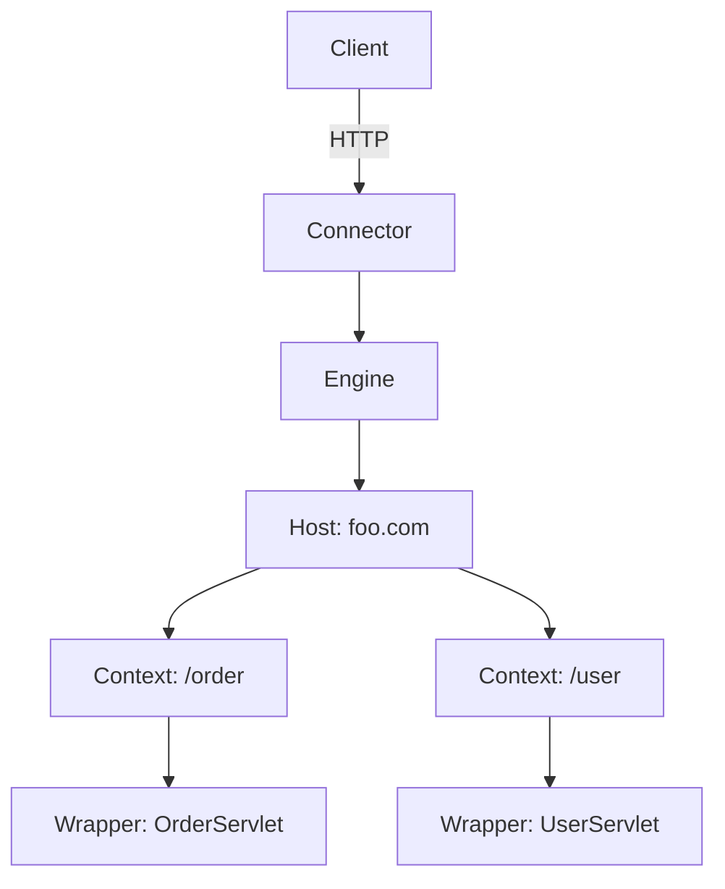
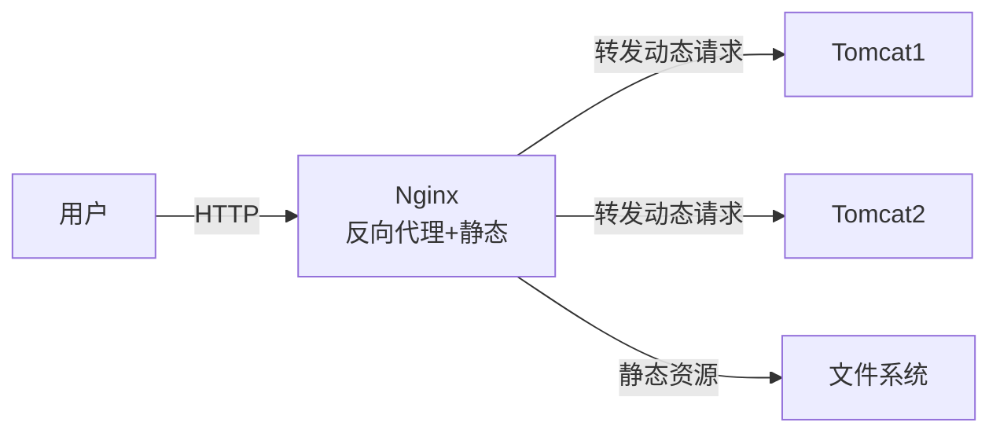
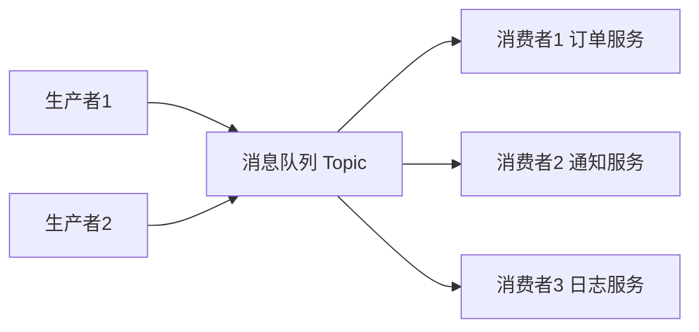
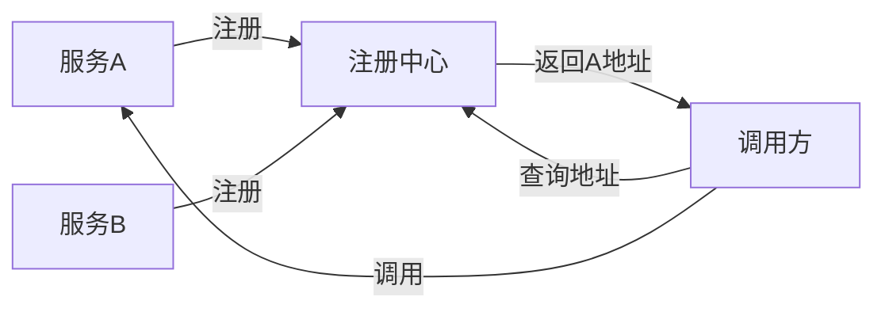

# 中间件

> 中间件是介于“应用程序”和“操作系统/网络”之间的软件，提供消息传递、缓存、路由、配置、Web 容器等通用能力，让业务代码不必重复造轮子。它解决了分布式系统中各部分如何高效协作的问题。

**关键词**：中间件、消息队列、缓存、API网关、Web容器、Tomcat、解耦、分布式

## 抽象类比

中间件就像“快递中转站”：发件人和收件人不需要直接见面，包裹统一送到中转站分拣、暂存、派送。中间件让分布式系统的各部分像快递一样高效协作——业务代码只管“寄”和“收”，中间件负责中间所有的事。

## 一、中间件的定义与分类

### 定义

- 独立于业务之外的通用服务软件
- 上承应用、下接系统/网络，屏蔽底层细节
- 提供"开箱即用"的能力，减少重复开发

### 常见分类

- Web 容器/应用服务器：Tomcat、Jetty、Undertow、WildFly
- 消息中间件：Kafka、RabbitMQ、RocketMQ
- 缓存中间件：Redis、Memcached
- API 网关：Nginx、Kong、APISIX
- 服务注册与发现：Nacos、Consul、Eureka
- 配置中心：Nacos、Apollo
- 数据库中间件：ShardingSphere、MyCat

## 二、Web 容器与应用服务器

Web 容器是运行 Web 应用的"运行时壳子"，负责接收 HTTP 请求、管理 Servlet 生命周期、调度请求到业务代码。在 Java 体系中尤其重要——Java Web 应用不能独立运行，必须部署到 Web 容器中。

### 类比：餐厅服务员与后厨

- 顾客（HTTP 请求）不直接进后厨，由服务员（Web 容器）接待
- 服务员负责带位、点单、传菜、收桌（连接管理、请求路由、生命周期管理）
- 后厨（业务代码 / Servlet）只管做菜，不用管接待流程
- 服务员可以同时接待多桌客人（多线程处理并发请求）

### Web 容器 vs 应用服务器

两者容易混淆，但有差别：

- Web 容器：只支持 Servlet/JSP 规范，轻量。代表：Tomcat、Jetty、Undertow
- 应用服务器：支持完整 Java EE/Jakarta EE 规范（EJB、JMS、JTA 等），重量级。代表：WildFly、WebLogic、WebSphere、GlassFish
- 实际：互联网公司多用 Web 容器 + Spring Boot 自带嵌入式的方案，几乎不用完整应用服务器

### 主流产品

- Tomcat：Apache 出品，Java Web 容器事实标准，Spring Boot 默认嵌入式容器
- Jetty：更轻量、启动快，适合嵌入到应用中
- Undertow：JBOSS 出品，高性能、低内存，Spring Boot 可选替代 Tomcat
- WildFly：原 JBOSS AS，Red Hat 维护，完整 Jakarta EE 实现
- Netty：严格说不是 Web 容器，而是异步事件驱动的网络框架，常用于自定义协议、网关、RPC

### Tomcat 的核心结构

Tomcat 是 Java Web 容器的代表，理解它的结构有助于排查线上问题。

- Connector：负责接收请求（HTTP、AJP、HTTPS），不同协议对应不同 Connector
- Container：负责处理请求，由 Engine → Host → Context → Wrapper 层层嵌套
- Engine：全局引擎，可包含多个 Host
- Host：虚拟主机，对应一个域名
- Context：一个 Web 应用，对应一个 war 包
- Wrapper：一个 Servlet 实例

### Tomcat 的并发模型

Tomcat 通过线程池处理并发请求，不同协议对应不同的 Endpoint：

- BIO（已废弃）：一个请求一个线程，阻塞 IO，并发能力弱
- NIO：基于 Java NIO，多路复用，少量线程处理大量连接（Tomcat 8.5+ 默认）
- APR：调用本地 Apache Portable Runtime，性能接近原生 C，需装 native 库

关键参数调优：

- maxConnections：最大连接数，超过则排队或拒绝
- maxThreads：最大工作线程数，决定同时能处理多少请求
- acceptCount：等待队列长度，连接满后再排多少
- minSpareThreads：最小空闲线程，避免冷启动延迟

### Tomcat vs Nginx

经常被一起比较，但定位不同：

- Nginx：Web 服务器/反向代理，擅长静态资源、负载均衡、SSL 卸载，不能跑 Java 应用
- Tomcat：Web 容器，专门跑 Java Web 应用，处理动态请求
- 典型架构：Nginx 在前做反向代理 + 静态资源，Tomcat 在后跑业务代码

### Spring Boot 内嵌 Tomcat

Spring Boot 把 Tomcat 打包成 jar 内嵌运行，开发者无需单独部署 Tomcat 实例：

- 优点：开箱即用、部署简单、可执行 jar 一键启动
- 缺点：每个应用一个 Tomcat 实例，资源占用稍多
- 替换：可以通过 `spring-boot-starter-undertow` 或 `spring-boot-starter-jetty` 换成其他容器

## 三、消息队列（MQ）

消息队列用于在进程/服务间异步传递消息，是事件驱动架构的核心载体。

### 类比：邮局排队

- 你寄信时不用管收件人现在在不在线，邮局会暂存并派送
- 信件按地址分类投递，发件人和收件人完全解耦
- 高峰期信件可堆在邮局，避免收件人被"挤爆"

### 主流产品

- Kafka：高吞吐、日志/数据流场景首选
- RabbitMQ：路由灵活、协议完善，适合业务消息
- RocketMQ：阿里出品，事务消息支持好

### 发布订阅模式

- 生产者把消息发到 Topic/Exchange，不直接发给消费者
- 多个消费者订阅同一 Topic，各取所需
- 一条消息可被多个消费者独立处理（一对多）

### Mermaid 图

### 应用场景

- 解耦：上游不依赖下游具体实现
- 削峰：高并发请求先入队列，下游按自己节奏消费
- 异步：发完消息即返回，不等耗时操作完成

## 四、缓存中间件

缓存用于把"热点数据"放在内存中，避免每次都查数据库，大幅提升读取速度。

### 类比：冰箱 vs 菜市场

- 菜市场 = 数据库：东西全但每次跑一趟慢
- 冰箱 = 缓存：常用的东西放家里，取用快
- 冰箱容量有限，要定期清理过期食物

### 主流产品

- Redis：单线程模型、数据结构丰富、持久化支持
- Memcached：简单 KV、纯内存、多线程

### 常见缓存策略

- Cache Aside（旁路缓存）：读时先查缓存，未命中再查库并回写；写时先更库再删缓存
- Write Through（直写）：写时同时更新缓存和数据库，由缓存组件同步
- Write Behind：写时只更新缓存，异步刷库（性能高但有丢失风险）

### 常见问题

- 缓存穿透：查询不存在的数据，每次都打穿到数据库 → 用布隆过滤器或缓存空值
- 缓存击穿：单个热 key 过期瞬间，大量请求直冲数据库 → 加互斥锁或永不过期
- 缓存雪崩：大量 key 同时失效，请求全打向数据库 → 过期时间加随机值、多级缓存

## 五、API 网关

API 网关是系统对外的"统一入口"，把鉴权、限流、路由等横切关注点集中处理。

### 类比：公司前台

- 外部访客先到前台，不能直接闯进办公室
- 前台负责登记、指引、拦住不速之客
- 访客只看到"前台"这一个入口，不用记各部门位置

### 核心职责

- 路由：把请求分发到对应后端服务
- 鉴权：校验身份和权限
- 限流：防止恶意流量压垮系统
- 熔断：下游异常时主动失败，避免级联雪崩
- 日志监控：统一记录请求

### 主流产品

- Nginx：高性能 Web/反向代理，搭配 Lua 可扩展
- Kong：基于 OpenResty，插件丰富
- APISIX：国产、动态路由、性能强

## 六、服务注册与发现

在微服务中，服务实例动态增减，调用方不能写死 IP。注册中心负责"登记地址、查询地址"。

### 类比：电话簿

- 每个服务启动时把自己的"电话"登记到电话簿
- 调用方需要联系某服务时，先查电话簿拿到地址
- 服务挂了，电话簿自动剔除其号码

### 主流产品

- Nacos：阿里出品，注册+配置一体
- Consul：HashiCorp 出品，支持健康检查
- Eureka：Netflix 出品，AP 模型，已进入维护期

### Mermaid 图

## 七、配置中心

配置中心统一管理多环境、多应用的配置，支持动态刷新，避免改配置就要重启。

### 类比：统一设置面板

- 一台机器配置改一处就要逐台登录很麻烦
- 配置中心像"统一设置面板"，一处修改、处处生效
- 还能灰度发布、版本回滚

### 主流产品

- Nacos：与注册中心共用一套，省心
- Apollo：携程开源，权限管理完善
- Spring Cloud Config：基于 Git，简单易用

## 八、数据库中间件

数据库中间件用于解决单库单表数据量过大的问题，主要做"分库分表"和读写分离。

### 类比：图书馆分区

- 一个图书馆装不下书，就分多个分馆
- 文学类去 A 馆，理工类去 B 馆，按规则分流
- 借书时先查目录确定在哪馆，再去取

### 主流产品

- ShardingSphere：Apache 顶级项目，支持分片/读写分离/加密
- MyCat：早期流行，纯代理模式

### 关键能力

- 分片：按字段把数据拆到多个库/表
- 读写分离：主库写、从库读
- 分布式事务：跨库事务的弱保证

## 九、常见中间件对比与选型

- Java Web 应用运行环境 → Tomcat（默认） / Undertow（高性能）
- 嵌入式 Web 容器、轻量场景 → Jetty
- 高吞吐日志/数据流 → Kafka
- 复杂路由的业务消息 → RabbitMQ / RocketMQ
- 热点数据缓存、丰富数据结构 → Redis
- 纯 KV 简单缓存 → Memcached
- 统一入口 + 鉴权限流 → Kong / APISIX
- 注册 + 配置一体化 → Nacos
- 配置权限要求高 → Apollo
- 单库数据爆炸 → ShardingSphere

## 面试速答

### Q1：为什么用消息队列？

- 解耦：上游不感知下游变化
- 削峰：高峰请求入队列，下游平稳消费
- 异步：耗时操作异步化，提升响应速度
- 代价：系统复杂度上升、可能丢消息、增加延迟

### Q2：缓存穿透怎么解决？

- 现象：查询根本不存在的数据，缓存永远不命中
- 方案一：缓存空值（短过期）
- 方案二：布隆过滤器拦截非法 key
- 方案三：接口层做参数校验

### Q3：API 网关的作用？

- 统一入口，屏蔽后端服务细节
- 集中鉴权、限流、熔断、监控
- 让后端服务只关心业务，不用重复处理横切逻辑

### Q4：Tomcat 和 Nginx 有什么区别？能互相替代吗？

- 定位不同：Tomcat 是 Web 容器，跑 Java 应用（动态请求）；Nginx 是 Web 服务器/反向代理，擅长静态资源和负载均衡
- 不能完全替代：动态请求 Tomcat 强，静态资源 Nginx 强
- 实际架构：常见"Nginx + Tomcat"组合——Nginx 在前做反向代理、SSL 卸载、静态资源，把动态请求转发到后端 Tomcat 集群

### Q5：Spring Boot 为什么要内嵌 Tomcat？

- 开箱即用：开发者不需要单独装 Tomcat，jar 包直接跑
- 部署简化：一个可执行 jar 即一个完整服务，契合容器化（Docker）部署
- 运维统一：所有微服务实例结构一致，便于自动化
- 代价：每个应用一份 Tomcat 实例，资源占用稍高，但微服务场景下可接受

