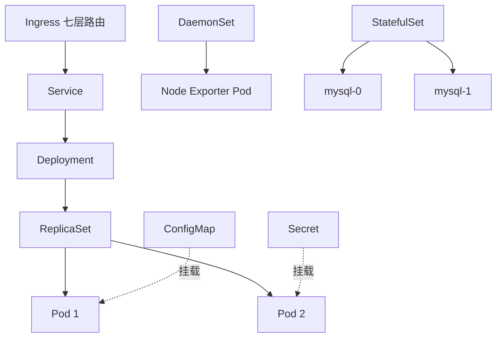
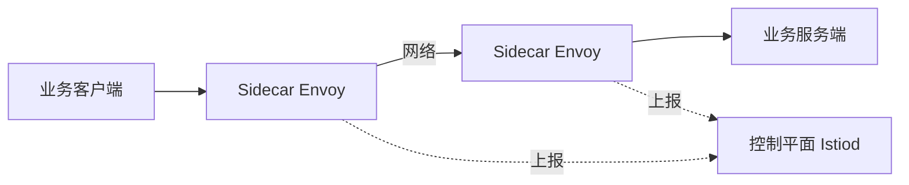
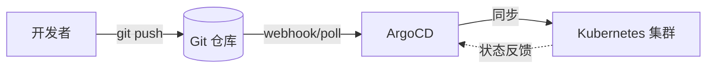
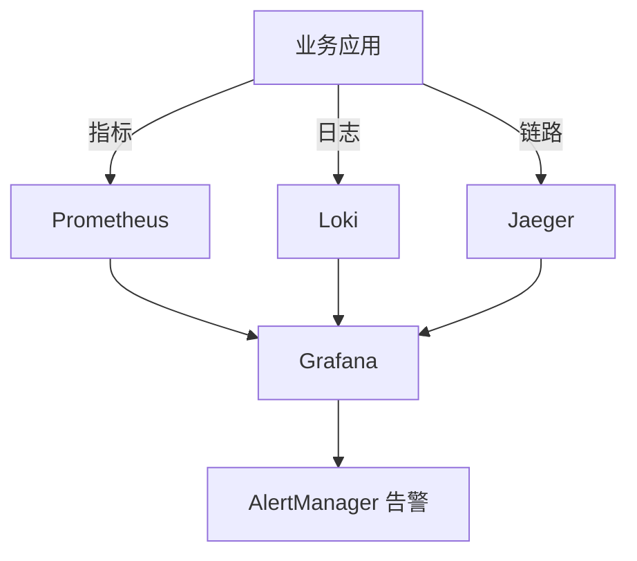
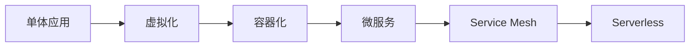

# 云原生架构

> 云原生架构是一套让应用"生于云、长于云"的方法论，通过容器、微服务、声明式 API、不可变基础设施等手段，构建弹性、可观测、松耦合的现代系统。

**关键词**：云原生、容器化、Kubernetes、服务网格、不可变基础设施

## 抽象类比

云原生就像"现代农业"——传统种地（单体应用）一户一块田，遇旱遇涝只能自己扛；现代农业（云原生）用温室大棚（容器）、自动化灌溉系统（Kubernetes）、农技服务站（服务网格），把种植、灌溉、施肥标准化、自动化，遇到灾害可快速迁移到另一片大棚继续生产。应用不再"绑死"在某台机器上，而是作为可移植的工作负载在云上自由调度。

另一层类比是"乐高积木"——传统应用是一整块注塑成型的大玩具，拆装困难；云原生应用由一个个标准化小积木（容器）拼装，可替换、可复用、可弹性伸缩，需要时多拼几块、不需要时拆掉几块即可。

## 一、云原生是什么

"云原生"由 Pivotal 的 Matt Stine 于 2013 年提出，后由 CNCF（Cloud Native Computing Foundation）正式定义。它不是某一项技术，而是一套构建与运行应用的方法论。

### CNCF 定义

云原生技术栈包含：

- 容器（Container）
- 服务网格（Service Mesh）
- 微服务（Microservices）
- 不可变基础设施（Immutable Infrastructure）
- 声明式 API（Declarative API）

### 12 因素应用

12-Factor App 由 Heroku 提出，是云原生应用的"行为准则"：

- 代码库：一份代码库，多份部署
- 依赖：显式声明依赖
- 配置：环境变量存储配置
- 后端服务：把后端视为可附加资源
- 构建/发布/运行：三个阶段严格分离
- 进程：应用作为无状态进程运行
- 端口绑定：通过端口绑定提供服务
- 并发：通过进程水平扩展
- 易处理：快速启动、优雅终止
- 开发生产等价：尽量缩小各环境差异
- 日志：作为事件流处理
- 管理进程：与管理任务一致运行

### 云原生 vs 传统上云

- 传统上云：把虚拟机当物理机用，应用直接部署到 ECS，运维方式不变
- 云原生：应用从设计就考虑弹性、可观测、声明式配置，发挥云的弹性能力
- 区别核心：是否利用云的弹性、自动化、可观测能力

## 二、容器化

容器是云原生的"标准件"，让应用与运行环境一起打包、随处运行。

### Docker 原理

- 基于 Linux Namespace 实现进程隔离（PID、Network、Mount、UTS、IPC、User）
- 基于 Cgroups 实现资源限制（CPU、内存、IO）
- 基于 UnionFS（联合文件系统）实现镜像分层
- 与虚拟机对比：容器共享宿主内核、启动秒级、资源开销小

### 镜像（Image）

- 只读分层模板，包含应用代码与运行时
- 通过 Dockerfile 构建：`FROM → RUN → COPY → CMD`
- 镜像 ID 由内容哈希决定，不可变

### 容器运行时（Container Runtime）

- 高层运行时：Docker Engine、containerd、CRI-O（负责容器生命周期）
- 低层运行时：runc、kata-runtime（负责真正创建与运行容器）
- Kubernetes 1.24 起弃用 Docker，默认使用 containerd

### 镜像仓库（Registry）

- 公有：Docker Hub、Quay、GitHub Container Registry
- 私有：Harbor、Nexus、阿里云 ACR
- 镜像格式：`registry/repository:tag`，如 `registry.cn-hangzhou.aliyuncs.com/myapp/api:v1`

## 三、容器编排：Kubernetes

Kubernetes（K8s）是云原生的"操作系统"，负责容器的部署、调度、扩缩容与故障恢复。

### Pod

- K8s 最小调度单位，包含一个或多个紧密耦合的容器
- 同一 Pod 内容器共享网络与存储命名空间
- Pod 是临时的，IP 会变化，需通过 Service 访问

### Deployment

- 管理 Pod 的副本集（ReplicaSet），保证期望副本数
- 支持滚动更新与回滚
- 无状态应用首选

### Service

- 为一组 Pod 提供稳定的访问入口（ClusterIP、NodePort、LoadBalancer、ExternalName）
- 通过 Label Selector 关联 Pod
- 解决 Pod IP 不稳定的问题

### Ingress

- 七层路由入口，把 HTTP/HTTPS 流量路由到 Service
- 常用实现：Nginx Ingress、Traefik、Istio Gateway
- 支持 TLS 终结、虚拟主机、路径路由

### ConfigMap 与 Secret

- ConfigMap：存储非敏感配置（如日志级别、特性开关）
- Secret：存储敏感信息（如数据库密码、TLS 证书），Base64 编码
- 二者均可作为环境变量或 Volume 挂载到 Pod

### StatefulSet

- 管理有状态应用，提供稳定网络标识与持久存储
- Pod 名按序生成（如 `mysql-0`、`mysql-1`）
- 适用于数据库、消息队列、分布式存储

### DaemonSet

- 在每个节点运行一个 Pod 副本
- 常用于日志采集（Filebeat）、监控代理（Node Exporter）、网络插件（Calico）

### Job 与 CronJob

- Job：运行一次性任务，正常完成后退出
- CronJob：定时任务，按 Cron 表达式调度
- 适用于批处理、数据清洗、定时备份

### Mermaid 图：K8s 核心对象关系

## 四、服务网格（Service Mesh）

服务网格为微服务间通信提供透明的基础设施层，把流量治理、可观测、安全能力从应用代码中剥离。

### Sidecar 模式

- 在每个业务 Pod 中注入一个代理容器（Sidecar）
- 业务进出流量都被 Sidecar 拦截处理
- 业务代码无需感知，可使用任意语言

### 主流实现

- Istio：功能最全，基于 Envoy，Google/IBM/Lyft 主导
- Linkerd：轻量级，基于 Rust 写的 Linkerd2-proxy
- Consul Connect：HashiCorp 出品，与 Consul 集成

### 流量治理

- 流量拆分：按比例灰度（如 90% v1 / 10% v2）
- 流量镜像：把生产流量复制到测试版本
- 超时与重试：自动重试失败请求
- 故障注入：注入延迟与错误测试系统韧性

### 可观测性

- 指标（Metrics）：QPS、延迟、错误率
- 链路追踪：基于 OpenTelemetry / Jaeger
- 访问日志：每次请求的源、目的、状态

### Mermaid 图：Sidecar 流量拦截

## 五、不可变基础设施与声明式 API

### 不可变基础设施

- 服务器一旦部署就不再修改，需要变更时直接替换为新实例
- 优势：可重复、可回滚、避免配置漂移
- 容器与镜像天然符合这一理念

### 基础设施即代码（IaC）

- 用代码描述基础设施，版本化、可审查
- 主流工具：
  - Terraform：多云资源管理，HashiCorp Configuration Language（HCL）
  - Pulumi：用真实编程语言（TS/Python/Go）描述基础设施
  - AWS CloudFormation：AWS 原生
  - Ansible：偏配置管理，过程式

### 声明式 API

- 描述"想要什么状态"，而非"怎么做"
- K8s 控制器持续调谐（Reconcile），使实际状态趋近期望状态
- 优势：幂等、可自愈、易于 GitOps

### GitOps

- 把 Git 作为"单一可信源"（Single Source of Truth）
- 应用与基础设施配置都存在 Git 仓库
- 自动同步 Git 状态到集群
- 主流工具：ArgoCD、FluxCD

### Mermaid 图：GitOps 工作流

## 六、Serverless 与 FaaS

Serverless 让开发者只关心业务代码，无需管理服务器，按需付费、自动伸缩。

### FaaS（Function as a Service）

- 以函数为部署单位，事件触发执行
- 主流产品：AWS Lambda、Azure Functions、阿里云函数计算
- 计费按调用次数与执行时长，无流量不付费

### Knative

- 基于 K8s 的 Serverless 框架，Google 主导
- 分为 Serving（请求驱动）与 Eventing（事件驱动）
- 可在自建 K8s 上实现 Lambda 式体验

### 冷启动（Cold Start）

- 函数长时间未调用后，首次调用需重新拉起容器，延迟较高
- 优化手段：预留实例、预热、轻量运行时、SnapStart
- 不适合长连接、低延迟场景

### Serverless 适用场景

- 事件驱动：OSS 上传触发图片处理
- 定时任务：Cron 触发数据清洗
- 流量波动大：突发流量自动扩缩，按需付费
- Webhook 处理、ETL 流水线

### 局限性

- 冷启动延迟
- 函数执行时长上限（如 Lambda 15 分钟）
- 状态管理需依赖外部存储
- 厂商绑定风险高

## 七、云原生可观测性

可观测性是云原生的"眼睛"，由三支柱组成。

### 三支柱

- 指标（Metrics）：聚合数值，如 QPS、延迟分位、错误率
- 日志（Logs）：离散事件文本，记录运行时细节
- 链路（Traces）：跨服务调用链，定位瓶颈

### Prometheus 监控

- 时序数据库，按 metric name + label 查询
- 多维度数据模型，使用 PromQL 查询
- Pull 模式主动抓取指标，也支持 Pushgateway
- 已成为云原生监控事实标准

### Grafana 可视化

- 通用可视化面板，支持 Prometheus、Loki、Jaeger 等数据源
- 提供告警、仪表盘模板市场
- 与 Prometheus 组合是云原生监控"黄金搭档"

### Jaeger 链路追踪

- 实现 OpenTelemetry 标准，记录跨服务调用链
- 通过 TraceID 串联多个 Span，定位慢调用与错误
- 与 Istio 集成可自动收集网格内流量

### Loki 日志

- Grafana 出品，"类似 Prometheus 的日志系统"
- 只索引标签，日志原文存对象存储，成本低
- 与 Grafana 深度集成，可在面板中直接关联日志

### Mermaid 图：可观测性三支柱

## 八、云原生的典型架构演进

### 演进路径

- 单体应用：所有功能打成一个 WAR/JAR，部署在物理机或虚拟机
- 虚拟化：用 VM 隔离应用，提升资源利用率，但启动慢、镜像大
- 容器化：用容器替代 VM，秒级启动、镜像分层共享
- 微服务：按业务拆分服务，独立部署、独立扩展
- Service Mesh：把流量治理从代码剥离到 Sidecar
- Serverless：进一步抽象，按需运行、按需付费

### 演进对比

- 部署粒度：单体 → VM → 容器 → 函数
- 运维方式：手工 → 脚本 → IaC → GitOps
- 弹性能力：固定容量 → 人工扩容 → 自动扩缩 → 按需伸缩
- 可观测性：日志查看 → 指标面板 → 三支柱融合

### Mermaid 图：架构演进

### 演进建议

- 不要"一步到位"跳到 Serverless，按业务规模逐步演进
- 容器化是云原生的"地基"，应优先落地
- 微服务拆分参考 [[领域驱动设计]] 中的限界上下文
- 服务网格引入前评估 Sidecar 资源开销与运维成本

## 面试速答

### Q1：云原生的核心特征是什么？与传统上云有什么区别？

- CNCF 定义：容器、服务网格、微服务、不可变基础设施、声明式 API
- 传统上云：把应用搬到 ECS，运维方式不变
- 云原生：从设计就考虑弹性、可观测、声明式，发挥云的能力
- 核心区别：是否利用云的弹性、自动化与可观测能力

### Q2：K8s 中 Deployment、StatefulSet、DaemonSet 有何区别？

- Deployment：管理无状态应用，Pod 名随机、可任意替换，支持滚动更新
- StatefulSet：管理有状态应用，Pod 名有序、网络标识稳定、独立持久存储
- DaemonSet：每个节点运行一个副本，常用于日志采集与监控代理

### Q3：Service Mesh 解决什么问题？为什么用 Sidecar？

- 把流量治理、可观测、安全能力从应用代码剥离到基础设施层
- Sidecar 与业务容器同 Pod，透明拦截进出流量
- 业务无需感知，可用任意语言开发
- 代价：每个 Pod 多一个代理容器，有资源开销与延迟

### Q4：什么是 GitOps？与 CI/CD 有何区别？

- GitOps 把 Git 作为单一可信源，应用与基础设施配置都在 Git
- 自动同步 Git 状态到集群，所有变更可审计可回滚
- CI/CD 关注"如何构建与推送"，GitOps 关注"如何持续同步期望状态"
- 典型工具：ArgoCD、FluxCD

### Q5：Serverless 的冷启动是什么？如何优化？

- 函数长时间未调用后，首次调用需重新拉起容器，延迟较高
- 优化手段：预留实例、预热请求、轻量运行时、SnapStart 快照启动
- 不适合长连接、强低延迟场景，适合事件驱动、流量波动大的场景

## 参考链接

- [CNCF Cloud Native Definition](https://github.com/cncf/toc/blob/main/DEFINITION.md)
- [The Twelve-Factor App](https://12factor.net/)
- [Kubernetes 官方文档](https://kubernetes.io/zh-cn/docs/home/)
- [Istio 官方文档](https://istio.io/latest/zh/docs/)
- 相关文档：[[Docker]]、[[分布式系统]]、[[架构模式]]、[[领域驱动设计]]、[[高可用架构]]

---

## 理解与验证闭环

- **关键连接**：容器提供交付单元，编排提供期望状态，声明式配置和可观测性支撑持续演进。
- **最小验证**：把一个服务容器化，设置资源请求/限制、探针、配置、滚动更新和回滚验证。
- **取舍边界**：上 Kubernetes 不等于云原生；团队规模、运维能力和故障半径决定是否值得。

复习时先画出核心对象和数据流，再用一个反例解释边界，最后用实验数据或可观察证据校正直觉。
