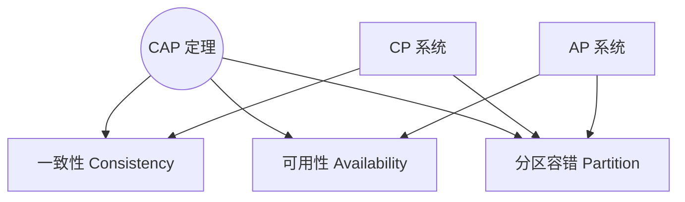
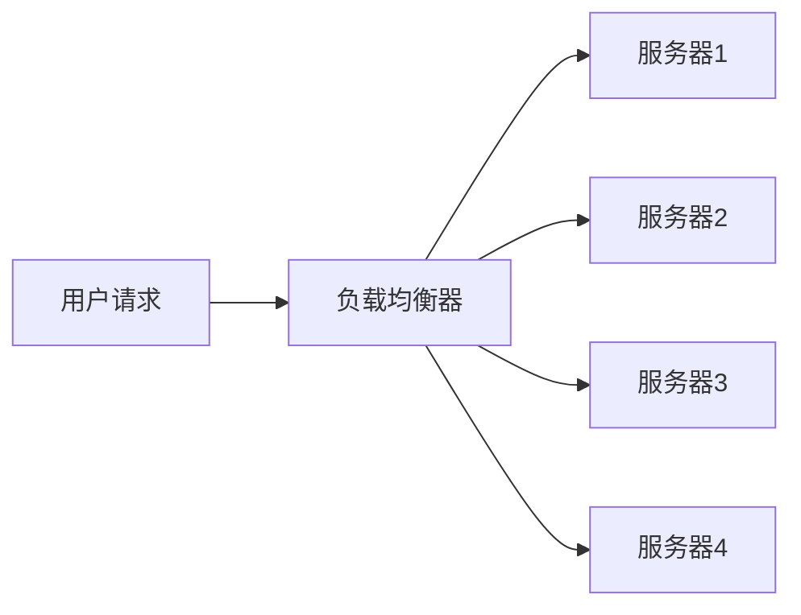
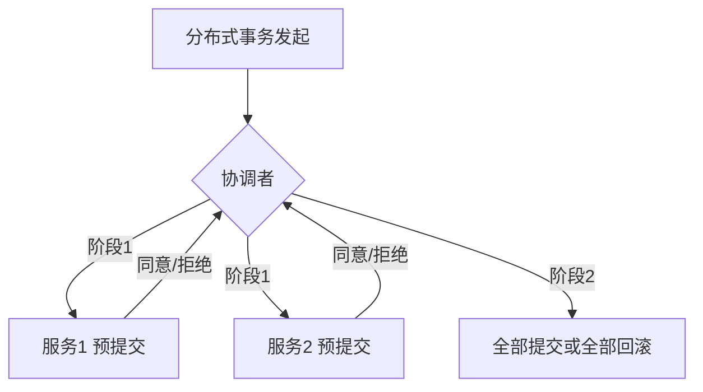

# 分布式系统

> 分布式系统是由多台独立机器通过网络协作、对外呈现为“一台机器”的系统。它解决了单机的计算、存储、可用性和扩展性瓶颈，是现代互联网的基石。本文讲清楚分布式系统的核心理论（CAP/BASE）、关键技术和常见挑战。

**关键词**：分布式系统、CAP、一致性、负载均衡、可用性、扩展性

## 抽象类比

分布式系统就像“多人协作搬砖”：一个人搬不完的砖，几个人分工合作，谁累了换人顶上，整体看起来像一支高效的搬运队伍。分布式系统让计算和存储能横向扩展——加机器就能加能力，但代价是引入了网络延迟、数据一致性等复杂问题。

## 一、为什么需要分布式

单机的能力有天花板，分布式系统主要解决三大瓶颈：

- 计算瓶颈：单 CPU 算力不够，需要多机并行
- 存储瓶颈：单机磁盘装不下，需要分散存储
- 可用性瓶颈：单机宕机服务就停，需要多机容错
- 扩展瓶颈：单机升级成本指数上升，加机器更便宜
- 地域瓶颈：用户遍布全球，需要就近部署

## 二、CAP 定理

CAP 是分布式系统的"宪法"：一个分布式系统最多只能同时满足三者中的两个。

### 三个性质

- C（Consistency 一致性）：所有节点同一时刻数据一致
- A（Availability 可用性）：每次请求都有响应（不保证是最新数据）
- P（Partition Tolerance 分区容错）：网络分区时系统仍能工作

### 类比：三角只能选两边

- 假设三角形的三个角是 C、A、P
- 网络一定会分区（P 必选），所以实际是 CP vs AP
- 三者不能全占，必须取舍

### Mermaid 图

### 取舍选择

- 强一致场景（金融、库存） → CP
- 高可用场景（社交、内容） → AP

## 三、BASE 理论

BASE 是 CAP 在工程中的实践版，是"AP 优先 + 最终一致"的思路。

- 基本可用（Basically Available）：故障时允许损失部分可用性（如响应变慢、降级页面）
- 软状态（Soft State）：允许中间状态存在，不要求每时每刻一致
- 最终一致（Eventually Consistent）：系统保证最终达到一致，但需要时间

## 四、一致性模型

不同业务对一致性要求不同，需要选择合适的模型。

### 类比：开会同步 vs 异步通知

- 强一致：所有人当场开会确认，慢但准
- 弱一致：发完通知不等所有人确认，立刻返回
- 最终一致：保证最后大家都收到，但中间可能短暂不一致

### 三种模型

- 强一致性：写入后立刻所有节点都能读到最新值
- 弱一致性：写入后不保证立刻能读到最新值
- 最终一致性：弱一致性的特例，保证最终会一致

## 五、负载均衡

负载均衡把请求分发到多台机器，避免单机过载，是分布式系统的"调度员"。

### 三层负载

- LVS：工作在内核层（四层），性能极高
- Nginx：工作在应用层（七层），灵活强大
- 客户端负载：调用方自己从注册中心拿地址并选择（如 Ribbon）

### 常见算法

- 轮询：依次分配，简单公平
- 加权轮询：按机器性能分配不同权重
- 最少连接：优先发给当前连接数最少的机器
- 一致性哈希：相同请求固定打到同一节点，便于缓存命中
- 随机：实现简单，量大时近似均匀

### Mermaid 图

## 六、分布式存储

单机存不下时，需要把数据分散到多台机器。

### 类比：图书馆分馆

- 一个图书馆装不下书，就开分馆
- 不同类别的书放在不同分馆（分片）
- 同一本书可以备几本放在不同分馆（副本）
- 一个分馆临时闭馆，其他分馆还能借（高可用）

### 三个核心概念

- 分片（Sharding）：按规则把数据拆到多个节点
- 副本（Replica）：同一份数据存多份，保证可用性
- 分区（Partition）：逻辑上的数据划分单元

## 七、分布式事务

跨多个服务/数据库的事务，不能用单机事务的 ACID，需要专门方案。

### 常见方案

- 2PC（两阶段提交）：协调者先问"能提交吗"，再统一下令"提交"
- 3PC：在 2PC 基础上加"预提交"阶段，减少阻塞
- TCC（Try-Confirm-Cancel）：业务层补偿，每个操作要写 Try/Confirm/Cancel 三步
- Saga：把长事务拆成多个子事务，失败时按反序补偿
- 本地消息表：业务库+消息表同事务写，后台异步发消息保证最终一致

### Mermaid 图

### 方案对比

- 强一致 → 2PC/3PC（性能差、阻塞）
- 业务侵入小 → 本地消息表（最终一致）
- 业务可拆解 → Saga/TCC（最终一致，开发成本高）

## 八、分布式 ID 生成

分布式系统中每条数据都需要全局唯一 ID，单机自增不再适用。

### 常见方案

- UUID：本地生成、无中心，但长且无序，索引友好度差
- 雪花算法（Snowflake）：时间戳+机器号+序列号，有序且性能高
- 号段模式：数据库批量发号，本地消费一段后再次申请

### 雪花算法结构

- 1 位符号位（固定 0）
- 41 位时间戳（可用约 69 年）
- 10 位机器号（最多 1024 台机器）
- 12 位序列号（同毫秒内最多 4096 个）

## 九、常见挑战

- 网络延迟：跨机器调用必然慢于本地，要尽量减少调用次数
- 网络分区：网络抖动导致节点间不可达，要靠 CAP 取舍
- 脑裂：集群分裂成两个子集群各自选主，需仲裁机制
- 时钟同步：不同机器时钟不同步，影响日志排序和超时判断
- 数据一致性：副本之间数据可能短暂不一致，需要一致性协议
- 部分失败：节点可能"半死不活"，比完全宕机更难处理

## 面试速答

### Q1：CAP 怎么选？

- 网络分区一定发生（P 必选），所以是 CP 与 AP 之间选
- 资金、库存等强一致场景 → CP（如 ZooKeeper、HBase）
- 互联网应用、社交内容等高可用场景 → AP（如 Eureka、Cassandra）
- 实际工程多用"AP + 最终一致"

### Q2：分布式事务怎么实现？

- 强一致：2PC/3PC，性能差，少用
- 最终一致优先：本地消息表、事务消息（RocketMQ）
- 业务可补偿：TCC、Saga
- 选型看一致性要求和开发成本

### Q3：负载均衡算法有哪些？

- 轮询 / 加权轮询：简单公平
- 最少连接：按负载动态分配
- 一致性哈希：相同请求固定节点，缓存友好
- 随机：实现简单
- 实际常组合使用，如"加权轮询 + 健康检查"

---

## 理解与验证闭环

- **关键连接**：复制提升可用性却带来一致性问题；分区发生时必须在可用性和一致性之间做业务选择。
- **最小验证**：实现或模拟主从复制，注入延迟、重复、乱序与节点故障，观察读写语义。
- **取舍边界**：超时不是失败证明，重试会制造重复；幂等、去重和可观测的状态机是基本功。

复习时先画出核心对象和数据流，再用一个反例解释边界，最后用实验数据或可观察证据校正直觉。
