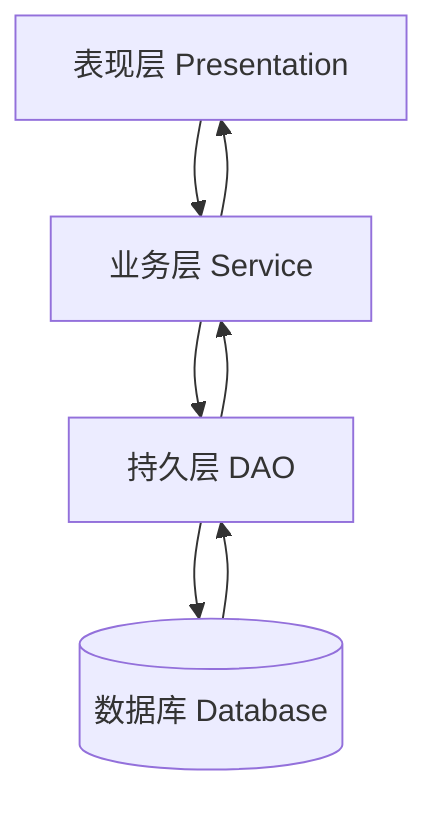
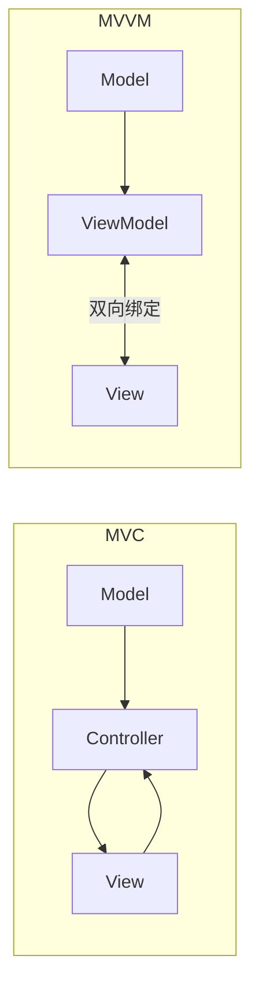
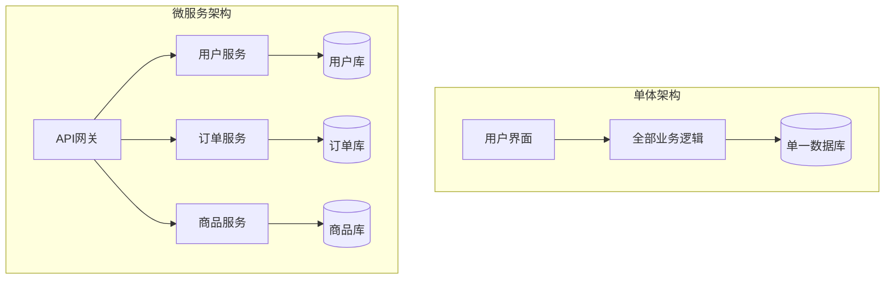
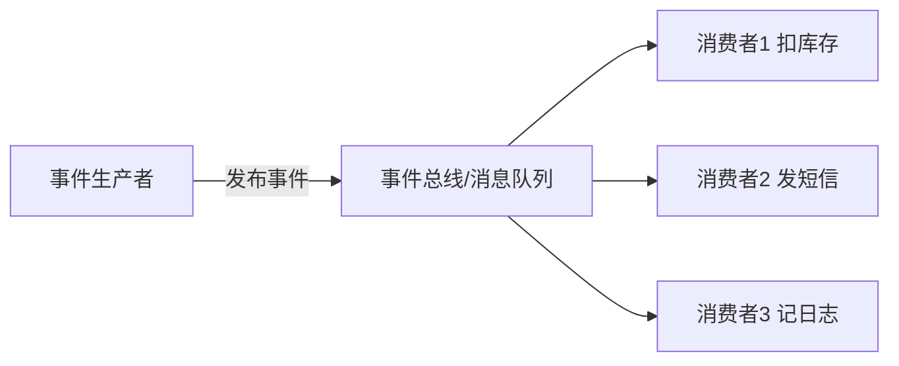
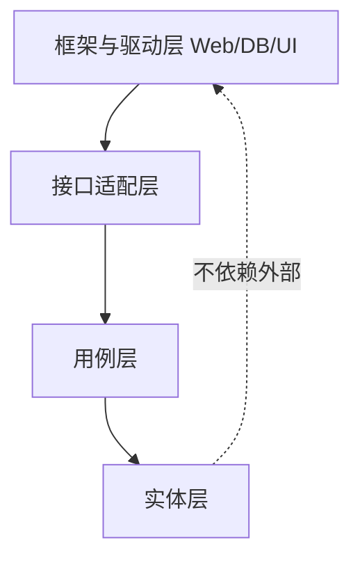

# 架构模式

> 架构模式是软件设计的“骨架蓝图”，规定了系统各部分如何组织、如何协作。它决定了代码的“分层与流向”，选对架构模式系统更易扩展、维护和测试。

**关键词**：架构模式、分层架构、微服务、MVC、MVVM、解耦

## 抽象类比

架构模式就像“建筑图纸风格”——盖别墅、盖写字楼、盖商场用的图纸风格完全不同，选错风格后改起来代价巨大。软件也一样：小型工具用分层架构最简单，大型互联网系统用微服务更灵活。架构模式不直接写出代码，但决定了代码的“分层与流向”，选错则步步艰难、改一处动全身。

## 一、分层架构（Layered）

分层架构是最经典也最常见的架构，把系统按职责拆成若干"层"，每层只与相邻层通信。

### 类比：公司部门分层

- 一家公司分"前台接待 → 业务部门 → 财务部门 → 银行账户"
- 前台不会直接动银行账户，要经业务部门和财务层层传达
- 每层只关心自己的事，下层不依赖上层

### 典型四层

- 表现层（Presentation/UI）：与用户交互，比如网页、App 界面
- 业务层（Business/Service）：核心逻辑，比如"下单""扣库存"
- 持久层（Persistence/DAO）：封装数据库访问
- 数据库层（Database）：MySQL/PostgreSQL 等存储

### Mermaid 图

## 二、MVC 与 MVVM

MVC 和 MVVM 都是关注 UI 与逻辑分离的架构模式，常见于 Web 和移动端开发。

### 类比：舞台剧分工

- Model 是"剧本内容"：剧情、台词
- View 是"舞台布景"：观众看到的画面
- Controller/ViewModel 是"导演"：根据剧本指挥布景怎么变

### MVC：Model-View-Controller

- Model：数据和业务逻辑
- View：界面展示
- Controller：接收用户输入，调用 Model，更新 View
- 特点：Controller 是核心，View 直接引用 Model

### MVVM：Model-View-ViewModel

- Model：数据
- View：界面
- ViewModel：抽象的视图模型，通过双向绑定与 View 同步
- 特点：View 与 ViewModel 双向绑定，ViewModel 不直接操作 View

### Mermaid 图

## 三、微服务架构

微服务把一个大单体拆成多个独立部署的小服务，每个服务有自己的数据库和边界。

### 类比：一个大工厂 vs 多个小作坊

- 单体：一个大工厂包揽所有工序，搬机器要停整个厂
- 微服务：每个作坊专注一种工艺，互不干扰，升级一个作坊不影响其他

### 单体 vs 微服务

- 单体优点：简单、易部署、易调试
- 单体缺点：规模大后难维护、技术栈受限、扩展只能整体扩展
- 微服务优点：独立部署、独立扩展、技术栈灵活
- 微服务缺点：运维复杂、网络开销大、分布式事务难

### Mermaid 对比图

## 四、事件驱动架构（EDA）

事件驱动架构以"事件"为核心，组件通过发布和订阅事件协作，彼此不直接调用。

### 类比：订阅公众号

- 你关注了一个公众号，不会主动打电话催更
- 公众号发文时，所有订阅者都会自动收到推送
- 发布者不关心谁订阅、订阅者也不直接找发布者

### 核心组件

- 事件生产者：发出事件（比如"用户下单"）
- 事件通道：消息队列/事件总线
- 事件消费者：处理事件（比如"扣库存""发短信"）

### Mermaid 图

### 适用场景

- 异步处理、解耦系统
- 实时通知、IoT、日志收集

## 五、Clean Architecture / 六边形架构

二者都强调"依赖倒置"：核心业务逻辑不依赖外部细节（框架、数据库、UI）。

### 类比：洋葱层层包裹

- 最里层是"洋葱心"：业务规则，最稳定、最珍贵
- 外层是"洋葱皮"：UI、数据库、框架，可以剥掉换掉
- 依赖方向永远从外指向内：外层依赖内层，内层不依赖外层

### 分层（由内到外）

- 实体层（Entities）：核心业务对象
- 用例层（Use Cases）：应用业务规则
- 接口适配层（Interface Adapters）：控制器、网关、展示器
- 框架与驱动层（Frameworks & Drivers）：Web、数据库、UI 框架

### 六边形架构（端口与适配器）

- 把应用看作一个"六边形"
- 内部是业务逻辑，外部通过"端口"与外界交互
- 每个端口可接不同的"适配器"（比如 REST 适配器、gRPC 适配器）

### Mermaid 图

## 六、架构模式选型

- 小型内部系统、团队规模小 → 分层架构（最简单）
- Web 后端 + 模板渲染 → MVC
- 前端 SPA / 移动端 → MVVM
- 大型互联网系统、需独立扩展 → 微服务
- 异步、解耦、实时通知 → 事件驱动架构
- 复杂业务、长期演进、强调可测试性 → Clean Architecture

## 面试速答

### Q1：单体架构 vs 微服务，怎么选？

- 团队小、业务简单、迭代快 → 单体优先
- 团队大、业务边界清晰、需独立扩展 → 微服务
- 不要"为了微服务而微服务"，过早拆分反而增加成本

### Q2：MVC 和 MVVM 的区别？

- MVC：Controller 主动控制 View，View 直接引用 Model
- MVVM：ViewModel 通过双向绑定自动同步 View，View 不直接依赖 ViewModel 内部
- MVVM 更适合数据驱动的前端场景

### Q3：什么时候用事件驱动架构？

- 业务流程可异步、不需同步返回结果
- 多个系统需要对同一事件做出反应（一对多）
- 希望降低系统间耦合，提高扩展性

