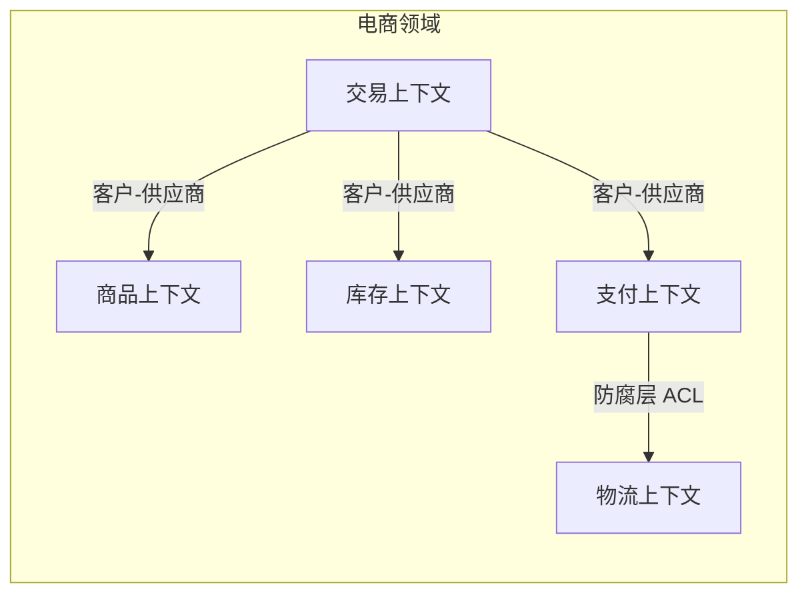
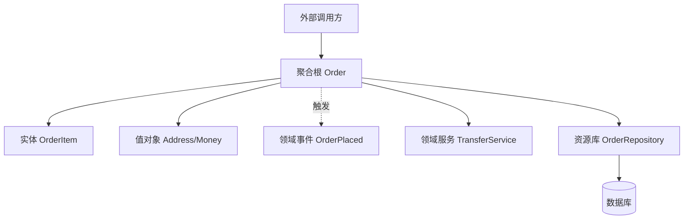
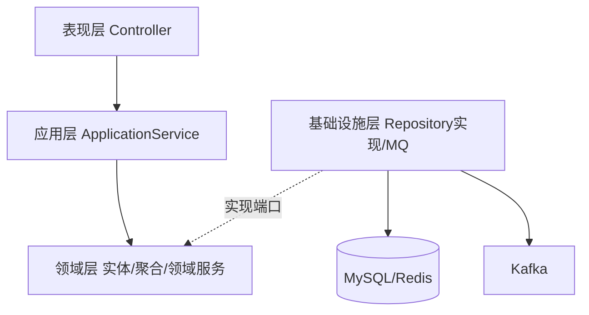
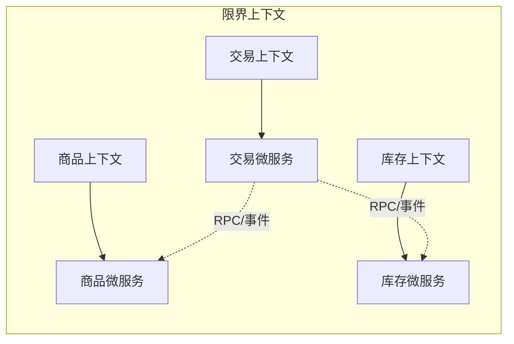

# 领域驱动设计

> 领域驱动设计（DDD）是一套用业务语言建模、用统一语言沟通、用限界上下文划界的方法论，让复杂业务系统的代码结构与业务模型保持一致。

**关键词**：领域驱动设计、限界上下文、聚合根、统一语言、充血模型

## 抽象类比

DDD 就像"城市规划"——先规划商业区、住宅区、工业区（战略设计），再规定每栋楼内部的结构和出入口（战术设计）。如果城市规划混乱，住宅区里突然冒出工厂，居民和工厂互相干扰、路网拥堵。软件也一样：先划清业务边界与协作关系，再设计每个边界内的实体与聚合，否则代码会逐渐变成"大泥球"。

另一层类比是"翻译官与建筑师"——开发与产品说同一种语言（统一语言），避免产品说"订单"、代码里写 `OrderInfo`、数据库里叫 `t_trade` 三套术语。统一语言让业务专家和工程师用同一套词汇讨论问题，减少翻译损耗。

## 一、DDD 是什么

领域驱动设计由 Eric Evans 于 2003 年在同名著作中提出，核心目标是解决复杂业务系统的建模问题。它不是框架、不是工具，而是一套"以业务为核心的软件设计方法论"。

### DDD 要解决的核心问题

- 业务复杂度高，代码与业务模型脱节
- 开发与产品各说各话，需求频繁误解
- 系统越改越乱，"一处改动、多处牵连"
- 贫血模型充斥 Service 层，业务逻辑散落各处

### DDD 的核心理念

- 业务逻辑应内聚到领域对象中（充血模型），而非散落在 Service 里（贫血模型）
- 开发与业务专家共用一套统一语言（Ubiquitous Language）
- 通过限界上下文划分模型边界，避免一个"客户"在销售、财务、仓储中含义不同却强行共用一个类
- 战略设计先行，战术设计落地

### DDD 的对立面：贫血模型

- 贫血模型：实体只有 getter/setter，业务逻辑全在 Service
- 充血模型：实体包含行为，业务逻辑内聚在领域对象中
- DDD 推崇充血模型，让对象"既封装数据、也封装行为"

## 二、战略设计

战略设计关注"大图"，回答"系统边界在哪里、子域如何划分、上下文之间如何协作"。

### 领域与子域

- 领域（Domain）：业务系统的范围，如"电商领域"
- 子域（Subdomain）：领域拆分后的小块，分为三类：
  - 核心域：企业核心竞争力，必须自研、重点投入（如电商的"交易"）
  - 支撑域：非核心但必要，可自研也可外包（如"物流")
  - 通用域：通用能力，可直接采购（如"认证授权""消息通知"）

### 限界上下文（Bounded Context）

- 一个模型只在某个边界内有效，超出边界含义可能不同
- 例：销售上下文中的"商品"关注价格与促销；仓储上下文中的"商品"关注库存与库位
- 限界上下文是 DDD 中最重要的概念之一，也是微服务拆分的核心依据

### 上下文映射（Context Map）

描述限界上下文之间的协作关系，常见关系类型：

- 合作关系（Partnership）：两个上下文团队紧密协作
- 共享内核（Shared Kernel）：共享一部分模型代码
- 客户-供应商（Customer-Supplier）：上游供应、下游消费
- 遵奉者（Conformist）：下游无条件顺从上游模型
- 防腐层（Anti-Corruption Layer, ACL）：下游建翻译层隔离上游污染
- 开放主机服务（Open Host Service, OHS）：上游开放标准协议
- 发布语言（Published Language, PL）：与 OHS 配套的共享数据格式
- 各行其道（Separate Ways）：不集成，独立实现

### Mermaid 图：电商系统的限界上下文



## 三、战术设计

战术设计关注限界上下文内部的代码结构，提供一套积木式的构建块。

### 实体（Entity）

- 有唯一标识，即使属性变化仍是同一个对象
- 例：`Order`（订单），订单号不变即同一订单，金额可改
- 强调"身份连续性"而非属性相等

### 值对象（Value Object）

- 无唯一标识，由属性定义，属性相同即相等
- 不可变（Immutable），修改即创建新实例
- 例：`Address`（地址）、`Money`（金额）
- 推荐优先使用值对象，简化测试与并发

### 聚合（Aggregate）与聚合根

- 聚合是一组相关对象的集合，对外提供一致性边界
- 聚合根是聚合的入口，外部只能通过聚合根操作聚合内对象
- 聚合内强一致，聚合间最终一致
- 设计原则：聚合尽量小、聚合间通过 ID 引用而非对象引用

例：`Order`（聚合根）包含多个 `OrderItem`（实体），`OrderItem` 不能脱离 `Order` 单独被外部访问。

### 领域服务（Domain Service）

- 当一个行为不属于任何单一实体或值对象时，封装为领域服务
- 例：转账操作涉及两个 `Account` 实体，应放在 `TransferService` 中
- 注意：领域服务 ≠ 应用服务，前者承载业务规则，后者只编排流程

### 领域事件（Domain Event）

- 描述"领域中发生过的重要事件"，用过去时命名（如 `OrderPlaced`）
- 用于解耦聚合间协作、跨上下文集成
- 通常异步发布，触发后续流程（如扣库存、发短信）

### 工厂（Factory）

- 封装复杂对象的创建逻辑，保证聚合创建时即满足不变量
- 可用工厂方法或抽象工厂实现

### 资源库（Repository）

- 对聚合根提供类似集合的持久化抽象
- 隐藏底层存储（MySQL、MongoDB、Redis）
- 接口定义在领域层，实现放在基础设施层（依赖倒置）

### Mermaid 图：战术设计积木



## 四、分层架构与六边形架构在 DDD 中的应用

DDD 不规定具体架构风格，但要求"领域层独立、不依赖框架与基础设施"。

### 传统四层架构

- 表现层（Interface）：Controller、视图，负责协议转换
- 应用层（Application）：编排领域对象完成用例，不承载业务规则
- 领域层（Domain）：实体、值对象、聚合、领域服务、领域事件
- 基础设施层（Infrastructure）：数据库、消息队列、第三方接口、Repository 实现

依赖方向：表现层 → 应用层 → 领域层 ← 基础设施层（基础设施依赖领域，反之不可）。

### 六边形架构（端口与适配器）

- 应用核心通过"端口"对外提供能力，通过"适配器"接入具体技术
- 适配器分主动适配器（Driving，如 REST Controller）与被动适配器（Driven，如 Repository 实现）
- 与 DDD 高度契合：领域层定义端口，基础设施层实现适配器

### Mermaid 图：DDD 分层依赖



## 五、贫血模型 vs 充血模型

这是 DDD 落地最具争议的话题，也是面试高频考点。

### 二者区别

- 贫血模型：实体只有字段与 getter/setter，业务逻辑全在 Service
- 充血模型：实体既有数据也有行为，Service 只做编排与事务

### 贫血模型示例

```java
// 实体：只装数据
class Order {
    private OrderStatus status;
    public OrderStatus getStatus() { return status; }
    public void setStatus(OrderStatus s) { this.status = s; }
}
// Service：装载数据与逻辑
class OrderService {
    public void pay(Order order) {
        if (order.getStatus() != WAIT_PAY) throw new ...;
        order.setStatus(PAID);
    }
}
```

### 充血模型示例

```java
// 实体：封装数据与行为
class Order {
    private OrderStatus status;
    public void pay() {
        if (this.status != WAIT_PAY) throw new ...;
        this.status = PAID;
    }
}
// Service：只做编排
class OrderService {
    public void pay(Long orderId) {
        Order order = repo.findById(orderId);
        order.pay();              // 业务规则内聚在实体
        repo.save(order);
    }
}
```

### 优缺点对比

- 贫血模型优点：简单直观、上手快、与 MyBatis/JPA 等 ORM 天然契合
- 贫血模型缺点：业务逻辑分散在 Service，实体退化为 DTO，难以演进
- 充血模型优点：业务内聚、规则集中、易于测试与演进
- 充血模型缺点：学习成本高、与某些 ORM 框架存在摩擦

### 何时用哪种

- 简单 CRUD 系统、生命周期短 → 贫血模型足够
- 复杂业务、长期演进、规则频繁变化 → 充血模型更优
- 中间路线：核心域用充血模型、支撑域用贫血模型

## 六、DDD 落地步骤

DDD 不是"看完书就能用"，需要一套工程化的落地方法。

### 1. 事件风暴（Event Storming）

- 一种工作坊式建模方法，由 Alberto Brandolini 提出
- 用便利贴贴出领域事件、命令、聚合、外部系统、读模型
- 多角色共同参与：产品、开发、测试、业务专家
- 输出：领域事件流、聚合边界、限界上下文候选

### 2. 统一语言（Ubiquitous Language）

- 团队与业务专家共同约定的术语表
- 类名、方法名、字段名、API 命名都应与业务术语一致
- 一旦术语变更，代码同步重构

### 3. 领域建模工作坊

- 基于事件风暴结果，识别聚合、实体、值对象
- 划定限界上下文边界与上下文映射
- 输出领域模型图与代码骨架

### 落地建议

- 先做战略设计，再写代码；切勿跳过战略设计直接套战术模板
- 一次只落地一个核心域，避免铺得过大
- 选择合适的脚手架（如 COLA、DDD-Scaffold）降低模板代码成本

## 七、DDD 与微服务的关系

DDD 与微服务常被一起讨论，但二者不画等号。

### 二者关系

- DDD 的限界上下文为微服务拆分提供"业务依据"
- 一个限界上下文通常对应一个微服务（也可一个上下文内多服务，但反向不成立）
- 上下文映射指导服务间的集成方式（同步 RPC、异步事件、ACL 防腐层）

### 常见误区

- "微服务 = DDD"：错误，微服务是部署架构，DDD 是设计方法
- "一个微服务一个聚合"：过细，应一个微服务包含一个或多个聚合
- "用 DDD 必须微服务"：错误，单体内部也可应用 DDD 划分模块

### Mermaid 图：限界上下文到微服务



## 八、DDD 的常见误区

- 过度设计：简单 CRUD 也套聚合根、领域事件、Repository，徒增复杂度
- 为 DDD 而 DDD：业务简单却硬上 DDD，团队学习成本高于收益
- 忽视战略设计：只学实体、值对象等战术积木，却不知道为何划分上下文
- 统一语言流于形式：文档写一套，代码里仍是 `OrderInfo`、`t_trade`
- 聚合设计过大：把整棵对象树塞进一个聚合，导致加载与事务性能爆炸
- 聚合间强引用：聚合根之间直接持有对象引用，破坏边界与一致性
- 领域服务滥用：所有逻辑都塞进领域服务，实体重新沦为贫血对象
- 领域事件当消息队列用：用领域事件解决一切跨域问题，忽视最终一致性代价

## 面试速答

### Q1：DDD 中聚合和聚合根是什么？如何设计聚合？

- 聚合是一组相关对象的集合，提供一致性边界
- 聚合根是聚合的对外入口，外部只能通过它操作聚合
- 设计原则：聚合尽量小、聚合间通过 ID 引用、聚合内强一致、聚合间最终一致
- 例：`Order` 是聚合根，`OrderItem` 是聚合内实体，外部不能直接访问 `OrderItem`

### Q2：限界上下文和微服务是什么关系？

- 限界上下文是 DDD 战略设计中的模型边界，关注"业务含义"
- 微服务是部署架构，关注"独立交付"
- 限界上下文为微服务拆分提供业务依据，一个限界上下文通常对应一个或多个微服务
- 但反过来不成立：一个微服务不应该跨多个限界上下文

### Q3：贫血模型和充血模型有什么区别？DDD 推荐哪种？

- 贫血模型：实体只有 getter/setter，业务逻辑在 Service
- 充血模型：实体既封装数据也封装行为，Service 只做编排
- DDD 推荐充血模型，因为业务规则内聚、易于演进与测试
- 实践中可在核心域用充血模型，在支撑域用贫血模型折中

### Q4：领域事件有什么用？与消息队列有什么区别？

- 领域事件表示"领域中发生过的重要事实"，用过去时命名（如 `OrderPlaced`）
- 用于解耦聚合间协作、跨上下文集成
- 领域事件是设计概念，消息队列是实现载体
- 一个领域事件可通过 Kafka/RabbitMQ 等异步发布，也可同步发布到本地事件表

### Q5：DDD 落地的最大难点是什么？

- 不是战术模式，而是战略设计与统一语言
- 团队需要与业务专家长期协作，建立统一语言并持续维护
- 老系统改造需要"绞杀者模式"逐步迁移，无法一蹴而就
- 需要组织架构配合（康威定律），否则跨团队上下文协作困难

## 参考链接

- [Domain-Driven Design: Tackling Complexity in the Heart of Software (Eric Evans)](https://www.domainlanguage.com/ddd/)
- [DDD Community](https://www.dddcommunity.org/)
- [Microsoft DDD 文档](https://learn.microsoft.com/dotnet/architecture/microservices/microservice-ddd-cqrs-patterns/)
- 相关文档：[[架构模式]]、[[分布式系统]]、[[中间件]]

---

## 理解与验证闭环

- **关键连接**：统一语言减少沟通损耗，限界上下文隔离模型含义，聚合维护单个事务内的不变量。
- **最小验证**：围绕一个下单流程做事件风暴，提取命令、事件、策略、聚合和外部系统。
- **取舍边界**：DDD 不要求处处充血模型，也不等于微服务；简单子域可以使用简单设计。

复习时先画出核心对象和数据流，再用一个反例解释边界，最后用实验数据或可观察证据校正直觉。
