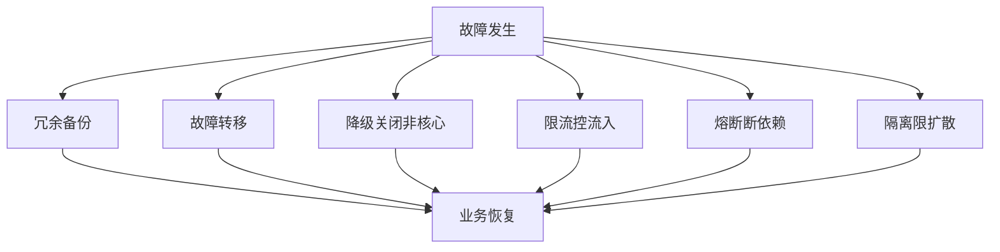
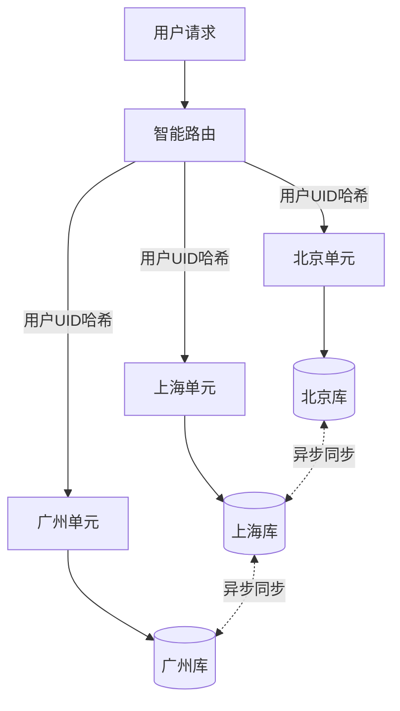
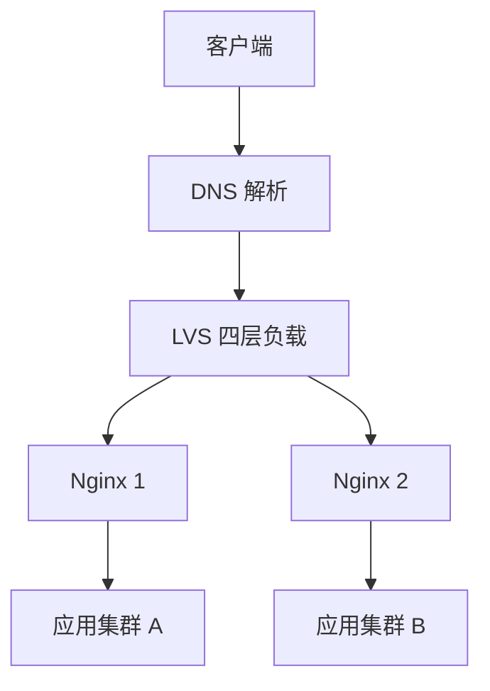
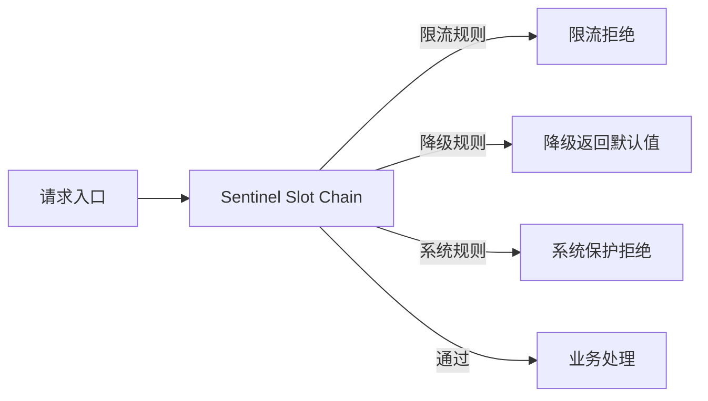
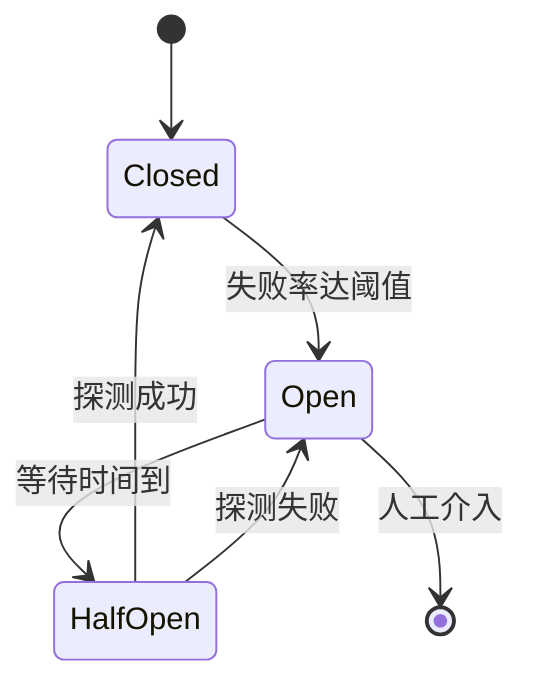
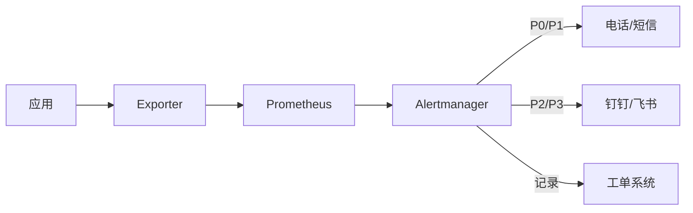
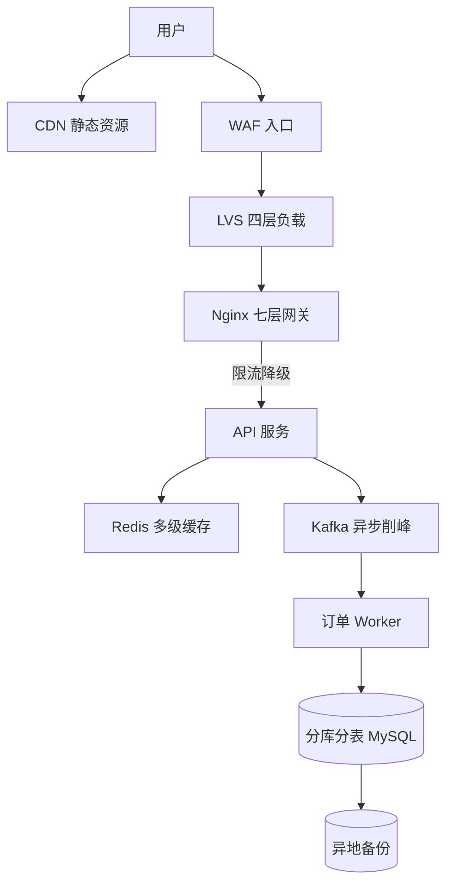

# 高可用架构

> 高可用架构是一套让系统在面对单点故障、流量洪峰、网络分区等异常时仍能持续提供服务的工程方法论，目标是用冗余、隔离、降级、熔断等手段把"故障"压缩到可接受的时间窗口内。

**关键词**：高可用、冗余、限流熔断、多活架构、容灾备份

## 抽象类比

高可用就像"消防体系"——不能保证永不着火，但通过烟雾报警器（监控告警）、灭火器与喷淋系统（限流降级）、防火门（隔离舱壁）、备用电源与逃生通道（多活容灾）把火灾损失降到最低。架构师的目标不是"零故障"，而是"故障可承受、业务可恢复"。

另一层类比是"医院急诊分级"——大量病人涌入时按轻重缓急分流：危重病人优先抢救（核心交易链路）、轻症病人排队等候（非核心功能如评论）、可有可无的服务直接关门（降级关闭推荐）。这就是高可用的限流、降级、隔离思想。

## 一、什么是高可用

高可用（High Availability, HA）指系统在较长时间内持续可用、对外提供正常服务的能力。它不是"永远不挂"，而是"故障时间足够短、影响面足够小"。

### 可用性指标：几个 9

- 2 个 9（99%）：年宕机 87.6 小时，普通内部系统
- 3 个 9（99.9%）：年宕机 8.76 小时，常规互联网系统
- 4 个 9（99.99%）：年宕机 52.6 分钟，核心交易系统
- 5 个 9（99.999%）：年宕机 5.26 分钟，电信级、金融核心

### 关键指标

- MTBF（Mean Time Between Failures）：平均故障间隔时间，越大越好
- MTTR（Mean Time To Recovery）：平均故障恢复时间，越小越好
- 可用性 = MTBF / (MTBF + MTTR)
- RTO（Recovery Time Objective）：恢复时间目标，业务可容忍的中断时长
- RPO（Recovery Point Objective）：恢复点目标，业务可容忍的数据丢失量

### 指标关系

- 提升可用性 = 增大 MTBF（少出故障） + 减小 MTTR（快速恢复）
- RTO 关注"业务中断多久能恢复"
- RPO 关注"恢复后能丢多少数据"
- 二者是容灾方案设计的核心输入

## 二、高可用的核心思路

高可用的本质是"假设一切都会坏，提前准备好兜底"。

### 冗余（Redundancy）

- 同一组件部署多份，单点故障不影响整体
- 主备冗余：一主一备或一主多备
- 多活冗余：多副本同时提供服务
- 数据冗余：多副本存储、多机房备份

### 故障转移（Failover）

- 主节点故障时，备用节点自动接管
- 切换需感知故障：心跳检测、健康检查
- 数据层切换难点：避免脑裂、保证数据一致性
- 常见方案：Redis Sentinel、MySQL MHA、Zookeeper 选主

### 降级（Degradation）

- 流量过大时主动关闭非核心功能，保住核心链路
- 例：大促时关闭商品评论、推荐、积分明细
- 实现方式：开关、规则引擎、Sentinel 动态规则

### 限流（Rate Limiting）

- 控制单位时间内的请求量，防止系统被压垮
- 在入口处拦截，避免压力向后传递
- 详见"六、限流与降级"

### 熔断（Circuit Breaker）

- 依赖服务故障时主动切断调用，防止级联雪崩
- 详见"七、熔断与隔离"

### 隔离（Isolation）

- 把故障限制在局部，避免扩散到全局
- 线程池隔离、信号量隔离、机房隔离、租户隔离
- 详见"七、熔断与隔离"

### Mermaid 图：高可用核心思路

## 三、多活架构

多活架构通过在不同机房部署可独立提供服务的副本，应对机房级故障。

### 同城双活

- 两个机房在同一城市，通过专线互联
- 业务流量分担到两个机房，数据强同步
- 优势：机房级故障可快速切换
- 劣势：仍受城市级灾难影响

### 异地多活

- 机房分布在不同城市，距离通常 > 1000 公里
- 解决城市级灾难（地震、洪水、停电）
- 难点：跨城网络延迟（10-30ms），数据同步挑战大
- 通常按用户分流，每个机房只负责一部分用户

### 两地三中心

- 同城两个机房 + 异地一个备份机房
- 同城双活提供日常高可用
- 异地机房作为灾备，平时不承担流量
- 是金融行业常见架构

### 单元化部署

- 把业务按用户维度切分为多个"单元"
- 每个单元自包含：应用、数据、缓存、消息队列
- 单元内闭环，跨单元调用最少
- 阿里"单元化"架构是异地多活的典型实践

### Mermaid 图：异地多活与单元化

## 四、负载均衡与流量调度

负载均衡把流量分发到多台后端机器，是高可用的"流量调度员"。本节聚焦高可用视角的流量调度策略，负载均衡算法理论（轮询/最少连接/一致性哈希等）详见 [[分布式系统]]，Nginx/LVS 等产品对比详见 [[中间件]]。

### 四层 vs 七层负载均衡

- 四层（L4）：基于 IP + 端口转发，效率高，如 LVS、F5
- 七层（L7）：基于 HTTP/URL/Cookie 转发，灵活，如 Nginx、HAProxy
- 选择依据：性能优先选四层，路由灵活选七层
- 实际部署常分层：DNS → LVS（四层） → Nginx（七层） → 应用

### DNS 负载均衡

- 通过 DNS 解析返回多个 IP，客户端就近访问
- 优势：客户端分布式，无单点
- 劣势：DNS 缓存导致切换慢、精细度低
- 常用：GSLB（全局服务器负载均衡）、HTTPDNS

### LVS 与 Nginx 选型

- LVS：四层负载，性能极高，常作为入口流量"第一跳"
- Nginx：七层反向代理，配置灵活，支持灰度发布与流量染色
- LVS 三种模式（NAT/DR/TUN）与 Nginx 调度算法详见 [[分布式系统]]，产品对比详见 [[中间件]]

### 健康检查

- 主动检查：定时向后端发探测请求
- 被动检查：累计失败次数后剔除节点
- 检查维度：TCP 端口、HTTP 状态码、自定义健康接口
- 健康检查不当时会导致"健康但被剔除"或"故障仍被转发"

### 灰度发布

- 蓝绿部署：两套环境切换，瞬间切流
- 滚动发布：逐台替换，零停机
- 金丝雀发布：先小流量验证，再逐步放量
- A/B 测试：按用户分组分流，验证业务效果

### Mermaid 图：分层负载均衡

## 五、容灾与备份

容灾是"故障已发生，如何恢复"，备份是"数据已丢失，如何找回"。

### 冷备（Cold Standby）

- 备用系统平时不运行，故障时启动接管
- 优势：成本低
- 劣势：恢复时间长，数据可能丢失
- 适合：非核心系统、能容忍长时间中断的业务

### 热备（Hot Standby）

- 备用系统实时运行并同步数据，但平时不接流量
- 故障时切换到热备，秒级到分钟级恢复
- 常见：MySQL 主从、Redis 主从
- 仍是"主备"模式，备机资源利用率不高

### 双活（Active-Active）

- 主备都承担流量，互为备份
- 资源利用率高、性能更好
- 难点：双向数据同步、冲突解决
- 详见"三、多活架构"

### 容灾演练

- 定期模拟故障，验证容灾方案是否生效
- 演练内容：机房断电、网络分区、依赖服务宕机
- 演练分级：桌面推演、半实战、全量实战
- 不演练的容灾方案等于没有容灾

### 混沌工程（Chaos Engineering）

- Netflix 提出，主动在生产环境注入故障
- 验证系统的"真实韧性"而非"假设韧性"
- 代表工具：Chaos Monkey、ChaosBlade、Litmus
- 演进路径：单机故障 → 网络故障 → 机房故障 → 区域故障

### 备份策略

- 全量备份：完整拷贝所有数据，恢复快但耗时长
- 增量备份：只备份变化部分，省空间但恢复需链式重放
- 差异备份：相对上次全量的变化，恢复只需"全量 + 一次差异"
- 备份要定期验证：能恢复的备份才是真备份
- 备份要异地存放：避免机房灾难导致备份与数据同归于尽

## 六、限流与降级

限流控"流入"，降级控"流出"，二者协同保护系统不被压垮。限流作为 API 网关核心职责的基本介绍详见 [[中间件]]，本节聚焦算法对比、工具实战与降级策略。

### 限流算法

- 计数器法：单位时间内计数，超阈值拒绝
- 滑动窗口：细粒度窗口平滑限流，避免临界突变
- 漏桶算法：请求匀速进入处理，多余请求排队或丢弃
- 令牌桶算法：固定速率发放令牌，请求需拿到令牌才处理，允许突发

### 漏桶 vs 令牌桶

- 漏桶：强制匀速输出，平滑流量，不允许突发
- 令牌桶：允许突发流量（桶中令牌可累积），更贴近真实业务
- 多数场景用令牌桶，强匀速场景（如对接三方限流 API）用漏桶

### 主流限流工具

- Sentinel：阿里开源，支持限流、降级、熔断、系统自适应保护
- Hystrix：Netflix 早期开源，已停止维护，建议迁移到 Resilience4j
- Resilience4j：轻量函数式，与 Spring Boot 2.x/3.x 配合好
- Nginx LimitReq：入口层限流，配置简单
- Redis + Lua：分布式限流，跨进程一致

### 限流维度

- QPS 限流：每秒请求数
- 并发数限流：同时处理请求数
- 资源限流：CPU、内存、线程数
- 用户限流：单用户 QPS 上限，防恶意刷接口

### 降级策略

- 读降级：返回缓存、默认值、空数据
- 写降级：异步写、合并写、丢日志后补
- 功能降级：关闭推荐、评论、积分等非核心功能
- 服务降级：直接拒绝部分低优先级请求

### Mermaid 图：Sentinel 限流降级链路

## 七、熔断与隔离

熔断防止"故障扩散"，隔离防止"故障全局化"，二者是稳定性的"最后一道防线"。

### 熔断器模式（Circuit Breaker）

- 借鉴电路保险丝思想，故障率过高时自动切断调用
- 三个状态：
  - Closed（关闭）：正常调用，统计失败率
  - Open（打开）：失败率达阈值，直接拒绝请求一段时间
  - Half-Open（半开）：试探性放少量请求，成功则关闭熔断，失败则继续打开

### 熔断触发条件

- 慢调用比例：响应时间超阈值的请求占比过高
- 异常比例：异常请求占比超阈值
- 异常数：异常请求绝对数超阈值
- 触发后执行 fallback：返回默认值、走缓存、抛异常

### 线程池隔离

- 为每个依赖服务分配独立线程池
- 某依赖服务慢调用只会耗尽自己的线程池，不扩散
- 优势：隔离彻底、可并发控制
- 劣势：线程切换开销大、池数量多难管理

### 信号量隔离

- 用计数器限制并发数，不创建新线程
- 优势：无线程切换开销，轻量
- 劣势：不能异步超时，调用方线程会被阻塞
- 适合：内部信任的快速调用

### 舱壁模式（Bulkhead）

- 借鉴船舶分舱设计：船体破损只淹没一个舱，不沉整条船
- 在系统层面把资源分区，故障限制在分区内
- 实现方式：线程池隔离、连接池隔离、机房隔离、租户隔离

### Mermaid 图：熔断器状态机

## 八、监控与告警

监控是高可用的"眼睛"，没有监控的系统等于"闭眼开车"。

### SLA / SLO / SLI

- SLI（Service Level Indicator）：服务等级指标，如可用性、延迟、错误率
- SLO（Service Level Objective）：服务等级目标，如"99.9% 请求 200ms 内返回"
- SLA（Service Level Agreement）：服务等级协议，对外的合同承诺，违约需赔偿
- 关系：SLI 是测量值，SLO 是内部目标，SLA 是对外承诺

### 监控分层

- 业务监控：订单量、支付成功率、转化率（最贴近用户感受）
- 应用监控：QPS、延迟、错误率、JVM 指标
- 中间件监控：MySQL 慢查询、Redis 命中率、MQ 堆积
- 系统监控：CPU、内存、磁盘、网络
- 容器/K8s 监控：Pod 状态、节点资源、Deployment 副本数

### Prometheus + Grafana

- Prometheus：时序数据库 + 拉取式采集 + PromQL 查询语言
- Grafana：通用可视化面板，与 Prometheus 深度集成
- Alertmanager：告警路由、抑制、静默
- 已是云原生监控事实标准，详见 [[云原生架构]]

### 告警分级

- P0：核心业务中断，需 5 分钟响应，全员投入
- P1：核心功能受损，需 15 分钟响应
- P2：非核心功能异常，工作时间处理
- P3：潜在风险，记录待优化

### On-Call 机制

- 轮值制度：7x24 小时保障，团队轮流值班
- 升级机制：长时间未响应自动升级到二级、三级
- 复盘机制：每次故障后做 Postmortem，定位根因、定改进项
- On-Call 文化：允许犯错、重视复盘、对事不对人

### Mermaid 图：监控告警链路

## 九、高可用案例

### 电商大促（双 11）

- 流量峰值远超日常：日常 10 万 QPS，峰值可达数百万 QPS
- 应对手段：
  - 多级缓存：CDN → Nginx 缓存 → Redis → 本地缓存
  - 异步削峰：下单请求进消息队列，后端按节奏消费
  - 限流降级：非核心功能提前关闭，保交易核心链路
  - 弹性扩容：基于 K8s 自动扩缩容，按峰值预留资源
  - 全链路压测：提前模拟大促流量，发现瓶颈

### 红包场景（微信红包）

- 瞬时超高并发：除夕夜峰值千万级 QPS
- 应对手段：
  - 异步拆红包：用户点击后异步处理结果
  - 内存预分配：红包金额提前计算并缓存
  - 数据库分库分表：按用户 ID 哈希分散
  - 多机房多活：同城双活 + 异地容灾

### 12306 春运购票

- 业务复杂：余票计算涉及站点、车次、区间多个维度
- 应对手段：
  - 内存余票计算：避免每次查库
  - 排队机制：高峰期请求进队列，按节奏放行
  - 异步出票：下单成功后异步生成订单
  - 削峰填谷：用排队拉平流量曲线

### Netflix Chaos Monkey

- Netflix 最早在生产环境随机杀实例的工具
- 哲学：与其等故障发生，不如主动制造故障验证韧性
- 演进：从随机杀实例到 Simian Army（多类故障注入）
- 启发：高可用不是"假设无故障"，而是"验证能扛故障"

### Mermaid 图：电商大促高可用架构

## 面试速答

### Q1：高可用架构的核心思路有哪些？

- 冗余：多副本部署，单点故障不影响整体
- 故障转移：主节点故障时备用节点自动接管
- 限流：控制单位时间请求量，防止系统被压垮
- 降级：主动关闭非核心功能，保住核心链路
- 熔断：依赖服务故障时主动切断调用，防止雪崩
- 隔离：把故障限制在局部，避免全局扩散

### Q2：限流的令牌桶和漏桶有什么区别？

- 漏桶：请求匀速输出，强制平滑流量，不允许突发
- 令牌桶：固定速率发令牌，桶中令牌可累积，允许突发流量
- 多数业务场景用令牌桶（如 Sentinel 默认算法）
- 强匀速场景用漏桶（如对接三方限流 API）

### Q3：什么是熔断器模式？三个状态分别是什么？

- 借鉴电路保险丝，故障率过高时自动切断调用
- Closed：正常调用并统计失败率
- Open：失败率达阈值后直接拒绝请求一段时间
- Half-Open：试探性放少量请求，成功则关闭熔断，失败则继续打开
- 目的：防止级联故障导致雪崩

### Q4：异地多活的难点是什么？

- 跨城网络延迟：10-30ms，强同步会影响写入性能
- 数据同步挑战：双向同步易冲突，需业务层避免
- 流量路由：按用户分流，避免跨机房调用
- 一致性权衡：核心数据强一致、非核心最终一致
- 演练难度高：演练本身风险大，需充分准备

### Q5：混沌工程解决什么问题？

- 主动在生产注入故障，验证系统的真实韧性
- 假设故障迟早发生，不如提前发现薄弱环节
- Netflix Chaos Monkey 是代表工具
- 演进路径：单机故障 → 网络故障 → 机房故障 → 区域故障
- 前提：系统需先具备完善的监控与自动恢复能力

## 参考链接

- [Google SRE Book](https://sre.google/sre-book/table-of-contents/)
- [Netflix Tech Blog: Chaos Engineering](https://netflixtechblog.com/tagged/chaos-engineering)
- [Sentinel 官方文档](https://sentinelguard.io/zh-cn/docs/introduction.html)
- [Prometheus 官方文档](https://prometheus.io/docs/introduction/overview/)
- 相关文档：[[分布式系统]]、[[架构模式]]、[[云原生架构]]、[[中间件]]、[[领域驱动设计]]

---

## 理解与验证闭环

- **关键连接**：高可用从可度量的 SLI/SLO 开始，再通过冗余、隔离、限流、降级和恢复满足目标。
- **最小验证**：为一个依赖服务注入超时与错误，验证重试预算、熔断、降级、恢复和告警。
- **取舍边界**：冗余若共享电源、网络、配置或发布链路，仍会形成共同故障点。

复习时先画出核心对象和数据流，再用一个反例解释边界，最后用实验数据或可观察证据校正直觉。
