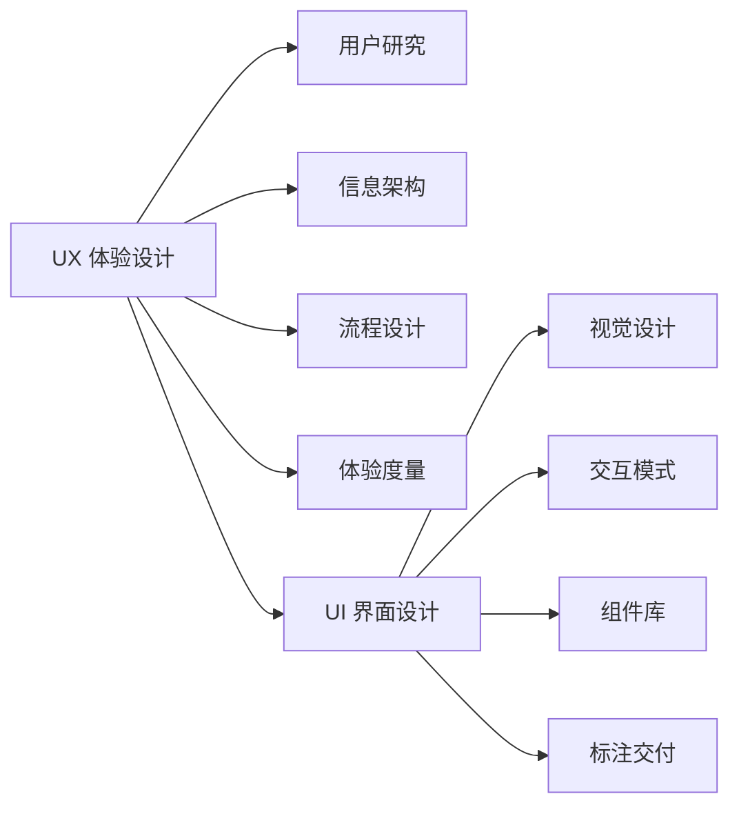
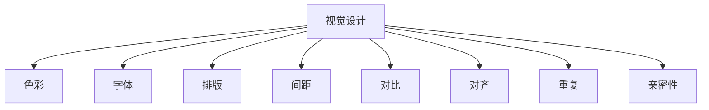
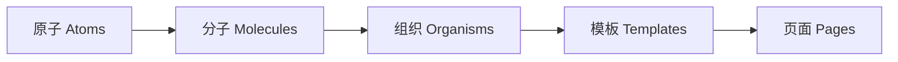
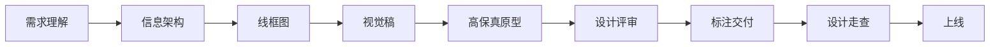
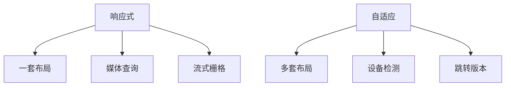

# UI 设计基础

> UI 设计（User Interface Design）是把产品功能与信息翻译成"看得见、点得动、用得顺"的界面的过程，决定了用户对产品的第一印象与每一次点击的体验。

**关键词**：UI 设计、视觉设计、交互模式、设计系统、响应式适配

## 抽象类比

UI 设计就像"装修一套房子"。房子本身的户型结构是产品经理和架构师定的（功能与信息架构），而 UI 设计负责选地板、刷墙漆、摆家具、布置灯光，让这套房子住起来既好看又顺手。哪怕户型一样，不同风格的装修会让人有完全不同的居住感受。

再换一个角度：UI 是产品的"脸"。一个人的性格（UX 体验）需要长期相处才能感受到，但脸（UI 视觉）决定了别人是否愿意走过来认识你。所以 UI 设计既要"好看"吸引人停留，又要"好用"让人愿意留下来。

## 适合人群

- 想转行做 UI 设计的设计师或前端开发
- 需要和设计师协作的产品经理、前端工程师
- 对"为什么这个界面看起来舒服"有兴趣的非设计背景同学
- 创业者或独立开发者，需要自己动手做产品界面

## 预备知识

- 有基本的美学感受力，能分辨"好看"和"难看"
- 用过至少几款主流 App 或网站，对常见交互有直觉
- 了解前端 HTML/CSS 的基本概念更佳（方便理解"设计能否落地"）
- 不需要美术基础，UI 设计更重逻辑与规范

---

## 一、UI 设计是什么

UI 设计（User Interface Design）即用户界面设计，关注"用户与产品交互的视觉与操作呈现"。它解决的是"界面长什么样、用户怎么操作"的问题。

### UI 与 UX 的区别

- UI 偏"视觉与交互呈现"：颜色、字体、布局、组件、动效
- UX 偏"整体体验"：研究用户、定义流程、衡量满意度、改进体验

类比：UI 是"舞台的布景与道具"，UX 是"整场演出的剧本与观众感受"。UI 是 UX 的一个落地环节，UX 决定"该有什么"，UI 决定"它看起来什么样"。

### UI 设计师的核心产出

- 视觉稿（Visual Design）：页面最终长什么样
- 高保真原型（Prototype）：可点击、可演示交互
- 设计标注（Spec）：尺寸、颜色、字号、间距给开发用
- 切图素材（Assets）：图标、插画、占位图
- 组件库（Component Library）：可复用的设计资产

---

## 二、UI 设计的核心原则

参考 Don Norman《设计心理学》提出的原则，UI 设计有几条放之四海皆准的准则。

- 一致性（Consistency）：同样功能用同样样式，降低学习成本
- 可见性（Visibility）：让用户看到"能做什么、当前在哪"
- 反馈（Feedback）：每次操作都要有即时反馈，不能让用户怀疑是否点中了
- 容错（Error Tolerance）：防止用户犯错，犯了也能轻松撤销
- 效率（Efficiency）：常用操作步骤少、路径短，支持快捷方式
- 可控性（Control）：用户能掌控节奏，能取消、能返回、能退出

### 诺曼的"执行鸿沟"与"评估鸿沟"

- 执行鸿沟：用户想做的事，界面有没有给清楚的入口
- 评估鸿沟：用户做完操作后，能不能判断自己成功了

UI 设计的很多细节就是在缩小这两条鸿沟：按钮做得像按钮（执行），点击后弹出"已保存"（评估）。

### 七大设计原则

Norman 在《设计心理学》中提出七条：

- 可供性（Affordance）：外观暗示用途，比如按钮看起来就该被按
- 意符（Signifiers）：提示用户在哪里操作，比如输入框的下划线
- 映射（Mapping）：控件和结果的关系符合直觉，比如向右滑切换下一张
- 反馈（Feedback）：操作后立即有响应
- 约束（Constraint）：限制错误操作，比如日期只能选未来不能选过去
- 一致性（Consistency）：内部一致、与行业惯例一致
- 概念模型（Conceptual Model）：用户脑中的模型与系统实际行为一致

---

## 三、视觉设计要素

视觉设计是 UI 的"门面"，决定第一眼的吸引力。

### 色彩

- 主色（Primary）：品牌识别色，占比 5%-10%
- 辅助色（Secondary）：补充主色，占比 20%-30%
- 中性色（Neutral）：背景、文字、边框，占比 60%-70%
- 强调色（Accent）：用于关键操作，占比 5% 以内
- 语义色：成功（绿）、警告（黄）、错误（红）、信息（蓝）

色彩要考虑无障碍（Accessibility）：文字与背景的对比度至少 4.5:1（WCAG AA 标准）。

### 字体

- 字体族：无衬线（如 PingFang、Roboto）适合屏幕，衬线（如 Times）适合长文阅读
- 字号层级：标题 24/20/18，正文 14/16，辅助 12
- 字重：常用 Regular（400）、Medium（500）、Semibold（600）
- 行高：正文 1.5-1.7 倍，标题 1.2-1.4 倍

### 排版

- 8 点栅格：所有间距是 8 的倍数，保证视觉协调
- 留白：让内容呼吸，避免拥挤
- 对齐：同一页面内统一对齐方式，减少视觉跳跃

### CRAP 原则

视觉设计的四大经典原则：

- 对比（Contrast）：突出差异，让重要信息一眼可见
- 重复（Repetition）：相同元素用相同样式，建立统一感
- 对齐（Alignment）：所有元素有视觉关联，不要随意摆放
- 亲密性（Proximity）：相关元素靠近，无关元素远离

---

## 四、交互设计模式

交互模式是反复出现的设计解法，熟悉它们能让设计快速落地。

### 导航类

- 顶部导航（Top Nav）：适合 Web，可见性强
- 侧边导航（Side Nav）：适合 B 端管理后台，层级清晰
- 底部 Tab（Bottom Tab）：适合移动端，拇指友好
- 抽屉导航（Drawer）：把次要入口藏起来，节省空间
- 面包屑（Breadcrumb）：让用户知道自己在哪一层

### 表单类

- 单列表单：标签左对齐或顶对齐，输入框统一宽度
- 分步表单：长表单拆成多步，降低心理压力
- 内联校验：输入时实时提示，而不是提交才报错
- 智能默认值：能预填就预填，减少用户输入

### 列表与详情

- 列表页：筛选、排序、分页/无限滚动
- 详情页：突出主体信息，操作放右上或底部
- 主从布局（Master-Detail）：左列表右详情，适合邮件、IM

### 反馈类

- Toast：轻提示，自动消失，不打断操作
- Modal：强提示，必须用户响应才能继续
- Snackbar：带操作按钮的轻提示（如"已删除，撤销"）
- Loading：骨架屏 > 加载动画 > 进度条
- 空状态：无数据时给插画 + 引导操作，不能只显示"暂无数据"

### 弹窗与浮层

- Dialog：模态弹窗，强阻断
- Popover：点击触发的浮层，弱阻断
- Tooltip：悬停提示，信息补充
- ActionSheet：底部弹出操作菜单，移动端常用

---

## 五、设计系统 Design System

设计系统是一套可复用的设计资产与规范，让团队协作和产品迭代保持一致。

### 原子设计（Atomic Design）

Brad Frost 提出，把界面拆成五层：

- 原子（Atoms）：按钮、输入框、标签
- 分子（Molecules）：搜索框 = 输入框 + 按钮
- 组织（Organisms）：导航栏 = Logo + 菜单 + 搜索框
- 模板（Templates）：页面骨架，无真实内容
- 页面（Pages）：填充真实内容后的最终形态

### 设计令牌（Design Token）

把设计变量抽象成"令牌"，跨平台复用：

- 颜色令牌：`color-primary-blue` → `#1890FF`
- 字号令牌：`font-size-large` → `18px`
- 间距令牌：`spacing-md` → `16px`

好处是改一处全局生效，配合前端变量系统能做到设计、开发、多端同步。

### 主流设计系统

- Material Design（Google）：以"纸张"和"墨水"为隐喻，强调层级和阴影
- Apple HIG（Human Interface Guidelines）：强调模糊、毛玻璃、原生体验
- Ant Design（蚂蚁）：国内 B 端事实标准，组件丰富
- Fluent Design（Microsoft）：注重深度、动效、光感
- Carbon（IBM）：企业级，规范严格

---

## 六、UI 设计流程

UI 设计不是"画一张图"，而是一条从需求到交付的流水线。

### 标准流程

1. 需求理解：读懂 PRD，明确"为谁设计、解决什么问题"
2. 信息架构：梳理页面层级、功能分组、导航结构
3. 低保真线框图（Wireframe）：用灰白框表达布局，不纠结样式
4. 视觉稿（Visual）：确定色彩、字体、组件样式
5. 高保真原型（Prototype）：可点击，演示完整交互
6. 设计评审：与产品、开发、测试对齐可行性
7. 标注交付：输出尺寸、间距、颜色给开发
8. 设计走查（Design Review）：上线前比对"做出来的"和"设计的"

### 各阶段产出

- 需求阶段：UI 设计 checklist
- 信息架构：站点地图、流程图
- 线框图：低保真黑白稿
- 视觉稿：高保真静态图
- 原型：可交互 demo
- 标注：Figma inspect 或第三方插件导出
- 走查：差异清单、修改建议

---

## 七、UI 设计工具

工具是手段，不是目的。不同工具有不同侧重。

### 主流工具

- Figma：浏览器协作、组件库、Auto Layout，目前行业事实标准
- Sketch：老牌 Mac 矢量设计工具，生态成熟
- Adobe XD：Adobe 全家桶，对老设计师友好
- MasterGo：国产协作设计工具，对国内团队友好
- Pixso：国产，类似 Figma 的体验

### 原型与动效

- Principle：移动端交互动效，已逐渐被 Figma 内置动效替代
- ProtoPie：高保真原型，支持传感器、复杂交互
- Figma Smart Animate：内置动效工具，能满足 80% 场景
- LottieFiles：动效导出 JSON，给前端直接渲染

### 辅助工具

- FigJam：白板协作，做头脑风暴
- Zeplin / 蓝湖 / 摹客：标注与切图交付平台
- Iconfont / Streamline / Phosphor：图标素材库
- Unsplash / Humaaans / Blush：插画与图片素材

---

## 八、响应式与多端适配

同一套产品要跑在手机、平板、桌面、大屏上，UI 设计必须考虑适配。

### 核心概念

- 断点（Breakpoint）：屏幕宽度阈值，如移动 576px、平板 768px、桌面 992px、大屏 1200px
- 移动优先（Mobile First）：先设计移动端，再向上扩展
- 栅格系统（Grid）：12 列栅格，内容按列对齐
- 自适应（Adaptive）：为不同设备设计不同版本
- 响应式（Responsive）：一套布局根据屏幕宽度变化

### 自适应 vs 响应式

- 自适应：检测设备，跳转到对应版本（如 m.example.com）
- 响应式：同一套代码，根据 CSS 媒体查询动态调整

### 多端适配要点

- 触摸目标：移动端按钮最小 44x44px，方便手指点击
- 字体大小：移动端正文不小于 14px
- 图片：使用 srcset 提供多分辨率版本
- 安全区域：iPhone 顶部刘海、底部 Home Indicator 要留白
- 暗色模式：通过 Design Token 切换，不是简单反色

---

## 九、UI 设计与前端开发的协作

设计与开发的协作质量直接决定产品最终样子。

### 协作流程

- 设计阶段：开发提前介入，评估可行性
- 评审阶段：设计师讲解、开发提问、确认边界
- 开发阶段：设计师答疑，必要时调整方案
- 走查阶段：开发完成后，设计师对照设计稿逐页核对
- 上线阶段：QA 验收，设计师看线上版本

### 标注与切图

- 标注：尺寸、颜色、字号、间距、圆角、阴影
- 切图：图标导出 SVG 或 PNG@2x/@3x
- 组件命名：设计稿和代码组件名对齐，方便查找
- 版本管理：设计稿改了要同步开发，避免信息错位

### 组件库对接

- 设计师维护 Figma 组件库
- 开发维护代码组件库（如 React 组件）
- 双向同步：设计改了通知开发，开发改了通知设计
- 组件版本：组件迭代要有版本号和 changelog

### 设计走查（Design Review）

走查清单：

- 视觉一致性：颜色、字号、间距是否符合规范
- 交互完整性：hover、focus、disabled 状态都做了吗
- 异常状态：空数据、加载中、错误、超长文本
- 响应式：不同屏幕宽度下都正常吗
- 文案：错别字、占位符是否替换

---

## 面试速答

### Q1：UI 和 UX 有什么区别？

回答思路：UI 关注"界面长什么样"，是视觉与交互呈现的具体设计；UX 关注"用户整体感受"，覆盖从需求到使用到反馈的全流程。UI 是 UX 的子集和落地手段。可以类比：UI 是装修风格，UX 是居住体验。两者要协同，UI 偏执行层，UX 偏策略层，但在小团队往往由同一人承担。

### Q2：你怎么保证设计的可访问性（Accessibility）？

回答思路：从色彩、对比、字号、交互四方面入手。色彩不能只靠颜色区分信息（色盲用户），要辅以图标或文字；对比度遵循 WCAG AA 标准，文字对比度至少 4.5:1；字号不小于 12px，移动端正文 14px 起；交互支持键盘操作，所有功能有 focus 状态，关键操作有 ARIA 标签。本质上是无障碍不是"额外功能"，而是设计的基本规范。

### Q3：设计系统是什么？为什么需要？

回答思路：设计系统是"组件库 + 规范 + 资产"的集合，包含可复用组件、设计令牌、使用规范、变更流程。需要它的原因有三：一是保证一致性，多人协作也能产出统一风格；二是提升效率，组件复用避免重复造轮子；三是降低协作成本，设计师和开发用同一套语言。常见设计系统有 Material Design、Ant Design、Apple HIG，它们都是开源的参考范本。

### Q4：响应式和自适应有什么区别？

回答思路：响应式是一套布局根据屏幕宽度动态调整，使用媒体查询和流式栅格，所有设备看到的是同一套页面，只是布局变了；自适应是为不同设备设计不同版本，通过设备检测跳转到对应页面（如 m.example.com）。响应式维护成本低但定制性弱，自适应维护成本高但体验更好。当前主流是响应式 + 移动优先，少数场景（如复杂 B 端）仍用自适应。

### Q5：如何与前端协作保证还原度？

回答思路：四步走。第一，设计阶段开发提前介入，评估方案可行性，避免设计完做不出来；第二，标注清晰，用 Figma 自带标注或蓝湖等工具，所有尺寸、颜色、间距都给到；第三，建立组件库双向同步机制，设计改了通知开发，避免信息错位；第四，上线前做设计走查，对照设计稿逐页核对，重点关注 hover/focus/disabled 等状态、空数据/加载/错误等异常态、不同屏幕宽度下的响应式表现。还原度的核心是"沟通前置 + 走查兜底"。

---

## 相关文档

- [产品经理](产品经理.md)
- [产品运营](产品运营.md)
- [项目管理](项目管理.md)
- [HTML](HTML.md)
- [CSS](CSS.md)
- [设计模式](设计模式.md)

## 外部参考

- [Material Design](https://m3.material.design/)
- [Apple Human Interface Guidelines](https://developer.apple.com/design/human-interface-guidelines/)
- [Ant Design](https://ant.design/docs/spec/introduce)
- [Figma 官网](https://www.figma.com/)
- [WCAG 2.1 标准](https://www.w3.org/TR/WCAG21/)
- [Atomic Design (Brad Frost)](https://atomicdesign.bradfrost.com/)
