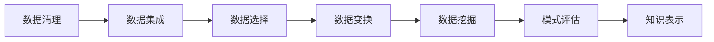

# 数据挖掘

> 数据挖掘（Data Mining）是从海量、不完整、有噪声的数据中，通过统计学、机器学习与数据库技术，提取出潜在有用、最终可理解的"知识模式"的方法论与流程。机器学习偏"算法理论"，数据挖掘偏"如何把数据变成业务价值"——它关心的是端到端的数据流程、模式发现与可解释性，而非单一模型的最优表现。

**关键词**：KDD 流程、数据预处理、关联规则、聚类分析、异常检测

## 抽象类比

数据挖掘就像"在沙金矿里淘金"：原始数据是含泥沙的矿土，里面偶尔夹杂金沙。你不能直接拿来用，得先冲洗掉泥沙（数据清洗），再用筛子分级（数据变换），最后用淘金盘反复摇晃（挖掘算法），才能把金砂从废土里分离出来。整个过程不是"一锤子买卖"，而是一条流水线。

再换一个角度：数据挖掘像"侦探破案"。侦探面对的是凌乱的线索（原始数据），他得先整理证据（预处理），再归纳嫌疑人的共同特征（聚类）、发现作案规律（关联规则）、预测下一步目标（分类与回归）。它的核心不在于某个推理手法多巧妙，而在于"从证据到结论"的完整闭环。

## 一、数据挖掘是什么

### 与相邻学科的关系

数据挖掘站在统计学、机器学习与数据库三者的交叉点上：

- **统计学**提供假设检验、分布理论、显著性度量等理论基础
- **机器学习**提供分类、聚类、回归等可复用算法作为工具
- **数据库**提供高效存储、索引、查询能力，支撑海量数据处理
- **数据挖掘**则是把三者整合为"从数据中提炼可执行知识"的工程方法论

一句话定位：**统计学关心"对不对"，机器学习关心"准不准"，数据挖掘关心"有没有用、能不能落地"**。

### KDD 过程

KDD（Knowledge Discovery in Databases）是数据挖掘的标准流程，强调"挖掘"只是其中一步：

- **数据清理**：去噪、补缺、去重，消除脏数据
- **数据集成**：把多源数据（数据库、日志、API）合并到一起
- **数据选择**：与任务相关的字段才保留，避免维度灾难
- **数据变换**：归一化、离散化、构造派生特征
- **数据挖掘**：套用分类、聚类、关联等算法发现模式
- **模式评估**：按兴趣度、业务可解释性筛选有价值的模式
- **知识表示**：用图表、规则、报告把结果讲给业务方听

注意：KDD 是一个反复迭代的过程，评估阶段发现问题后往往要回到前面的步骤重新调整。

## 二、数据预处理

数据预处理通常占整个数据挖掘项目 60%~80% 的工作量，是决定成败的关键。

### 数据清洗

- **缺失值处理**
  - 直接删除：缺失比例低（如 < 5%）且随机分布时
  - 均值/中位数/众数填充：数值型用均值、类别型用众数
  - 模型填充：用 KNN、随机森林等预测缺失值，效果更稳但开销大
  - 标记为"未知"：当缺失本身就有信息量时（如用户拒填收入）
- **异常值处理**
  - 3σ 法：超出均值 ±3 倍标准差视为异常
  - 箱线图法：超出 1.5 倍 IQR 的点视为异常
  - 业务规则法：年龄 200 岁、收入为负等明显不合逻辑的值
  - 处理方式：删除、截断、单独建模，或保留为"异常信号"
- **去重与一致性**
  - 主键去重：同一 ID 出现多条记录时合并
  - 格式统一：日期格式、货币单位、编码口径要一致

### 数据归约

数据量太大时，先在不损失信息的前提下"瘦身"：

- **维度归约**：用 PCA、特征选择去掉冗余特征
- **数量归约**：抽样、分箱、聚类后用簇代表代替个体
- **数据压缩**：编码压缩、离散化压缩存储空间

### 数据变换

- **标准化 Z-Score**：变换为均值 0、方差 1 的分布，适合大多数距离类算法
- **归一化 Min-Max**：压缩到 [0, 1] 区间，适合神经网络、对量纲敏感的方法
- **离散化**：把连续值切成若干区间
  - 等宽：按值域均分，简单但易受异常值影响
  - 等频：每段样本数相同，分布更均衡
  - 卡方分箱：基于统计显著性，常用于风控评分卡
- **类别编码**：One-Hot、Label Encoding、Target Encoding

## 三、分类与预测

分类预测离散标签，回归预测连续值。这里聚焦数据挖掘视角下的算法选择与评估。

### 常见分类算法

- **决策树**：可解释性最强，输出"如果…就…"规则，是评分卡、风控规则的首选
- **朴素贝叶斯**：基于贝叶斯定理 + 特征独立假设，文本分类常用基线
- **KNN（K 近邻）**：懒惰学习，无需训练，但预测慢、对维度敏感
- **SVM（支持向量机）**：小样本高维场景表现好，核技巧可处理非线性
- **逻辑回归**：输出概率、可解释，是金融风控评分卡的标配
- **神经网络**：拟合能力强但黑盒，数据量大时才占优
- **集成方法**：随机森林、GBDT、XGBoost 在结构化表格数据上长期霸榜

### 分类评估指标

- **准确率 Accuracy**：所有预测中正确占比，类别不均衡时失效
- **精确率 Precision**：预测为正中真正为正的比例，关注"别误杀"
- **召回率 Recall**：真正为正中被找出来的比例，关注"别漏掉"
- **F1 值**：精确率与召回率的调和平均，综合两者
- **ROC 曲线**：以假阳率（FPR）为横轴、真阳率（TPR）为纵轴
- **AUC**：ROC 曲线下面积，越接近 1 越好，0.5 等于随机猜
- **混淆矩阵**：TP / FP / FN / TN 四象限，所有指标的来源

业务场景决定指标权重：医疗诊断偏召回（别漏诊），垃圾过滤偏精确（别误杀）。

## 四、聚类分析

聚类是无监督学习代表任务，目标是"物以类聚"，事先不知道类别标签。

### K-Means

- 思想：选定 K 个中心点，反复"分配→更新中心"直到收敛
- 优点：简单、快、可扩展到大数据
- 缺点：要预设 K，对初始中心敏感，只能发现球形簇
- 适用：客户分群、图像压缩、文档聚类

### 层次聚类

- 思想：自底向上（凝聚）或自顶向下（分裂）逐步合并/分裂簇
- 输出：树状图（Dendrogram），可直观看到簇的层次结构
- 优点：不需要预设 K，结果可解释
- 缺点：计算复杂度高 O(n³)，不适合大数据

### DBSCAN

- 思想：基于密度，从核心点出发不断向外扩张
- 优点：不需要预设 K，能发现任意形状的簇，自动识别噪声点
- 缺点：对参数（ε、MinPts）敏感，密度差异大时表现差
- 适用：地理空间聚类、异常检测

### 聚类评估

聚类没有"标准答案"，评估更依赖内部指标：

- **轮廓系数 Silhouette**：衡量样本与同簇的紧密度 vs 与最近邻簇的分离度，范围 [-1, 1]，越大越好
- **肘部法则 Elbow Method**：画出 K 与簇内平方和的曲线，找"肘部"拐点作为最佳 K
- **Calinski-Harabasz 指数**：簇间方差与簇内方差的比值，越大越好
- **业务可解释性**：最终还是要看簇的标签能否被业务方接受

## 五、关联规则挖掘

关联规则是数据挖掘的"特产"任务，机器学习教材里很少深入讲。典型场景是"购物篮分析"——买啤酒的人也会买尿布。

### 三个核心指标

- **支持度 Support**：P(A∩B)，包含 A 和 B 的交易占总交易的比例
- **置信度 Confidence**：P(B|A)，买了 A 的人中有多少也买 B
- **提升度 Lift**：P(B|A) / P(B)，衡量 A 对 B 的"提升作用"
  - Lift > 1：A 促进 B，正相关
  - Lift = 1：A 与 B 独立
  - Lift < 1：A 抑制 B，负相关

只看置信度会误导，必须结合提升度判断规则是否真有价值。

### Apriori 算法

- 思想：基于"频繁项集的所有子集也必须频繁"的先验性质
- 流程：扫描数据库 → 统计 1-项集 → 剪枝 → 生成 2-项集 → … 直到无法生成
- 优点：原理简单、易于实现
- 缺点：多次扫描数据库，候选集指数膨胀，效率低

### FP-Growth

- 思想：把交易数据压缩成一棵 FP-Tree，避免生成候选集
- 优点：只需扫描数据库两次，速度比 Apriori 快一个数量级
- 缺点：树结构占内存，对稀疏数据优势不明显

### 应用场景

- 购物篮分析：商品搭配推荐、货架摆放优化
- 交叉销售：电商"购买此商品的人还买了"
- 医疗：药物不良反应组合挖掘
- 网页分析：用户浏览路径模式发现

## 六、回归分析

回归用于预测连续值，是数据挖掘最早的统计工具之一。

### 线性回归

- 假设：y 与 x 之间是线性关系
- 求解：最小二乘法，使残差平方和最小
- 优点：可解释、计算快
- 缺点：对非线性关系无能为力，对异常值敏感

### 多元回归

- 多个自变量共同预测因变量
- 注意多重共线性：自变量高度相关会让系数不稳定
- 用 VIF（方差膨胀因子）检测，VIF > 10 通常需处理

### 正则化回归

- **Lasso（L1）**：损失函数加 L1 惩罚项，能让部分系数变 0，自带特征选择
- **Ridge（L2）**：损失函数加 L2 惩罚项，系数整体变小但不为 0
- **ElasticNet**：L1 + L2 折中，适合特征多且相关的场景
- 作用：抑制过拟合，提升泛化能力

### 回归评估指标

- **MSE 均方误差**：对大误差敏感，惩罚异常预测
- **RMSE 均方根误差**：与原变量同量纲，便于直观理解
- **MAE 平均绝对误差**：对异常值不敏感，更稳健
- **R² 决定系数**：模型解释的方差占比，范围 [0, 1]，越接近 1 越好
- 注意：R² 在训练集上必增，加特征不一定真有用，可用调整 R² 或 AIC 校正

## 七、异常检测

异常检测是从数据中找出"与众不同的少数"，在风控、运维、医疗等领域极为重要。

### 基于统计

- 假设数据服从某种分布（如正态），超出置信区间的判为异常
- 优点：原理简单、可解释
- 缺点：依赖分布假设，现实中数据往往不服从任何标准分布

### 基于距离

- 思想：异常点离大多数点都很远
- 代表：K 近邻距离法、KDD'99 经典方法
- 缺点：计算复杂度高 O(n²)，对维度敏感

### 基于密度 LOF

- **LOF（Local Outlier Factor）**：比较一个点的局部密度与邻居的局部密度
- 优点：能识别"局部异常"，不依赖全局分布
- 适用：密度差异大的数据集

### 基于聚类

- 思路：聚类后，离簇中心远的点或归属为噪声簇的点判为异常
- 代表：DBSCAN 的噪声点、K-Means 的距离阈值法
- 缺点：依赖聚类质量，且假设异常是少数

### 其他方法

- **孤立森林 Isolation Forest**：随机划分特征空间，异常点更容易被孤立
- **自编码器**：重建误差大的视为异常，深度学习常用
- **时序异常**：ARIMA 残差、Prophet、变点检测

## 八、数据挖掘工具与平台

### 传统数据挖掘工具

- **Weka**：新西兰怀卡托大学出品，老牌开源工具，GUI 友好，适合教学
- **RapidMiner**：可视化拖拽建模，企业级数据挖掘平台，适合非程序员
- **SPSS Modeler**：IBM 出品，金融、电信行业传统选择
- **SAS Enterprise Miner**：商业旗舰，银行风控评分卡常用

### 现代开源栈

- **scikit-learn**：Python 机器学习标准库，覆盖分类、聚类、关联等大部分算法
- **Pandas + Jupyter**：数据探索、清洗、可视化的黄金组合
- **Spark MLlib**：面向海量数据的分布式机器学习库，适合 TB 级数据挖掘
- **SQL + 数据仓库**：Hive、ClickHouse、Doris 等先做大规模聚合与抽样
- **特征平台**：Feast、Hopsworks 等管理离线/在线特征一致性

### 选型建议

- 教学/小数据：Weka 或 scikit-learn + Jupyter
- 业务探索：RapidMiner 或 Pandas
- 海量数据：Spark MLlib + 数据仓库
- 工业落地：scikit-learn 原型 → 迁移到 Spark / 自研平台

## 九、数据挖掘的应用场景

- **推荐系统**
  - 电商商品推荐、视频内容推荐、音乐推荐
  - 常结合关联规则、协同过滤、用户画像
- **金融风控**
  - 信用评分卡（逻辑回归 + WOE 编码）
  - 反欺诈（异常检测 + 图挖掘）
  - 反洗钱（异常交易模式识别）
- **用户画像**
  - 聚类分群 + 标签体系
  - 支撑精准营销、个性化推荐
- **精准营销**
  - 流失预测：谁要走了，提前干预
  - 响应预测：谁会点击广告，优化投放
  - 价值分层：RFM 模型识别高价值客户
- **文本挖掘**
  - 评论情感分析、舆情监控
  - 客服工单分类、关键词抽取
  - 与 [[自然语言处理]] 深度结合
- **零售与供应链**
  - 购物篮分析优化商品组合
  - 销量预测优化库存与补货
- **医疗健康**
  - 电子病历挖掘辅助诊断
  - 药物关联规则发现不良反应
- **运维与物联网**
  - 日志异常检测、设备故障预警
  - 传感器时序数据模式发现

## 十、数据挖掘 vs 机器学习 vs 深度学习

三者边界常常模糊，但定位与典型场景差异明显：

- **关注点不同**
  - 数据挖掘：从数据到知识的"流程与方法"
  - 机器学习：让算法从数据中学规律的"理论"
  - 深度学习：用多层神经网络学特征的"技术"
- **数据形态偏好**
  - 数据挖掘：结构化表格数据为主，业务数据库
  - 机器学习：表格 + 部分非结构化数据
  - 深度学习：图像、文本、语音等非结构化数据
- **可解释性**
  - 数据挖掘：要求高，结果要能讲给业务方
  - 机器学习：中等，决策树、逻辑回归可解释
  - 深度学习：弱，常被视为黑盒
- **典型任务**
  - 数据挖掘：关联规则、用户分群、评分卡、购物篮分析
  - 机器学习：分类、回归、聚类（详见 [[机器学习]]）
  - 深度学习：图像识别、机器翻译、大模型（详见 [[深度学习]]）
- **相互关系**
  - 数据挖掘常调用机器学习算法作为工具
  - 深度学习是机器学习的子集
  - 三者在工业项目里经常配合使用：DM 流程 + ML 算法 + DL 处理非结构化数据

一句话区分：**数据挖掘负责"挖"，机器学习负责"学"，深度学习负责"看清"**。

## 面试速答

- Q1：数据挖掘和机器学习有什么区别？
  - 数据挖掘偏"流程与方法论"，关注从数据到知识的端到端过程
  - 机器学习偏"算法理论"，研究如何让模型从数据中学到规律
  - 数据挖掘的独有任务：关联规则、购物篮分析、KDD 流程
  - 二者交叉点：数据挖掘常借用机器学习算法作为建模工具
  - 一句话总结：机器学习是"工具箱"，数据挖掘是"工程方法论"

- Q2：什么是 KDD 过程？
  - KDD 是 Knowledge Discovery in Databases 的缩写
  - 标准流程：数据清理 → 集成 → 选择 → 变换 → 挖掘 → 评估 → 知识表示
  - 强调"挖掘"只是其中一步，预处理和评估同样关键
  - 实际项目中预处理常占 60%~80% 的工作量

- Q3：关联规则中支持度、置信度、提升度有什么区别？
  - 支持度：A 和 B 同时出现的频率，衡量规则的普遍性
  - 置信度：买 A 后也买 B 的条件概率，衡量规则的可靠性
  - 提升度：置信度 / B 的整体概率，衡量 A 对 B 的促进程度
  - Lift > 1 正相关，= 1 独立，< 1 负相关
  - 只看置信度会误导，必须结合提升度判断规则价值

- Q4：K-Means 和 DBSCAN 有什么区别？
  - K-Means 需要预设簇数 K，DBSCAN 不需要
  - K-Means 只能发现球形簇，DBSCAN 能发现任意形状
  - DBSCAN 能自动识别噪声点，K-Means 强行把所有点分到某个簇
  - K-Means 对初始中心敏感，DBSCAN 对参数 ε 和 MinPts 敏感
  - 大数据场景 K-Means 更快，密度差异大时 DBSCAN 更稳

- Q5：数据预处理为什么重要？
  - 现实数据脏：缺失、噪声、不一致、格式混乱
  - "垃圾进，垃圾出"：数据质量直接决定模型上限
  - 不同算法对量纲、分布敏感，不预处理会导致偏差
  - 特征工程能大幅提升效果，常比换模型更有效
  - 工业界常说：80% 时间在处理数据，20% 时间在调模型