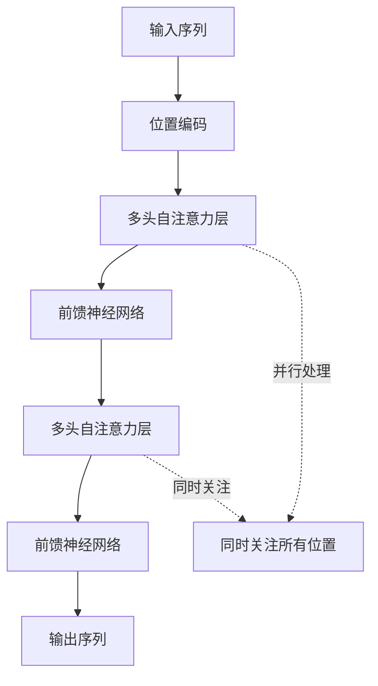
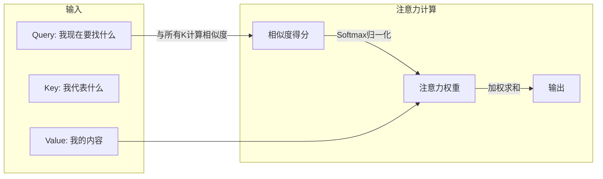
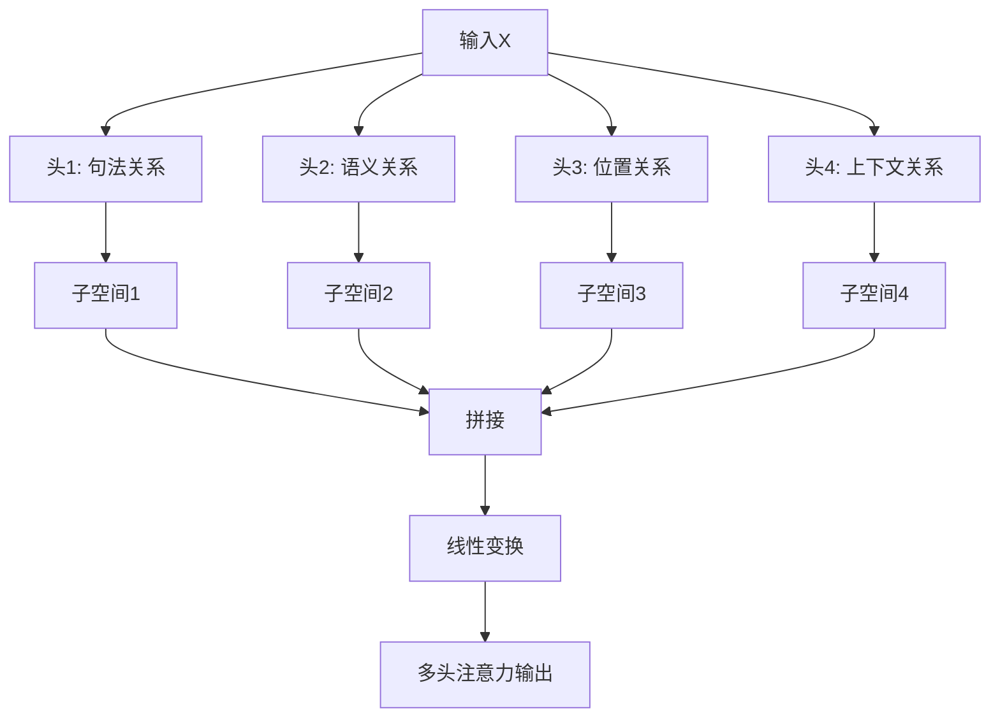
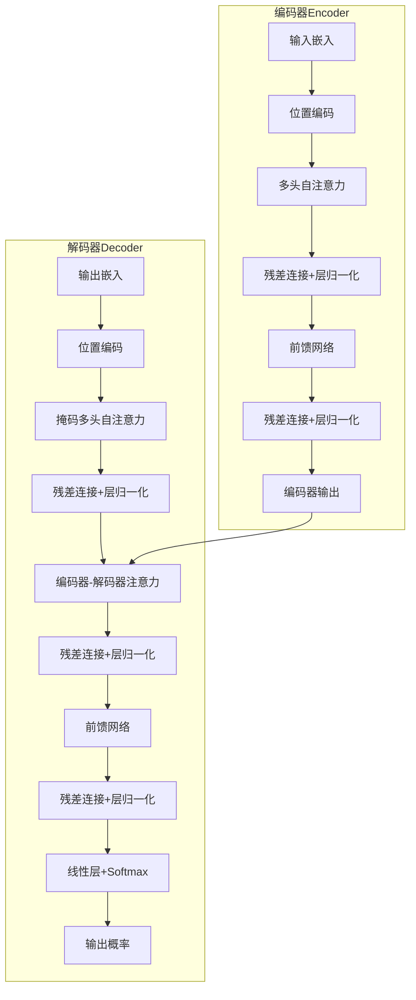
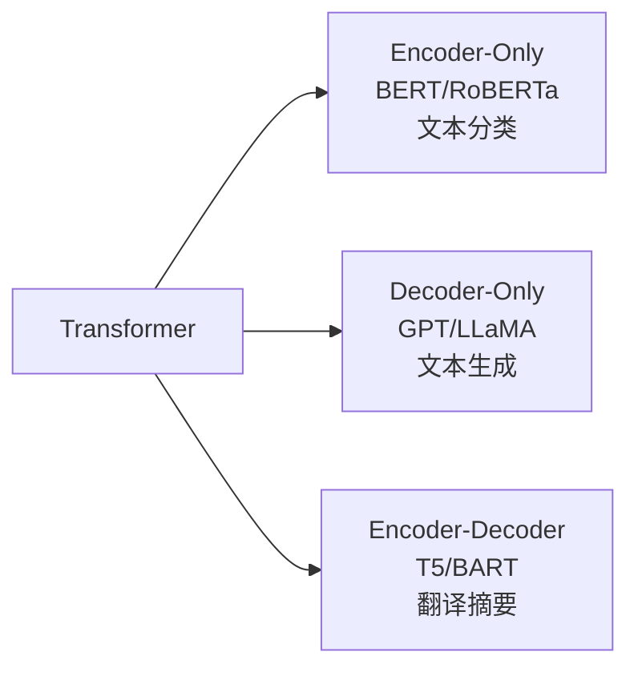
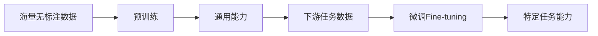
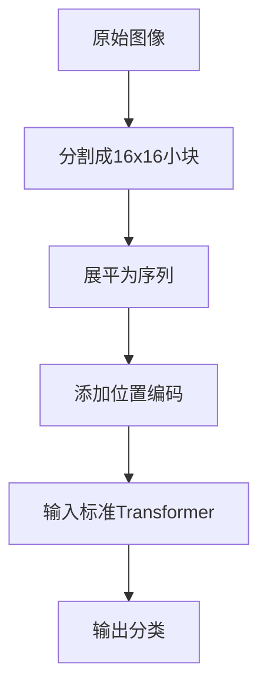
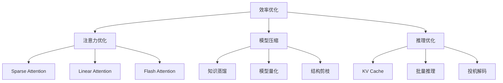
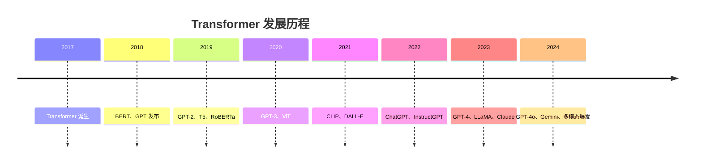

# Transformer：深度学习的革命性架构

> Transformer 是一种深度学习模型架构，通过注意力机制让模型并行处理整段文本并判断词与词之间的关系。它解决了传统序列模型无法并行、长距离依赖差的问题，是 LLM、多模态等模型的底层基础。本文讲解其核心原理、架构组成与应用。

**关键词**：Transformer、注意力机制、并行计算、位置编码、自注意力

## 抽象类比

传统深度学习模型像"逐字阅读的读者"，必须一个字一个字往下读，前面读过的内容只能靠记忆保留；Transformer 像"并行阅读的读书会"——能同时看整段内容，并判断哪些词、哪些信息彼此相关。

你读一句话"我把苹果放进包里，因为它太重了"，人会自动判断"它"指的是苹果还是包。Transformer 的注意力机制做的就是类似事情：在一堆信息里判断谁和谁关系更大。

所以 Transformer 的核心不是"神经网络很复杂"，而是：**让模型学会在大量信息中分配注意力。**

## 什么是 Transformer

**Transformer** 是一种深度学习模型架构，彻底改变了自然语言处理（NLP）领域，并在计算机视觉、语音处理等领域取得突破性进展。

**类比**：传统深度学习模型像"逐字阅读的读者"，Transformer 像"并行阅读的读书会"——能同时关注书中所有内容，理解词与词之间的关系，就像一个能捕捉文本中微妙联系的文学评论家。

## 诞生背景：为什么要发明 Transformer

传统序列模型的局限：

- **RNN**：长序列依赖差，信息一步步传递，距离越远衰减越严重
- **LSTM**：必须按顺序处理，无法并行，计算效率低
- **GRU**：门控机制仍难以处理超长序列

**核心突破**：Transformer 彻底抛弃"顺序处理"，实现真正的并行计算，让长序列处理变得高效。

## 核心概念详解

### 自注意力机制（Self-Attention）

**类比**：你读文章时遇到"他"字，大脑会自动回溯去找"他"指的是谁。自注意力机制让模型学会这种"回溯"。

三个核心角色：

- **Query（查询）**：当前位置的"我想要找什么"
- **Key（键）**：每个位置的"我代表什么"
- **Value（值）**：每个位置的实际内容

**数学公式**：`Attention(Q, K, V) = softmax(QK^T / √d_k) × V`

### 多头注意力（Multi-Head Attention）

**类比**：像一个团队从不同角度分析问题，每个人关注不同方面，最后汇总结果。

核心思想：

- 将注意力机制并行运行多次
- 每个"头"学习不同的注意力模式
- 捕捉不同类型的依赖关系（句法、语义、位置、上下文等）

### 位置编码（Positional Encoding）

**问题**：自注意力机制本身不包含位置信息，"我打你"和"你打我"会被认为相同。

**类比**：像在课堂上点名，"第一排左边的同学"和"第三排右边的同学"位置不同。

常用方法：

- **正弦/余弦编码**：固定模式，可外推到更长序列
- **可学习位置编码**：可训练参数，更灵活，需要更多数据
- **旋转位置编码（RoPE）**：用旋转矩阵表达相对位置，LLaMA 等主流模型使用
- **相对位置编码**：以相对距离建模，更适合长序列

## Transformer 架构详解

### 整体架构

### 编码器 vs 解码器

- **编码器**：输入完整序列；用自注意力；无掩码；用于"理解输入"；代表模型 BERT、ViT
- **解码器**：输入目标序列（部分）；含掩码自注意力 + 交叉注意力；防止看到未来信息；用于"生成输出"；代表模型 GPT、LLaMA

### 关键组件

- **残差连接**：缓解梯度消失，让深层网络可训练
- **层归一化**：稳定训练过程
- **前馈网络**：对每个位置做非线性特征变换
- **Dropout**：防止过拟合

## Transformer 的三大变体

### 编码器-only（Encoder-Only）

- **代表模型**：BERT、RoBERTa、ALBERT
- **特点**：双向注意力，可看到完整上下文
- **适合**：理解类任务（分类、实体识别、搜索排序）
- **预训练任务**：掩码语言模型（MLM），挖空让模型填

### 解码器-only（Decoder-Only）

- **代表模型**：GPT、LLaMA、ChatGLM、Qwen
- **特点**：单向注意力（从左到右）
- **适合**：生成类任务（对话、写作、代码）
- **预训练任务**：下一个词预测

### 编码器-解码器（Encoder-Decoder）

- **代表模型**：T5、BART、原始 Transformer
- **特点**：编码器理解输入，解码器生成输出
- **适合**：序列到序列任务（翻译、摘要）
- **经典应用**：机器翻译

## Transformer 的训练范式

### 预训练 + 微调

### 常用优化技术

- **梯度累积**：显存不足时模拟更大批大小
- **混合精度训练**：用 FP16/BF16 加速训练
- **Flash Attention**：加速注意力计算，减少显存占用
- **LoRA**：高效微调，只训练少量附加参数
- **RLHF**：基于人类反馈的强化学习，对齐人类偏好（ChatGPT 关键技术）

## 应用场景

### 自然语言处理

- **文本生成**：ChatGPT、LLaMA 等对话与写作
- **机器翻译**：Google 翻译等
- **文本分类**：情感分析、内容审核
- **问答系统**：智能客服、知识库问答
- **文本摘要**：长文章自动摘要

### 计算机视觉

**ViT（Vision Transformer）** 将图像分割成小块（patch）当作序列处理：

- **ViT**：图像分类
- **DETR**：目标检测
- **Stable Diffusion**：图像生成（用 Transformer 作为文本理解模块）

### 多模态

- **CLIP**：图文匹配，理解图像和文本关系
- **GPT-4V**：视觉问答、看图说话
- **Flamingo**：多模态对话

## 主要挑战与优化

### 主要挑战

- **计算复杂度**：O(n²) 随序列长度平方增长 → 用稀疏注意力、线性注意力
- **显存占用**：长序列显存爆炸 → 用梯度检查点、量化
- **长上下文**：难以处理超长序列 → 用 RoPE 等位置编码改进
- **幻觉问题**：生成不存在的知识 → 用 RAG、外部知识库

### 效率优化技术

## 关键术语

- **自注意力（Self-Attention）**：序列内部计算相关性的机制
- **Q/K/V**：查询、键、值，注意力的三个核心向量
- **多头注意力**：并行多组注意力，捕捉不同模式
- **位置编码**：为序列注入位置信息
- **掩码（Mask）**：屏蔽不该被看到的位置（如未来词、padding）
- **残差连接**：跨层直连，缓解梯度消失
- **Layer Norm**：层归一化，稳定训练
- **KV Cache**：推理时缓存历史 K/V，加速自回归生成

## 面试速答

**Q1：Transformer 和 RNN 的主要区别？**
RNN 串行处理、难以捕捉长距离依赖、复杂度 O(n)；Transformer 完全并行、轻松捕捉长距离依赖、复杂度 O(n²)，注意力权重还可可视化。

**Q2：为什么 Transformer 需要位置编码？**
自注意力机制本身是"置换不变的"，打乱输入顺序输出不变。位置编码为模型提供序列顺序信息。

**Q3：Encoder-Only、Decoder-Only、Encoder-Decoder 各适合什么任务？**
Encoder-Only 适合理解任务（分类、NER），Decoder-Only 适合生成任务（对话、写作），Encoder-Decoder 适合 seq2seq 任务（翻译、摘要）。

**Q4：为什么 GPT 系列选 Decoder-Only 而不是 Encoder-Only？**
Decoder-Only 的自回归生成天然契合"预测下一个词"的生成范式，且能通过扩大参数和训练数据持续提升生成能力。

**Q5：注意力机制的复杂度是多少？长序列为什么会卡？**
自注意力复杂度是 O(n²)，序列长度翻倍，显存和计算量变 4 倍。长序列容易爆显存、推理变慢。缓解方法：稀疏注意力、线性注意力、Flash Attention、KV Cache 等。

## 发展脉络

**一句话总结**：Transformer 是深度学习领域的"万能钥匙"，用注意力机制解决了序列处理的核心问题，成为现代 AI 的基础设施。

---

**参考链接**：

- 原始论文：[Attention Is All You Need](https://arxiv.org/abs/1706.03762)
- Hugging Face 文档：[https://huggingface.co/docs/transformers](https://huggingface.co/docs/transformers)
- The Illustrated Transformer：[https://jalammar.github.io/illustrated-transformer](https://jalammar.github.io/illustrated-transformer)

---

## 端到端实践与评估

- **实践任务**：手算一个极小注意力示例，并用代码验证张量形状、mask 与 softmax 维度。
- **评估要求**：分别测序列长度变化对训练显存、首 token 延迟和解码吞吐的影响。
- **失败边界**：O(n²) 只是标准注意力的主要瓶颈之一，实际还受 KV Cache、带宽、batch 与实现影响。

实验记录至少包含问题定义、数据来源与版本、基线、配置、指标、失败样本和结论适用范围。只有结果可复现、误差可解释，模型改进才有可信度。
