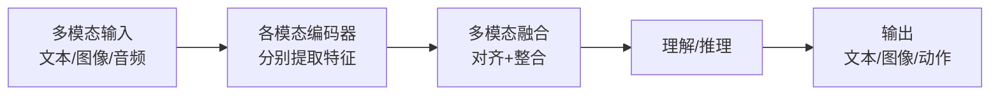

# 多模态 AI：能看会听的 AI

> 多模态 AI 是能够同时处理和理解文本、图像、音频、视频等多种类型数据的人工智能系统。它让机器更接近人类感知世界的方式，是 GPT-4V、Gemini 等模型的核心能力。本文讲解多模态的核心概念、技术原理与应用场景。

**关键词**：多模态AI、跨模态理解、视觉、音频、模态融合、模态对齐

## 抽象类比

以前的 AI 像只会读书的"书呆子"——文字再厉害，给它一张图片就傻了；多模态 AI 像"五感俱全的正常人"——能看图片、听声音、读文字，然后综合判断。

**关键区别**：单模态 AI 只能处理一种信息（如文字），多模态 AI 能同时处理多种信息并理解它们之间的关系。

## 什么是多模态 AI

**一句话定义**：多模态 AI 是**能够同时处理和理解多种类型数据（如文本、图像、音频、视频等）的人工智能系统**。

**类比**：多模态 AI 像"五感俱全的人"——单模态 AI 像只带耳朵的人（只能听），多模态 AI 能看、能听、能说、能理解。简单说，多模态 = 视觉（看）+ 听觉（听）+ 语言（说）+ 理解（思考）。

## 什么是"模态"

**模态**就是信息的类型或形式。常见模态：

- **文本**：文字、句子、文章（像读报纸）
- **图像**：照片、图表、截图（像看照片）
- **音频**：语音、音乐、环境音（像听音乐）
- **视频**：电影、录像、直播（像看电视）
- **3D 点云**：激光雷达数据（像摸物体形状）
- **传感器数据**：温度、湿度、加速度（像感觉冷热）

### 为什么需要多模态

现实世界本身就是多模态的——我们看到的、听到的、感受到的是同时发生的。AI 要真正理解世界，必须能处理多模态信息。

- **看图问答**：单模态只能读文字看不懂图，多模态能理解图片内容并回答
- **语音识别**：结合口型和声音更准确
- **视频理解**：理解时间序列和画面变化，而非逐帧分析
- **机器人控制**：结合视觉、触觉、语言综合决策

## 多模态 AI 的核心能力

### 1. 跨模态理解

理解不同模态之间的关系。

- 看到图片，用文字描述
- 听到语音，转换成文字
- 读到文字，生成对应图片

**类比**：像翻译官，能把一种语言翻译成另一种语言。

### 2. 多模态融合

综合多种模态的信息做出判断。

- 看视频 + 听声音 → 判断情绪
- 看图片 + 读文字 → 理解场景
- 听语音 + 看口型 → 提高识别准确率

**类比**：像法官审案，要听取多方证词才能做出准确判断。

### 3. 跨模态生成

根据一种模态生成另一种模态。

- 文字 → 图片（文生图）
- 文字 → 视频（文生视频）
- 图片 → 文字（图像描述）
- 语音 → 文字（语音识别）

**类比**：像画家，听到故事就能画出画面。

## 多模态 AI 的工作流程

**关键步骤**：

- **编码**：每种模态用专门的编码器（如图像用 ViT、文本用 Transformer、音频用 Whisper）
- **对齐**：把不同模态的特征映射到统一空间，让"猫"的图和"猫"的字对应
- **融合**：综合多模态特征做判断
- **输出**：生成文本、图像或控制指令

## 典型应用

### 视觉问答（VQA）

给 AI 一张图片，问它问题。

- "图片里有几个人？"
- "桌子上有什么？"
- "这个人在做什么？"

**代表模型**：GPT-4V、Gemini、Qwen-VL。

### 图像描述

让 AI 用文字描述图片内容。

- 盲人辅助：描述周围环境
- 图片搜索：根据描述找图片
- 内容审核：自动识别图片内容

### 视频理解

理解视频中的动作、事件、情感。

- 自动驾驶：识别行人和车辆
- 安防监控：检测异常行为
- 体育分析：分析运动员动作

### 语音识别与合成

语音转文字、文字转语音。

- 智能音箱：听懂指令
- 会议记录：自动转录
- 语音助手：对话交互

### 机器人控制

结合视觉、触觉、语言控制机器人。

- 网球拾取机器人：看球 + 理解指令 + 控制机械臂
- 家庭服务机器人：识别物品 + 理解需求 + 执行动作

## 技术挑战

### 模态对齐

**问题**：不同模态的数据如何对应？图片里的"猫"和文字里的"猫"如何关联？

**类比**：像学外语，要把母语和外语的词汇对应起来。

### 模态融合

**问题**：如何有效整合多种模态的信息？

- 不同模态的信息量不同
- 有些模态可能缺失
- 模态之间可能冲突

### 计算资源

- 图像和视频数据量大
- 需要同时运行多个模型
- 边缘设备资源受限

### 数据稀缺

- 多模态标注数据少，标注成本高
- 需要跨领域专业知识
- 数据质量参差不齐

## 关键术语

- **模态（Modality）**：信息的类型或形式（文本、图像、音频等）
- **跨模态理解**：理解不同模态之间的关系
- **多模态融合**：综合多种模态信息做出判断
- **模态对齐**：把不同模态的特征映射到统一空间
- **VLM（视觉语言模型）**：处理图像和文本的多模态模型子类
- **VQA（视觉问答）**：基于图片回答问题
- **具身智能**：在多模态感知基础上增加行动能力
- **零样本学习**：模型能处理训练时没见过的任务

## 面试速答

**Q1：什么是模态？为什么需要多模态？**
模态是信息的类型（文本、图像、音频等）。现实世界本身就是多模态的，单一模态无法完整理解世界——比如只看文字无法理解图片内容，只听声音看不到画面会丢失信息。多模态让 AI 更接近人类感知方式。

**Q2：多模态融合有哪些方式？**
主要三种：早期融合（先合并原始特征再处理）、晚期融合（各模态分别处理后再整合）、混合融合（分层结合）。实际中常用注意力机制做跨模态对齐，让模型自动学习不同模态间的关联。

**Q3：VQA 是怎么工作的？**
VQA 把图片和问题作为输入，图像编码器（如 ViT）提取视觉特征，文本编码器提取问题特征，融合后用解码器生成答案。核心难点是让模型理解"问题问的是图片中的什么"。

**Q4：多模态 AI 和具身智能什么关系？**
多模态 AI 提供"感知"能力（看、听、理解），具身智能在感知基础上增加"行动"能力（控制机器人执行任务）。多模态是具身智能的基础，让机器人能像人一样感知世界并做出反应。

**Q5：模态对齐是什么意思？为什么重要？**
模态对齐是把不同模态的特征映射到统一的向量空间，让"猫"的图和"猫"的字向量相近。没有对齐，不同模态的数据无法比较和关联，跨模态理解就无从谈起。CLIP 是典型的对齐模型。

---

**一句话总结**：多模态 AI 是能同时处理和理解文字、图片、声音、视频等多种数据的人工智能，让 AI 更接近人类"五感俱全"的感知方式，是 VQA、机器人、自动驾驶等场景的关键基础。

---

## 端到端实践与评估

- **实践任务**：完成图片加文本的抽取任务，并加入方向、分辨率、遮挡和冲突信息样本。
- **评估要求**：分别评估感知、定位、推理和最终回答，避免只用端到端总分掩盖问题。
- **失败边界**：模型可能看错细节、忽略空间关系或受图中文字诱导，关键读数需程序或人工复核。

实验记录至少包含问题定义、数据来源与版本、基线、配置、指标、失败样本和结论适用范围。只有结果可复现、误差可解释，模型改进才有可信度。
